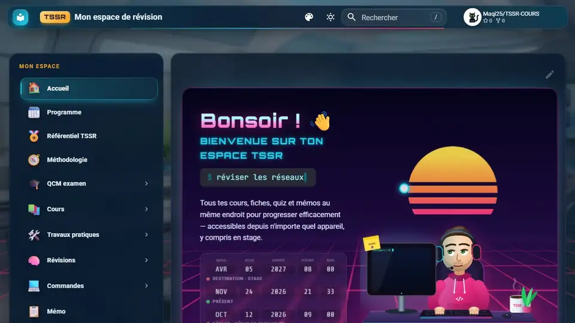
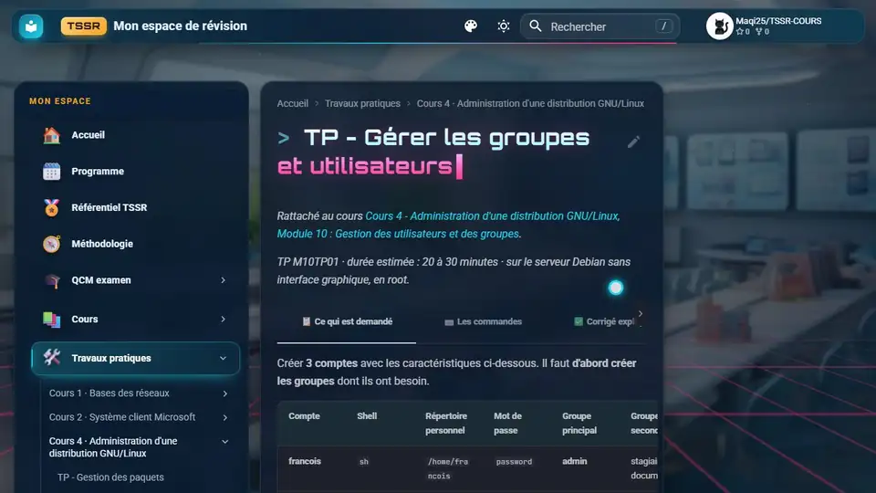
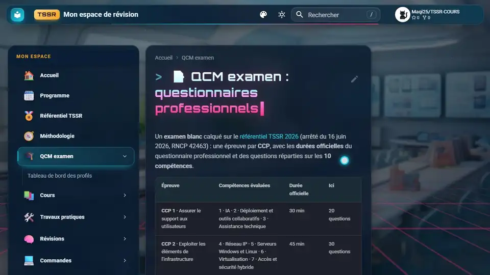
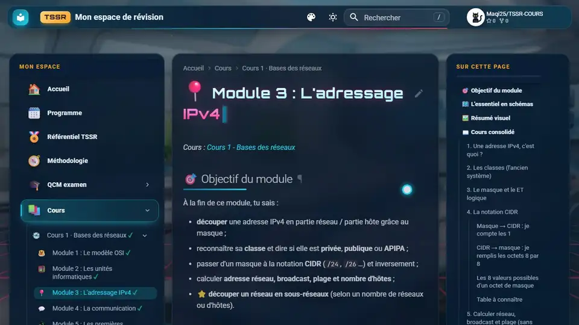
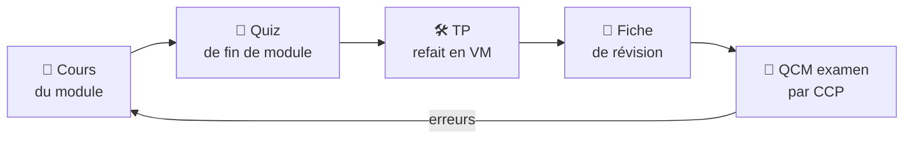

<div align="center">

# 🎓 TSSR · Mon espace de révision

**Cours, TP, fiches, mémos et examens blancs pour le titre professionnel<br>Technicien Supérieur Systèmes et Réseaux (REAC 2026 · RNCP 42463)**

[](https://maqi25.github.io/TSSR-COURS/)

[](https://github.com/Maqi25/TSSR-COURS/actions)


</div>

---

## ✨ Ce que contient le site

| | | |
|---|---|---|
| 📚 **17 cours · 105 modules** | Cours consolidés, schémas, résumés visuels et quiz en fin de module | du réseau à la supervision |
| 🛠️ **Travaux pratiques** | Chaque TP en 3 onglets : consigne · commandes · corrigé expliqué | rangés par cours et module |
| 🎯 **QCM examen** | Examens blancs par CCP, chronométrés aux durées officielles, suivi par compétence | questions en anglais incluses |
| 🧠 **14 fiches de révision** | L'essentiel de chaque cours sur une page | + mémos de commandes Linux / Windows |
| 🧭 **Référentiel & méthodo** | Les 3 CCP et 10 compétences reliés aux cours, planning de révision espacée | J+7 · J+30 · J+90 |
| 🔎 **Recherche & glossaire** | Recherche plein texte instantanée, glossaire filtrable | tout le site |

## 🎬 En images

<table>
<tr>
<td width="50%" valign="top">

### 🔎 Recherche instantanée
Une commande, un sigle, une notion : le résultat s'affiche pendant la frappe.



</td>
<td width="50%" valign="top">

### 🛠️ Un TP en 3 onglets
Ce qui est demandé, les commandes à taper, puis le corrigé expliqué.



</td>
</tr>
<tr>
<td width="50%" valign="top">

### 🎯 Examen blanc chronométré
Profil de suivi, épreuve par CCP, correction détaillée et progression par compétence.



</td>
<td width="50%" valign="top">

### 🧮 Calculatrice IPv4
Réseau, broadcast, plage d'hôtes et binaire recalculés à chaque frappe.



</td>
</tr>
<tr>
<td colspan="2" align="center">

### 🎨 À tes couleurs
6 couleurs de thème et un mode clair / sombre, mémorisés dans le navigateur.


</td>
</tr>
</table>

## 🗺️ Le parcours



## 🧱 Structure du dépôt

```text
tssr-cours/
├── mkdocs.yml                    → configuration du site (thème, menu, scripts)
├── requirements.txt              → versions de MkDocs / Material
├── .github/
│   ├── workflows/deploy.yml      → publication automatique sur GitHub Pages
│   └── demo/                     → les animations de ce README
└── docs/
    ├── index.md                  → page d'accueil
    ├── programme/ · referentiel/ · methodologie/
    ├── cours/                    → 17 cours + bonus Microsoft 365, un dossier par module
    ├── travaux-pratiques/        → les TP, classés par cours
    ├── qcm-examen/               → examens blancs et tableau de bord des profils
    ├── revisions/                → fiches de révision et mémos de commandes
    ├── commandes/ · memo/ · glossaire/
    ├── stylesheets/              → thème, animations, accueil
    └── javascripts/              → quiz, QCM, filtres, calculatrice IP, thèmes…
```

## 🚀 Lancer le site en local

```bash
pip install -r requirements.txt
python -m mkdocs serve
```

Puis ouvrir <http://127.0.0.1:8000/TSSR-COURS/>.

## 📤 Publier

Chaque `git push` sur `main` reconstruit et publie le site (onglet **Actions**).
Prérequis, une seule fois : **Settings → Pages → Source : GitHub Actions**.

Le mode d'emploi pour ajouter modules, quiz, TP, glossaire et commandes est sur la page [+ Ajouter du contenu](docs/ajouter-du-contenu.md).

## 🙏 Crédits

- Site construit avec [MkDocs Material](https://squidfunk.github.io/mkdocs-material/). Le moteur (thème, vignettes, quiz, filtres de recherche) est repris du projet [Maqi-25/tssr-cours](https://github.com/Maqi25/tssr-cours).
- Icônes des cours et des modules : [Fluent Emoji](https://github.com/microsoft/fluentui-emoji) de Microsoft (licence MIT, voir `docs/assets/icones/LICENCE.txt`).
- Les TP s'appuient sur les supports de la formation ; leurs énoncés et corrigés originaux restent la propriété de leurs auteurs.
