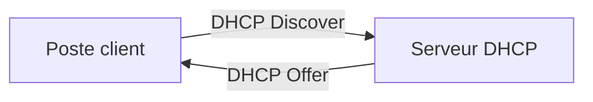

# + Ajouter du contenu

Chaque page du site est un simple fichier texte (Markdown) rangé dans le dossier `docs/`. Dès qu'une modification arrive sur la branche `main` du dépôt GitHub, le site se reconstruit et se republie tout seul en 1 à 2 minutes (suivi dans l'onglet **Actions** du dépôt).

## Deux façons de modifier une page

=== "Depuis le dossier sur ton PC (VS Code + git)"

    1. Ouvre le dossier `tssr-cours` dans VS Code et modifie le fichier voulu, par exemple `docs/cours/cours-01-bases-des-reseaux/module-1-le-modele-osi/index.md`.
    2. (Optionnel) Prévisualise le site en local :

        ```bash
        pip install -r requirements.txt
        mkdocs serve
        ```

        puis ouvre <http://127.0.0.1:8000>. La page se recharge à chaque sauvegarde.

    3. Publie :

        ```bash
        git add .
        git commit -m "Cours 1 : module OSI"
        git push
        ```

=== "Depuis le navigateur (GitHub)"

    1. Sur le site, ouvre la page à modifier et clique sur le crayon ✏️ **« Modifier cette page »** en haut à droite (ou navigue dans `docs/` sur GitHub et clique sur le crayon du fichier).
    2. Modifie le texte (onglet « Preview » pour l'aperçu).
    3. Clique sur **« Commit changes… »**, laisse la branche `main` et confirme.

    Pense ensuite à faire `git pull` sur ton PC pour récupérer la modification avant de retravailler en local.

## Compléter un module de cours

Les 17 cours et tous leurs modules sont déjà créés. Chaque page de module contient les mêmes sections, à remplir :

| Section | Contenu attendu |
|---|---|
| 🎯 Objectif du module | 2-3 phrases : ce que le module t'apprend |
| 🖼️ Résumé visuel | Un schéma (voir [plus bas](#schemas-et-diagrammes)) |
| 📖 Cours consolidé | Le cours lui-même, avec titres `###`, tableaux, blocs de code |
| ✅ Points clés à retenir | Une liste courte |
| 📝 Fiche de révision | L'essentiel à relire la veille de l'examen |
| 🧠 Quiz | Les questions au format JSON (voir ci-dessous) |

Sur la page d'accueil de chaque cours (`docs/cours/cours-XX-.../index.md`), complète aussi l'encadré **Informations pratiques** (dates, formateur).

### Écrire le quiz

En bas de chaque module se trouve un tableau JSON. Chaque question suit ce modèle :

```json
{
  "question": "Quel est le rôle du protocole DHCP ?",
  "options": ["Résoudre les noms de domaine", "Attribuer des adresses IP automatiquement", "Chiffrer le trafic"],
  "correctIndex": 1,
  "explanation": "DHCP distribue automatiquement une configuration IP aux postes du réseau."
}
```

`correctIndex` commence à **0** : `0` = première réponse, `1` = deuxième, etc.

## Schémas et diagrammes

**Mermaid** : écris le diagramme en texte, il est dessiné automatiquement.

````markdown

````

**Schéma « en couches »** (modèle OSI, TCP/IP, encapsulation…) : copie ce bloc et ajoute une ligne `tssr-layer` par couche, avec la couleur de ton choix.

```html
<div class="tssr-layers">
  <div class="tssr-layer" style="--layer-color:#3b82f6;">
    <span class="tssr-layer-num">3</span>
    <span class="tssr-layer-name">Réseau</span>
    <span class="tssr-layer-desc">IPv4/IPv6, choix du chemin, routeur</span>
    <span class="tssr-layer-tag">Paquet</span>
  </div>
</div>
```

**Images** : dépose le fichier (`.png`, `.jpg`) dans le même dossier que le module, puis écris ``.

**PDF** : dépose le fichier à côté du module, puis affiche-le dans la page avec :

```html
<iframe class="tssr-pdf-frame" src="mon-document.pdf"></iframe>
```

## Ajouter un terme au glossaire, une commande ou un TP

Ces pages fonctionnent de la même façon : un tableau JSON en haut du fichier (entre `<script type="application/json">` et `</script>`). Exemple pour le glossaire :

```json
{
  "title": "Nom du terme",
  "subtitle": "Acronyme développé (optionnel)",
  "description": "Explication courte.",
  "course": "Cours 1 - Bases des réseaux",
  "courseHref": "../cours/cours-01-bases-des-reseaux/",
  "module": "Module 3 : L'adressage IPv4",
  "moduleHref": "../cours/cours-01-bases-des-reseaux/module-3-l-adressage-ipv4/",
  "tags": ["Réseaux"]
}
```

Fichiers à modifier :

- Glossaire : `docs/glossaire/index.md`
- Commandes : `docs/commandes/powershell/index.md` et `docs/commandes/bash/index.md`
- TP : `docs/travaux-pratiques/index.md` (et crée la page du TP dans `docs/travaux-pratiques/cours-XX-.../`)

Ajoute une **virgule** après le dernier `}` existant, puis colle ton nouveau bloc `{ ... }`. La page se met à jour toute seule (recherche, filtres, compteur).

Les champs `courseHref` et `moduleHref` sont optionnels : ils rendent le nom du cours/module cliquable. Pour une commande ou un TP, le champ `href` rend le titre de la carte cliquable vers une page détaillée (exemple : la page [`ls`](commandes/bash/ls.md)).

!!! warning "Attention à la syntaxe JSON"
    Chaque `{ ... }` est séparé du suivant par une virgule, et il n'y a **jamais** de virgule après le dernier élément du tableau `[ ]`. Si la page affiche un message d'erreur rouge, c'est presque toujours une virgule oubliée ou en trop.

## Ajouter une fiche de révision

1. Crée `docs/revisions/fiche-nom-du-sujet.md`.
2. Ajoute un lien vers elle dans `docs/revisions/index.md`.

## Ajouter un nouveau cours ou module

1. Copie le dossier d'un module existant et renomme-le (ex. `module-9-nouveau-sujet/`).
2. Dans le `index.md` copié, change le titre et remplace l'identifiant du quiz (les trois occurrences de `quiz-cours-...`) pour qu'il soit unique.
3. Ajoute une vignette dans le `index.md` du cours (copie un bloc `<a class="tssr-card" ...>`).
4. Ajoute une ligne dans `mkdocs.yml`, section `nav:`, pour que la page apparaisse dans le menu.

## En cas de problème

- **Coche rouge dans l'onglet Actions** : clique dessus pour lire l'erreur. Le build est en mode strict, donc un lien vers une page inexistante bloque la publication (c'est voulu : ça évite les liens cassés).
- **Revenir en arrière** : sur GitHub, onglet **History** du fichier, ou en local `git log` puis `git revert <commit>`.
