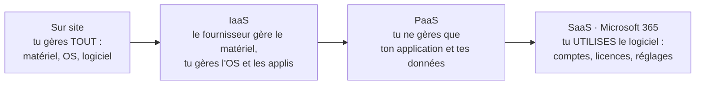
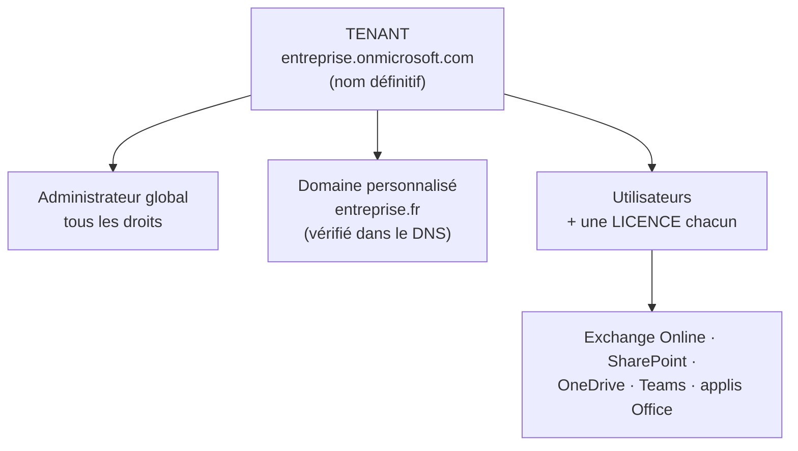

# Module 1 : Découvrir Microsoft 365

*Cours : [Bonus - Microsoft 365](../index.md)*

## 🎯 Objectif du module

Comprendre ce qu'est **Microsoft 365** : une offre **SaaS**, ses **services** (Exchange Online, SharePoint, OneDrive, Teams, applications Office), les **plans et licences**, le **tenant** et le **domaine personnalisé**.

!!! abstract "En clair"
    Avec Microsoft 365, l'entreprise ne gère plus de serveur de messagerie ni de serveur de fichiers chez elle : Microsoft les héberge dans ses datacenters, et l'entreprise paie un **abonnement par utilisateur**. Le technicien, lui, crée les comptes, attribue les **licences** et dépanne les postes.

## 🗺️ L'essentiel en schémas

!!! info "Référentiel TSSR 2026"
    **CCP 1 · compétence 2 : Assurer le déploiement des équipements numériques et accompagner à l'utilisation des outils collaboratifs.** Et **compétence 7** : l'environnement **hybride** (comptes locaux et cloud).

**① Ce qu'on gère soi-même selon le modèle**

**② Le tenant Microsoft 365**

## 📖 Cours consolidé

### 1. Le SaaS

**SaaS** (*Software as a Service*, logiciel en tant que service) : le logiciel est installé sur les **serveurs du fournisseur**, pas sur le poste. On ne paie pas une version, mais un **abonnement**, et on y accède par Internet.

| Modèle | Le fournisseur gère… | Le client gère… | Exemple |
|---|---|---|---|
| **IaaS** | Matériel, réseau, virtualisation | OS, applications, données | Machines virtuelles Azure |
| **PaaS** | + l'OS et le moteur | Son application, ses données | Base de données managée |
| **SaaS** | **Tout** le logiciel | Les **comptes**, les **réglages**, les **données** | **Microsoft 365**, Google Workspace |

➕ Moins de serveurs sur site, accès depuis tous les appareils (PC, Mac, mobile, navigateur), mises à jour faites par l'éditeur. ➖ Dépendance à **Internet** et au **fournisseur**, coût récurrent.

### 2. Les services de Microsoft 365

| Service | Rôle |
|---|---|
| **Exchange Online** | Messagerie, calendriers, contacts ([module 4](../module-4-exploiter-et-depanner-outlook/index.md)) |
| **SharePoint Online** | Sites intranet, bibliothèques de documents partagés |
| **OneDrive** | Espace de stockage **personnel** de chaque utilisateur |
| **Teams** | Conversations, réunions, travail en équipe ([module 5](../module-5-teams-sharepoint-et-onedrive/index.md)) |
| **Microsoft 365 Apps** (ex-Office 365 ProPlus) | Word, Excel, PowerPoint, Outlook **installés** sur le poste ; existent aussi **en ligne** dans le navigateur |
| **Microsoft Entra ID** (ex-Azure AD) | L'**annuaire** des comptes dans le cloud |
| Autres | OneNote, Stream (vidéo), Viva Engage (ex-Yammer, réseau social d'entreprise), Power Automate… |

### 3. Plans et licences

Microsoft regroupe les offres par **famille** (particuliers, entreprises, éducation, secteur public, associations), puis par **plan** :

| Famille | Plans courants |
|---|---|
| **PME** (jusqu'à 300 utilisateurs) | **Business Basic** (applis en ligne seulement), **Business Standard** (+ applis installées), **Business Premium** (+ sécurité, gestion des appareils) |
| **Grande entreprise** | **E3**, **E5** (plus de sécurité et de conformité) |
| **Employés de terrain** | **F3** (accès limité, souvent sur mobile) |
| **Éducation** | A1, A3, A5 |

Une **licence** est **attribuée à chaque utilisateur** dans le centre d'administration : sans licence, pas de boîte mail ni d'applications.

### 4. Le tenant

| Notion | À retenir |
|---|---|
| **Tenant** | L'**espace** de l'entreprise dans Microsoft 365 : tous ses services, comptes et réglages |
| **Nom du tenant** | `nomchoisi.onmicrosoft.com` : choisi à la création, **non modifiable** |
| **Administrateur global** | Le compte qui a souscrit, avec **tous les droits** sur le tenant ; à protéger (MFA) et à réserver à l'administration |
| **Centre d'administration** | `https://admin.microsoft.com` : utilisateurs, licences, domaines, facturation |

**Créer un tenant** : choisir un plan → donner une adresse mail valide → les informations de l'entreprise (nom, nombre de salariés) → choisir le **nom du tenant** et le compte administrateur (`admin@nomchoisi.onmicrosoft.com`) → terminer l'inscription.

### 5. Le domaine personnalisé

Pour des adresses en `@entreprise.fr` plutôt qu'en `@nomchoisi.onmicrosoft.com` :

1. **Louer** le nom de domaine chez un registraire (vérifier d'abord qu'il est **disponible**).
2. L'**ajouter** dans le centre d'administration (*Paramètres → Domaines*).
3. **Prouver** qu'on en est propriétaire : Microsoft donne un enregistrement **TXT** à créer dans la zone DNS.
4. Créer les enregistrements DNS demandés pour les services (**MX** pour la messagerie, **CNAME** `autodiscover` pour la configuration d'Outlook…).

## 📝 Fiche de révision

| Notion | À retenir |
|---|---|
| **SaaS** | Logiciel hébergé chez le fournisseur, payé par abonnement |
| **IaaS / PaaS / SaaS** | Du plus au moins de choses à gérer soi-même |
| **Tenant** | L'espace de l'entreprise, `xxx.onmicrosoft.com`, non modifiable |
| **Administrateur global** | Tous les droits sur le tenant |
| **Licence** | Attribuée **par utilisateur** |
| **Business / E / F / A** | PME / grande entreprise / terrain / éducation |
| **Domaine personnalisé** | Vérifié par un enregistrement **TXT**, puis MX, CNAME… |
| **Entra ID** | L'annuaire cloud (ex-Azure AD) |

### ⚠️ Les pièges

- Le **nom du tenant** ne se change pas : bien le choisir dès le début.
- Utiliser le compte **administrateur global** pour travailler tous les jours.
- Un utilisateur **sans licence** n'a ni boîte mail ni applications.
- Oublier les enregistrements **DNS** après l'ajout du domaine : les mails n'arrivent pas.

### ✏️ Entraîne-toi (clique pour voir la correction)

??? question "1. Un nouveau salarié a bien un compte Microsoft 365 mais Outlook lui dit qu'il n'a pas de boîte aux lettres. Que vérifies-tu ?"
    Dans le **centre d'administration**, que le compte a bien une **licence** qui comprend **Exchange Online** (une licence peut aussi mettre quelques minutes à activer la boîte).

## 🧠 Quiz — entraîne-toi

