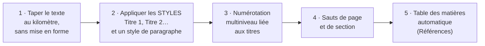
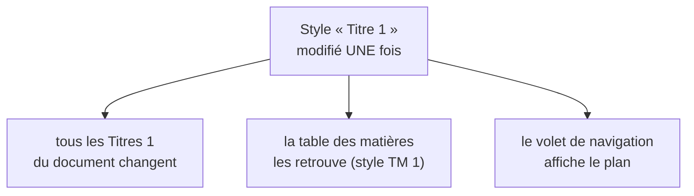

# Module 2 : Les bases de Word

*Cours : [Bonus - Microsoft 365](../index.md)*

## 🎯 Objectif du module

Connaître l'**interface** de Word et produire un document **propre** : **styles** de titres et de paragraphes, **numérotation** multiniveau, **espacements**, **tabulations**, **sauts** et **table des matières** automatique.

!!! abstract "En clair"
    Un utilisateur te dira : « ma table des matières ne marche pas » ou « ma mise en page part dans tous les sens ». La réponse est presque toujours la même : il a mis en forme **à la main** (lignes vides, espaces, gras) au lieu d'utiliser les **styles**. Les styles, c'est ce qui rend un document **automatique**.

## 🗺️ L'essentiel en schémas

!!! info "Référentiel TSSR 2026"
    **CCP 1 · compétence 2 : accompagner à l'utilisation des outils collaboratifs**, et **compétence 3 : Apporter une assistance technique** (aider un utilisateur sur la bureautique).

**① La bonne méthode pour un document**

**② Pourquoi les styles comptent**

## 📖 Cours consolidé

### 1. L'interface

| Zone | Rôle |
|---|---|
| **Barre de titre** | Nom du fichier |
| **Barre d'accès rapide** | Commandes les plus utilisées, **personnalisable** |
| **Ruban** | Les commandes rangées par **onglets** (Accueil, Insertion, Mise en page, Références, Affichage…) |
| **Règle** | Positionner retraits et **taquets de tabulation** (*Affichage → Règle*, masquée par défaut) |
| **Barre d'état** | Nombre de pages, de mots, langue, zoom |

Au démarrage : **nouveau document vide**, **modèle** ou **document récent**.

### 2. Les bons réflexes

- Afficher les **caractères non imprimables** (*Accueil → ¶*) : on voit les espaces, tabulations, sauts.
- **Ne pas** créer d'espace avec des **paragraphes vides** (touche Entrée répétée) : on règle l'**espacement avant / après** du paragraphe.
- **Ne pas** aligner avec des espaces : on utilise les **retraits** et les **tabulations**.
- Tout le texte reçoit un **style** (pas de « Normal » partout).

### 3. Les styles et la numérotation

| Action | Comment |
|---|---|
| **Appliquer un style** | *Accueil → Styles* : Titre 1, Titre 2… |
| **Modifier un style** | Mettre en forme un titre puis clic droit sur le style → **Mettre à jour pour correspondre à la sélection**, ou clic droit → **Modifier** → *Format* (police, paragraphe, tabulations) |
| **Créer un style** | Mettre en forme un paragraphe → *Styles → Créer un style* et le nommer |
| **Enchaîner les styles** | Dans *Modifier le style* : **style du paragraphe suivant** (après un Titre 1 vient automatiquement le style du corps de texte) |
| **Numéroter les titres** | **Liste à plusieurs niveaux** → *Définir une nouvelle liste* → bouton **Plus** → **lier chaque niveau** à son style (niveau 1 ↔ Titre 1…) |

### 4. Paragraphes, espacements, tabulations

| Réglage | Options |
|---|---|
| **Alignement** | Gauche, centré, droite, **justifié** (aligné à gauche **et** à droite) |
| **Retraits** | Marge du paragraphe à gauche, à droite, première ligne |
| **Espacement** | **Avant** et **après** le paragraphe, **interligne** |
| **Taquets de tabulation** | **Gauche**, **centré**, **droit**, **décimal** (aligne sur la virgule) ; un appui sur `Tab` par taquet |

### 5. Les sauts

| Saut | Usage |
|---|---|
| **Saut de page** (`Ctrl + Entrée`) | Forcer le passage à la page suivante (page de garde, sommaire) |
| **Saut de colonne** | Passer le texte dans la colonne suivante |
| **Saut de section (page suivante)** | Nouvelle page **avec une mise en page différente** : orientation **paysage**, **en-tête / pied de page**, **numérotation** différents |
| **Saut de section (continu)** | Changer la mise en page **sur la même page** (marges, colonnes) |

### 6. La table des matières

*Références → Table des matières* : automatique, ou **personnalisée** (niveaux affichés, caractères de suite, format). Elle repose sur les styles **Titre X** ; son apparence dépend des styles **TM X**. Après des modifications : clic droit → **Mettre à jour les champs** (ou `F9`).

## 📝 Fiche de révision

| Notion | À retenir |
|---|---|
| **Caractères non imprimables** | Le bouton ¶ pour voir ce qui se passe |
| **Style** | Mise en forme nommée, modifiée une fois pour tout le document |
| **Liste à plusieurs niveaux** | Numérotation des titres, chaque niveau lié à un style |
| **Espacement** | Avant / après le paragraphe, pas de lignes vides |
| **Tabulations** | Gauche, centré, droit, décimal |
| **Saut de page** | `Ctrl + Entrée` |
| **Saut de section** | Changer orientation, en-tête, numérotation |
| **Table des matières** | Références → basée sur les styles Titre X ; `F9` pour mettre à jour |

### ⚠️ Les pièges

- Un titre en **gras taille 16** sans style **n'apparaît pas** dans la table des matières.
- Des **lignes vides** pour espacer : tout se décale à la moindre modification.
- Mettre une page en paysage **sans saut de section** : tout le document bascule.
- Oublier de **mettre à jour** la table des matières après des changements.

### ✏️ Entraîne-toi (clique pour voir la correction)

??? question "1. Un utilisateur se plaint : certains de ses titres n'apparaissent pas dans la table des matières. Que fais-tu ?"
    Afficher les styles : ces titres sont sans doute en **Normal** mis en gras. Leur appliquer le style **Titre 1 / Titre 2**, puis **mettre à jour** la table des matières (clic droit → Mettre à jour les champs → toute la table).

## 🧠 Quiz — entraîne-toi

