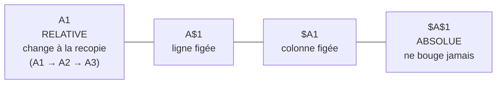
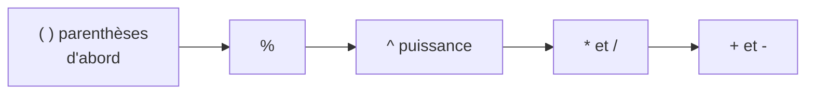

# Module 3 : Les bases d'Excel

*Cours : [Bonus - Microsoft 365](../index.md)*

## 🎯 Objectif du module

Connaître les bases d'**Excel** : classeur, feuilles et **cellules**, calculs et **priorité des opérateurs**, **fonctions** courantes (SOMME, SI, RECHERCHEV…), **références relatives et absolues**, et le lien avec **SharePoint** (enregistrement automatique, versions).

!!! abstract "En clair"
    Le technicien n'est pas comptable, mais il fait souvent ses **inventaires**, ses **plannings** ou ses exports dans Excel, et les utilisateurs l'appellent quand « la formule ne marche plus après la copie ». Il faut donc maîtriser les fonctions de base et surtout le **$** des références absolues.

## 🗺️ L'essentiel en schémas

!!! info "Référentiel TSSR 2026"
    **CCP 1 · compétence 2 : accompagner à l'utilisation des outils collaboratifs** et **compétence 3 : Apporter une assistance technique**.

**① Ce que devient une formule quand on la recopie**

**② L'ordre de calcul**

## 📖 Cours consolidé

### 1. Classeur, feuilles, cellules

| Notion | À retenir |
|---|---|
| **Classeur** | Le fichier `.xlsx`, contenant une ou plusieurs **feuilles** (nom de feuille : 31 caractères max) |
| **Cellule** | Croisement d'une **colonne** (lettres) et d'une **ligne** (nombre) : de **A1** à **XFD1048576** (16 384 colonnes, 1 048 576 lignes) |
| **Plage** | Un ensemble de cellules : `A1:A10` |
| **Nom** | Une cellule ou une plage peut recevoir un **nom** (*Formules → Gestionnaire de noms*) : `=SOMME(Ventes)` |

| Pointeur | Action |
|---|---|
| **Croix blanche** | Sélectionner |
| **Flèche** (bord de la cellule) | **Déplacer** ; avec `Ctrl` : **copier** |
| **Croix noire** (petit carré en bas à droite, la **poignée de recopie**) | **Recopier** en **incrémentant** (1, 2, 3… ou lundi, mardi… ; sélectionner deux cellules pour donner le **pas**) |

### 2. Les calculs

Une formule commence **toujours** par `=`. Opérateurs : `+` `-` `*` `/` `^` `%`. Ordre : **parenthèses**, puis `%`, `^`, puis `*` et `/`, puis `+` et `-`.

`=2+3*4` donne **14** ; `=(2+3)*4` donne **20**.

### 3. Les fonctions à connaître

Dans Excel en français, les arguments sont séparés par des **points-virgules**.

| Catégorie | Fonction | Exemple → résultat |
|---|---|---|
| **Maths** | `SOMME`, `MOYENNE`, `MIN`, `MAX` | `=SOMME(A1:A10)` |
| | `ARRONDI`, `ARRONDI.INF`, `ARRONDI.SUP`, `ENT` | `=ARRONDI(3,14159;2)` → 3,14 |
| | `QUOTIENT`, `MOD` | `=QUOTIENT(5;2)` → 2 · `=MOD(5;2)` → 1 |
| | `ALEA` | Nombre aléatoire entre 0 et 1 |
| **Texte** | `CONCAT` (ou `&`) | `=CONCAT("Hello";" ";"world")` → Hello world |
| | `GAUCHE`, `DROITE`, `NBCAR` | `=GAUCHE("Hello";4)` → Hell · `=NBCAR("Hello")` → 5 |
| | `MAJUSCULE`, `MINUSCULE`, `CNUM` | `CNUM` convertit un texte « 17,12 » en nombre |
| **Logique** | `SI` | `=SI(B2>=10;"Reçu";"Ajourné")` |
| | `ET`, `OU` | `=SI(ET(A2>2;B2="Rennes");"OK";"Non")` (ET : **toutes** les conditions ; OU : **au moins une**) |
| | `SIERREUR` | `=SIERREUR(A2/B2;"division impossible")` |
| **Recherche** | `RECHERCHEV` | `=RECHERCHEV(3;A2:E5;4;FAUX)` : cherche 3 dans la **1ʳᵉ colonne** et renvoie la valeur de la **4ᵉ colonne** de la même ligne |
| | `RECHERCHEH` | Même chose à l'**horizontale** |
| | `TROUVE`, `LIGNE`, `COLONNE` | Position d'un texte, numéro de ligne / colonne |
| **Dates** | `AUJOURDHUI`, `MAINTENANT` | Date du jour, date et heure |

💡 Taper `=` puis les premières lettres : Excel **propose** les fonctions et affiche une **aide** sur leurs arguments.

### 4. Références relatives et absolues

| Écriture | À la recopie |
|---|---|
| `A1` (**relative**) | Évolue : en E2 `=SOMME(A2:D2)`, recopiée en E3 devient `=SOMME(A3:D3)` |
| `$A$1` (**absolue**) | Ne change **jamais** (un taux de TVA dans une cellule fixe, par exemple) |
| `A$1` / `$A1` (**mixte**) | La **ligne** / la **colonne** est figée |

La touche **`F4`** fait défiler ces écritures dans la formule. Pour recopier **seulement** la formule (sans la mise en forme) : clic droit → **Collage spécial** → Formules.

### 5. Excel et SharePoint / OneDrive

Un classeur enregistré dans **SharePoint** ou **OneDrive** ([module 5](../module-5-teams-sharepoint-et-onedrive/index.md)) a l'**enregistrement automatique**, l'**historique des versions** (ouvrir ou restaurer une ancienne version sans écraser l'actuelle, voir **qui** a modifié) et la **coédition** à plusieurs. Accès par le **nom du classeur** dans la barre de titre ou *Fichier → Informations → Historique des versions*.

## 📝 Fiche de révision

| Notion | À retenir |
|---|---|
| **Formule** | Commence par `=` |
| **Priorité** | ( ) puis % ^ puis * / puis + - |
| **Plage** | `A1:A10` · séparateur d'arguments `;` |
| **SI / ET / OU** | Condition / toutes / au moins une |
| **RECHERCHEV** | Cherche dans la 1ʳᵉ colonne, renvoie la n-ième |
| **SIERREUR** | Remplace une erreur par un message |
| **$A$1** | Référence absolue, touche `F4` |
| **Poignée de recopie** | Recopie et incrémente |
| **SharePoint** | Enregistrement auto, versions, coédition |

### ⚠️ Les pièges

- Recopier une formule qui pointe sur une cellule fixe **sans** `$` : les résultats deviennent faux (ou `#REF!`, `#DIV/0!`).
- Oublier `FAUX` comme dernier argument de `RECHERCHEV` : une valeur **approchée** peut être renvoyée.
- Un nombre stocké **comme du texte** (aligné à gauche) : il n'est pas compté par `SOMME` → `CNUM`.
- Une virgule `,` au lieu d'un point-virgule `;` entre les arguments dans un Excel français.

### ✏️ Entraîne-toi (clique pour voir la correction)

??? question "1. En C2, la formule =B2*F1 calcule un prix TTC avec le taux en F1. Recopiée vers le bas, C3 affiche 0. Pourquoi, et comment corriger ?"
    À la recopie, `F1` est devenu `F2`, qui est vide. Il faut **figer** la cellule du taux : `=B2*$F$1` (touche `F4`), puis recopier.

## 🧠 Quiz — entraîne-toi

