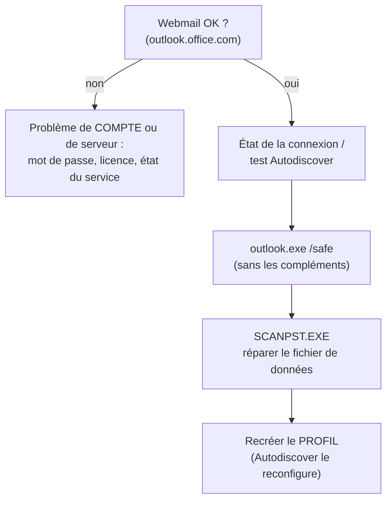

# Module 4 : Exploiter et dépanner Outlook

*Cours : [Bonus - Microsoft 365](../index.md)*

## 🎯 Objectif du module

Comprendre le **cheminement d'un e-mail** et ses **protocoles** (SMTP, IMAP, POP, MAPI), configurer **Outlook** avec **Autodiscover**, utiliser la messagerie et le calendrier, puis **dépanner** Outlook (profil, fichiers .ost/.pst, mode sans échec, tests de connectivité).

!!! abstract "En clair"
    « Outlook ne reçoit plus mes mails » est l'un des tickets les plus fréquents. Le technicien doit savoir **où** le mail se perd (poste, réseau, serveur) et connaître une poignée d'outils : le **test de configuration automatique**, le **mode sans échec**, la **réparation** du fichier de données et, en dernier recours, un **nouveau profil**.

## 🗺️ L'essentiel en schémas

!!! info "Référentiel TSSR 2026"
    **CCP 1 · compétence 2 : accompagner à l'utilisation des outils collaboratifs** et **compétence 3 : Apporter une assistance technique** (diagnostiquer et résoudre un incident de messagerie).

**① Le chemin d'un e-mail**

**② Dépanner Outlook, du plus simple au plus lourd**

## 📖 Cours consolidé

### 1. Les protocoles de la messagerie

| Protocole | Rôle | Port | Port chiffré |
|---|---|---|---|
| **SMTP** | **Envoyer** : du client au serveur (soumission) et **entre serveurs** | 25 (entre serveurs) | **587** (soumission, STARTTLS) · 465 |
| **POP3** | **Télécharger** les mails sur le poste (en général supprimés du serveur) | 110 | **995** |
| **IMAP4** | **Consulter** les mails restés **sur le serveur** (synchronisés sur tous les appareils) | 143 | **993** |
| **HTTP(S)** | Webmail, **MAPI over HTTP** (Outlook ↔ Exchange), **ActiveSync** (mobiles) | 80 | **443** |

Le serveur de l'expéditeur trouve le serveur du destinataire grâce à l'enregistrement DNS **MX** du domaine. Ces ports doivent être **ouverts** sur le pare-feu.

### 2. Installer et configurer Outlook

- **Installer** : se connecter au portail Microsoft 365 (`https://portal.office.com`) → **Installer les applications**.
- **Autodiscover** (découverte automatique) : l'utilisateur tape **seulement son adresse mail** ; Outlook interroge le DNS (enregistrement **autodiscover**), télécharge un fichier **XML** avec les paramètres du serveur et se configure seul.
- **Tester** : `Ctrl` + **clic droit** sur l'icône Outlook près de l'horloge → **Tester la configuration automatique de la messagerie** (codes HTTP : 2xx succès, 3xx redirection, 4xx erreur côté client, 5xx erreur côté serveur) et **État de la connexion**.

| Version | À retenir |
|---|---|
| **Outlook installé** (Microsoft 365 Apps) | Toutes les fonctions, fonctionne **hors connexion** grâce au fichier **.ost** |
| **Outlook sur le web** | Dans le navigateur, sans installation, nécessite Internet ; très utile pour **tester** un compte |

### 3. Utiliser Outlook

| Fonction | À retenir |
|---|---|
| **Mode conversation** | Regroupe les messages qui ont le même objet |
| **Réponses automatiques** | Message d'**absence** envoyé à ceux qui écrivent |
| **Règles** | **Condition → action** (sauf **exception**) : ranger, transférer, catégoriser automatiquement |
| **Rappel d'un message** | Supprimer ou remplacer un message **non lu** (seulement dans la même organisation Exchange) |
| **Catégories** | Classer et colorer messages, rendez-vous, tâches |
| **Archivage** | Déplacer les anciens messages pour alléger la boîte |
| **Calendrier** | **Rendez-vous** (bloque un créneau pour soi) · **réunion** (invite des participants et des **ressources** : salles, matériel) · **événement** (journée entière, ne bloque pas le temps) ; **groupes de calendriers** pour voir plusieurs agendas |
| **Tâches** | Actions à mener, avec priorité et suivi |

Raccourcis utiles : nouveau message `Ctrl + Maj + M`, envoyer `Alt + S`, rechercher `Ctrl + E`, calendrier `Ctrl + 2`, envoyer/recevoir `F9`.

### 4. Les fichiers de données

| Fichier | Contenu |
|---|---|
| **.ost** (*Offline Storage Table*) | **Copie locale** d'une boîte **Exchange** pour le hors connexion ; l'original est sur le serveur : on peut le **supprimer**, il est **reconstruit** |
| **.pst** (*Personal Storage Table*) | Mails stockés **uniquement en local** (comptes POP, archives) : à **sauvegarder** |

Ils se trouvent dans `C:\Users\<utilisateur>\AppData\Local\Microsoft\Outlook\` ; taille maximale par défaut **50 Go**.

### 5. Dépanner Outlook

| Outil | Quand |
|---|---|
| **Outlook sur le web** | Isoler le problème : si le webmail marche, le **compte** et le **serveur** vont bien, le souci est sur le **poste** |
| **État de la connexion** / **test Autodiscover** | `Ctrl` + clic droit sur l'icône Outlook |
| **Mode sans échec** | `outlook.exe /safe` : démarre **sans les compléments** ; si ça marche, désactiver le complément fautif (*Fichier → Options → Compléments*) |
| **Mode hors connexion** | Travailler pendant une coupure, diagnostiquer un problème réseau |
| **SCANPST.EXE** | **Réparer** un fichier .pst ou .ost endommagé (Outlook fermé) |
| **Journalisation** | *Fichier → Options → Avancé* : journaux dans `%TEMP%` pour les erreurs de connexion |
| **Nouveau profil** | *Panneau de configuration → Courrier → Afficher les profils* : supprimer ou ajouter un profil, Outlook fermé ; Autodiscover le reconfigure |
| **Microsoft Remote Connectivity Analyzer** | `https://testconnectivity.microsoft.com` : teste **depuis Internet** l'Autodiscover, la messagerie, le DNS |

Avec Exchange Online, Outlook se connecte **par Internet en HTTPS** : **pas besoin de VPN**.

## 📝 Fiche de révision

| Notion | À retenir |
|---|---|
| **SMTP** | Envoi · 25 entre serveurs, **587** soumission |
| **IMAP / POP** | Sur le serveur, synchronisé (**993**) / téléchargé en local (**995**) |
| **MX** | Enregistrement DNS du serveur de messagerie du domaine |
| **Autodiscover** | Configuration automatique depuis l'adresse mail |
| **.ost / .pst** | Cache Exchange reconstructible / données locales à sauvegarder |
| **Mode sans échec** | `outlook.exe /safe`, sans compléments |
| **SCANPST** | Réparer le fichier de données |
| **Profil** | Panneau de configuration → Courrier |
| **Test à distance** | testconnectivity.microsoft.com |

### ⚠️ Les pièges

- Supprimer un **.pst** en pensant que c'est un cache : ce sont les **seules** copies des mails.
- Recréer le profil **en premier** : c'est la solution la plus lourde, on commence par le webmail et le mode sans échec.
- Confondre **IMAP** (mails restés sur le serveur) et **POP** (mails rapatriés sur un seul poste).
- Un **complément** (antivirus, outil métier) qui fait planter Outlook au démarrage.

### ✏️ Entraîne-toi (clique pour voir la correction)

??? question "1. Outlook d'un utilisateur se ferme dès l'ouverture. Ses mails sont accessibles sur outlook.office.com. Quelle démarche ?"
    Le compte et le serveur vont bien (webmail OK) : le problème est **local**. 1) `outlook.exe /safe` : s'il démarre, désactiver les **compléments** un par un · 2) sinon **SCANPST.EXE** sur le fichier .ost · 3) en dernier recours, **nouveau profil** (Panneau de configuration → Courrier) et Autodiscover reconfigure le compte. Noter la solution dans le **ticket**.

## 🧠 Quiz — entraîne-toi

