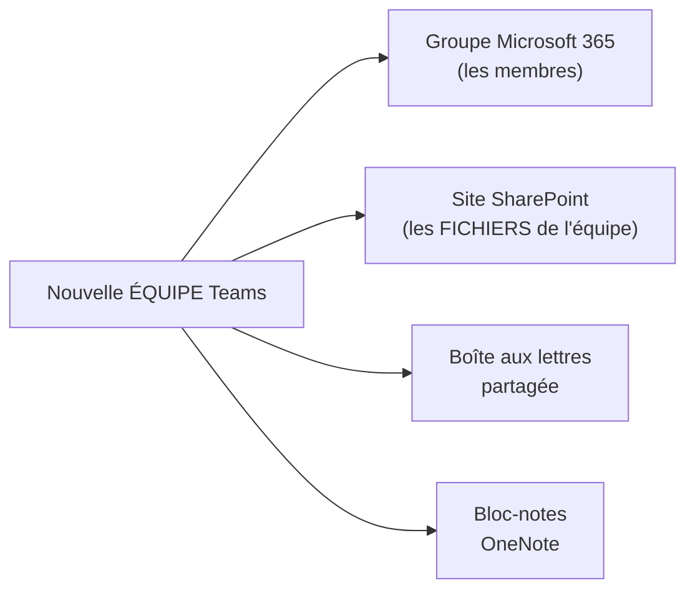
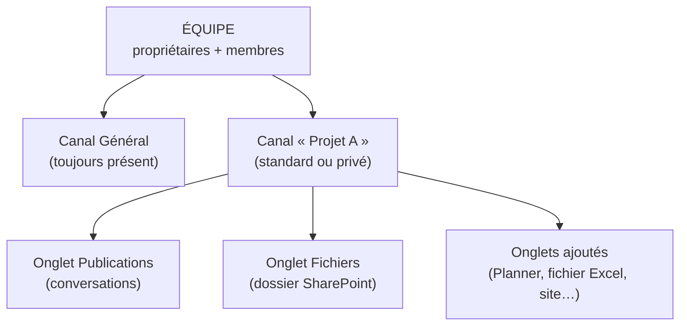

# Module 5 : Teams, SharePoint et OneDrive

*Cours : [Bonus - Microsoft 365](../index.md)*

## 🎯 Objectif du module

Utiliser et faire utiliser les outils **collaboratifs** de Microsoft 365 : **SharePoint** (sites et bibliothèques), **OneDrive** (stockage personnel, synchronisation, partage, versions) et **Teams** (équipes, canaux, onglets, réunions).

!!! abstract "En clair"
    **OneDrive**, ce sont **mes** fichiers. **SharePoint**, ce sont les fichiers **de l'équipe** ou du service. **Teams** est la **porte d'entrée** qui réunit conversations, réunions et fichiers : derrière chaque équipe Teams, il y a en réalité un **site SharePoint**.

## 🗺️ L'essentiel en schémas

!!! info "Référentiel TSSR 2026"
    **CCP 1 · compétence 2 : Assurer le déploiement des équipements numériques et accompagner à l'utilisation des outils collaboratifs.** C'est exactement le sujet de ce module.

**① Ce que crée une équipe Teams**

**② Structure d'une équipe**

## 📖 Cours consolidé

### 1. SharePoint

**SharePoint** sert à créer des **sites web internes** (intranet, sites d'équipe ou de projet) avec des **bibliothèques de documents**.

| Version | À retenir |
|---|---|
| **SharePoint Online** | Hébergé par Microsoft, inclus dans Microsoft 365 |
| **SharePoint Server** | Installé **sur site** (*on-premises*) |

À quoi il sert : **partager** des documents et **collaborer** (avec **versions**), **informer** (actualités, intranet), créer un **wiki** d'entreprise, automatiser des **flux** métier, **protéger** les données (droits, antivirus intégré).

### 2. OneDrive

| Notion | À retenir |
|---|---|
| **Rôle** | Espace de stockage **personnel** dans le cloud (1 To par défaut en entreprise), fondé sur SharePoint |
| **Accès** | Portail Microsoft 365, navigateur, application sur PC / Mac / mobile |
| **Synchronisation** | Le client OneDrive synchronise les fichiers avec un dossier du PC ; on choisit les **dossiers** à synchroniser |
| **Fichiers à la demande** | Fichier **seulement en ligne** (nuage) / **disponible localement** (coche verte) / **toujours conservé** sur l'appareil (cercle vert plein) |
| **Partage** | Par **lien** ou par **mail**, à des personnes **internes ou externes**, avec ou sans droit de modification |
| **Corbeille** | Restaurer un fichier supprimé ; *Restaurer votre OneDrive* à une date antérieure (rançongiciel, suppressions massives) |
| **Historique des versions** | Revenir à une version précédente sans perdre la dernière |
| **Coédition** | Travailler **à plusieurs en même temps** sur un `.docx`, `.xlsx` ou `.pptx`, chacun avec la couleur de son curseur |

| Icône OneDrive | Signification |
|---|---|
| ☁️ Nuage | Disponible **en ligne seulement** |
| ✅ Coche verte | Disponible sur l'appareil |
| 🔄 Flèches circulaires | **Synchronisation en cours** |
| ❌ Croix rouge | **Ne peut pas être synchronisé** (nom interdit, chemin trop long, fichier ouvert…) |
| ⏸️ Pause | Synchronisation **en pause** |
| Nuage grisé | Pas connecté au compte |
| 🔒 Cadenas | Un paramètre (stratégie) **empêche** la synchronisation |
| Nuage avec une personne | Élément **partagé** |

### 3. Teams

**Teams** = l'espace de travail centralisé : **conversations**, **réunions** audio/vidéo, **partage d'écran**, **fichiers**, **applications**, **calendrier**, sur ordinateur, navigateur et mobile.

| Élément | À retenir |
|---|---|
| **Équipe** | Un ensemble d'**utilisateurs**, de contenus et d'outils ; des **propriétaires** (gèrent l'équipe) et des **membres** |
| **À la création** | Teams crée un **groupe Microsoft 365**, un **site SharePoint**, une **boîte aux lettres partagée** et un **bloc-notes OneNote** |
| **Canal** | Découpe l'équipe **par sujet** ; un canal **Général** existe toujours ; un canal peut être **standard** (toute l'équipe) ou **privé** (quelques membres) ; un canal supprimé se **restaure** pendant **30 jours** |
| **Onglets** | **Publications** (conversations), **Fichiers**, et des onglets ajoutés (application, fichier, site) |
| **Fichiers** | Rangés dans la **bibliothèque SharePoint** de l'équipe, un **dossier par canal** : versions et coédition comme OneDrive |
| **Messages** | **Publication** dans un canal (visible par les membres) ou **conversation privée** (*chat*) |
| **Paramètres de l'équipe** | Photo, **autorisations des membres** et des **invités**, @mentions, code d'invitation, emojis et GIF |

| Rôle en réunion | Droits |
|---|---|
| **Organisateur** | Crée la réunion, **tous les droits** |
| **Présentateur** | Partage, gère la réunion et les participants, mais **pas les rôles** |
| **Participant** | Assiste, discute ; ne partage pas si l'organisateur l'interdit |

Une réunion peut être **planifiée** (aussi depuis **Outlook**) ou lancée **tout de suite** ; on y partage son **écran**, une présentation **PowerPoint** ou un **tableau blanc** ; une **salle d'attente** fait patienter les participants ; la réunion peut être **enregistrée**.

## 📝 Fiche de révision

| Notion | À retenir |
|---|---|
| **OneDrive** | Mes fichiers · 1 To · synchronisation · partage · versions |
| **SharePoint** | Fichiers et sites de l'équipe / du service |
| **Teams** | Conversations, réunions, fichiers (stockés dans SharePoint) |
| **Équipe** | Groupe M365 + site SharePoint + BAL partagée + OneNote |
| **Canal** | Sujet de l'équipe · Général toujours présent · standard ou privé |
| **Onglets** | Publications, Fichiers, + applications |
| **Coédition** | Plusieurs personnes sur le même fichier en même temps |
| **Croix rouge** | Fichier non synchronisé |
| **Rôles de réunion** | Organisateur / présentateur / participant |

### ⚠️ Les pièges

- Mettre des fichiers **d'équipe** dans **son** OneDrive : ils disparaissent quand la personne quitte l'entreprise.
- Envoyer un fichier en **pièce jointe** plutôt qu'un **lien** : plusieurs copies divergentes.
- Croire qu'un fichier « en ligne seulement » (nuage) est disponible **hors connexion**.
- Supprimer une **équipe** Teams : on supprime aussi son **site SharePoint** et ses fichiers.

### ✏️ Entraîne-toi (clique pour voir la correction)

??? question "1. Un utilisateur voit une croix rouge sur un fichier dans son dossier OneDrive. Que vérifies-tu ?"
    Le **nom** (caractères interdits, nom réservé), la **longueur du chemin**, si le fichier est **ouvert** ou **verrouillé**, l'**espace** disponible, et le message détaillé en cliquant sur l'**icône OneDrive** près de l'horloge. Un clic droit → **Afficher les problèmes de synchronisation** aide aussi.

## 🧠 Quiz — entraîne-toi

