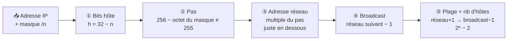

# Module 3 : L'adressage IPv4

*Cours : [Cours 1 - Bases des réseaux](../index.md)*

## 🎯 Objectif du module

À la fin de ce module, tu sais :

- **découper** une adresse IPv4 en partie réseau / partie hôte grâce au masque ;
- reconnaître sa **classe** et dire si elle est **privée**, **publique** ou **APIPA** ;
- passer d'un masque à la notation **CIDR** (`/24`, `/26`…) et inversement ;
- calculer **adresse réseau, broadcast, plage et nombre d'hôtes** ;
- ⭐ **découper un réseau en sous-réseaux** (selon un nombre de réseaux ou d'hôtes).

!!! abstract "En clair"
    Une adresse IP, c'est comme une adresse postale : **une rue + un numéro de maison**. La rue, c'est le **réseau** ; le numéro, c'est l'**hôte** (la machine). Le **masque** est la règle qui dit où s'arrête le nom de la rue et où commence le numéro.
    Faire des **sous-réseaux**, c'est couper une longue rue en plusieurs petites rues : on prend quelques chiffres du numéro de maison pour en faire un numéro de rue. Plus de rues, mais moins de maisons dans chacune.

## 🖼️ Résumé visuel

**Une adresse IPv4 = 4 octets. Le masque dit où s'arrête le réseau et où commence l'hôte.**

<div class="tssr-ip">
  <div class="tssr-ip-grid">
    <span class="tssr-ip-label">Adresse IP</span>
    <span class="tssr-ip-oct is-net"><b>192</b><code>11000000</code></span>
    <span class="tssr-ip-oct is-net"><b>168</b><code>10101000</code></span>
    <span class="tssr-ip-oct is-net"><b>1</b><code>00000001</code></span>
    <span class="tssr-ip-oct is-host"><b>10</b><code>00001010</code></span>
    <span class="tssr-ip-label">Masque /24</span>
    <span class="tssr-ip-oct is-mask"><b>255</b><code>11111111</code></span>
    <span class="tssr-ip-oct is-mask"><b>255</b><code>11111111</code></span>
    <span class="tssr-ip-oct is-mask"><b>255</b><code>11111111</code></span>
    <span class="tssr-ip-oct is-zero"><b>0</b><code>00000000</code></span>
    <span class="tssr-ip-label"></span>
    <span class="tssr-ip-brace is-net">◀ Partie <b>réseau</b> : 24 bits (masque à 1) ▶</span>
    <span class="tssr-ip-brace is-host">Partie <b>hôte</b> : 8 bits</span>
  </div>
  <div class="tssr-ip-results">
    <div><small>Adresse réseau</small><b>192.168.1.<u>0</u></b><span>hôte tout à 0</span></div>
    <div><small>1er hôte → dernier hôte</small><b>.1 → .254</b><span>les adresses attribuables</span></div>
    <div><small>Broadcast</small><b>192.168.1.<u>255</u></b><span>hôte tout à 1</span></div>
    <div><small>Hôtes utilisables</small><b>2⁸ − 2 = 254</b><span>2<sup>bits hôte</sup> − 2</span></div>
  </div>
</div>

**La méthode de calcul, toujours la même :**



## 📖 Cours consolidé

### 1. Une adresse IPv4, c'est quoi ?

- **32 bits** = **4 octets**, écrits en décimal et séparés par des points. Chaque octet va de **0 à 255** (2⁸ = 256 valeurs).
- Toujours **2 parties** : **ID réseau** (la rue) + **ID hôte** (la maison).
- Une machine a besoin de **2 infos** : son **adresse IP** + son **masque**. Avec ça, elle calcule seule son **adresse réseau** et son **adresse de broadcast**.

```
Adresse   :    192    .   168    .    1     .    10
Binaire   :  11000000 . 10101000 . 00000001 . 00001010
```

---

### 2. Les classes (l'ancien système)

Avant CIDR, la taille d'un réseau était fixée par sa **classe**, lue sur le **1er octet** :

| Classe | 1er octet | Masque par défaut | Réseau / hôte | Usage |
|---|---|---|---|---|
| **A** | 1 à 126 | 255.0.0.0 (/8) | 1 octet / 3 octets | Très grands réseaux · 2²⁴ − 2 ≈ 16,7 M hôtes |
| **B** | 128 à 191 | 255.255.0.0 (/16) | 2 / 2 | Réseaux moyens · 65 534 hôtes |
| **C** | 192 à 223 | 255.255.255.0 (/24) | 3 / 1 | Petits réseaux · 254 hôtes |
| **D** | 224 à 239 | — | — | **Multicast** (envoi à un groupe) |
| **E** | 240 à 255 | — | — | Expérimental, jamais sur un poste |

📌 En théorie la classe A va de 0 à 127, mais **0** et **127** sont réservés → on retient **1 à 126**.

**3 adresses spéciales à connaître :**

| Adresse | Rôle | Exemple |
|---|---|---|
| **Boucle locale** (localhost) | La machine se parle à elle-même (test de la carte réseau) | 127.0.0.1 |
| **Adresse réseau** | Le « nom » du réseau : bits hôte **tous à 0** | 192.168.1.**0** |
| **Broadcast** | « À tout le monde » dans le réseau : bits hôte **tous à 1** | 192.168.1.**255** |

⚠️ Adresse réseau et broadcast ne sont **jamais données à une machine** → d'où le **− 2** dans tous les calculs d'hôtes.

---

### 3. Le masque et le ET logique

Le **masque** = des **1** pour la partie réseau, puis des **0** pour la partie hôte. Jamais de mélange : `11111111.11111111.11110000.00000000` ✅ · `11110000.11111111…` ❌.

Pour trouver l'**adresse réseau**, la machine fait un **ET logique** bit à bit entre son IP et son masque. Règle du ET : **1 ET 1 = 1, tout le reste = 0**. Autrement dit, le masque « laisse passer » la partie réseau et « efface » la partie hôte.

```
IP       192.168.10.100 :  11000000.10101000.00001010.01100100
Masque   255.255.255.0  :  11111111.11111111.11111111.00000000
                           ─────────────────────────────────── ET
Réseau                  :  11000000.10101000.00001010.00000000  →  192.168.10.0
Broadcast (hôte à 1)    :  11000000.10101000.00001010.11111111  →  192.168.10.255
```

💡 **Raccourci** : masque à **255** → on recopie l'octet de l'IP · masque à **0** → on met 0 (réseau) ou 255 (broadcast). Le binaire ne sert que pour l'**octet coupé** (ni 255 ni 0).

---

### 4. La notation CIDR

**/n = nombre de bits à 1 dans le masque.** `192.168.1.0/24` = 24 bits réseau = `255.255.255.0`.

**Pourquoi ?** Avec les classes, on ne pouvait avoir que des blocs de 254, 65 534 ou 16 millions d'hôtes : énorme gaspillage. CIDR permet un masque **de n'importe quelle taille** (/20, /27…), donc un réseau **à la bonne taille**.

#### Masque → CIDR : je compte les 1

On écrit chaque octet en binaire et on compte les 1.

```
255.255.248.0  =  11111111.11111111.11111000.00000000
                     8    +    8    +   5    +   0      =  /21
```

#### CIDR → masque : je remplis les octets 8 par 8

On distribue les bits à 1 par paquets de 8, puis on convertit le reste.

```
/12  →  8 bits  | 4 bits   | 0        | 0
        11111111.11110000.00000000.00000000  =  255.240.0.0
```

#### Les 8 valeurs possibles d'un octet de masque

On ajoute un bit à 1 à chaque fois, en partant de la gauche :

| Bits à 1 dans l'octet | 1 | 2 | 3 | 4 | 5 | 6 | 7 | 8 |
|---|---|---|---|---|---|---|---|---|
| **Valeur** | 128 | 192 | 224 | 240 | 248 | 252 | 254 | 255 |
| **Pas** (256 − valeur) | 128 | 64 | 32 | 16 | 8 | 4 | 2 | 1 |

#### Table à connaître

| CIDR | Masque | Bits hôte | Hôtes utilisables |
|---|---|---|---|
| /8 | 255.0.0.0 | 24 | 16 777 214 |
| /16 | 255.255.0.0 | 16 | 65 534 |
| /20 | 255.255.240.0 | 12 | 4 094 |
| **/24** | 255.255.255.0 | 8 | **254** |
| /25 | 255.255.255.128 | 7 | 126 |
| **/26** | 255.255.255.192 | 6 | **62** |
| /27 | 255.255.255.224 | 5 | 30 |
| **/28** | 255.255.255.240 | 4 | **14** |
| /29 | 255.255.255.248 | 3 | 6 |
| /30 | 255.255.255.252 | 2 | **2** (liaison entre 2 routeurs) |

---

### 5. Calculer réseau, broadcast et plage (sans binaire)

**Le « pas »** (ou nombre magique) = **256 − octet coupé du masque**. Les réseaux commencent tous à un **multiple du pas** : c'est comme des tranches de même taille.

| # | Je cherche… | Comment |
|---|---|---|
| ① | Bits hôte, nb d'hôtes | h = 32 − n · hôtes = **2ʰ − 2** |
| ② | Le pas | 256 − octet du masque qui n'est ni 255 ni 0 |
| ③ | L'adresse réseau | multiple du pas **≤** l'octet de l'IP ; octets à droite → 0 |
| ④ | Le broadcast | réseau suivant − 1 ; octets à droite → 255 |
| ⑤ | La plage | réseau + 1 → broadcast − 1 |

**Exemple A : 192.168.10.77 /26** (octet coupé = le 4ᵉ)

- Masque 255.255.255.**192** → pas = 256 − 192 = **64** → réseaux en .0 · .64 · .128 · .192
- 77 est entre 64 et 127 → **réseau 192.168.10.64**, **broadcast 192.168.10.127**
- **Plage .65 → .126** · 2⁶ − 2 = **62 hôtes**

**Exemple B (du support) : 172.25.192.0 /20** (octet coupé = le 3ᵉ)

- Masque 255.255.**240**.0 → pas = **16** → 3ᵉ octet en 0, 16, 32… **192**, 208…
- 192 est un multiple de 16 → **réseau 172.25.192.0** (l'adresse donnée *est* l'adresse réseau !)
- Réseau suivant 172.25.208.0 → **broadcast 172.25.207.255**
- **Plage 172.25.192.1 → 172.25.207.254** · 2¹² − 2 = **4 094 hôtes**
- Type : **privée** (172.16 → 172.31)

⚠️ Quand l'octet coupé est le 3ᵉ, le 4ᵉ octet va **jusqu'au bout** : broadcast en **.255**, 1er hôte en **.1**.

#### 🧮 Vérifie tes calculs

Fais d'abord le calcul **à la main**, puis tape l'adresse ici pour vérifier (format `IP/CIDR` ou `IP masque`) :

<div class="tssr-calc" data-ip="192.168.10.77/26"></div>

---

### 6. Adresses privées, publiques et APIPA

#### Privées (RFC 1918, 1996)

Réservées aux réseaux internes, **jamais routées sur Internet**. Tout le reste (hors adresses spéciales) est **public**.

| Plage privée | CIDR | Pour qui |
|---|---|---|
| **10**.0.0.0 → 10.255.255.255 | 10.0.0.0/8 | Grandes entreprises |
| **172.16**.0.0 → **172.31**.255.255 | 172.16.0.0/12 | Réseaux moyens |
| **192.168**.0.0 → 192.168.255.255 | 192.168.0.0/16 | Maison, PME |

- Pour sortir sur Internet, le routeur fait du **NAT** : il remplace l'IP privée par **son IP publique** (fournie par le FAI). Toute la maison partage **une seule** adresse publique.
- ✅ Économise les adresses publiques · ✅ les machines internes ne sont pas joignables directement de l'extérieur.
- ❌ Pour rendre un serveur interne accessible, il faut une config en plus (redirection NAT, DMZ).

⚠️ **172.32.0.1 est publique** : le privé s'arrête à 172.**31**.

#### APIPA : 169.254.0.0/16 (RFC 3927)

Le poste est en DHCP **mais aucun serveur DHCP ne répond** → il se donne **lui-même** une adresse en **169.254.x.x / 255.255.0.0**, après avoir vérifié par **ARP** que personne ne l'utilise.

| ✅ Ça marche | ❌ Ça ne marche pas |
|---|---|
| Parler aux autres postes APIPA du **même réseau local** (fichiers, imprimante) | Internet et les autres réseaux (**non routable**) · pas distribuée par DHCP · pas dans le DNS |

🩺 **Réflexe dépannage** : `ipconfig` affiche **169.254.x.x** → **problème DHCP** (serveur HS, câble, mauvais VLAN…).

---

### 7. ⭐ Les sous-réseaux (subnetting)

#### L'idée

On **découpe** un réseau en plusieurs petits réseaux en **empruntant des bits à la partie hôte** pour les donner à la partie réseau. Le masque **s'allonge**.

<div class="tssr-ip">
  <div class="tssr-borrow-label">Avant : 192.168.1.0 /24</div>
  <div class="tssr-borrow">
    <span style="--bits:24"><b>Réseau</b> · 24 bits (192.168.1)</span>
    <span class="is-host" style="--bits:8"><b>Hôte</b> · 8 bits</span>
  </div>
  <div class="tssr-borrow-label">Après : 4 sous-réseaux en /26 (on emprunte 2 bits)</div>
  <div class="tssr-borrow">
    <span style="--bits:24"><b>Réseau</b> · 24 bits</span>
    <span class="is-sub" style="--bits:2"><b>SR</b><br>2 bits</span>
    <span class="is-host" style="--bits:6"><b>Hôte</b> · 6 bits</span>
  </div>
  <div class="tssr-borrow-label">2 bits de sous-réseau → 2² = 4 sous-réseaux · 6 bits hôte → 2⁶ − 2 = 62 hôtes chacun</div>
</div>

**Pourquoi découper ?**

- **Moins de gaspillage** : chaque service reçoit un réseau à sa taille.
- **Moins de broadcast** : un broadcast reste dans son sous-réseau → réseau plus fluide.
- **Sécurité** : compta, serveurs, Wi-Fi invités séparés ; on filtre ce qui passe de l'un à l'autre (routeur, pare-feu).

#### Les 2 formules

| Formule | Donne | Avec |
|---|---|---|
| **2ⁿ** | le nombre de **sous-réseaux** | n = bits **empruntés** |
| **2ʰ − 2** | le nombre d'**hôtes** par sous-réseau | h = bits **hôte restants** |

📌 C'est un **échange** : chaque bit emprunté **double** le nombre de sous-réseaux et **divise par 2** leur taille.

| Depuis un /24 | /25 | /26 | /27 | /28 | /29 | /30 |
|---|---|---|---|---|---|---|
| Bits empruntés | 1 | 2 | 3 | 4 | 5 | 6 |
| Sous-réseaux | 2 | 4 | 8 | 16 | 32 | 64 |
| Hôtes chacun | 126 | 62 | 30 | 14 | 6 | 2 |

#### La méthode en 5 étapes

| # | Étape | Comment |
|---|---|---|
| ① | **Bits à emprunter** | le plus petit n tel que **2ⁿ ≥ nombre de sous-réseaux voulus** |
| ② | **Nouveau masque** | ancien /n + bits empruntés |
| ③ | **Le pas** | 256 − octet coupé du nouveau masque |
| ④ | **Lister les sous-réseaux** | on part du réseau de départ et on **ajoute le pas** ; arrivé à 256, on repart à 0 et on fait **+1 sur l'octet de gauche** |
| ⑤ | **Pour chaque sous-réseau** | réseau · 1er hôte (+1) · broadcast (suivant − 1) · dernier hôte (−1) |

💡 Si on veut **6** sous-réseaux, 2² = 4 ne suffit pas → on prend **3 bits** (2³ = 8). Les 2 en trop restent en **réserve** pour plus tard.

#### Exemple 1 — le classique : 192.168.1.0/24 en 4 sous-réseaux

① 4 = 2² → **2 bits** · ② /24 + 2 = **/26** (255.255.255.192) · ③ pas = 256 − 192 = **64** · 2⁶ − 2 = **62 hôtes**

| SR | Adresse réseau | 1er hôte | Dernier hôte | Broadcast |
|---|---|---|---|---|
| 1 | 192.168.1.**0**/26 | .1 | .62 | .63 |
| 2 | 192.168.1.**64**/26 | .65 | .126 | .127 |
| 3 | 192.168.1.**128**/26 | .129 | .190 | .191 |
| 4 | 192.168.1.**192**/26 | .193 | .254 | .255 |

#### Exemple 2 (du support) — le pas tombe dans le 3ᵉ octet : 192.168.0.0/16 en 6 sous-réseaux

① 6 → 2³ = 8 ≥ 6 → **3 bits** · ② /16 + 3 = **/19** → 255.255.**224**.0 · ③ pas = **32** sur le **3ᵉ octet** · hôtes : 32 − 19 = 13 bits → 2¹³ − 2 = **8 190**

| SR | Adresse réseau | Plage d'hôtes | Broadcast |
|---|---|---|---|
| 1 | 192.168.**0**.0/19 | 192.168.0.1 → 192.168.31.254 | 192.168.31.255 |
| 2 | 192.168.**32**.0/19 | 192.168.32.1 → 192.168.63.254 | 192.168.63.255 |
| 3 | 192.168.**64**.0/19 | 192.168.64.1 → 192.168.95.254 | 192.168.95.255 |
| … | **96**, **128**, **160** | | |
| 7–8 | **192**, **224** (en réserve) | | |

#### Exemple 3 (du support) — avec retenue : 192.170.0.0/15 en 8 sous-réseaux

① 8 = 2³ → **3 bits** · ② /15 + 3 = **/18** → 255.255.**192**.0 · ③ pas = **64** sur le 3ᵉ octet.

Ici le 1er bit emprunté est dans le **2ᵉ octet** : quand le 3ᵉ octet dépasse 192, on repart à 0 et le 2ᵉ octet passe de 170 à **171**.

| SR | 1 | 2 | 3 | 4 | 5 | 6 | 7 | 8 |
|---|---|---|---|---|---|---|---|---|
| **Réseau** | 192.170.**0**.0 | 192.170.**64**.0 | 192.170.**128**.0 | 192.170.**192**.0 | 192.**171**.**0**.0 | 192.171.64.0 | 192.171.128.0 | 192.171.192.0 |

#### Découper selon le nombre d'**hôtes**

Souvent, la consigne n'est pas « X sous-réseaux » mais « **au moins Y machines par réseau** ». On part alors des hôtes :

1. Plus petit h tel que **2ʰ − 2 ≥ Y**.
2. Nouveau masque = **/(32 − h)**.
3. Puis même méthode (pas, liste).

> Ex. : 50 postes par service dans 192.168.1.0/24 → 2⁵ − 2 = 30 ❌ · 2⁶ − 2 = 62 ✅ → h = 6 → **/26** → 4 sous-réseaux de 62 hôtes.

💡 Pense **large** : prévois de la marge pour la croissance (et une adresse pour la passerelle, qui est aussi un hôte !).

## 📝 Fiche de révision

### 🧠 Par cœur

| | |
|---|---|
| **Classes** | **A** 1–126 → /8 · **B** 128–191 → /16 · **C** 192–223 → /24 |
| **Privées** | **10**.x.x.x · **172.16** à **172.31**.x.x · **192.168**.x.x |
| **Spéciales** | **127.0.0.1** boucle locale · **169.254.x.x** APIPA (pas de DHCP) |
| **Formules** | sous-réseaux = **2ⁿ** (bits empruntés) · hôtes = **2ʰ − 2** (bits restants) |

### 📏 L'octet de masque en un coup d'œil

| CIDR (dernier octet) | /24 | /25 | /26 | /27 | /28 | /29 | /30 |
|---|---|---|---|---|---|---|---|
| **Octet du masque** | 0 | 128 | 192 | 224 | 240 | 248 | 252 |
| **Pas** (256 − masque) | 256 | 128 | 64 | 32 | 16 | 8 | 4 |
| **Hôtes** (pas − 2) | 254 | 126 | 62 | 30 | 14 | 6 | 2 |

💡 Même logique un octet plus à gauche : /17 = 255.255.**128**.0, /18 = .**192**.0, /19 = .**224**.0, /20 = .**240**.0…

### 🛠️ Calculer une adresse (ex. : 10.0.0.200 /27)

| # | Je cherche… | Je calcule | Résultat |
|---|---|---|---|
| ① | Le masque | /27 → 255.255.255.**224** | |
| ② | Le pas | 256 − 224 | **32** → 0, 32 … 192, 224 |
| ③ | Le réseau | multiple de 32 ≤ 200 | **10.0.0.192** |
| ④ | Le broadcast | 224 − 1 | **10.0.0.223** |
| ⑤ | Plage, nb d'hôtes | +1 / −1 ; 2⁵ − 2 | **.193 → .222**, **30 hôtes** |

### ✂️ Découper un réseau

| # | Étape | Ex. : 172.16.0.0/16 en 10 SR |
|---|---|---|
| ① | 2ⁿ ≥ nb de SR | 2⁴ = 16 ≥ 10 → **4 bits** |
| ② | Nouveau masque | /16 + 4 = **/20** = 255.255.240.0 |
| ③ | Pas | 256 − 240 = **16** (3ᵉ octet) |
| ④ | Liste | 172.16.**0**.0 · .**16**.0 · .**32**.0 · … · .**240**.0 |
| ⑤ | Hôtes | 2¹² − 2 = **4 094** par SR |

### ⚠️ Les pièges

- Oublier le **− 2** : un /24 a 256 adresses mais **254 hôtes**.
- **172.32.x.x est publique** (le privé s'arrête à 172.31).
- **Masque ≠ CIDR** : 255.255.255.192 = **/26** (pas /192).
- Prendre **2ⁿ < besoin** : 6 sous-réseaux → **3 bits** (8), pas 2 (4).
- Pas dans le 3ᵉ octet → le **broadcast finit en .255** et le 1er hôte en **.1** (ex. 192.168.31.255).
- Oublier la **retenue** : après 192.170.192.0/18 vient **192.171.0.0**.

### ✏️ Entraîne-toi (clique pour voir la correction)

??? question "1. 192.168.5.130 /25 : réseau, broadcast, plage, nb d'hôtes ?"
    /25 → masque 255.255.255.**128**, pas **128** → réseaux en .0 et .128.

    - 130 ≥ 128 → **réseau 192.168.5.128**
    - **Broadcast 192.168.5.255**
    - **Plage .129 → .254**
    - 2⁷ − 2 = **126 hôtes**

??? question "2. 10.1.1.50 /28 : réseau, broadcast, plage, nb d'hôtes ?"
    /28 → masque 255.255.255.**240**, pas **16** → 0, 16, 32, **48**, 64…

    - 48 ≤ 50 < 64 → **réseau 10.1.1.48**
    - **Broadcast 10.1.1.63**
    - **Plage .49 → .62**
    - 2⁴ − 2 = **14 hôtes**

??? question "3. Convertis : 255.255.252.0 en CIDR, puis /27 en masque."
    - `255.255.252.0` → 8 + 8 + `11111100` (6) + 0 = **/22**
    - `/27` → 8 + 8 + 8 + **3** → dernier octet `11100000` = 224 → **255.255.255.224**

??? question "4. Privée, publique ou spéciale : 172.20.3.4 · 172.40.3.4 · 169.254.10.1 · 8.8.8.8 ?"
    - **172.20.3.4** → privée (entre 172.16 et 172.31)
    - **172.40.3.4** → publique (au-delà de 172.31)
    - **169.254.10.1** → APIPA : le poste n'a pas eu de réponse DHCP
    - **8.8.8.8** → publique (DNS de Google)

??? question "5. Découpe 192.168.1.0/24 en 8 sous-réseaux : masque, hôtes, liste ?"
    8 = 2³ → **3 bits** → **/27** (255.255.255.224), pas **32**, 2⁵ − 2 = **30 hôtes**.

    Réseaux : .0 · .32 · .64 · .96 · .128 · .160 · .192 · .224. Le 3ᵉ par exemple : réseau **.64**, hôtes **.65 → .94**, broadcast **.95**.

??? question "6. Découpe 10.0.0.0/8 en 4 sous-réseaux. Donne les 4 adresses réseau."
    4 = 2² → **2 bits** → **/10** → masque 255.**192**.0.0, pas **64** sur le **2ᵉ octet**.

    **10.0.0.0/10 · 10.64.0.0/10 · 10.128.0.0/10 · 10.192.0.0/10**, avec chacun 2²² − 2 = **4 194 302 hôtes**.

??? question "7. (du support) 192.168.140.0/22 à découper en 12 sous-réseaux : masque ? 1er et dernier sous-réseau ?"
    12 → 2⁴ = 16 ≥ 12 → **4 bits** → /22 + 4 = **/26** (255.255.255.192), pas **64** sur le 4ᵉ octet, 62 hôtes.

    Le /22 couvre le 3ᵉ octet de **140 à 143** → 4 sous-réseaux par valeur du 3ᵉ octet :
    140.0 · 140.64 · 140.128 · 140.192 · **141**.0 · … · **143**.192 (16 au total, 4 en réserve).

    - 1er : **192.168.140.0/26** (hôtes .1 → .62, broadcast 140.63)
    - Dernier : **192.168.143.192/26** (hôtes 143.193 → 143.254, broadcast **143.255**)

??? question "8. Il te faut des réseaux d'au moins 500 machines dans 172.16.0.0/16. Quel masque ? Combien de sous-réseaux ? Les 2 premiers ?"
    2⁸ − 2 = 254 ❌ · 2⁹ − 2 = **510** ✅ → h = 9 → /(32 − 9) = **/23** (255.255.**254**.0).

    Bits empruntés : 23 − 16 = 7 → 2⁷ = **128 sous-réseaux**. Pas = 256 − 254 = **2** sur le 3ᵉ octet :

    - **172.16.0.0/23** → hôtes 172.16.0.1 → 172.16.1.254, broadcast **172.16.1.255**
    - **172.16.2.0/23** → hôtes 172.16.2.1 → 172.16.3.254, broadcast 172.16.3.255

??? question "9. Un PC a 192.168.50.70/27 et un autre 192.168.50.100/27. Sont-ils dans le même sous-réseau ?"
    Pas = 256 − 224 = **32** → réseaux en .64 (de .64 à .95) et .96 (de .96 à .127).

    - .70 → réseau **192.168.50.64**
    - .100 → réseau **192.168.50.96**

    **Non** : deux sous-réseaux différents, il leur faut un **routeur** pour communiquer.

## 🧠 Quiz — entraîne-toi

<div id="quiz-cours-01-bases-des-reseaux-module-3-l-adressage-ipv4"></div>

<script type="application/json" id="quiz-cours-01-bases-des-reseaux-module-3-l-adressage-ipv4-data">
[
  {
    "question": "Sur combien de bits une adresse IPv4 est-elle codée ?",
    "options": [
      "32 bits",
      "16 bits",
      "64 bits",
      "128 bits"
    ],
    "correctIndex": 0,
    "explanation": "Une adresse IPv4 est codée sur 32 bits, répartis en 4 octets de 8 bits chacun, ce qui permet 256 valeurs possibles (0 à 255) par octet."
  },
  {
    "question": "À quelle classe appartient l'adresse IP 172.16.0.1 ?",
    "options": [
      "Classe A",
      "Classe B",
      "Classe C",
      "Classe D"
    ],
    "correctIndex": 1,
    "explanation": "Une adresse est de classe B lorsque son premier octet est compris entre 128 et 191 ; 172 se situe dans cette plage."
  },
  {
    "question": "Quelle plage de valeurs pour le premier octet caractérise une adresse de classe C ?",
    "options": [
      "0 à 127",
      "128 à 191",
      "192 à 223",
      "224 à 239"
    ],
    "correctIndex": 2,
    "explanation": "Les adresses de classe C ont un premier octet compris entre 192 et 223 ; les trois premiers octets identifient le réseau et le dernier octet identifie l'hôte."
  },
  {
    "question": "À quoi sert l'adresse 127.0.0.1 ?",
    "options": [
      "C'est une adresse de diffusion pour tout le réseau local",
      "C'est une adresse réservée au multicast",
      "C'est l'adresse publique par défaut d'un routeur",
      "C'est l'adresse de boucle locale (localhost), utilisée pour les tests internes à l'appareil"
    ],
    "correctIndex": 3,
    "explanation": "127.0.0.1 est l'adresse de boucle locale (localhost) : elle permet à un appareil de communiquer avec lui-même, notamment pour des tests, sans passer par le réseau physique."
  },
  {
    "question": "Que permet l'adresse de diffusion (broadcast) d'un réseau, comme 192.168.1.255 pour un réseau de classe C ?",
    "options": [
      "Envoyer un message à tous les appareils du réseau simultanément",
      "Identifier un hôte unique sur le réseau",
      "Chiffrer les communications du réseau",
      "Router les paquets vers Internet"
    ],
    "correctIndex": 0,
    "explanation": "L'adresse de diffusion permet d'envoyer un message à l'ensemble des appareils connectés à un réseau, contrairement à une adresse d'hôte qui cible un seul appareil."
  },
  {
    "question": "Dans la notation CIDR, que signifie le nombre après le slash (par exemple /24 dans 192.168.1.0/24) ?",
    "options": [
      "Le nombre total d'hôtes disponibles sur le réseau",
      "Le nombre de bits réservés à l'identification de la partie réseau",
      "Le numéro de la classe d'adresse utilisée",
      "Le nombre d'octets composant l'adresse IP"
    ],
    "correctIndex": 1,
    "explanation": "Le chiffre après le slash indique combien de bits, en partant de la gauche, sont dédiés à la partie réseau de l'adresse ; les bits restants servent à identifier les hôtes."
  },
  {
    "question": "À quel masque de sous-réseau décimal correspond la notation CIDR /24 ?",
    "options": [
      "255.255.0.0",
      "255.0.0.0",
      "255.255.255.0",
      "255.255.255.192"
    ],
    "correctIndex": 2,
    "explanation": "/24 signifie que les 24 premiers bits sont à 1, ce qui correspond aux trois premiers octets à 255 et au dernier octet à 0, soit 255.255.255.0."
  },
  {
    "question": "Quelle opération logique est utilisée entre l'adresse IP et le masque de sous-réseau pour déterminer l'ID réseau ?",
    "options": [
      "L'opération OR",
      "L'opération XOR",
      "L'opération NOT",
      "L'opération AND"
    ],
    "correctIndex": 3,
    "explanation": "L'opération AND, bit à bit, entre l'adresse IP et le masque de sous-réseau permet d'obtenir l'identifiant du réseau : le résultat ne vaut 1 que si les deux bits comparés valent 1."
  },
  {
    "question": "Pour l'adresse IP 192.168.1.10 avec un masque /24, quel est l'ID réseau obtenu ?",
    "options": [
      "192.168.1.0",
      "192.168.1.10",
      "192.168.0.0",
      "192.168.1.255"
    ],
    "correctIndex": 0,
    "explanation": "Avec un masque /24, les trois premiers octets définissent le réseau et le dernier octet est mis à zéro pour obtenir l'ID réseau, soit 192.168.1.0."
  },
  {
    "question": "Quelle plage d'adresses privées correspond à la classe A selon la RFC 1918 ?",
    "options": [
      "172.16.0.0 à 172.31.255.255",
      "10.0.0.0 à 10.255.255.255",
      "192.168.0.0 à 192.168.255.255",
      "169.254.0.0 à 169.254.255.255"
    ],
    "correctIndex": 1,
    "explanation": "La RFC 1918 réserve la plage 10.0.0.0 à 10.255.255.255 (préfixe /8) comme plage privée de classe A, souvent utilisée dans les grandes entreprises nécessitant de nombreux sous-réseaux."
  },
  {
    "question": "Pourquoi une adresse IP privée ne peut-elle pas être atteinte directement depuis Internet ?",
    "options": [
      "Parce qu'elle est automatiquement chiffrée par le pare-feu",
      "Parce qu'elle change toutes les 24 heures",
      "Parce qu'elle n'est pas routable sur Internet et nécessite une traduction NAT pour communiquer vers l'extérieur",
      "Parce qu'elle n'est valable que pour les connexions Wi-Fi"
    ],
    "correctIndex": 2,
    "explanation": "Les adresses privées ne sont pas routées sur Internet ; un appareil qui en possède une doit passer par le NAT (Network Address Translation) de son routeur, qui la traduit en adresse IP publique pour communiquer vers l'extérieur."
  },
  {
    "question": "Dans quel contexte un appareil s'attribue-t-il automatiquement une adresse APIPA ?",
    "options": [
      "Lorsqu'il détecte une attaque réseau",
      "Lorsqu'il se connecte à Internet pour la première fois",
      "Lorsqu'un administrateur configure une adresse statique",
      "Lorsqu'il ne parvient pas à obtenir d'adresse IP d'un serveur DHCP"
    ],
    "correctIndex": 3,
    "explanation": "APIPA (Automatic Private IP Addressing) permet à un appareil de s'auto-attribuer une adresse dans la plage réservée 169.254.0.0/16 lorsqu'aucun serveur DHCP ne répond, afin de maintenir une communication locale."
  },
  {
    "question": "Quelle est la plage d'adresses réservée au mécanisme APIPA ?",
    "options": [
      "169.254.0.0 à 169.254.255.255",
      "127.0.0.0 à 127.255.255.255",
      "10.0.0.0 à 10.255.255.255",
      "192.168.0.0 à 192.168.255.255"
    ],
    "correctIndex": 0,
    "explanation": "APIPA choisit une adresse dans la plage réservée 169.254.0.0 à 169.254.255.255, avec un masque de sous-réseau 255.255.0.0, lorsqu'aucune réponse DHCP n'est reçue."
  },
  {
    "question": "Un appareil disposant uniquement d'une adresse APIPA peut-il accéder à Internet ?",
    "options": [
      "Oui, sans aucune restriction",
      "Non, car les adresses APIPA ne sont pas routables au-delà du réseau local",
      "Oui, mais uniquement en HTTPS",
      "Oui, à condition d'utiliser un VPN"
    ],
    "correctIndex": 1,
    "explanation": "Les adresses APIPA permettent uniquement la communication locale entre appareils du même réseau ; elles ne sont pas routables, donc aucun accès à Internet ou à d'autres réseaux externes n'est possible."
  },
  {
    "question": "Que permet le sous-réseautage (subnetting) dans un réseau IPv4 ?",
    "options": [
      "Augmenter automatiquement le nombre d'adresses IP publiques disponibles",
      "Remplacer le protocole IPv4 par IPv6",
      "Diviser un réseau en plusieurs sous-réseaux plus petits pour optimiser l'adressage, la sécurité et les performances",
      "Chiffrer l'ensemble du trafic réseau"
    ],
    "correctIndex": 2,
    "explanation": "Le sous-réseautage divise un grand réseau en sous-réseaux plus petits, ce qui optimise l'utilisation des adresses, réduit la taille des domaines de diffusion et facilite le contrôle de la sécurité entre segments."
  },
  {
    "question": "Dans le calcul du sous-réseautage, comment crée-t-on des sous-réseaux supplémentaires à partir d'un réseau existant ?",
    "options": [
      "En empruntant des bits à la partie réseau pour les affecter à la partie hôte",
      "En ajoutant un cinquième octet à l'adresse IP",
      "En dupliquant l'adresse réseau existante",
      "En empruntant des bits à la partie hôte pour les affecter à la partie réseau"
    ],
    "correctIndex": 3,
    "explanation": "Créer des sous-réseaux consiste à « emprunter » un ou plusieurs bits de la partie hôte du masque pour les utiliser dans l'identification de sous-réseaux distincts, ce qui augmente le nombre de réseaux au détriment du nombre d'hôtes par réseau."
  },
  {
    "question": "Avec un masque /26 sur un réseau 192.168.1.0, combien de sous-réseaux et d'hôtes utilisables par sous-réseau obtient-on ?",
    "options": [
      "4 sous-réseaux de 62 hôtes chacun",
      "2 sous-réseaux de 126 hôtes chacun",
      "8 sous-réseaux de 30 hôtes chacun",
      "4 sous-réseaux de 64 hôtes chacun"
    ],
    "correctIndex": 0,
    "explanation": "Un masque /26 emprunte 2 bits à la partie hôte du /24 d'origine, ce qui donne 2² = 4 sous-réseaux, chacun disposant de 2⁶ - 2 = 62 hôtes utilisables (on retranche l'adresse réseau et l'adresse de diffusion)."
  },
  {
    "question": "Pourquoi retranche-t-on systématiquement 2 adresses au nombre total d'adresses d'un sous-réseau pour obtenir le nombre d'hôtes utilisables ?",
    "options": [
      "Parce que deux adresses sont toujours réservées au serveur DHCP",
      "Parce que la première adresse identifie le réseau et la dernière sert d'adresse de diffusion, toutes deux non attribuables à un hôte",
      "Parce que le masque de sous-réseau occupe deux adresses supplémentaires",
      "Parce que deux adresses sont réservées aux adresses APIPA"
    ],
    "correctIndex": 1,
    "explanation": "Dans chaque sous-réseau, la première adresse désigne le réseau lui-même et la dernière est l'adresse de diffusion (broadcast) ; ces deux adresses ne peuvent pas être attribuées à un hôte, d'où la formule 2^n - 2."
  },
  {
    "question": "Pourquoi la notation CIDR a-t-elle été introduite en remplacement de l'adressage par classes traditionnel (A, B, C) ?",
    "options": [
      "Pour remplacer définitivement les adresses IPv4 par des adresses IPv6",
      "Pour supprimer la nécessité d'un masque de sous-réseau",
      "Pour permettre un découpage plus flexible des réseaux et limiter le gaspillage d'adresses IPv4",
      "Pour imposer un nombre fixe de 256 adresses par réseau"
    ],
    "correctIndex": 2,
    "explanation": "L'adressage par classes attribuait des blocs de taille fixe, ce qui gaspillait souvent des adresses. La notation CIDR permet de définir des sous-réseaux de tailles adaptées aux besoins réels, optimisant ainsi l'espace d'adressage IPv4."
  },
  {
    "question": "Quels sont les deux éléments dont un hôte a besoin pour calculer son adresse de réseau logique et son adresse de diffusion ?",
    "options": [
      "Son adresse MAC et son adresse IP",
      "Son masque de sous-réseau et l'adresse de sa passerelle par défaut",
      "Son adresse IP et l'adresse du serveur DNS",
      "Son adresse IP et son masque de sous-réseau"
    ],
    "correctIndex": 3,
    "explanation": "À partir de son adresse IP et de son masque de sous-réseau, un hôte peut déterminer, via une opération AND, son adresse de réseau logique ainsi que son adresse de diffusion."
  },
  {
    "question": "Pour l'adresse 192.168.10.77 /26, quelle est l'adresse réseau ?",
    "options": [
      "192.168.10.0",
      "192.168.10.64",
      "192.168.10.77",
      "192.168.10.128"
    ],
    "correctIndex": 1,
    "explanation": "/26 → masque 255.255.255.192, nombre magique 256 − 192 = 64 : les réseaux commencent en .0, .64, .128, .192. 77 est entre 64 et 127, donc le réseau est 192.168.10.64."
  },
  {
    "question": "Quelle est l'adresse de broadcast du réseau 192.168.10.64 /26 ?",
    "options": [
      "192.168.10.255",
      "192.168.10.126",
      "192.168.10.127",
      "192.168.10.128"
    ],
    "correctIndex": 2,
    "explanation": "Le réseau suivant commence en .128 (64 + 64) ; le broadcast est l'adresse juste avant : 192.168.10.127. La plage d'hôtes va donc de .65 à .126."
  },
  {
    "question": "L'adresse 172.32.10.5 est-elle privée ?",
    "options": [
      "Oui, elle fait partie de 172.16.0.0/12",
      "Non, la plage privée s'arrête à 172.31.255.255",
      "Oui, toutes les adresses en 172 sont privées",
      "Non, c'est une adresse APIPA"
    ],
    "correctIndex": 1,
    "explanation": "La plage privée de classe B va de 172.16.0.0 à 172.31.255.255. 172.32.x.x est donc une adresse publique — un piège fréquent."
  },
  {
    "question": "Quel préfixe CIDR correspond au masque 255.255.248.0 ?",
    "options": [
      "/19",
      "/20",
      "/21",
      "/22"
    ],
    "correctIndex": 2,
    "explanation": "On compte les bits à 1 : 255 (8) + 255 (8) + 248 = 11111000 (5) + 0 = 21 bits, soit /21."
  },
  {
    "question": "On veut découper un réseau en 6 sous-réseaux. Combien de bits faut-il emprunter à la partie hôte ?",
    "options": [
      "2 bits",
      "3 bits",
      "6 bits",
      "4 bits"
    ],
    "correctIndex": 1,
    "explanation": "2 bits ne donnent que 2² = 4 sous-réseaux, insuffisant. 3 bits donnent 2³ = 8 sous-réseaux ≥ 6 : on en utilise 6 et 2 restent en réserve."
  },
  {
    "question": "192.168.0.0/16 est découpé en sous-réseaux /19. Quelle est l'adresse du 2ᵉ sous-réseau ?",
    "options": [
      "192.168.1.0",
      "192.168.19.0",
      "192.168.0.32",
      "192.168.32.0"
    ],
    "correctIndex": 3,
    "explanation": "/19 → masque 255.255.224.0 : le pas est 256 − 224 = 32, et il s'applique au 3ᵉ octet. Les sous-réseaux sont 192.168.0.0, 192.168.32.0, 192.168.64.0…"
  },
  {
    "question": "Il faut au moins 50 machines par sous-réseau. Quel est le masque le plus adapté ?",
    "options": [
      "/26 (62 hôtes)",
      "/27 (30 hôtes)",
      "/25 (126 hôtes)",
      "/28 (14 hôtes)"
    ],
    "correctIndex": 0,
    "explanation": "On cherche le plus petit h tel que 2ʰ − 2 ≥ 50 : 2⁵ − 2 = 30 ne suffit pas, 2⁶ − 2 = 62 convient. 6 bits hôte → 32 − 6 = /26."
  },
  {
    "question": "192.170.0.0/15 est découpé en 8 sous-réseaux /18. Quel sous-réseau vient juste après 192.170.192.0/18 ?",
    "options": [
      "192.170.256.0/18",
      "192.171.0.0/18",
      "192.170.255.0/18",
      "192.171.192.0/18"
    ],
    "correctIndex": 1,
    "explanation": "Le pas est 64 sur le 3ᵉ octet. Après 192, on atteindrait 256 : on repart à 0 et on ajoute 1 à l'octet de gauche (retenue) → 192.171.0.0/18."
  }
]
</script>

<script>
  document.addEventListener("DOMContentLoaded", function () {
    TSSRQuiz.init({
      containerId: "quiz-cours-01-bases-des-reseaux-module-3-l-adressage-ipv4",
      dataId: "quiz-cours-01-bases-des-reseaux-module-3-l-adressage-ipv4-data",
    });
  });
</script>
