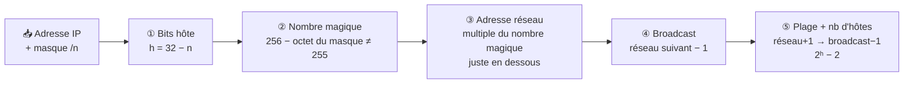

# Module 3 : L'adressage IPv4

*Cours : [Cours 1 - Bases des réseaux](../index.md)*

## 🎯 Objectif du module

À la fin de ce module, tu sais :

- lire une adresse IPv4 et la **découper** en partie réseau / partie hôte grâce au masque ;
- reconnaître la **classe** d'une adresse et savoir si elle est **privée**, **publique** ou **APIPA** ;
- passer d'un masque décimal à la notation **CIDR** (`/24`, `/26`…) et inversement ;
- calculer, pour n'importe quelle adresse, **l'adresse réseau, le broadcast, la plage d'hôtes et le nombre d'hôtes** ;
- **découper** un réseau en sous-réseaux.

## 🖼️ Résumé visuel

**Une adresse IPv4 = 4 octets. Le masque dit où s'arrête le réseau et où commence l'hôte.**

<div class="tssr-ip">
  <div class="tssr-ip-grid">
    <span class="tssr-ip-label">Adresse IP</span>
    <span class="tssr-ip-oct is-net"><b>192</b><code>11000000</code></span>
    <span class="tssr-ip-oct is-net"><b>168</b><code>10101000</code></span>
    <span class="tssr-ip-oct is-net"><b>1</b><code>00000001</code></span>
    <span class="tssr-ip-oct is-host"><b>10</b><code>00001010</code></span>
    <span class="tssr-ip-label">Masque /24</span>
    <span class="tssr-ip-oct is-mask"><b>255</b><code>11111111</code></span>
    <span class="tssr-ip-oct is-mask"><b>255</b><code>11111111</code></span>
    <span class="tssr-ip-oct is-mask"><b>255</b><code>11111111</code></span>
    <span class="tssr-ip-oct is-zero"><b>0</b><code>00000000</code></span>
    <span class="tssr-ip-label"></span>
    <span class="tssr-ip-brace is-net">◀ Partie <b>réseau</b> : 24 bits (masque à 1) ▶</span>
    <span class="tssr-ip-brace is-host">Partie <b>hôte</b> : 8 bits</span>
  </div>
  <div class="tssr-ip-results">
    <div><small>Adresse réseau</small><b>192.168.1.<u>0</u></b><span>hôte tout à 0</span></div>
    <div><small>1er hôte → dernier hôte</small><b>.1 → .254</b><span>les adresses attribuables</span></div>
    <div><small>Broadcast</small><b>192.168.1.<u>255</u></b><span>hôte tout à 1</span></div>
    <div><small>Hôtes utilisables</small><b>2⁸ − 2 = 254</b><span>2<sup>bits hôte</sup> − 2</span></div>
  </div>
</div>

**La méthode de calcul, toujours la même :**



## 📖 Cours consolidé

### 1. Structure d'une adresse IPv4

Une adresse **IPv4** fait **32 bits**, découpés en **4 octets** de 8 bits. On l'écrit en décimal, séparée par des points : chaque octet vaut de **0 à 255**.

```
Adresse   :    192    .   168    .    1     .    10
Binaire   :  11000000 . 10101000 . 00000001 . 00001010
```

Elle contient toujours **deux parties** :

| Partie | Rôle | Analogie |
|---|---|---|
| **ID réseau** | Identifie le réseau (le « quartier ») | Le nom de la rue |
| **ID hôte** | Identifie une machine dans ce réseau | Le numéro de la maison |

📌 Pour communiquer, une machine a besoin de **son adresse IP + son masque** : c'est le masque qui indique où s'arrête la rue et où commence le numéro.

---

### 2. Les classes d'adresses (historique)

Avant CIDR, la **classe** d'une adresse fixait la taille du réseau. On la reconnaît au **premier octet** :

| Classe | 1er octet | Masque par défaut | Réseau / hôte | Usage | Exemple |
|---|---|---|---|---|---|
| **A** | 1 à 126 | 255.0.0.0 (/8) | 8 / 24 bits | Très grands réseaux | 10.0.0.1 |
| **B** | 128 à 191 | 255.255.0.0 (/16) | 16 / 16 bits | Réseaux moyens | 172.16.0.1 |
| **C** | 192 à 223 | 255.255.255.0 (/24) | 24 / 8 bits | Petits réseaux (LAN) | 192.168.1.1 |
| **D** | 224 à 239 | — | — | Multicast (groupes) | 224.0.0.1 |
| **E** | 240 à 255 | — | — | Expérimental | 240.0.0.1 |

📌 La classe A couvre en théorie 0 à 127, mais **0** (« ce réseau ») et **127** (boucle locale) sont réservés : on retient donc **1 à 126**.

#### Les adresses spéciales

| Adresse | Rôle | Exemple |
|---|---|---|
| **Boucle locale** (localhost) | La machine se parle à elle-même (tests) | 127.0.0.1 |
| **Adresse réseau** | Désigne le réseau lui-même : bits hôte **tous à 0** | 192.168.1.0 |
| **Broadcast** | Message à toutes les machines du réseau : bits hôte **tous à 1** | 192.168.1.255 |

⚠️ L'adresse réseau et le broadcast **ne s'attribuent jamais à une machine** : c'est pour ça qu'on retire toujours **2** au nombre d'adresses.

---

### 3. Le masque de sous-réseau et le ET logique

Le **masque** est une suite de bits **1** (partie réseau) suivie de bits **0** (partie hôte). Pour trouver l'adresse réseau, on fait un **ET logique (AND)** bit à bit entre l'IP et le masque : le résultat vaut 1 **seulement si les deux bits valent 1**.

| ET | 0 | 1 |
|---|---|---|
| **0** | 0 | 0 |
| **1** | 0 | 1 |

**Exemple : 192.168.1.10 /24**

```
Adresse IP :  11000000.10101000.00000001.00001010   (192.168.1.10)
Masque /24 :  11111111.11111111.11111111.00000000   (255.255.255.0)
              ─────────────────────────────────── ET
ID réseau  :  11000000.10101000.00000001.00000000   →  192.168.1.0
```

💡 **Astuce** : là où le masque vaut **255**, on recopie l'octet de l'IP ; là où il vaut **0**, on met 0. Le calcul binaire n'est nécessaire que pour l'octet « coupé » (ni 255 ni 0).

---

### 4. La notation CIDR

La notation **CIDR** écrit le masque sous la forme **/n** = **nombre de bits à 1** dans le masque. `192.168.1.0/24` = 24 bits de réseau = masque `255.255.255.0`.

**Pourquoi ?** Les classes donnaient des blocs de taille fixe (une entreprise qui voulait 300 adresses devait prendre une classe B entière de 65 536 adresses). CIDR permet de tailler un réseau **à la taille exacte** du besoin.

#### Table de correspondance à connaître

| CIDR | Masque décimal | Bits hôte | Adresses | **Hôtes utilisables** |
|---|---|---|---|---|
| /8 | 255.0.0.0 | 24 | 16 777 216 | 16 777 214 |
| /16 | 255.255.0.0 | 16 | 65 536 | 65 534 |
| /20 | 255.255.240.0 | 12 | 4 096 | 4 094 |
| /22 | 255.255.252.0 | 10 | 1 024 | 1 022 |
| **/24** | 255.255.255.0 | 8 | 256 | **254** |
| /25 | 255.255.255.128 | 7 | 128 | 126 |
| **/26** | 255.255.255.192 | 6 | 64 | **62** |
| /27 | 255.255.255.224 | 5 | 32 | 30 |
| **/28** | 255.255.255.240 | 4 | 16 | **14** |
| /29 | 255.255.255.248 | 3 | 8 | 6 |
| /30 | 255.255.255.252 | 2 | 4 | 2 |

💡 Les valeurs possibles d'un octet de masque sont toujours : **128, 192, 224, 240, 248, 252, 254, 255** (on ajoute un bit à 1 à chaque fois : 128, +64, +32, +16…).

---

### 5. La méthode rapide : le « nombre magique »

Pour trouver réseau, broadcast et plage **sans tout convertir en binaire** :

1. **Bits hôte** : h = 32 − n. Nombre d'hôtes = **2ʰ − 2**.
2. **Octet intéressant** : celui où le masque n'est ni 255 ni 0.
3. **Nombre magique** = **256 − valeur du masque** dans cet octet. Les réseaux « sautent » de cette valeur : 0, magique, 2× magique…
4. **Adresse réseau** = le multiple du nombre magique **juste en dessous ou égal** à l'octet de l'IP.
5. **Broadcast** = (réseau suivant) − 1. **Plage** = réseau + 1 → broadcast − 1.

**Exemple 1 : 192.168.10.77 /26**

| Étape | Calcul | Résultat |
|---|---|---|
| Masque | /26 = 255.255.255.**192** | octet intéressant : le 4ᵉ |
| Nombre magique | 256 − 192 | **64** → réseaux en .0, .64, .128, .192 |
| Adresse réseau | 77 est entre 64 et 127 | **192.168.10.64** |
| Broadcast | réseau suivant (.128) − 1 | **192.168.10.127** |
| Plage d'hôtes | .65 → .126 | **192.168.10.65 → 192.168.10.126** |
| Nb d'hôtes | 32 − 26 = 6 bits → 2⁶ − 2 | **62** |

**Exemple 2 : 172.16.45.10 /20** (l'octet coupé est le 3ᵉ)

| Étape | Calcul | Résultat |
|---|---|---|
| Masque | /20 = 255.255.**240**.0 | octet intéressant : le 3ᵉ |
| Nombre magique | 256 − 240 | **16** → 0, 16, 32, 48… |
| Adresse réseau | 45 est entre 32 et 47 | **172.16.32.0** |
| Broadcast | réseau suivant (172.16.48.0) − 1 | **172.16.47.255** |
| Plage d'hôtes | | **172.16.32.1 → 172.16.47.254** |
| Nb d'hôtes | 32 − 20 = 12 bits → 2¹² − 2 | **4 094** |

---

### 6. Le sous-réseautage (subnetting)

**Découper** un réseau en plusieurs réseaux plus petits, en **empruntant des bits à la partie hôte** pour les donner à la partie réseau.

**Pourquoi ?** Moins d'adresses gaspillées, des **broadcasts plus petits** (meilleures performances) et des réseaux **séparés** (sécurité : compta d'un côté, Wi-Fi invités de l'autre).

| Formule | Donne | Avec |
|---|---|---|
| **2ⁿ** | le nombre de **sous-réseaux** | n = bits empruntés |
| **2ʰ − 2** | le nombre d'**hôtes** par sous-réseau | h = bits hôte restants |

**Exemple : découper 192.168.1.0/24 en 4 sous-réseaux**

Il faut 4 = 2² sous-réseaux → on emprunte **2 bits** → **/26** (masque 255.255.255.192, nombre magique 64), chaque sous-réseau a 2⁶ − 2 = **62 hôtes**.

| Sous-réseau | Adresse réseau | Plage d'hôtes | Broadcast |
|---|---|---|---|
| 1 | 192.168.1.0/26 | .1 → .62 | .63 |
| 2 | 192.168.1.64/26 | .65 → .126 | .127 |
| 3 | 192.168.1.128/26 | .129 → .190 | .191 |
| 4 | 192.168.1.192/26 | .193 → .254 | .255 |

📌 Plus on emprunte de bits, plus on a de sous-réseaux… mais **plus ils sont petits**. Avec 1 bit (/25) : 2 réseaux de 126 hôtes ; avec 2 bits (/26) : 4 de 62 ; avec 3 bits (/27) : 8 de 30.

---

### 7. Adresses privées, publiques et APIPA

#### Les adresses privées (RFC 1918)

Réservées aux réseaux internes (maison, entreprise), **jamais routées sur Internet**. Tout le reste (hors adresses spéciales) est **public**.

| Plage privée | CIDR | Classe | Usage typique |
|---|---|---|---|
| **10**.0.0.0 → 10.255.255.255 | 10.0.0.0/8 | A | Grandes entreprises |
| **172.16**.0.0 → **172.31**.255.255 | 172.16.0.0/12 | B | Réseaux moyens |
| **192.168**.0.0 → 192.168.255.255 | 192.168.0.0/16 | C | Maison, petites entreprises |

Pour aller sur Internet, une adresse privée passe par le **NAT** du routeur, qui la remplace par **l'adresse publique** fournie par le FAI. C'est ce qui permet à tous les appareils d'une maison (192.168.1.x) de partager **une seule** adresse publique.

⚠️ Piège classique : **172.32.0.1 est publique** ! La plage privée s'arrête à 172.**31**.

#### Les adresses APIPA (169.254.x.x)

Quand un poste **ne reçoit pas de réponse du serveur DHCP**, il s'attribue tout seul une adresse **APIPA** dans **169.254.0.0/16** (après avoir vérifié par ARP qu'elle est libre).

| | |
|---|---|
| **Plage** | 169.254.0.0 → 169.254.255.255 |
| **Masque** | 255.255.0.0 (/16) |
| **Ce qui marche** | Communication avec les autres postes APIPA du réseau local |
| **Ce qui ne marche pas** | Internet et les autres réseaux (non routable) |

🩺 **Réflexe de diagnostic** : un `ipconfig` qui affiche **169.254.x.x** = **problème de DHCP** (serveur en panne, câble débranché, mauvais VLAN…).

## ✅ Points clés à retenir

- IPv4 = **32 bits = 4 octets** (0 à 255), toujours **ID réseau + ID hôte**.
- Classes (1er octet) : **A 1–126 (/8)**, **B 128–191 (/16)**, **C 192–223 (/24)**, D multicast, E expérimental ; **127 = boucle locale**.
- **Adresse réseau** = hôte tout à 0 ; **broadcast** = hôte tout à 1 → jamais attribuées, d'où le **− 2**.
- **ID réseau = IP ET masque** ; astuce : 255 → on recopie, 0 → on met 0.
- **/n** = nombre de bits à 1 du masque ; hôtes utilisables = **2^(32 − n) − 2**.
- **Nombre magique = 256 − octet du masque** : il donne le pas entre deux réseaux.
- Subnetting : **2ⁿ** sous-réseaux (bits empruntés), **2ʰ − 2** hôtes (bits restants).
- Privées : **10/8, 172.16/12, 192.168/16** → NAT pour sortir ; **169.254.x.x = DHCP injoignable**.

## 📝 Fiche de révision

### 🧠 Les 3 choses à savoir par cœur

| | |
|---|---|
| **Classes** | **A** 1–126 → /8 · **B** 128–191 → /16 · **C** 192–223 → /24 |
| **Privées** | **10**.x.x.x · **172.16** à **172.31**.x.x · **192.168**.x.x |
| **Spéciales** | **127.0.0.1** boucle locale · **169.254.x.x** APIPA (pas de DHCP) |

### 📏 Le masque en un coup d'œil

| CIDR | /24 | /25 | /26 | /27 | /28 | /29 | /30 |
|---|---|---|---|---|---|---|---|
| **Dernier octet du masque** | 0 | 128 | 192 | 224 | 240 | 248 | 252 |
| **Nombre magique** (256 − masque) | 256 | 128 | 64 | 32 | 16 | 8 | 4 |
| **Hôtes utilisables** | 254 | 126 | 62 | 30 | 14 | 6 | 2 |

💡 Pour retrouver la ligne « hôtes » : **nombre magique − 2**.

### 🛠️ La méthode en 5 étapes (exemple : 10.0.0.200 /27)

| # | Je cherche… | Je calcule | Exemple |
|---|---|---|---|
| ① | Le masque | /27 → 255.255.255.**224** | 255.255.255.224 |
| ② | Le nombre magique | 256 − 224 | **32** → 0, 32, 64… 192, 224 |
| ③ | L'adresse réseau | multiple de 32 ≤ 200 | **10.0.0.192** |
| ④ | Le broadcast | réseau suivant (224) − 1 | **10.0.0.223** |
| ⑤ | La plage et le nombre d'hôtes | réseau + 1 → broadcast − 1 ; 2⁵ − 2 | **.193 → .222**, **30 hôtes** |

### ⚠️ Les pièges

- Oublier le **− 2** : un /24 a 256 adresses mais **254 hôtes**.
- **172.32.x.x est publique** (le privé s'arrête à 172.31).
- **127.x.x.x** n'est pas de la classe A utilisable : c'est la boucle locale.
- **Masque ≠ CIDR** : 255.255.255.192 = /26 (pas /192).
- **169.254.x.x** n'est pas une « vraie » config : c'est le signe d'un DHCP absent.

### ✏️ Entraîne-toi (clique pour voir la correction)

??? question "1. 192.168.5.130 /25 : réseau, broadcast, plage, nb d'hôtes ?"
    /25 → masque 255.255.255.**128**, nombre magique **128** → réseaux en .0 et .128.

    - 130 ≥ 128 → **réseau 192.168.5.128**
    - **Broadcast 192.168.5.255**
    - **Plage .129 → .254**
    - 2⁷ − 2 = **126 hôtes**

??? question "2. 10.1.1.50 /28 : réseau, broadcast, plage, nb d'hôtes ?"
    /28 → masque 255.255.255.**240**, nombre magique **16** → 0, 16, 32, **48**, 64…

    - 48 ≤ 50 < 64 → **réseau 10.1.1.48**
    - **Broadcast 10.1.1.63**
    - **Plage .49 → .62**
    - 2⁴ − 2 = **14 hôtes**

??? question "3. Privée, publique ou spéciale : 172.20.3.4 · 172.40.3.4 · 169.254.10.1 · 8.8.8.8 ?"
    - **172.20.3.4** → privée (entre 172.16 et 172.31)
    - **172.40.3.4** → publique (au-delà de 172.31)
    - **169.254.10.1** → APIPA : le poste n'a pas eu de réponse DHCP
    - **8.8.8.8** → publique (DNS de Google)

??? question "4. Je veux découper 192.168.1.0/24 en 8 sous-réseaux : quel masque, combien d'hôtes ?"
    8 = 2³ → on emprunte **3 bits** → **/27** (255.255.255.224).

    Nombre magique 32 → réseaux en .0, .32, .64, .96, .128, .160, .192, .224, chacun avec 2⁵ − 2 = **30 hôtes**.

## 🧠 Quiz — entraîne-toi

<div id="quiz-cours-01-bases-des-reseaux-module-3-l-adressage-ipv4"></div>

<script type="application/json" id="quiz-cours-01-bases-des-reseaux-module-3-l-adressage-ipv4-data">
[
  {
    "question": "Sur combien de bits une adresse IPv4 est-elle codée ?",
    "options": [
      "32 bits",
      "16 bits",
      "64 bits",
      "128 bits"
    ],
    "correctIndex": 0,
    "explanation": "Une adresse IPv4 est codée sur 32 bits, répartis en 4 octets de 8 bits chacun, ce qui permet 256 valeurs possibles (0 à 255) par octet."
  },
  {
    "question": "À quelle classe appartient l'adresse IP 172.16.0.1 ?",
    "options": [
      "Classe A",
      "Classe B",
      "Classe C",
      "Classe D"
    ],
    "correctIndex": 1,
    "explanation": "Une adresse est de classe B lorsque son premier octet est compris entre 128 et 191 ; 172 se situe dans cette plage."
  },
  {
    "question": "Quelle plage de valeurs pour le premier octet caractérise une adresse de classe C ?",
    "options": [
      "0 à 127",
      "128 à 191",
      "192 à 223",
      "224 à 239"
    ],
    "correctIndex": 2,
    "explanation": "Les adresses de classe C ont un premier octet compris entre 192 et 223 ; les trois premiers octets identifient le réseau et le dernier octet identifie l'hôte."
  },
  {
    "question": "À quoi sert l'adresse 127.0.0.1 ?",
    "options": [
      "C'est une adresse de diffusion pour tout le réseau local",
      "C'est une adresse réservée au multicast",
      "C'est l'adresse publique par défaut d'un routeur",
      "C'est l'adresse de boucle locale (localhost), utilisée pour les tests internes à l'appareil"
    ],
    "correctIndex": 3,
    "explanation": "127.0.0.1 est l'adresse de boucle locale (localhost) : elle permet à un appareil de communiquer avec lui-même, notamment pour des tests, sans passer par le réseau physique."
  },
  {
    "question": "Que permet l'adresse de diffusion (broadcast) d'un réseau, comme 192.168.1.255 pour un réseau de classe C ?",
    "options": [
      "Envoyer un message à tous les appareils du réseau simultanément",
      "Identifier un hôte unique sur le réseau",
      "Chiffrer les communications du réseau",
      "Router les paquets vers Internet"
    ],
    "correctIndex": 0,
    "explanation": "L'adresse de diffusion permet d'envoyer un message à l'ensemble des appareils connectés à un réseau, contrairement à une adresse d'hôte qui cible un seul appareil."
  },
  {
    "question": "Dans la notation CIDR, que signifie le nombre après le slash (par exemple /24 dans 192.168.1.0/24) ?",
    "options": [
      "Le nombre total d'hôtes disponibles sur le réseau",
      "Le nombre de bits réservés à l'identification de la partie réseau",
      "Le numéro de la classe d'adresse utilisée",
      "Le nombre d'octets composant l'adresse IP"
    ],
    "correctIndex": 1,
    "explanation": "Le chiffre après le slash indique combien de bits, en partant de la gauche, sont dédiés à la partie réseau de l'adresse ; les bits restants servent à identifier les hôtes."
  },
  {
    "question": "À quel masque de sous-réseau décimal correspond la notation CIDR /24 ?",
    "options": [
      "255.255.0.0",
      "255.0.0.0",
      "255.255.255.0",
      "255.255.255.192"
    ],
    "correctIndex": 2,
    "explanation": "/24 signifie que les 24 premiers bits sont à 1, ce qui correspond aux trois premiers octets à 255 et au dernier octet à 0, soit 255.255.255.0."
  },
  {
    "question": "Quelle opération logique est utilisée entre l'adresse IP et le masque de sous-réseau pour déterminer l'ID réseau ?",
    "options": [
      "L'opération OR",
      "L'opération XOR",
      "L'opération NOT",
      "L'opération AND"
    ],
    "correctIndex": 3,
    "explanation": "L'opération AND, bit à bit, entre l'adresse IP et le masque de sous-réseau permet d'obtenir l'identifiant du réseau : le résultat ne vaut 1 que si les deux bits comparés valent 1."
  },
  {
    "question": "Pour l'adresse IP 192.168.1.10 avec un masque /24, quel est l'ID réseau obtenu ?",
    "options": [
      "192.168.1.0",
      "192.168.1.10",
      "192.168.0.0",
      "192.168.1.255"
    ],
    "correctIndex": 0,
    "explanation": "Avec un masque /24, les trois premiers octets définissent le réseau et le dernier octet est mis à zéro pour obtenir l'ID réseau, soit 192.168.1.0."
  },
  {
    "question": "Quelle plage d'adresses privées correspond à la classe A selon la RFC 1918 ?",
    "options": [
      "172.16.0.0 à 172.31.255.255",
      "10.0.0.0 à 10.255.255.255",
      "192.168.0.0 à 192.168.255.255",
      "169.254.0.0 à 169.254.255.255"
    ],
    "correctIndex": 1,
    "explanation": "La RFC 1918 réserve la plage 10.0.0.0 à 10.255.255.255 (préfixe /8) comme plage privée de classe A, souvent utilisée dans les grandes entreprises nécessitant de nombreux sous-réseaux."
  },
  {
    "question": "Pourquoi une adresse IP privée ne peut-elle pas être atteinte directement depuis Internet ?",
    "options": [
      "Parce qu'elle est automatiquement chiffrée par le pare-feu",
      "Parce qu'elle change toutes les 24 heures",
      "Parce qu'elle n'est pas routable sur Internet et nécessite une traduction NAT pour communiquer vers l'extérieur",
      "Parce qu'elle n'est valable que pour les connexions Wi-Fi"
    ],
    "correctIndex": 2,
    "explanation": "Les adresses privées ne sont pas routées sur Internet ; un appareil qui en possède une doit passer par le NAT (Network Address Translation) de son routeur, qui la traduit en adresse IP publique pour communiquer vers l'extérieur."
  },
  {
    "question": "Dans quel contexte un appareil s'attribue-t-il automatiquement une adresse APIPA ?",
    "options": [
      "Lorsqu'il détecte une attaque réseau",
      "Lorsqu'il se connecte à Internet pour la première fois",
      "Lorsqu'un administrateur configure une adresse statique",
      "Lorsqu'il ne parvient pas à obtenir d'adresse IP d'un serveur DHCP"
    ],
    "correctIndex": 3,
    "explanation": "APIPA (Automatic Private IP Addressing) permet à un appareil de s'auto-attribuer une adresse dans la plage réservée 169.254.0.0/16 lorsqu'aucun serveur DHCP ne répond, afin de maintenir une communication locale."
  },
  {
    "question": "Quelle est la plage d'adresses réservée au mécanisme APIPA ?",
    "options": [
      "169.254.0.0 à 169.254.255.255",
      "127.0.0.0 à 127.255.255.255",
      "10.0.0.0 à 10.255.255.255",
      "192.168.0.0 à 192.168.255.255"
    ],
    "correctIndex": 0,
    "explanation": "APIPA choisit une adresse dans la plage réservée 169.254.0.0 à 169.254.255.255, avec un masque de sous-réseau 255.255.0.0, lorsqu'aucune réponse DHCP n'est reçue."
  },
  {
    "question": "Un appareil disposant uniquement d'une adresse APIPA peut-il accéder à Internet ?",
    "options": [
      "Oui, sans aucune restriction",
      "Non, car les adresses APIPA ne sont pas routables au-delà du réseau local",
      "Oui, mais uniquement en HTTPS",
      "Oui, à condition d'utiliser un VPN"
    ],
    "correctIndex": 1,
    "explanation": "Les adresses APIPA permettent uniquement la communication locale entre appareils du même réseau ; elles ne sont pas routables, donc aucun accès à Internet ou à d'autres réseaux externes n'est possible."
  },
  {
    "question": "Que permet le sous-réseautage (subnetting) dans un réseau IPv4 ?",
    "options": [
      "Augmenter automatiquement le nombre d'adresses IP publiques disponibles",
      "Remplacer le protocole IPv4 par IPv6",
      "Diviser un réseau en plusieurs sous-réseaux plus petits pour optimiser l'adressage, la sécurité et les performances",
      "Chiffrer l'ensemble du trafic réseau"
    ],
    "correctIndex": 2,
    "explanation": "Le sous-réseautage divise un grand réseau en sous-réseaux plus petits, ce qui optimise l'utilisation des adresses, réduit la taille des domaines de diffusion et facilite le contrôle de la sécurité entre segments."
  },
  {
    "question": "Dans le calcul du sous-réseautage, comment crée-t-on des sous-réseaux supplémentaires à partir d'un réseau existant ?",
    "options": [
      "En empruntant des bits à la partie réseau pour les affecter à la partie hôte",
      "En ajoutant un cinquième octet à l'adresse IP",
      "En dupliquant l'adresse réseau existante",
      "En empruntant des bits à la partie hôte pour les affecter à la partie réseau"
    ],
    "correctIndex": 3,
    "explanation": "Créer des sous-réseaux consiste à « emprunter » un ou plusieurs bits de la partie hôte du masque pour les utiliser dans l'identification de sous-réseaux distincts, ce qui augmente le nombre de réseaux au détriment du nombre d'hôtes par réseau."
  },
  {
    "question": "Avec un masque /26 sur un réseau 192.168.1.0, combien de sous-réseaux et d'hôtes utilisables par sous-réseau obtient-on ?",
    "options": [
      "4 sous-réseaux de 62 hôtes chacun",
      "2 sous-réseaux de 126 hôtes chacun",
      "8 sous-réseaux de 30 hôtes chacun",
      "4 sous-réseaux de 64 hôtes chacun"
    ],
    "correctIndex": 0,
    "explanation": "Un masque /26 emprunte 2 bits à la partie hôte du /24 d'origine, ce qui donne 2² = 4 sous-réseaux, chacun disposant de 2⁶ - 2 = 62 hôtes utilisables (on retranche l'adresse réseau et l'adresse de diffusion)."
  },
  {
    "question": "Pourquoi retranche-t-on systématiquement 2 adresses au nombre total d'adresses d'un sous-réseau pour obtenir le nombre d'hôtes utilisables ?",
    "options": [
      "Parce que deux adresses sont toujours réservées au serveur DHCP",
      "Parce que la première adresse identifie le réseau et la dernière sert d'adresse de diffusion, toutes deux non attribuables à un hôte",
      "Parce que le masque de sous-réseau occupe deux adresses supplémentaires",
      "Parce que deux adresses sont réservées aux adresses APIPA"
    ],
    "correctIndex": 1,
    "explanation": "Dans chaque sous-réseau, la première adresse désigne le réseau lui-même et la dernière est l'adresse de diffusion (broadcast) ; ces deux adresses ne peuvent pas être attribuées à un hôte, d'où la formule 2^n - 2."
  },
  {
    "question": "Pourquoi la notation CIDR a-t-elle été introduite en remplacement de l'adressage par classes traditionnel (A, B, C) ?",
    "options": [
      "Pour remplacer définitivement les adresses IPv4 par des adresses IPv6",
      "Pour supprimer la nécessité d'un masque de sous-réseau",
      "Pour permettre un découpage plus flexible des réseaux et limiter le gaspillage d'adresses IPv4",
      "Pour imposer un nombre fixe de 256 adresses par réseau"
    ],
    "correctIndex": 2,
    "explanation": "L'adressage par classes attribuait des blocs de taille fixe, ce qui gaspillait souvent des adresses. La notation CIDR permet de définir des sous-réseaux de tailles adaptées aux besoins réels, optimisant ainsi l'espace d'adressage IPv4."
  },
  {
    "question": "Quels sont les deux éléments dont un hôte a besoin pour calculer son adresse de réseau logique et son adresse de diffusion ?",
    "options": [
      "Son adresse MAC et son adresse IP",
      "Son masque de sous-réseau et l'adresse de sa passerelle par défaut",
      "Son adresse IP et l'adresse du serveur DNS",
      "Son adresse IP et son masque de sous-réseau"
    ],
    "correctIndex": 3,
    "explanation": "À partir de son adresse IP et de son masque de sous-réseau, un hôte peut déterminer, via une opération AND, son adresse de réseau logique ainsi que son adresse de diffusion."
  },
  {
    "question": "Pour l'adresse 192.168.10.77 /26, quelle est l'adresse réseau ?",
    "options": [
      "192.168.10.0",
      "192.168.10.64",
      "192.168.10.77",
      "192.168.10.128"
    ],
    "correctIndex": 1,
    "explanation": "/26 → masque 255.255.255.192, nombre magique 256 − 192 = 64 : les réseaux commencent en .0, .64, .128, .192. 77 est entre 64 et 127, donc le réseau est 192.168.10.64."
  },
  {
    "question": "Quelle est l'adresse de broadcast du réseau 192.168.10.64 /26 ?",
    "options": [
      "192.168.10.255",
      "192.168.10.126",
      "192.168.10.127",
      "192.168.10.128"
    ],
    "correctIndex": 2,
    "explanation": "Le réseau suivant commence en .128 (64 + 64) ; le broadcast est l'adresse juste avant : 192.168.10.127. La plage d'hôtes va donc de .65 à .126."
  },
  {
    "question": "L'adresse 172.32.10.5 est-elle privée ?",
    "options": [
      "Oui, elle fait partie de 172.16.0.0/12",
      "Non, la plage privée s'arrête à 172.31.255.255",
      "Oui, toutes les adresses en 172 sont privées",
      "Non, c'est une adresse APIPA"
    ],
    "correctIndex": 1,
    "explanation": "La plage privée de classe B va de 172.16.0.0 à 172.31.255.255. 172.32.x.x est donc une adresse publique — un piège fréquent."
  }
]
</script>

<script>
  document.addEventListener("DOMContentLoaded", function () {
    TSSRQuiz.init({
      containerId: "quiz-cours-01-bases-des-reseaux-module-3-l-adressage-ipv4",
      dataId: "quiz-cours-01-bases-des-reseaux-module-3-l-adressage-ipv4-data",
    });
  });
</script>
