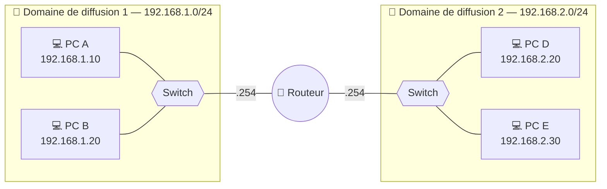
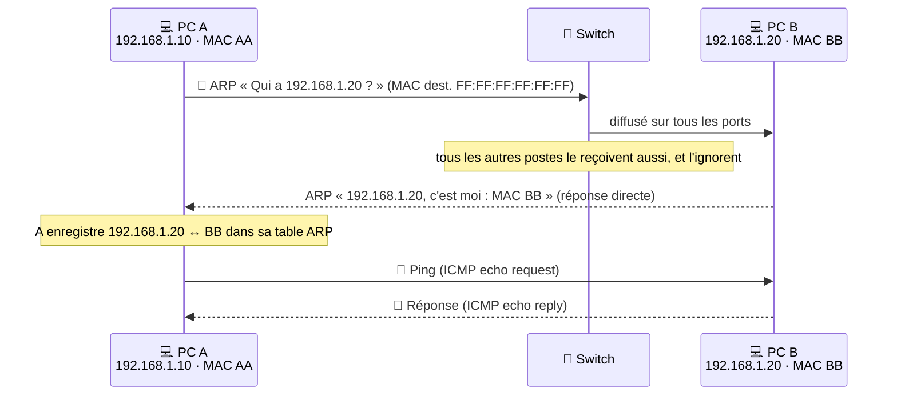

# Module 4 : La communication

*Cours : [Cours 1 - Bases des réseaux](../index.md)*

## 🎯 Objectif du module

À la fin de ce module, tu sais :

- expliquer ce qu'est un **domaine de diffusion** et quel équipement le limite ;
- dérouler **pas à pas** un ping entre deux postes du **même réseau** (ARP) ;
- dérouler un ping entre deux **réseaux différents** (passerelle, routeur) et dire **ce qui change à chaque saut** ;
- lire une **table de routage** et distinguer routage **statique** / **dynamique** ;
- **regrouper** plusieurs réseaux en un **sur-réseau** (supernetting).

## 🖼️ Résumé visuel

**① Le routeur coupe le réseau en domaines de diffusion**



Un broadcast de A atteint B (même switch), **mais jamais D ni E** : le routeur ne le laisse pas passer.

**② Le réflexe d'un poste avant d'envoyer un paquet**


**③ Ce qui change à chaque saut : les MAC. Ce qui ne change jamais : les IP.**

<div class="tssr-hop">
  <div class="tssr-hop-path">
    <span class="tssr-hop-node">💻 <b>PC A</b><small>192.168.1.10<br/>MAC AA</small></span>
    <span class="tssr-hop-link">→</span>
    <span class="tssr-hop-node is-router">🛜 <b>Routeur</b><small>e0 : 192.168.1.254 · MAC R1<br/>e1 : 192.168.2.254 · MAC R2</small></span>
    <span class="tssr-hop-link">→</span>
    <span class="tssr-hop-node">💻 <b>PC D</b><small>192.168.2.20<br/>MAC DD</small></span>
  </div>
  <div class="tssr-hop-frames">
    <div class="tssr-hop-frame">
      <small>Trame sur le réseau 1 (A → routeur)</small>
      <span class="is-mac">MAC : <b>AA → R1</b></span>
      <span class="is-ip">IP : <b>192.168.1.10 → 192.168.2.20</b></span>
    </div>
    <div class="tssr-hop-frame">
      <small>Trame sur le réseau 2 (routeur → D)</small>
      <span class="is-mac">MAC : <b>R2 → DD</b> <em>réécrites</em></span>
      <span class="is-ip">IP : <b>192.168.1.10 → 192.168.2.20</b> <em>identiques</em></span>
    </div>
  </div>
</div>

## 📖 Cours consolidé

### 1. Le domaine de diffusion (broadcast domain)

Un **domaine de diffusion** est la zone du réseau dans laquelle un message de **diffusion (broadcast)** est reçu par **toutes** les machines. C'est l'équivalent d'une annonce au haut-parleur : tout le monde dans la pièce l'entend, même si elle ne le concerne pas.

| Couche | Adresse de broadcast | Exemple |
|---|---|---|
| **2** (Liaison) | MAC **`FF:FF:FF:FF:FF:FF`** | requête ARP |
| **3** (Réseau) | IP avec **tous les bits hôte à 1** | `192.168.1.255` pour 192.168.1.0/24 |

**Qui utilise le broadcast ?** Surtout **ARP** (« qui a cette IP ? ») et **DHCP** (« y a-t-il un serveur DHCP ? »).

#### Qui arrête (ou pas) le broadcast ?

| Équipement | Effet sur le broadcast |
|---|---|
| **Switch** | ❌ Le **propage** sur tous ses ports (du même VLAN) |
| **Routeur** | ✅ L'**arrête** : 1 interface de routeur = 1 domaine de diffusion |
| **VLAN** | ✅ **1 VLAN = 1 domaine** de diffusion, même sur un seul switch physique |

**Pourquoi c'est important ?** Plus le domaine est grand, plus chaque machine reçoit et traite de broadcasts inutiles → **perte de performances**. On **segmente** donc les réseaux avec des routeurs et des VLAN (meilleures performances et meilleure sécurité).

---

### 2. Communication dans le même réseau : ARP

**Situation** : A (`192.168.1.10/24`, MAC `AA`) fait un `ping 192.168.1.20` vers B (MAC `BB`).

| # | A se demande… | Réponse dans l'exemple |
|---|---|---|
| ① | Est-ce ma propre adresse (`127.0.0.1`) ? | Non → on continue |
| ② | Quel est mon réseau et celui de B ? (IP **ET** masque) | 192.168.1.10 → **192.168.1.0** · 192.168.1.20 → **192.168.1.0** |
| ③ | Sommes-nous dans le même réseau ? | **Oui** → envoi direct à B (sinon → passerelle, section 3) |
| ④ | Ma **table ARP** connaît-elle la MAC de B ? | Non → **requête ARP en broadcast**, le ping attend |
| ⑤ | B a-t-il répondu ? | Oui → table ARP mise à jour, **le ping part** (sinon : erreur, « hôte inaccessible ») |



#### Le contenu des messages ARP

| Message | MAC destination | MAC source | IP recherchée / cible | IP source |
|---|---|---|---|---|
| **Requête ARP** (broadcast) | `FF:FF:FF:FF:FF:FF` | AA | 192.168.1.20 | 192.168.1.10 |
| **Réponse ARP** (unicast) | AA | BB | 192.168.1.10 | 192.168.1.20 |

💡 Pour voir la table ARP de ton poste : `arp -a` (Windows et Linux).

---

### 3. Communication entre deux réseaux : la passerelle

**Situation** : A (`192.168.1.10/24`, passerelle `192.168.1.254`) fait un ping vers D (`192.168.2.20/24`, passerelle `192.168.2.254`).

#### Côté PC A

Même raisonnement que la section 2, mais à l'étape ③ : `192.168.1.0 ≠ 192.168.2.0` → **réseaux différents**. A n'envoie donc **pas** la trame à D mais à **sa passerelle** : il fait une requête ARP pour obtenir la **MAC de la passerelle** (R1), puis lui envoie le ping.

⚠️ La passerelle doit **toujours être dans le même réseau que le poste**. Sans passerelle configurée, A ne peut joindre que son propre réseau.

#### Côté routeur

| # | Le routeur… | Si non |
|---|---|---|
| ① | désencapsule jusqu'à la couche 3 et lit l'**IP de destination** (192.168.2.20) | — |
| ② | cherche ce réseau (192.168.2.0/24) dans sa **table de routage** | pas de route (ni route par défaut) → paquet détruit, erreur ICMP « destination inaccessible » |
| ③ | vérifie si ce réseau est **directement connecté** à une de ses interfaces | → transmet au **routeur suivant** |
| ④ | cherche la **MAC de D** dans sa table ARP (sinon requête ARP sur le réseau 2) | pas de réponse → erreur ICMP |
| ⑤ | **réécrit les MAC** de la trame (source R2, destination DD) et l'envoie à D | — |

📌 **À retenir absolument** : à chaque saut, les adresses **MAC** sont **réécrites** (elles ne servent que sur un segment local), alors que les adresses **IP source et destination ne changent jamais** de bout en bout (sauf NAT, vu plus tard).

---

### 4. Le routage

Le **routage** consiste à choisir le **chemin** d'un paquet à travers un ou plusieurs réseaux. Il se fait à la **couche 3** par les **routeurs**. Le switch, lui, ne fait que faire circuler les trames **dans** un réseau.

#### La table de routage

Pour chaque paquet, le routeur lit l'IP de destination et consulte sa **table de routage** :

| Réseau destination | Masque | Passerelle (prochain saut) | Interface de sortie |
|---|---|---|---|
| 192.168.1.0 | 255.255.255.0 | — (directement connecté) | e0 |
| 192.168.2.0 | 255.255.255.0 | — (directement connecté) | e1 |
| 10.0.0.0 | 255.0.0.0 | 192.168.2.253 | e1 |
| **0.0.0.0** | **0.0.0.0** | 203.0.113.1 | e2 (Internet) |

- **Directement connecté** : le réseau est branché sur une interface du routeur.
- **Passerelle** : le routeur voisin à qui confier le paquet.
- **0.0.0.0/0 = route par défaut** : « tout le reste », utilisée quand aucune autre route ne correspond (typiquement vers Internet).
- **Métrique** : le « coût » d'une route (nombre de sauts, débit…), pour choisir entre deux chemins.

#### Statique ou dynamique ?

| | Routage **statique** | Routage **dynamique** |
|---|---|---|
| **Comment** | Routes saisies **à la main** par l'admin | Routes apprises **automatiquement** entre routeurs |
| **Protocoles** | — | **RIP**, **OSPF**, **BGP** (Internet) |
| **➕** | Simple, prévisible, aucune ressource | S'adapte seul aux pannes et changements |
| **➖** | À refaire à la main à chaque changement | Plus complexe, consomme CPU et bande passante |
| **Idéal pour** | Petit réseau stable | Réseau moyen à grand, Internet |

---

### 5. Le sur-réseau (supernetting)

Le **sur-réseau** est l'**inverse du sous-réseau** : on **regroupe plusieurs réseaux contigus** en un seul, plus grand, avec un masque **plus court** (moins de bits à 1). But : **une seule ligne dans la table de routage** au lieu de plusieurs.

| Sans sur-réseau : 4 routes | Avec sur-réseau : 1 route |
|---|---|
| 192.168.0.0/24 · 192.168.1.0/24 · 192.168.2.0/24 · 192.168.3.0/24 | **192.168.0.0/22** (de 192.168.0.0 à 192.168.3.255) |

#### La méthode en 3 étapes

1. **Convertir en binaire** l'octet qui change entre les réseaux (ici le 3ᵉ : 0, 1, 2, 3).
2. **Compter les bits communs** en partant de la gauche.
3. **Nouveau masque** = bits des octets identiques + bits communs de l'octet qui change.

```
3ᵉ octet :   0 = 000000|00
             1 = 000000|01
             2 = 000000|10
             3 = 000000|11
                 └────┘ 6 bits communs

Masque = 8 + 8 (192.168 identiques) + 6  =  /22   →   192.168.0.0/22
```

💡 **Raccourci** : regrouper **2ⁿ** réseaux /24 contigus revient à retirer **n** bits au masque → 2 réseaux = /23, 4 réseaux = /22, 8 réseaux = /21.

⚠️ **Condition** : les réseaux doivent être **contigus** et le premier doit être **aligné** (un multiple du nombre de réseaux regroupés). Exemple : 192.168.**1**.0 et 192.168.**2**.0 ne forment **pas** un /23 (1 = 00000001 et 2 = 00000010 n'ont que 6 bits communs).

| ➕ Avantages | ➖ Limites |
|---|---|
| Tables de routage plus petites, routeurs plus rapides | On ne peut plus distinguer finement chaque réseau regroupé |
| Administration simplifiée | Réseaux obligatoirement contigus et alignés |
| Indispensable sur Internet (les FAI annoncent des blocs agrégés) | Risque de conflits si le plan d'adressage est mal pensé |

## ✅ Points clés à retenir

- **Broadcast** : MAC `FF:FF:FF:FF:FF:FF` / IP avec bits hôte à 1 ; reçu par **tout le domaine de diffusion**.
- Le **switch propage** le broadcast, le **routeur l'arrête** ; **1 VLAN = 1 domaine** de diffusion.
- Avant d'envoyer, un poste calcule **IP ET masque** : même réseau → envoi direct ; sinon → **passerelle**.
- **ARP** traduit une IP en MAC : requête en **broadcast**, réponse en **unicast**, résultat dans la **table ARP** (`arp -a`).
- À chaque saut, les **MAC changent**, les **IP restent identiques**.
- Le routeur consulte sa **table de routage** ; **0.0.0.0/0** = route par défaut ; **statique** (manuel) vs **dynamique** (RIP, OSPF, BGP).
- **Sur-réseau** = regrouper des réseaux contigus ; masque = nombre de **bits communs** (4 × /24 → /22).

## 📝 Fiche de révision

### 🧠 L'essentiel en un tableau

| Notion | En une phrase | Exemple |
|---|---|---|
| **Domaine de diffusion** | Zone où un broadcast est reçu par tous | Tous les PC d'un même VLAN |
| **Broadcast** | Message « à tout le monde » | MAC `FF:FF:FF:FF:FF:FF`, IP `192.168.1.255` |
| **ARP** | Trouve la MAC qui correspond à une IP | « Qui a 192.168.1.20 ? » → « MAC BB » |
| **Table ARP** | Mémoire des couples IP ↔ MAC | `arp -a` |
| **Passerelle** | Routeur à qui confier ce qui sort du réseau | `192.168.1.254` |
| **Table de routage** | Liste « pour aller vers tel réseau, passer par… » | `10.0.0.0/8 → 192.168.2.253` |
| **Route par défaut** | « Tout le reste » | `0.0.0.0/0` |
| **Sur-réseau** | Plusieurs réseaux contigus = 1 seule route | 4 × /24 → `/22` |

### 🔁 Le scénario du ping à savoir réciter

1. **IP ET masque** → même réseau ? Oui → cible = la machine ; non → cible = la **passerelle**.
2. **Table ARP** → MAC connue ? Non → **ARP en broadcast**, réponse en unicast.
3. **Envoi** de la trame. Si la cible était la passerelle, le routeur consulte sa **table de routage**…
4. …puis **réécrit les MAC** et transmet. Les **IP ne bougent pas**.

### ⚠️ Les pièges

- Le **switch ne coupe pas** le broadcast (seuls le routeur et les VLAN le font).
- La **réponse ARP n'est pas un broadcast** : elle est envoyée directement au demandeur.
- Une **passerelle hors du réseau du poste** ne fonctionne pas.
- Les **IP ne changent pas** d'un saut à l'autre ; ce sont les **MAC** qui changent.
- Un sur-réseau exige des réseaux **contigus et alignés** : 192.168.1.0 + 192.168.2.0 ≠ un /23.

### ✏️ Entraîne-toi (clique pour voir la correction)

??? question "1. Un réseau : 3 PC reliés à un switch, ce switch relié à un routeur, et le routeur relié à un 2ᵉ switch avec 2 PC. Combien de domaines de diffusion ?"
    **2 domaines de diffusion** : un par interface du routeur utilisée. Le switch ne crée pas de nouveau domaine, il le propage.

??? question "2. PC 192.168.1.10/24 → ping 192.168.1.50. Le poste envoie-t-il la trame à la passerelle ?"
    **Non.** 192.168.1.10 ET 255.255.255.0 = 192.168.1.0 et 192.168.1.50 ET 255.255.255.0 = 192.168.1.0 : **même réseau**, envoi direct après une éventuelle requête ARP pour la MAC de .50.

??? question "3. PC 192.168.1.10/24 → ping 8.8.8.8. Quelle MAC destination dans la première trame ?"
    8.8.8.8 n'est pas dans 192.168.1.0/24 → le poste envoie à sa **passerelle**. La MAC de destination est donc **celle de la passerelle** (pas celle de 8.8.8.8, qu'il ne connaîtra jamais). L'IP de destination reste **8.8.8.8**.

??? question "4. Quel sur-réseau regroupe 10.1.4.0/24, 10.1.5.0/24, 10.1.6.0/24 et 10.1.7.0/24 ?"
    3ᵉ octet : 4 = 000001**00**, 5 = 000001**01**, 6 = 000001**10**, 7 = 000001**11** → **6 bits communs**.

    Masque = 8 + 8 + 6 = **/22** → **10.1.4.0/22** (de 10.1.4.0 à 10.1.7.255). 4 est bien un multiple de 4 : le bloc est aligné.

??? question "5. Peut-on regrouper 172.16.8.0/24 et 172.16.9.0/24 ? Et 172.16.9.0/24 avec 172.16.10.0/24 ?"
    - 8 = 0000100**0**, 9 = 0000100**1** → 7 bits communs → **oui : 172.16.8.0/23**.
    - 9 = 000010**01**, 10 = 000010**10** → seulement 6 bits communs → un /22 inclurait aussi .8 et .11 → **non**, ce n'est pas un regroupement exact (bloc non aligné).

## 🧠 Quiz — entraîne-toi

<div id="quiz-cours-01-bases-des-reseaux-module-4-la-communication"></div>

<script type="application/json" id="quiz-cours-01-bases-des-reseaux-module-4-la-communication-data">
[
  {
    "question": "Qu'est-ce qu'un domaine de diffusion (broadcast domain) ?",
    "options": [
      "Une portion logique du réseau dans laquelle une trame de diffusion est transmise à tous les appareils connectés",
      "Une zone géographique couverte par un seul point d'accès Wi-Fi",
      "Un ensemble de règles de pare-feu appliquées à un VLAN",
      "Une plage d'adresses IP réservée aux serveurs DNS"
    ],
    "correctIndex": 0,
    "explanation": "Un domaine de diffusion est une portion logique du réseau où un message de broadcast est reçu par tous les appareils connectés, même si ce message ne leur est pas explicitement destiné."
  },
  {
    "question": "En IPv4, comment est composée une adresse de broadcast comme 192.168.1.255 pour un réseau /24 ?",
    "options": [
      "Tous les bits de la partie réseau sont positionnés à 1",
      "Tous les bits de la partie hôte sont positionnés à 1",
      "Tous les bits de l'adresse sont positionnés à 0",
      "Seul le premier octet est positionné à 255"
    ],
    "correctIndex": 1,
    "explanation": "L'adresse de broadcast est obtenue en mettant tous les bits de la partie hôte à 1 ; pour un réseau 192.168.1.0/24, cela donne 192.168.1.255."
  },
  {
    "question": "Quel équipement délimite les domaines de diffusion, empêchant les trames de broadcast de passer d'un réseau à un autre ?",
    "options": [
      "Le commutateur (switch)",
      "Le répéteur",
      "Le routeur",
      "Le modem"
    ],
    "correctIndex": 2,
    "explanation": "Un routeur ne transmet pas les trames de diffusion d'un réseau vers un autre, ce qui crée une frontière entre domaines de diffusion, contrairement à un commutateur qui les propage à tous les ports d'un même VLAN."
  },
  {
    "question": "Pourquoi la mise en place de VLANs permet-elle de limiter la taille des domaines de diffusion ?",
    "options": [
      "Parce que les VLANs chiffrent automatiquement le trafic de broadcast",
      "Parce que les VLANs suppriment tout trafic de diffusion",
      "Parce que les VLANs remplacent les adresses IP par des adresses MAC",
      "Parce que chaque VLAN constitue un domaine de diffusion distinct, même sur un même switch physique"
    ],
    "correctIndex": 3,
    "explanation": "Un VLAN segmente logiquement un réseau : chaque VLAN forme un domaine de diffusion indépendant, même si plusieurs VLANs partagent le même commutateur physique."
  },
  {
    "question": "À quelle couche du modèle OSI le domaine de diffusion opère-t-il principalement ?",
    "options": [
      "La couche 2 (Liaison de données)",
      "La couche 1 (Physique)",
      "La couche 3 (Réseau)",
      "La couche 4 (Transport)"
    ],
    "correctIndex": 0,
    "explanation": "Le domaine de diffusion opère principalement à la couche 2, les diffusions étant transmises à tous les appareils via l'adresse MAC de destination spéciale FF:FF:FF:FF:FF:FF."
  },
  {
    "question": "Quelle adresse MAC de destination est utilisée pour une trame de diffusion ?",
    "options": [
      "00:00:00:00:00:00",
      "FF:FF:FF:FF:FF:FF",
      "192.168.1.255",
      "AA:AA:AA:AA:AA:AA"
    ],
    "correctIndex": 1,
    "explanation": "Une trame de diffusion utilise l'adresse MAC de destination FF:FF:FF:FF:FF:FF, reconnue par tous les appareils du domaine de diffusion comme une adresse de broadcast."
  },
  {
    "question": "Pourquoi un domaine de diffusion trop grand peut-il poser un problème de performance ?",
    "options": [
      "Parce que les adresses IP privées s'épuisent plus rapidement",
      "Parce que le chiffrement des données devient impossible",
      "Parce que chaque appareil du domaine doit traiter les diffusions, même celles qui ne lui sont pas destinées",
      "Parce que le nombre de VLANs est automatiquement limité à un seul"
    ],
    "correctIndex": 2,
    "explanation": "Dans un domaine de diffusion étendu, chaque appareil doit traiter toutes les diffusions reçues, ce qui peut surcharger le réseau et les ressources des machines si le domaine n'est pas correctement segmenté."
  },
  {
    "question": "À quelle couche du modèle OSI le processus de routage se déroule-t-il principalement ?",
    "options": [
      "La couche 2 (Liaison de données)",
      "La couche 4 (Transport)",
      "La couche 7 (Application)",
      "La couche 3 (Réseau)"
    ],
    "correctIndex": 3,
    "explanation": "Le routage est un mécanisme de la couche 3 (Réseau), où les routeurs déterminent le meilleur chemin pour acheminer les paquets à travers un ou plusieurs réseaux."
  },
  {
    "question": "Que consulte un routeur pour décider du meilleur chemin à emprunter pour un paquet ?",
    "options": [
      "Sa table de routage",
      "Le cache ARP de l'expéditeur",
      "Le fichier hosts local",
      "La table des adresses MAC"
    ],
    "correctIndex": 0,
    "explanation": "La table de routage est une base de données interne au routeur contenant les réseaux connus, les passerelles disponibles et les métriques associées, sur laquelle il s'appuie pour choisir la meilleure route."
  },
  {
    "question": "Quelle est la différence essentielle entre le routage statique et le routage dynamique ?",
    "options": [
      "Le routage statique utilise uniquement IPv6, tandis que le routage dynamique utilise uniquement IPv4",
      "Le routage statique est configuré manuellement par un administrateur, tandis que le routage dynamique ajuste les routes automatiquement via des protocoles",
      "Le routage statique fonctionne uniquement sur les VLANs, tandis que le routage dynamique fonctionne uniquement sur les LAN",
      "Le routage statique est réservé aux grands réseaux, tandis que le routage dynamique est réservé aux petits réseaux"
    ],
    "correctIndex": 1,
    "explanation": "En routage statique, les routes sont saisies manuellement par un administrateur, ce qui convient aux petits réseaux stables ; en routage dynamique, des protocoles comme RIP, OSPF ou BGP permettent aux routeurs d'échanger automatiquement des informations et de s'adapter aux changements du réseau."
  },
  {
    "question": "Lesquels de ces protocoles sont des protocoles de routage dynamique ?",
    "options": [
      "DHCP, DNS et ARP",
      "TCP, UDP et ICMP",
      "RIP, OSPF et BGP",
      "HTTP, FTP et SMTP"
    ],
    "correctIndex": 2,
    "explanation": "RIP (Routing Information Protocol), OSPF (Open Shortest Path First) et BGP (Border Gateway Protocol) sont des protocoles de routage dynamique permettant aux routeurs d'échanger automatiquement leurs informations de routage."
  },
  {
    "question": "Que se passe-t-il si un routeur ne trouve aucune route correspondante dans sa table de routage pour un paquet donné ?",
    "options": [
      "Il détruit systématiquement le paquet sans notification",
      "Il renvoie le paquet à l'expéditeur avec une erreur ARP",
      "Il diffuse le paquet à tous les réseaux connus",
      "Il transmet généralement le paquet à une passerelle par défaut"
    ],
    "correctIndex": 3,
    "explanation": "Lorsqu'aucune route spécifique ne correspond, le routeur utilise sa route par défaut (0.0.0.0/0), qui pointe vers une passerelle. S'il n'en a pas, le paquet est détruit et une erreur ICMP « destination inaccessible » est renvoyée."
  },
  {
    "question": "Dans l'exemple d'un ordinateur 192.168.1.100/24 envoyant des données vers 10.0.0.1, pourquoi le paquet est-il envoyé à la passerelle par défaut ?",
    "options": [
      "Parce que l'adresse de destination 10.0.0.1 n'appartient pas au même réseau local que l'expéditeur",
      "Parce que l'adresse 10.0.0.1 correspond à une adresse de broadcast",
      "Parce que la passerelle par défaut est toujours la première destination de tout paquet",
      "Parce que l'adresse IP 10.0.0.1 est une adresse APIPA"
    ],
    "correctIndex": 0,
    "explanation": "L'ordinateur détecte que 10.0.0.1 ne fait pas partie de son réseau local (192.168.1.0/24) ; il transmet donc le paquet à sa passerelle par défaut, qui se chargera de l'acheminer vers le réseau distant via sa table de routage."
  },
  {
    "question": "Qu'est-ce que le sur-réseau (supernetting) ?",
    "options": [
      "Une technique consistant à diviser un réseau en plusieurs sous-réseaux plus petits",
      "Une technique consistant à regrouper plusieurs sous-réseaux contigus en un seul réseau plus grand",
      "Une méthode de chiffrement des adresses IP",
      "Un protocole permettant d'attribuer automatiquement des adresses IP"
    ],
    "correctIndex": 1,
    "explanation": "Le sur-réseau, ou supernetting, est l'opération inverse du sous-réseautage : il fusionne plusieurs plages d'adresses IP contiguës en une seule, à l'aide d'un masque moins restrictif (moins de bits à 1)."
  },
  {
    "question": "Quel est le principal avantage du sur-réseau pour les routeurs d'Internet ?",
    "options": [
      "Il augmente automatiquement le nombre d'adresses IP publiques disponibles",
      "Il supprime la nécessité d'un masque de sous-réseau",
      "Il réduit la taille des tables de routage en regroupant plusieurs réseaux sous une seule entrée",
      "Il chiffre systématiquement le trafic entre routeurs"
    ],
    "correctIndex": 2,
    "explanation": "En combinant plusieurs réseaux contigus en une seule route, le sur-réseau simplifie et réduit la taille des tables de routage, ce qui améliore la performance des routeurs, notamment sur Internet."
  },
  {
    "question": "Dans l'exemple des réseaux 192.168.0.0/24, 192.168.1.0/24, 192.168.2.0/24 et 192.168.3.0/24, quel sur-réseau permet de les regrouper en une seule route ?",
    "options": [
      "192.168.0.0/23",
      "192.168.0.0/21",
      "192.168.0.0/16",
      "192.168.0.0/22"
    ],
    "correctIndex": 3,
    "explanation": "Ces quatre réseaux /24 partagent leurs 22 premiers bits en commun ; ils peuvent donc être regroupés en un seul sur-réseau 192.168.0.0/22, couvrant les adresses de 192.168.0.0 à 192.168.3.255."
  },
  {
    "question": "Pour créer un sur-réseau à partir de plusieurs sous-réseaux, quelle condition ces sous-réseaux doivent-ils remplir ?",
    "options": [
      "Être contigus et alignés sur des limites binaires compatibles",
      "Appartenir tous à la même classe d'adresse historique (A, B ou C)",
      "Utiliser tous le même masque /24 sans exception possible",
      "Être situés sur des continents différents"
    ],
    "correctIndex": 0,
    "explanation": "Le regroupement en sur-réseau nécessite que les plages d'adresses soient contiguës et alignées sur des limites binaires compatibles, faute de quoi le nouveau préfixe ne pourrait pas représenter fidèlement l'ensemble des sous-réseaux d'origine."
  },
  {
    "question": "Quelle est une limite du sur-réseau mentionnée dans le cours ?",
    "options": [
      "Une incompatibilité totale avec la notation CIDR",
      "Une perte de granularité, qui réduit la précision pour identifier ou isoler des plages spécifiques",
      "Une obligation d'utiliser exclusivement IPv6",
      "Une interdiction d'utilisation sur les réseaux privés"
    ],
    "correctIndex": 1,
    "explanation": "En regroupant plusieurs réseaux en un seul, le sur-réseau perd en granularité : il devient plus difficile d'identifier ou d'isoler précisément une plage d'adresses spécifique au sein du groupe."
  },
  {
    "question": "Quels usages typiques s'appuient sur les messages de diffusion (broadcast) dans un réseau local ?",
    "options": [
      "Le chiffrement des échanges HTTPS et la signature des certificats SSL",
      "Le routage BGP entre fournisseurs d'accès Internet",
      "La découverte de machines via DHCP et la résolution d'adresses via ARP",
      "La synchronisation de l'heure via NTP uniquement"
    ],
    "correctIndex": 2,
    "explanation": "Les messages de broadcast servent notamment à des tâches comme la découverte de machines (par exemple lors d'une requête DHCP) ou la résolution d'adresses (par exemple une requête ARP « Who has 192.168.1.10? »)."
  },
  {
    "question": "Quel est l'un des principaux avantages du routage pour un réseau ?",
    "options": [
      "Il élimine totalement le besoin d'adresses IP",
      "Il remplace les commutateurs dans tous les réseaux locaux",
      "Il empêche toute segmentation en sous-réseaux",
      "Il permet la communication entre différents réseaux tout en optimisant le trafic en choisissant les meilleurs chemins"
    ],
    "correctIndex": 3,
    "explanation": "Le routage permet d'acheminer les paquets entre différents réseaux, d'optimiser le trafic en choisissant le chemin le plus efficace, et d'assurer la scalabilité de réseaux complexes comme Internet."
  },
  {
    "question": "Lorsqu'un paquet traverse un routeur, quelles adresses sont modifiées dans la trame ?",
    "options": [
      "Les adresses IP source et destination",
      "Les adresses MAC source et destination",
      "Les numéros de port",
      "Aucune adresse n'est modifiée"
    ],
    "correctIndex": 1,
    "explanation": "À chaque saut, le routeur réécrit les adresses MAC (elles n'ont de sens que sur un segment local). Les adresses IP source et destination restent identiques de bout en bout (hors NAT)."
  },
  {
    "question": "Le PC 192.168.1.10/24 envoie un ping à 8.8.8.8. Quelle est l'adresse MAC de destination de la trame qu'il émet ?",
    "options": [
      "FF:FF:FF:FF:FF:FF",
      "La MAC du serveur 8.8.8.8",
      "La MAC de sa passerelle par défaut",
      "Sa propre adresse MAC"
    ],
    "correctIndex": 2,
    "explanation": "8.8.8.8 n'est pas dans le réseau 192.168.1.0/24 : la trame est envoyée à la passerelle, donc avec la MAC de la passerelle en destination. L'IP de destination, elle, reste 8.8.8.8."
  },
  {
    "question": "Comment est envoyée la réponse ARP ?",
    "options": [
      "En broadcast à tous les postes du réseau",
      "En unicast, directement au poste qui a posé la question",
      "En multicast vers 224.0.0.1",
      "Elle n'est jamais envoyée, la table ARP se remplit seule"
    ],
    "correctIndex": 1,
    "explanation": "Seule la requête ARP est diffusée (« Qui a cette IP ? »). La machine concernée répond directement au demandeur, dont elle connaît la MAC grâce à la requête."
  },
  {
    "question": "Quel sur-réseau regroupe exactement 10.1.4.0/24, 10.1.5.0/24, 10.1.6.0/24 et 10.1.7.0/24 ?",
    "options": [
      "10.1.4.0/23",
      "10.1.4.0/22",
      "10.1.0.0/21",
      "10.1.4.0/24"
    ],
    "correctIndex": 1,
    "explanation": "Dans le 3ᵉ octet, 4, 5, 6 et 7 partagent leurs 6 premiers bits (000001xx) : 8 + 8 + 6 = 22 bits communs, soit 10.1.4.0/22."
  }
]
</script>

<script>
  document.addEventListener("DOMContentLoaded", function () {
    TSSRQuiz.init({
      containerId: "quiz-cours-01-bases-des-reseaux-module-4-la-communication",
      dataId: "quiz-cours-01-bases-des-reseaux-module-4-la-communication-data",
    });
  });
</script>
