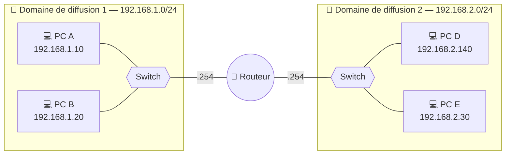
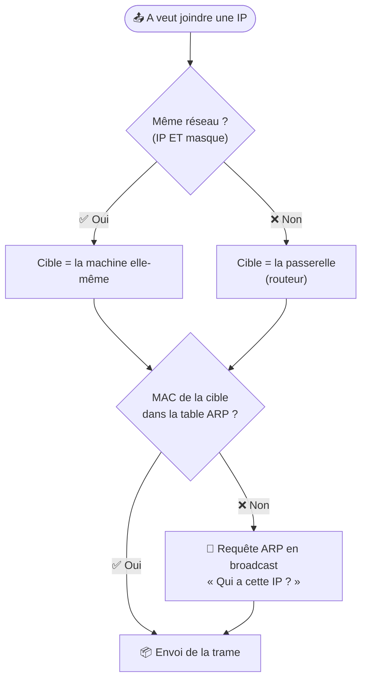
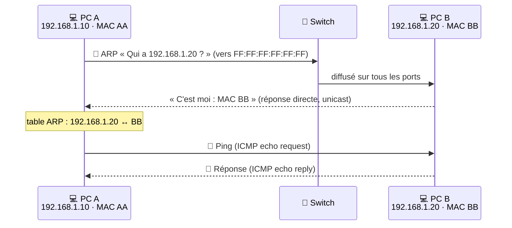

# Module 4 : La communication

*Cours : [Cours 1 - Bases des réseaux](../index.md)*

## 🎯 Objectif du module

À la fin de ce module, tu sais :

- dire ce qu'est un **domaine de diffusion** et quel équipement le coupe ;
- dérouler un **ping** dans le même réseau (**ARP**) puis vers un autre réseau (**passerelle**) ;
- lire une **table de routage** et choisir une route grâce à la **métrique** ;
- **regrouper** plusieurs réseaux en un **sur-réseau**.

!!! abstract "En clair : un réseau, c'est comme la poste"
    - **Adresse IP** = l'adresse postale (elle change si on déménage) · **adresse MAC** = le nom gravé sur la boîte aux lettres (il ne change jamais).
    - **Même rue** (même réseau) : on dépose la lettre soi-même. Si on ne connaît pas le nom sur la boîte, on **crie dans la rue** « qui habite au n° 20 ? » → c'est **ARP**.
    - **Autre rue** : on confie la lettre au **bureau de poste** du coin → la **passerelle** (le routeur), qui sait par où l'envoyer.
    - Le **haut-parleur** (broadcast) ne s'entend que **dans sa rue** : le routeur ne le laisse jamais passer.

## 🖼️ Résumé visuel

**① Le routeur coupe le réseau en domaines de diffusion**



Un broadcast de A atteint B (même switch), **jamais D ni E** : le routeur l'arrête.

**② Le réflexe d'un poste avant d'envoyer un paquet**



**③ À chaque saut, les MAC changent. Les IP, jamais.**

<div class="tssr-hop">
  <div class="tssr-hop-path">
    <span class="tssr-hop-node">💻 <b>PC A</b><small>192.168.1.10<br/>MAC AA</small></span>
    <span class="tssr-hop-link">→</span>
    <span class="tssr-hop-node is-router">🛜 <b>Routeur</b><small>e0 : 192.168.1.254 · MAC R1<br/>e1 : 192.168.2.254 · MAC R2</small></span>
    <span class="tssr-hop-link">→</span>
    <span class="tssr-hop-node">💻 <b>PC D</b><small>192.168.2.140<br/>MAC DD</small></span>
  </div>
  <div class="tssr-hop-frames">
    <div class="tssr-hop-frame">
      <small>Trame sur le réseau 1 (A → routeur)</small>
      <span class="is-mac">MAC : <b>AA → R1</b></span>
      <span class="is-ip">IP : <b>192.168.1.10 → 192.168.2.140</b></span>
    </div>
    <div class="tssr-hop-frame">
      <small>Trame sur le réseau 2 (routeur → D)</small>
      <span class="is-mac">MAC : <b>R2 → DD</b> <em>réécrites</em></span>
      <span class="is-ip">IP : <b>192.168.1.10 → 192.168.2.140</b> <em>identiques</em></span>
    </div>
  </div>
</div>

## 📖 Cours consolidé

### 1. Le domaine de diffusion

**Domaine de diffusion** = la zone où un **broadcast** (message « à tout le monde ») est reçu par **toutes** les machines, même celles qui ne sont pas concernées. En clair : **jusqu'où porte le haut-parleur**.

| Couche | Adresse de broadcast | Exemple |
|---|---|---|
| **2** (Liaison) | MAC **`FF:FF:FF:FF:FF:FF`** | requête ARP |
| **3** (Réseau) | IP avec **bits hôte tous à 1** | `192.168.1.255` pour un /24 |

**Qui s'en sert ?** **ARP** (« qui a cette IP ? ») et **DHCP** (« un serveur DHCP est là ? »).

| Équipement | Le broadcast… |
|---|---|
| **Switch** | ❌ **passe** : envoyé sur tous les ports (du même VLAN) |
| **Routeur** | ✅ **s'arrête** : 1 interface de routeur = 1 domaine |
| **VLAN** | ✅ **1 VLAN = 1 domaine**, même sur un seul switch |

**Pourquoi c'est important ?** Domaine trop grand = chaque machine traite des broadcasts inutiles → **réseau lent**. On **segmente** avec des **routeurs** et des **VLAN** : moins de trafic inutile, meilleures performances, plus de sécurité.

---

### 2. Ping dans le même réseau : ARP

Ta machine connaît l'**IP** de la cible (tu l'as tapée), mais pour mettre la trame sur le câble il lui faut sa **MAC**. **ARP** sert à ça : « qui a 192.168.1.20 ? donne-moi ta MAC ». La réponse est notée dans la **table ARP** (le carnet d'adresses) pour ne pas redemander.

**Situation** : A (`192.168.1.10/24`, MAC `AA`) → `ping 192.168.1.20` → B (MAC `BB`).

| # | A se demande… | Ici |
|---|---|---|
| ① | C'est moi-même (`127.0.0.1`) ? | Non |
| ② | Mon réseau et celui de B ? (IP **ET** masque, [module 3](../module-3-l-adressage-ipv4/index.md)) | 192.168.1.**0** et 192.168.1.**0** |
| ③ | Même réseau ? | **Oui** → j'envoie directement à B |
| ④ | MAC de B dans ma table ARP ? | Non → **requête ARP en broadcast**, le ping attend |
| ⑤ | B répond ? | Oui → table ARP mise à jour, **le ping part** · Non → erreur ICMP « hôte inaccessible » |



📌 **Requête ARP = broadcast** (tout le monde l'entend) · **réponse ARP = unicast** (envoyée au seul demandeur). Voir sa table : `arp -a`.

---

### 3. Ping vers un autre réseau : la passerelle

**Situation (du support)** : A (`192.168.1.10/24`, passerelle `192.168.1.254`) → `ping 192.168.2.140` → D (`192.168.2.140/26`, passerelle `192.168.2.254`).

**Côté PC A**

1. A calcule son réseau **et celui de D avec SON propre masque** (il ne connaît pas celui de D) : 192.168.1.0 ≠ 192.168.2.0 → **réseaux différents**.
2. A-t-il une **passerelle** ? Non → erreur ICMP, fin. Oui → la cible devient **la passerelle**.
3. ARP pour la **MAC de la passerelle** (pas celle de D !), puis envoi du ping au routeur.

**Côté routeur**

| # | Le routeur… | Sinon |
|---|---|---|
| ① | ouvre le paquet jusqu'à la couche 3 et lit l'**IP de destination** | — |
| ② | cherche le réseau de D dans sa **table de routage** | aucune route → paquet détruit, erreur ICMP |
| ③ | ce réseau est-il **branché sur une de ses interfaces** ? | non → il passe le paquet au **routeur suivant** |
| ④ | cherche la **MAC de D** (table ARP, sinon requête ARP côté réseau 2) | pas de réponse → erreur ICMP |
| ⑤ | **réécrit les MAC** (source R2, destination DD) et envoie à D | — |

⚠️ À retenir absolument : **les MAC changent à chaque saut** (elles ne valent que sur un segment), **les IP source et destination ne changent jamais** (sauf NAT, vu plus tard). Et la passerelle doit être **dans le même réseau que le poste**.

---

### 4. Le routage

**Routage** = choisir le **chemin** d'un paquet à travers plusieurs réseaux. C'est le travail du **routeur**, en **couche 3**. (Le switch, lui, reste **dans** un réseau.)

Le routeur : **lit l'IP de destination** → **consulte sa table de routage** → **envoie** vers le prochain routeur ou la destination. Rien ne correspond ? → **route par défaut** ; pas de route par défaut → paquet détruit.

#### La table de routage

| Réseau destination | Masque | Passerelle (prochain saut) | Interface | Métrique |
|---|---|---|---|---|
| 192.168.1.0 | 255.255.255.0 | — (directement connecté) | e0 | 0 |
| 192.168.2.0 | 255.255.255.0 | — (directement connecté) | e1 | 0 |
| 10.0.0.0 | 255.0.0.0 | 192.168.2.253 | e1 | 1 |
| **0.0.0.0** | **0.0.0.0** | 203.0.113.1 | e2 | 1 |

- **Passerelle** = le routeur voisin à qui confier le paquet.
- **0.0.0.0/0 = route par défaut** = « tout le reste » (souvent Internet).
- **Métrique** = le « coût » d'une route (nombre de **sauts**, débit…). Entre deux chemins, le routeur prend **la plus petite**.

**Exemple de métrique (du support)** : 4 réseaux en **boucle**, reliés par 4 routeurs R1 → R2 → R3 → R4 → R1. Pour aller au réseau 4, R1 a deux chemins :

| Chemin depuis R1 | Sauts | Choisi ? |
|---|---|---|
| via R2 puis R3 | 3 | ❌ |
| via R4 | **2** | ✅ métrique la plus faible |

Si R4 tombe en panne, l'autre chemin existe encore : c'est l'intérêt d'une boucle… à condition que les routeurs s'en rendent compte (→ routage dynamique).

#### Statique ou dynamique ?

| | **Statique** | **Dynamique** |
|---|---|---|
| **Comment** | Routes tapées **à la main** | Les routeurs **s'échangent** leurs routes |
| **Protocoles** | — | **RIP**, **OSPF**, **BGP** (Internet) |
| **➕** | Simple, contrôle total, ne consomme rien | S'adapte **seul** aux pannes |
| **➖** | Tout à refaire à chaque changement | Plus complexe, consomme CPU et mémoire |
| **Pour** | Petit réseau stable | Réseau moyen à grand |

---

### 5. Le sur-réseau (supernetting)

**Sur-réseau = l'inverse du sous-réseau** : on **regroupe** plusieurs réseaux voisins en **un seul** avec un masque **plus court**. But : **1 ligne** dans la table de routage au lieu de plusieurs (RFC 1519).

> En clair : au lieu de dire « rue 0, rue 1, rue 2, rue 3 → passer par là », on dit « **tout le quartier** → passer par là ».

➕ Tables plus petites → **moins de mémoire et de CPU**, routage **plus rapide**, réseau **plus stable**.

#### La méthode en 3 étapes

1. Écrire **en binaire** l'octet qui change d'un réseau à l'autre.
2. Compter les **bits identiques en partant de la gauche** (on s'arrête au premier bit différent).
3. **Masque** = bits des octets identiques + bits communs · **adresse** = bits communs, le reste à 0.

**Exemple simple** : 192.168.0.0/24 → 192.168.3.0/24

```
3ᵉ octet :  0 = 000000|00
            1 = 000000|01
            2 = 000000|10
            3 = 000000|11
                └────┘ 6 bits communs  →  8 + 8 + 6 = /22  →  192.168.0.0/22
```

**Exemple du support** : R1 doit joindre 6 réseaux situés derrière R2, R3 et R4 :
`192.168.70.0/24 · 192.168.75.64/26 · 192.168.100.128/25 · 192.168.102.96/27 · 192.168.115.128/27 · 192.168.120.192/27`

```
3ᵉ octet :  70 = 01|000110
            75 = 01|001011
           100 = 01|100100
           102 = 01|100110
           115 = 01|110011
           120 = 01|111000
                 └┘ 2 bits communs  →  8 + 8 + 2 = /18

Adresse : 01|000000 = 64  →  192.168.64.0/18   (de 192.168.64.0 à 192.168.127.255)
```

👉 Sur R1 : **une seule route** `192.168.64.0/18 → R2` au lieu de 6.

#### 🧮 Vérifie le sur-réseau

Tape le sur-réseau trouvé : la plage d'hôtes doit contenir **tous** les réseaux regroupés (ici de 192.168.64.1 à 192.168.127.254).

<div class="tssr-calc" data-ip="192.168.64.0/18"></div>

💡 **Raccourci** : regrouper **2ⁿ** réseaux /24 qui se suivent = retirer **n** bits : 2 réseaux → /23 · 4 → /22 · 8 → /21.

⚠️ **Pièges** :

- Les réseaux doivent être **contigus** et le premier **aligné** (multiple du nombre de réseaux) : 192.168.**1**.0 + 192.168.**2**.0 ne font **pas** un /23.
- Le sur-réseau peut **couvrir plus** que les réseaux réels (le /18 ci-dessus englobe aussi 192.168.80.0, etc.) : ça marche si ces adresses ne sont **utilisées nulle part ailleurs**.
- On perd la **finesse** : impossible de traiter un des réseaux regroupés à part.

## 📝 Fiche de révision

| Notion | En une phrase | Exemple |
|---|---|---|
| **Domaine de diffusion** | Zone où un broadcast est reçu par tous | Les PC d'un même VLAN |
| **ARP** | Trouve la MAC d'une IP | « Qui a .20 ? » → « MAC BB » |
| **Passerelle** | Le routeur à qui confier ce qui sort du réseau | `192.168.1.254` |
| **Table de routage** | « Pour tel réseau, passer par… » | `10.0.0.0/8 → 192.168.2.253` |
| **Route par défaut** | « Tout le reste » | `0.0.0.0/0` |
| **Métrique** | Coût d'une route, la plus petite gagne | 2 sauts < 3 sauts |
| **Sur-réseau** | Plusieurs réseaux = 1 route | 4 × /24 → `/22` |

### 🔁 Le scénario du ping à savoir réciter

1. **IP ET masque** → même réseau ? Oui → cible = la machine ; non → cible = la **passerelle**.
2. **Table ARP** → MAC connue ? Non → **ARP en broadcast**, réponse en unicast.
3. **Envoi**. Le routeur lit l'IP, consulte sa **table de routage**…
4. …**réécrit les MAC** et transmet. Les **IP ne bougent pas**.

### ⚠️ Les pièges

- Le **switch ne coupe pas** le broadcast (seuls routeur et VLAN le font).
- La **réponse ARP n'est pas un broadcast**.
- Vers un autre réseau, A demande en ARP la **MAC de la passerelle**, jamais celle de la cible.
- Une **passerelle hors du réseau du poste** ne marche pas.
- Sur-réseau : réseaux **contigus et alignés** ; on compte les bits communs **depuis la gauche**.

### ✏️ Entraîne-toi (clique pour voir la correction)

??? question "1. 3 PC sur un switch, ce switch relié à un routeur, le routeur relié à un 2ᵉ switch avec 2 PC. Combien de domaines de diffusion ?"
    **2** : un par interface de routeur utilisée. Le switch ne crée pas de domaine, il le propage.

??? question "2. PC 192.168.1.10/24 → ping 192.168.1.50. La trame part-elle vers la passerelle ?"
    **Non.** Les deux donnent 192.168.1.0 avec le masque /24 : **même réseau**, envoi direct (après un ARP si la MAC de .50 est inconnue).

??? question "3. PC 192.168.1.10/24 → ping 8.8.8.8. Quelles MAC et IP de destination dans la 1re trame ?"
    8.8.8.8 est hors de 192.168.1.0/24 → **MAC de destination = celle de la passerelle**. **IP de destination = 8.8.8.8** (elle ne change jamais en route).

??? question "4. Quel sur-réseau regroupe 10.1.4.0/24, 10.1.5.0/24, 10.1.6.0/24 et 10.1.7.0/24 ?"
    3ᵉ octet : 4 = 000001**00**, 5 = 000001**01**, 6 = 000001**10**, 7 = 000001**11** → **6 bits communs**.

    8 + 8 + 6 = **/22** → **10.1.4.0/22** (10.1.4.0 → 10.1.7.255). 4 est un multiple de 4 : bloc aligné ✅.

??? question "5. Peut-on regrouper 172.16.8.0/24 + 172.16.9.0/24 ? Et 172.16.9.0/24 + 172.16.10.0/24 ?"
    - 8 = 0000100**0**, 9 = 0000100**1** → 7 bits communs → **oui : 172.16.8.0/23**.
    - 9 = 000010**01**, 10 = 000010**10** → 6 bits communs → le /22 engloberait aussi .8 et .11 → **non**, bloc non aligné.

??? question "6. Quel sur-réseau pour 192.168.32.0/24, 192.168.40.0/24 et 192.168.47.0/24 ?"
    3ᵉ octet : 32 = 0010**0000**, 40 = 0010**1000**, 47 = 0010**1111** → **4 bits communs** (`0010`).

    8 + 8 + 4 = **/20** · adresse : `0010 0000` = 32 → **192.168.32.0/20** (192.168.32.0 → 192.168.47.255).

??? question "7. Un routeur a deux routes vers 10.0.0.0/8 : métrique 4 via R2, métrique 2 via R3. Laquelle utilise-t-il ? Et si R3 tombe en panne ?"
    Il prend **R3** (métrique **2**, la plus faible). Si R3 tombe : en **routage dynamique**, la route est retirée et il bascule seul sur R2 ; en **statique**, il continue d'envoyer vers R3 tant que l'admin ne corrige pas.

## 🧠 Quiz — entraîne-toi

<div id="quiz-cours-01-bases-des-reseaux-module-4-la-communication"></div>

<script type="application/json" id="quiz-cours-01-bases-des-reseaux-module-4-la-communication-data">
[
  {
    "question": "Qu'est-ce qu'un domaine de diffusion (broadcast domain) ?",
    "options": [
      "Une portion logique du réseau dans laquelle une trame de diffusion est transmise à tous les appareils connectés",
      "Une zone géographique couverte par un seul point d'accès Wi-Fi",
      "Un ensemble de règles de pare-feu appliquées à un VLAN",
      "Une plage d'adresses IP réservée aux serveurs DNS"
    ],
    "correctIndex": 0,
    "explanation": "Un domaine de diffusion est une portion logique du réseau où un message de broadcast est reçu par tous les appareils connectés, même si ce message ne leur est pas explicitement destiné."
  },
  {
    "question": "En IPv4, comment est composée une adresse de broadcast comme 192.168.1.255 pour un réseau /24 ?",
    "options": [
      "Tous les bits de la partie réseau sont positionnés à 1",
      "Tous les bits de la partie hôte sont positionnés à 1",
      "Tous les bits de l'adresse sont positionnés à 0",
      "Seul le premier octet est positionné à 255"
    ],
    "correctIndex": 1,
    "explanation": "L'adresse de broadcast est obtenue en mettant tous les bits de la partie hôte à 1 ; pour un réseau 192.168.1.0/24, cela donne 192.168.1.255."
  },
  {
    "question": "Quel équipement délimite les domaines de diffusion, empêchant les trames de broadcast de passer d'un réseau à un autre ?",
    "options": [
      "Le commutateur (switch)",
      "Le répéteur",
      "Le routeur",
      "Le modem"
    ],
    "correctIndex": 2,
    "explanation": "Un routeur ne transmet pas les trames de diffusion d'un réseau vers un autre, ce qui crée une frontière entre domaines de diffusion, contrairement à un commutateur qui les propage à tous les ports d'un même VLAN."
  },
  {
    "question": "Pourquoi la mise en place de VLANs permet-elle de limiter la taille des domaines de diffusion ?",
    "options": [
      "Parce que les VLANs chiffrent automatiquement le trafic de broadcast",
      "Parce que les VLANs suppriment tout trafic de diffusion",
      "Parce que les VLANs remplacent les adresses IP par des adresses MAC",
      "Parce que chaque VLAN constitue un domaine de diffusion distinct, même sur un même switch physique"
    ],
    "correctIndex": 3,
    "explanation": "Un VLAN segmente logiquement un réseau : chaque VLAN forme un domaine de diffusion indépendant, même si plusieurs VLANs partagent le même commutateur physique."
  },
  {
    "question": "À quelle couche du modèle OSI le domaine de diffusion opère-t-il principalement ?",
    "options": [
      "La couche 2 (Liaison de données)",
      "La couche 1 (Physique)",
      "La couche 3 (Réseau)",
      "La couche 4 (Transport)"
    ],
    "correctIndex": 0,
    "explanation": "Le domaine de diffusion opère principalement à la couche 2, les diffusions étant transmises à tous les appareils via l'adresse MAC de destination spéciale FF:FF:FF:FF:FF:FF."
  },
  {
    "question": "Quelle adresse MAC de destination est utilisée pour une trame de diffusion ?",
    "options": [
      "00:00:00:00:00:00",
      "FF:FF:FF:FF:FF:FF",
      "192.168.1.255",
      "AA:AA:AA:AA:AA:AA"
    ],
    "correctIndex": 1,
    "explanation": "Une trame de diffusion utilise l'adresse MAC de destination FF:FF:FF:FF:FF:FF, reconnue par tous les appareils du domaine de diffusion comme une adresse de broadcast."
  },
  {
    "question": "Pourquoi un domaine de diffusion trop grand peut-il poser un problème de performance ?",
    "options": [
      "Parce que les adresses IP privées s'épuisent plus rapidement",
      "Parce que le chiffrement des données devient impossible",
      "Parce que chaque appareil du domaine doit traiter les diffusions, même celles qui ne lui sont pas destinées",
      "Parce que le nombre de VLANs est automatiquement limité à un seul"
    ],
    "correctIndex": 2,
    "explanation": "Dans un domaine de diffusion étendu, chaque appareil doit traiter toutes les diffusions reçues, ce qui peut surcharger le réseau et les ressources des machines si le domaine n'est pas correctement segmenté."
  },
  {
    "question": "À quelle couche du modèle OSI le processus de routage se déroule-t-il principalement ?",
    "options": [
      "La couche 2 (Liaison de données)",
      "La couche 4 (Transport)",
      "La couche 7 (Application)",
      "La couche 3 (Réseau)"
    ],
    "correctIndex": 3,
    "explanation": "Le routage est un mécanisme de la couche 3 (Réseau), où les routeurs déterminent le meilleur chemin pour acheminer les paquets à travers un ou plusieurs réseaux."
  },
  {
    "question": "Que consulte un routeur pour décider du meilleur chemin à emprunter pour un paquet ?",
    "options": [
      "Sa table de routage",
      "Le cache ARP de l'expéditeur",
      "Le fichier hosts local",
      "La table des adresses MAC"
    ],
    "correctIndex": 0,
    "explanation": "La table de routage est une base de données interne au routeur contenant les réseaux connus, les passerelles disponibles et les métriques associées, sur laquelle il s'appuie pour choisir la meilleure route."
  },
  {
    "question": "Quelle est la différence essentielle entre le routage statique et le routage dynamique ?",
    "options": [
      "Le routage statique utilise uniquement IPv6, tandis que le routage dynamique utilise uniquement IPv4",
      "Le routage statique est configuré manuellement par un administrateur, tandis que le routage dynamique ajuste les routes automatiquement via des protocoles",
      "Le routage statique fonctionne uniquement sur les VLANs, tandis que le routage dynamique fonctionne uniquement sur les LAN",
      "Le routage statique est réservé aux grands réseaux, tandis que le routage dynamique est réservé aux petits réseaux"
    ],
    "correctIndex": 1,
    "explanation": "En routage statique, les routes sont saisies manuellement par un administrateur, ce qui convient aux petits réseaux stables ; en routage dynamique, des protocoles comme RIP, OSPF ou BGP permettent aux routeurs d'échanger automatiquement des informations et de s'adapter aux changements du réseau."
  },
  {
    "question": "Lesquels de ces protocoles sont des protocoles de routage dynamique ?",
    "options": [
      "DHCP, DNS et ARP",
      "TCP, UDP et ICMP",
      "RIP, OSPF et BGP",
      "HTTP, FTP et SMTP"
    ],
    "correctIndex": 2,
    "explanation": "RIP (Routing Information Protocol), OSPF (Open Shortest Path First) et BGP (Border Gateway Protocol) sont des protocoles de routage dynamique permettant aux routeurs d'échanger automatiquement leurs informations de routage."
  },
  {
    "question": "Que se passe-t-il si un routeur ne trouve aucune route correspondante dans sa table de routage pour un paquet donné ?",
    "options": [
      "Il détruit systématiquement le paquet sans notification",
      "Il renvoie le paquet à l'expéditeur avec une erreur ARP",
      "Il diffuse le paquet à tous les réseaux connus",
      "Il transmet généralement le paquet à une passerelle par défaut"
    ],
    "correctIndex": 3,
    "explanation": "Lorsqu'aucune route spécifique ne correspond, le routeur utilise sa route par défaut (0.0.0.0/0), qui pointe vers une passerelle. S'il n'en a pas, le paquet est détruit et une erreur ICMP « destination inaccessible » est renvoyée."
  },
  {
    "question": "Dans l'exemple d'un ordinateur 192.168.1.100/24 envoyant des données vers 10.0.0.1, pourquoi le paquet est-il envoyé à la passerelle par défaut ?",
    "options": [
      "Parce que l'adresse de destination 10.0.0.1 n'appartient pas au même réseau local que l'expéditeur",
      "Parce que l'adresse 10.0.0.1 correspond à une adresse de broadcast",
      "Parce que la passerelle par défaut est toujours la première destination de tout paquet",
      "Parce que l'adresse IP 10.0.0.1 est une adresse APIPA"
    ],
    "correctIndex": 0,
    "explanation": "L'ordinateur détecte que 10.0.0.1 ne fait pas partie de son réseau local (192.168.1.0/24) ; il transmet donc le paquet à sa passerelle par défaut, qui se chargera de l'acheminer vers le réseau distant via sa table de routage."
  },
  {
    "question": "Qu'est-ce que le sur-réseau (supernetting) ?",
    "options": [
      "Une technique consistant à diviser un réseau en plusieurs sous-réseaux plus petits",
      "Une technique consistant à regrouper plusieurs sous-réseaux contigus en un seul réseau plus grand",
      "Une méthode de chiffrement des adresses IP",
      "Un protocole permettant d'attribuer automatiquement des adresses IP"
    ],
    "correctIndex": 1,
    "explanation": "Le sur-réseau, ou supernetting, est l'opération inverse du sous-réseautage : il fusionne plusieurs plages d'adresses IP contiguës en une seule, à l'aide d'un masque moins restrictif (moins de bits à 1)."
  },
  {
    "question": "Quel est le principal avantage du sur-réseau pour les routeurs d'Internet ?",
    "options": [
      "Il augmente automatiquement le nombre d'adresses IP publiques disponibles",
      "Il supprime la nécessité d'un masque de sous-réseau",
      "Il réduit la taille des tables de routage en regroupant plusieurs réseaux sous une seule entrée",
      "Il chiffre systématiquement le trafic entre routeurs"
    ],
    "correctIndex": 2,
    "explanation": "En combinant plusieurs réseaux contigus en une seule route, le sur-réseau simplifie et réduit la taille des tables de routage, ce qui améliore la performance des routeurs, notamment sur Internet."
  },
  {
    "question": "Dans l'exemple des réseaux 192.168.0.0/24, 192.168.1.0/24, 192.168.2.0/24 et 192.168.3.0/24, quel sur-réseau permet de les regrouper en une seule route ?",
    "options": [
      "192.168.0.0/23",
      "192.168.0.0/21",
      "192.168.0.0/16",
      "192.168.0.0/22"
    ],
    "correctIndex": 3,
    "explanation": "Ces quatre réseaux /24 partagent leurs 22 premiers bits en commun ; ils peuvent donc être regroupés en un seul sur-réseau 192.168.0.0/22, couvrant les adresses de 192.168.0.0 à 192.168.3.255."
  },
  {
    "question": "Pour créer un sur-réseau à partir de plusieurs sous-réseaux, quelle condition ces sous-réseaux doivent-ils remplir ?",
    "options": [
      "Être contigus et alignés sur des limites binaires compatibles",
      "Appartenir tous à la même classe d'adresse historique (A, B ou C)",
      "Utiliser tous le même masque /24 sans exception possible",
      "Être situés sur des continents différents"
    ],
    "correctIndex": 0,
    "explanation": "Le regroupement en sur-réseau nécessite que les plages d'adresses soient contiguës et alignées sur des limites binaires compatibles, faute de quoi le nouveau préfixe ne pourrait pas représenter fidèlement l'ensemble des sous-réseaux d'origine."
  },
  {
    "question": "Quelle est une limite du sur-réseau mentionnée dans le cours ?",
    "options": [
      "Une incompatibilité totale avec la notation CIDR",
      "Une perte de granularité, qui réduit la précision pour identifier ou isoler des plages spécifiques",
      "Une obligation d'utiliser exclusivement IPv6",
      "Une interdiction d'utilisation sur les réseaux privés"
    ],
    "correctIndex": 1,
    "explanation": "En regroupant plusieurs réseaux en un seul, le sur-réseau perd en granularité : il devient plus difficile d'identifier ou d'isoler précisément une plage d'adresses spécifique au sein du groupe."
  },
  {
    "question": "Quels usages typiques s'appuient sur les messages de diffusion (broadcast) dans un réseau local ?",
    "options": [
      "Le chiffrement des échanges HTTPS et la signature des certificats SSL",
      "Le routage BGP entre fournisseurs d'accès Internet",
      "La découverte de machines via DHCP et la résolution d'adresses via ARP",
      "La synchronisation de l'heure via NTP uniquement"
    ],
    "correctIndex": 2,
    "explanation": "Les messages de broadcast servent notamment à des tâches comme la découverte de machines (par exemple lors d'une requête DHCP) ou la résolution d'adresses (par exemple une requête ARP « Who has 192.168.1.10? »)."
  },
  {
    "question": "Quel est l'un des principaux avantages du routage pour un réseau ?",
    "options": [
      "Il élimine totalement le besoin d'adresses IP",
      "Il remplace les commutateurs dans tous les réseaux locaux",
      "Il empêche toute segmentation en sous-réseaux",
      "Il permet la communication entre différents réseaux tout en optimisant le trafic en choisissant les meilleurs chemins"
    ],
    "correctIndex": 3,
    "explanation": "Le routage permet d'acheminer les paquets entre différents réseaux, d'optimiser le trafic en choisissant le chemin le plus efficace, et d'assurer la scalabilité de réseaux complexes comme Internet."
  },
  {
    "question": "Lorsqu'un paquet traverse un routeur, quelles adresses sont modifiées dans la trame ?",
    "options": [
      "Les adresses IP source et destination",
      "Les adresses MAC source et destination",
      "Les numéros de port",
      "Aucune adresse n'est modifiée"
    ],
    "correctIndex": 1,
    "explanation": "À chaque saut, le routeur réécrit les adresses MAC (elles n'ont de sens que sur un segment local). Les adresses IP source et destination restent identiques de bout en bout (hors NAT)."
  },
  {
    "question": "Le PC 192.168.1.10/24 envoie un ping à 8.8.8.8. Quelle est l'adresse MAC de destination de la trame qu'il émet ?",
    "options": [
      "FF:FF:FF:FF:FF:FF",
      "La MAC du serveur 8.8.8.8",
      "La MAC de sa passerelle par défaut",
      "Sa propre adresse MAC"
    ],
    "correctIndex": 2,
    "explanation": "8.8.8.8 n'est pas dans le réseau 192.168.1.0/24 : la trame est envoyée à la passerelle, donc avec la MAC de la passerelle en destination. L'IP de destination, elle, reste 8.8.8.8."
  },
  {
    "question": "Comment est envoyée la réponse ARP ?",
    "options": [
      "En broadcast à tous les postes du réseau",
      "En unicast, directement au poste qui a posé la question",
      "En multicast vers 224.0.0.1",
      "Elle n'est jamais envoyée, la table ARP se remplit seule"
    ],
    "correctIndex": 1,
    "explanation": "Seule la requête ARP est diffusée (« Qui a cette IP ? »). La machine concernée répond directement au demandeur, dont elle connaît la MAC grâce à la requête."
  },
  {
    "question": "Quel sur-réseau regroupe exactement 10.1.4.0/24, 10.1.5.0/24, 10.1.6.0/24 et 10.1.7.0/24 ?",
    "options": [
      "10.1.4.0/23",
      "10.1.4.0/22",
      "10.1.0.0/21",
      "10.1.4.0/24"
    ],
    "correctIndex": 1,
    "explanation": "Dans le 3ᵉ octet, 4, 5, 6 et 7 partagent leurs 6 premiers bits (000001xx) : 8 + 8 + 6 = 22 bits communs, soit 10.1.4.0/22."
  },
  {
    "question": "Quel sur-réseau résume 192.168.70.0/24, 192.168.75.64/26, 192.168.100.128/25, 192.168.102.96/27, 192.168.115.128/27 et 192.168.120.192/27 ?",
    "options": [
      "192.168.64.0/20",
      "192.168.0.0/16",
      "192.168.64.0/18",
      "192.168.70.0/18"
    ],
    "correctIndex": 2,
    "explanation": "Dans le 3ᵉ octet, 70 à 120 commencent tous par 01 (2 bits communs) : 8 + 8 + 2 = /18. L'adresse garde les bits communs et met le reste à 0 : 01000000 = 64, soit 192.168.64.0/18."
  },
  {
    "question": "Un routeur connaît deux chemins vers le même réseau : l'un avec une métrique de 3, l'autre de 2. Lequel choisit-il ?",
    "options": [
      "Celui de métrique 3",
      "Les deux en alternance, obligatoirement",
      "Le premier saisi par l'administrateur",
      "Celui de métrique 2"
    ],
    "correctIndex": 3,
    "explanation": "La métrique représente le coût d'une route (par exemple le nombre de sauts). Le routeur retient la route au coût le plus faible."
  },
  {
    "question": "Le PC A (192.168.1.10/24) veut joindre 192.168.2.140. Quel masque utilise-t-il pour calculer le réseau de la destination ?",
    "options": [
      "Son propre masque, 255.255.255.0",
      "Le masque de la destination, qu'il demande par ARP",
      "Toujours 255.255.0.0",
      "Aucun : il envoie directement la trame à la destination"
    ],
    "correctIndex": 0,
    "explanation": "Le poste ne connaît pas le masque de la destination : il applique son propre masque aux deux adresses. 192.168.1.0 ≠ 192.168.2.0, donc le paquet part vers la passerelle."
  }
]
</script>

<script>
  document.addEventListener("DOMContentLoaded", function () {
    TSSRQuiz.init({
      containerId: "quiz-cours-01-bases-des-reseaux-module-4-la-communication",
      dataId: "quiz-cours-01-bases-des-reseaux-module-4-la-communication-data",
    });
  });
</script>
