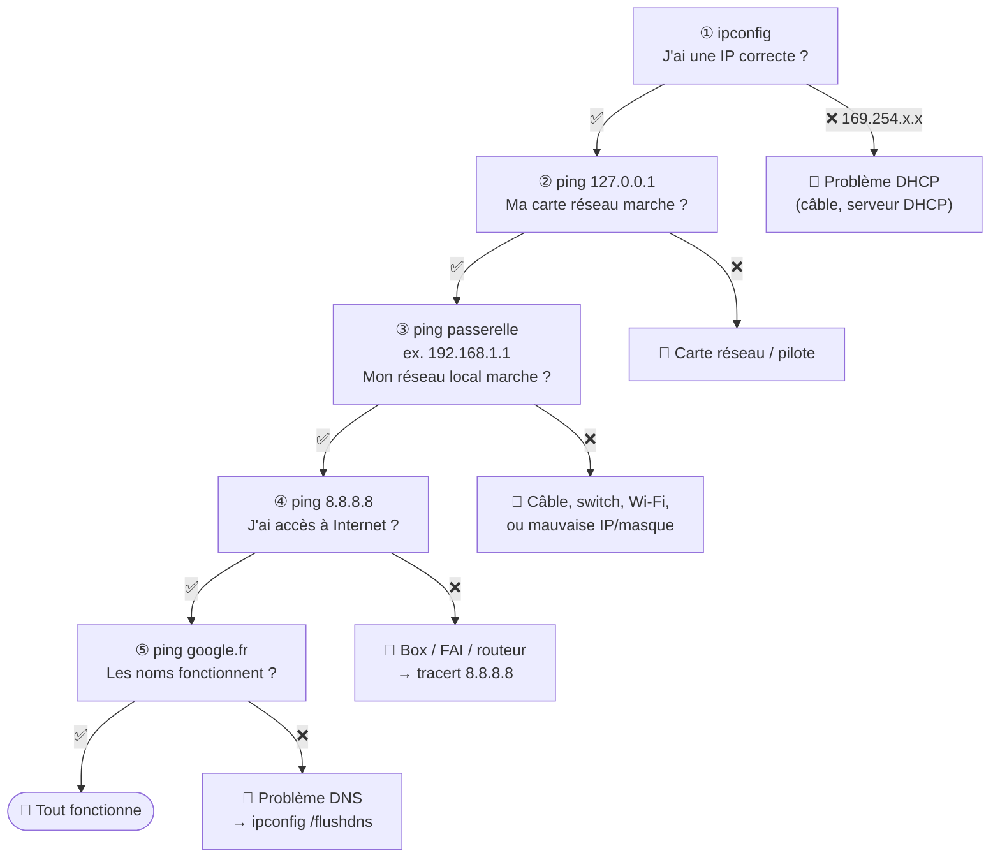

# Module 5 : Les premières commandes

*Cours : [Cours 1 - Bases des réseaux](../index.md)*

## 🎯 Objectif du module

Connaître **les 5 commandes de base** pour voir sa configuration réseau et trouver d'où vient une panne :

| Commande | Question à laquelle elle répond |
|---|---|
| `ipconfig` / `ip a` | **Quelle est ma configuration ?** (IP, masque, passerelle) |
| `ping` | **Est-ce que cette machine me répond ?** |
| `tracert` / `traceroute` | **Par où passent mes paquets, et où ça bloque ?** |
| `arp -a` | **Quelles adresses MAC mon poste connaît-il ?** |
| `netstat` | **Quelles connexions sont ouvertes sur mon poste ?** |

!!! tip "Où taper ces commandes ?"
    - **Windows** : touche ++win++, tape `cmd`, puis Entrée → l'**invite de commandes** s'ouvre.
    - **Linux** : ouvre le **Terminal** (++ctrl+alt+t++ sur Ubuntu/Debian).

## 🖼️ Résumé visuel

**La méthode de dépannage : on part de son poste et on s'éloigne, étape par étape.** La première étape qui échoue indique où est la panne.



## 📖 Cours consolidé

### 1. `ipconfig` (Windows) et `ip` (Linux) : voir sa configuration

**À quoi ça sert ?** Afficher l'**adresse IP**, le **masque** et la **passerelle** de ta machine. C'est **toujours la première commande** à taper en cas de problème.

| Je veux… | Windows | Linux |
|---|---|---|
| Voir mon IP, masque, passerelle | `ipconfig` | `ip a` (adresses) · `ip r` (passerelle) |
| Tout voir (MAC, DNS, DHCP) | `ipconfig /all` | `ip a` + `cat /etc/resolv.conf` (DNS) |
| Rendre mon IP au DHCP / en redemander une | `ipconfig /release` puis `ipconfig /renew` | — |
| Vider le cache DNS | `ipconfig /flushdns` | — |

**Exemple : lire un `ipconfig`**

```
Carte Ethernet Ethernet :
   Adresse IPv4. . . . . . . . . . . . . .: 192.168.1.100    ← mon IP
   Masque de sous-réseau. . . . . . . . . : 255.255.255.0    ← donc réseau 192.168.1.0/24
   Passerelle par défaut. . . . . . . . . : 192.168.1.1      ← ma box / mon routeur
```

**Sous Linux, `ip r`** affiche la passerelle sur la ligne `default` :

```
default via 192.168.1.1 dev eth0      ← passerelle = 192.168.1.1
192.168.1.0/24 dev eth0 ...           ← mon réseau local
```

🩺 **Le réflexe** : une IP en **169.254.x.x** = le poste n'a pas trouvé de serveur **DHCP** → `ipconfig /release` puis `ipconfig /renew`, et vérifier le câble ou le Wi-Fi.

---

### 2. `ping` : tester si une machine répond

**À quoi ça sert ?** Envoyer un petit message « tu es là ? » (**ICMP Echo Request**) et attendre la réponse (**Echo Reply**). On sait alors si la machine est **joignable** et **en combien de temps**.

| Je veux… | Windows | Linux |
|---|---|---|
| Tester une machine | `ping 192.168.1.1` (4 essais puis s'arrête) | `ping 192.168.1.1` (**sans fin** → ++ctrl+c++ pour arrêter) |
| Choisir le nombre d'essais | `ping -n 10 8.8.8.8` | `ping -c 10 8.8.8.8` |
| Ping en continu | `ping -t 8.8.8.8` | (par défaut) |

**Exemple : lire un `ping`**

```
Réponse de 8.8.8.8 : octets=32 temps=18 ms TTL=115
Réponse de 8.8.8.8 : octets=32 temps=17 ms TTL=115
Paquets : envoyés = 4, reçus = 4, perdus = 0 (perte 0%)
```

| Élément | Ce que ça veut dire |
|---|---|
| `temps=18 ms` | Temps de l'**aller-retour** : plus c'est petit, mieux c'est (< 50 ms = bien) |
| `TTL=115` | Nombre de routeurs que le paquet pouvait encore traverser |
| `perdus = 0` | Aucun message perdu : la liaison est bonne |

| Ce que j'obtiens | Ça veut dire… |
|---|---|
| `Délai d'attente de la demande dépassé` | Machine éteinte, injoignable, **ou un pare-feu bloque le ping** |
| `Impossible de joindre l'hôte de destination` | Pas de chemin : souvent une **passerelle** absente ou fausse |
| `ping 8.8.8.8` marche mais pas `ping google.fr` | Internet OK, mais **DNS** en panne |

⚠️ Une machine qui ne répond pas au ping **n'est pas forcément éteinte** : beaucoup de pare-feu (dont celui de Windows) bloquent le ping par défaut.

---

### 3. `tracert` (Windows) / `traceroute` (Linux) : voir le chemin

**À quoi ça sert ?** Afficher **chaque routeur traversé** (chaque « saut ») jusqu'à la destination, pour voir **où ça bloque**.

| Je veux… | Windows | Linux |
|---|---|---|
| Voir le chemin | `tracert 8.8.8.8` | `traceroute 8.8.8.8` |
| Plus rapide (sans les noms) | `tracert -d 8.8.8.8` | `traceroute -n 8.8.8.8` |

**Exemple : lire un `tracert`**

```
 1    <1 ms   <1 ms   <1 ms   192.168.1.1     ← ma box (1er saut)
 2    12 ms   10 ms   11 ms   10.0.0.1        ← le réseau du fournisseur d'accès
 3     *       *       *      Délai dépassé   ← ce routeur ne répond pas (souvent filtré)
 4    20 ms   19 ms   19 ms   8.8.8.8         ← arrivé !
```

| Ce que je vois | Ça veut dire… |
|---|---|
| Le **1er saut** ne répond pas | Problème **chez moi** (câble, box, passerelle) |
| Ça s'arrête **plus loin** | Problème **à l'extérieur** (fournisseur d'accès, Internet) |
| Une ligne `* * *` puis ça repart | Normal : ce routeur ne répond juste pas aux tests |

💡 **Comment ça marche ?** `tracert` envoie des paquets avec un **TTL** de 1, puis 2, puis 3… Chaque routeur retire 1 au TTL ; celui qui le fait tomber à 0 renvoie une erreur et **révèle ainsi son adresse**.

---

### 4. `arp -a` : voir les adresses MAC connues

**À quoi ça sert ?** Afficher la **table ARP** : la liste des correspondances **IP ↔ MAC** que ton poste a déjà apprises (voir le [module 4](../module-4-la-communication/index.md#2-communication-dans-le-meme-reseau-arp)).

| Je veux… | Windows | Linux |
|---|---|---|
| Voir la table ARP | `arp -a` | `ip neigh` (ou `arp -a`) |
| Vider la table ARP | `arp -d *` (en administrateur) | `sudo ip neigh flush all` |

```
  Adresse Internet      Adresse physique      Type
  192.168.1.1           a4-2b-b0-12-34-56     dynamique    ← la MAC de ma box
  192.168.1.255         ff-ff-ff-ff-ff-ff     statique     ← l'adresse de broadcast
```

💡 Astuce : fais un `ping` vers une machine de ton réseau, puis `arp -a` : sa MAC est apparue dans la liste.

---

### 5. `netstat` : voir les connexions ouvertes

**À quoi ça sert ?** Lister les **connexions** en cours et les **ports en écoute** sur ton poste (quels programmes communiquent, et avec qui).

| Je veux… | Windows | Linux |
|---|---|---|
| Voir toutes les connexions (en chiffres) | `netstat -an` | `ss -tuan` |
| Savoir quel programme utilise quel port | `netstat -ano` (n° de processus) | `sudo ss -tulpn` |

```
  Proto  Adresse locale         Adresse distante       État
  TCP    0.0.0.0:3389           0.0.0.0:0              LISTENING     ← j'attends des connexions (bureau à distance)
  TCP    192.168.1.100:52314    142.250.74.68:443      ESTABLISHED   ← connexion ouverte vers un site HTTPS
```

| État | Ça veut dire… |
|---|---|
| **LISTENING** | Un programme **attend** des connexions sur ce port |
| **ESTABLISHED** | Une connexion est **ouverte** et active |

💡 Sous Linux, `netstat` est remplacé par **`ss`** (mêmes options), et sous PowerShell par `Get-NetTCPConnection`.

## ✅ Points clés à retenir

- **Toujours commencer par `ipconfig`** : une IP en **169.254.x.x** = problème de **DHCP**.
- **`ping`** teste si une machine répond (ICMP) ; pas de réponse ≠ forcément éteinte (pare-feu).
- **Méthode de dépannage** : `ping 127.0.0.1` → `ping passerelle` → `ping 8.8.8.8` → `ping un nom`. La première étape qui échoue localise la panne.
- **`ping 8.8.8.8` OK mais `ping google.fr` KO** = problème de **DNS**.
- **`tracert`** montre chaque routeur traversé, grâce au **TTL** qui augmente de 1 à chaque essai.
- **`arp -a`** affiche les correspondances IP ↔ MAC ; **`netstat -an`** les connexions et ports ouverts.

## 📝 Fiche de révision

### 🪟🐧 Windows ↔ Linux : la table d'équivalence

| Je veux… | Windows | Linux |
|---|---|---|
| Ma configuration (IP, masque) | `ipconfig` · `ipconfig /all` | `ip a` |
| Ma passerelle | `ipconfig` | `ip r` |
| Renouveler mon IP (DHCP) | `ipconfig /release` + `/renew` | — |
| Vider le cache DNS | `ipconfig /flushdns` | — |
| Tester une machine | `ping` (4 fois) · `-n 10` · `-t` | `ping` (sans fin) · `-c 10` |
| Voir le chemin | `tracert` | `traceroute` |
| Table ARP | `arp -a` | `ip neigh` |
| Connexions et ports | `netstat -an` · `-ano` | `ss -tuan` · `ss -tulpn` |

### 🩺 La méthode de dépannage en 5 étapes

| # | Je tape | Si ça échoue, le problème vient… |
|---|---|---|
| ① | `ipconfig` | d'une IP absente ou en **169.254** → **DHCP** |
| ② | `ping 127.0.0.1` | de la **carte réseau** ou de son pilote |
| ③ | `ping 192.168.1.1` (ma passerelle) | du **réseau local** (câble, Wi-Fi, switch, IP/masque) |
| ④ | `ping 8.8.8.8` | de la **box / du FAI** → `tracert 8.8.8.8` |
| ⑤ | `ping google.fr` | du **DNS** → `ipconfig /flushdns` |

### ⚠️ Les pièges

- Sous **Linux**, `ping` ne s'arrête pas tout seul : ++ctrl+c++.
- **Pas de réponse au ping ≠ machine éteinte** : un pare-feu peut bloquer l'ICMP.
- **`* * *`** dans un `tracert` n'est pas forcément une panne.
- `ipconfig` est **Windows** ; sous Linux c'est **`ip a`** (l'ancien `ifconfig` est obsolète).

### ✏️ Entraîne-toi (clique pour voir la correction)

??? question "1. Ton PC affiche l'IP 169.254.23.7. Que se passe-t-il et que fais-tu ?"
    Le poste n'a reçu **aucune réponse du serveur DHCP** et s'est donné une adresse **APIPA**. Vérifie le câble ou le Wi-Fi, puis tape `ipconfig /release` et `ipconfig /renew`. Si ça ne marche toujours pas, le **serveur DHCP** (souvent la box) est en cause.

??? question "2. `ping 8.8.8.8` répond, mais `ping www.google.fr` affiche « hôte inconnu ». Où est le problème ?"
    Internet fonctionne (8.8.8.8 répond), mais le nom n'est pas traduit en adresse : c'est un problème de **DNS**. Commence par `ipconfig /flushdns`, puis vérifie les serveurs DNS avec `ipconfig /all`.

??? question "3. `ping 192.168.1.1` (ta passerelle) ne répond pas, `ping 127.0.0.1` répond. Où chercher ?"
    La carte réseau fonctionne (127.0.0.1 OK) mais tu n'atteins pas ta box : la panne est sur le **réseau local**. Vérifie le **câble ou le Wi-Fi**, et avec `ipconfig` que ton **IP et ton masque** sont bien dans le réseau de la passerelle.

??? question "4. Quelle commande pour savoir quel programme écoute sur le port 3389 sous Windows ?"
    `netstat -ano` : la colonne de droite donne le **numéro de processus (PID)** associé au port, que tu retrouves ensuite dans le Gestionnaire des tâches.

## 🧠 Quiz — entraîne-toi

<div id="quiz-cours-01-bases-des-reseaux-module-5-les-premieres-commandes"></div>

<script type="application/json" id="quiz-cours-01-bases-des-reseaux-module-5-les-premieres-commandes-data">
[
  {
    "question": "À quoi sert la commande ARP dans un réseau local ?",
    "options": [
      "À faire correspondre une adresse IP à une adresse MAC",
      "À résoudre un nom de domaine en adresse IP",
      "À attribuer dynamiquement une adresse IP à un hôte",
      "À chiffrer les communications entre deux machines"
    ],
    "correctIndex": 0,
    "explanation": "ARP (Address Resolution Protocol) permet de faire correspondre une adresse IP (couche Réseau) à une adresse MAC (couche Liaison) afin que les données puissent être acheminées correctement au sein du réseau local."
  },
  {
    "question": "Quelle commande permet d'afficher la table ARP locale sous Windows ou Linux ?",
    "options": [
      "arp -s",
      "arp -a",
      "ipconfig /all",
      "netstat -r"
    ],
    "correctIndex": 1,
    "explanation": "La commande arp -a liste toutes les associations IP/MAC actuellement connues par le système, stockées dans le cache ARP local."
  },
  {
    "question": "Que se passe-t-il lorsqu'une machine ne trouve pas l'adresse MAC correspondant à une IP cible dans sa table ARP ?",
    "options": [
      "Elle transmet automatiquement le paquet à la passerelle par défaut sans résolution",
      "Elle interroge un serveur DNS pour obtenir l'adresse MAC",
      "Elle envoie une requête ARP en broadcast à tous les appareils du réseau local",
      "Elle abandonne la communication sans autre tentative"
    ],
    "correctIndex": 2,
    "explanation": "Si l'adresse MAC n'est pas connue, la machine envoie une requête ARP broadcast du type « Qui a l'adresse IP X ? », et l'appareil concerné répond avec son adresse MAC."
  },
  {
    "question": "Quelle commande Windows affiche l'adresse IP, le masque de sous-réseau et la passerelle par défaut d'une interface réseau ?",
    "options": [
      "ipconfig",
      "arp -a",
      "tracert",
      "netstat -e"
    ],
    "correctIndex": 0,
    "explanation": "ipconfig affiche un résumé des configurations réseau des interfaces actives, incluant l'adresse IPv4, le masque de sous-réseau et la passerelle par défaut."
  },
  {
    "question": "Quelle option de ipconfig permet d'obtenir des informations détaillées comme l'adresse MAC et les serveurs DNS utilisés ?",
    "options": [
      "ipconfig /release",
      "ipconfig /all",
      "ipconfig /flushdns",
      "ipconfig /renew"
    ],
    "correctIndex": 1,
    "explanation": "ipconfig /all fournit une vue exhaustive des paramètres réseau d'une interface, y compris l'adresse physique (MAC), les serveurs DNS et les informations de bail DHCP."
  },
  {
    "question": "Sous Windows, si une machine obtient une adresse commençant par 169.254.x.x via ipconfig, que cela indique-t-il généralement ?",
    "options": [
      "Une configuration IPv6 correcte",
      "Une adresse publique attribuée par le FAI",
      "Une adresse réservée au multicast",
      "Un problème avec le serveur DHCP : la machine s'est auto-attribué une adresse APIPA"
    ],
    "correctIndex": 3,
    "explanation": "Une adresse dans la plage 169.254.x.x correspond à une adresse APIPA, que la machine s'attribue automatiquement lorsqu'elle ne parvient pas à contacter un serveur DHCP."
  },
  {
    "question": "Quelle commande Linux permet d'afficher la table de routage du système ?",
    "options": [
      "ip link",
      "ip route",
      "ip addr",
      "ip neigh"
    ],
    "correctIndex": 1,
    "explanation": "La commande ip route affiche la table de routage, incluant la route par défaut et les réseaux directement connectés."
  },
  {
    "question": "Quel protocole est utilisé par la commande ping pour tester la connectivité vers une machine distante ?",
    "options": [
      "ARP (Address Resolution Protocol)",
      "TCP (Transmission Control Protocol)",
      "ICMP (Internet Control Message Protocol)",
      "DNS (Domain Name System)"
    ],
    "correctIndex": 2,
    "explanation": "ping envoie des paquets ICMP Echo Request à la machine cible et attend un ICMP Echo Reply pour vérifier la connectivité et mesurer la latence."
  },
  {
    "question": "Que mesure le temps affiché (time=) dans le résultat d'une commande ping ?",
    "options": [
      "La bande passante disponible entre les deux machines",
      "Le nombre de routeurs traversés par le paquet",
      "La taille du paquet ICMP envoyé",
      "Le temps aller-retour (RTT, Round-Trip Time) du paquet entre les deux machines"
    ],
    "correctIndex": 3,
    "explanation": "Le champ time= indique le temps aller-retour (Round-Trip Time) nécessaire pour que le paquet ICMP atteigne la destination et que la réponse revienne."
  },
  {
    "question": "La commande ping permet-elle de mesurer la bande passante d'une connexion réseau ?",
    "options": [
      "Oui, c'est sa fonction principale",
      "Non, elle mesure uniquement la latence et la perte de paquets",
      "Oui, mais uniquement avec l'option -s",
      "Oui, en combinaison avec tracert"
    ],
    "correctIndex": 1,
    "explanation": "ping est limité à la mesure de la latence (RTT) et du taux de perte de paquets ; il ne fournit aucune information sur la bande passante disponible d'une connexion."
  },
  {
    "question": "Quelle commande affiche les connexions réseau actives (TCP/UDP) et les ports d'écoute d'un système ?",
    "options": [
      "tracert",
      "arp",
      "netstat",
      "ipconfig"
    ],
    "correctIndex": 2,
    "explanation": "netstat (network statistics) fournit des informations détaillées sur les connexions réseau actives, les ports d'écoute et les statistiques d'interface d'un système."
  },
  {
    "question": "Dans les résultats de netstat, que signifie l'état ESTABLISHED pour une connexion TCP ?",
    "options": [
      "Le port attend des connexions entrantes sans qu'aucune ne soit établie",
      "La connexion a été fermée par l'autre partie et attend une fermeture locale",
      "Une requête de connexion a été envoyée mais n'est pas encore établie",
      "La connexion est active et opérationnelle"
    ],
    "correctIndex": 3,
    "explanation": "L'état ESTABLISHED indique qu'une connexion TCP est pleinement active entre les deux extrémités, contrairement à LISTEN (en attente) ou SYN_SENT (en cours d'établissement)."
  },
  {
    "question": "Quel est le rôle principal de la commande tracert (ou traceroute sous Linux) ?",
    "options": [
      "Afficher les ports en écoute sur la machine locale",
      "Identifier tous les routeurs intermédiaires traversés par les paquets jusqu'à une destination donnée",
      "Attribuer une adresse IP statique à une interface réseau",
      "Chiffrer les paquets envoyés vers une destination"
    ],
    "correctIndex": 1,
    "explanation": "tracert (ou traceroute) révèle le chemin réseau emprunté par les paquets en identifiant chaque routeur intermédiaire (« hop ») entre la machine locale et la destination."
  },
  {
    "question": "Comment tracert parvient-elle à identifier chaque routeur intermédiaire sur le chemin vers une destination ?",
    "options": [
      "En interrogeant directement chaque routeur via une requête ARP",
      "En consultant la table de routage du serveur DNS",
      "En augmentant progressivement la valeur du TTL des paquets envoyés, ce qui provoque une réponse ICMP « TTL exceeded » à chaque saut",
      "En demandant au serveur cible de lister les routeurs traversés"
    ],
    "correctIndex": 2,
    "explanation": "tracert envoie des paquets avec un TTL croissant (1, 2, 3...) ; chaque routeur qui décrémente le TTL à 0 renvoie un message ICMP « TTL exceeded », ce qui permet d'identifier les routeurs successifs."
  },
  {
    "question": "Dans un résultat de tracert, que signifie une ligne contenant des astérisques (* * *) ?",
    "options": [
      "Le paquet a atteint sa destination finale avec succès",
      "La connexion a été interrompue définitivement",
      "Le routeur a redirigé le trafic vers un autre chemin",
      "Le routeur intermédiaire correspondant n'a pas répondu, souvent en raison d'un filtrage ICMP"
    ],
    "correctIndex": 3,
    "explanation": "Des astérisques à la place des temps de réponse indiquent que le routeur à ce saut n'a pas répondu dans le délai imparti, souvent parce qu'il filtre ou bloque les messages ICMP."
  },
  {
    "question": "ping 8.8.8.8 répond, mais ping www.google.fr échoue. D'où vient le problème ?",
    "options": [
      "De la carte réseau",
      "Du câble",
      "Du DNS (résolution des noms)",
      "Du serveur DHCP"
    ],
    "correctIndex": 2,
    "explanation": "Si une IP d'Internet répond, la connexion fonctionne. Si le nom ne marche pas, c'est la traduction nom → IP qui échoue : le DNS."
  },
  {
    "question": "Dans la méthode de dépannage, ping 127.0.0.1 répond mais pas le ping vers la passerelle. Où est la panne ?",
    "options": [
      "Sur le réseau local (câble, Wi-Fi, IP/masque)",
      "Chez le fournisseur d'accès",
      "Sur le serveur DNS",
      "Sur le site web visité"
    ],
    "correctIndex": 0,
    "explanation": "127.0.0.1 teste la carte réseau du poste lui-même. Si elle répond mais pas la passerelle, le problème est entre le poste et la box : câble, Wi-Fi, switch ou mauvaise configuration IP/masque."
  },
  {
    "question": "Sous Linux, comment arrêter un ping lancé sans option ?",
    "options": [
      "Il s'arrête seul après 4 essais",
      "Avec Ctrl + C",
      "Avec la commande stop",
      "Avec Échap"
    ],
    "correctIndex": 1,
    "explanation": "Sous Linux, ping est continu par défaut : on l'arrête avec Ctrl + C (ou on limite le nombre d'essais avec -c). Sous Windows, il s'arrête seul après 4 essais."
  }
]
</script>

<script>
  document.addEventListener("DOMContentLoaded", function () {
    TSSRQuiz.init({
      containerId: "quiz-cours-01-bases-des-reseaux-module-5-les-premieres-commandes",
      dataId: "quiz-cours-01-bases-des-reseaux-module-5-les-premieres-commandes-data",
    });
  });
</script>
