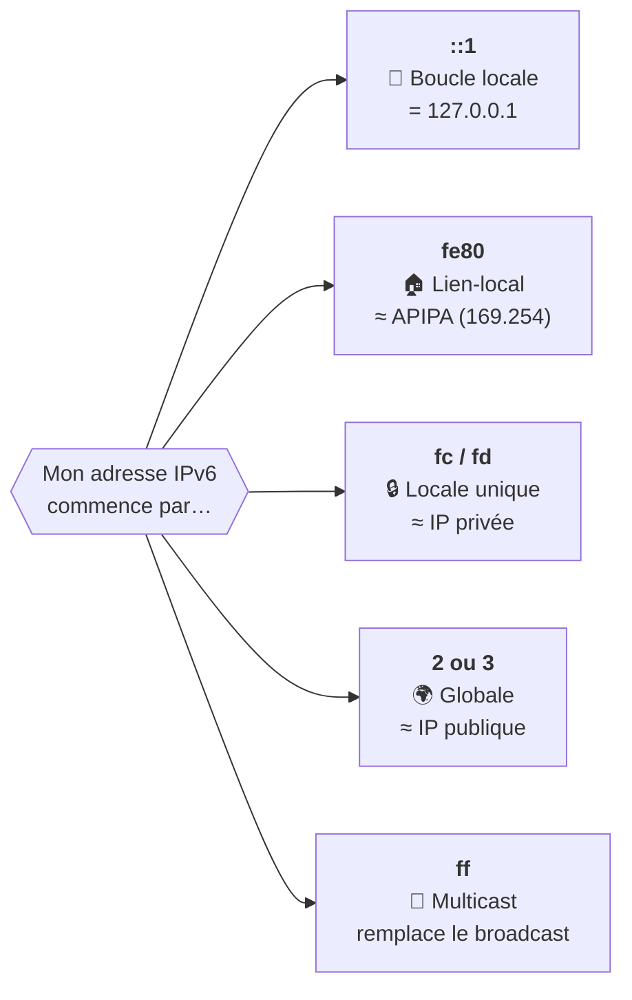

# Module 6 : L'adressage IPv6

*Cours : [Cours 1 - Bases des réseaux](../index.md)*

## 🎯 Objectif du module

À la fin de ce module, tu sais :

- lire une adresse IPv6 et l'**écrire en version courte** (et inversement) ;
- reconnaître **le type d'une adresse** à son début (`::1`, `fe80`, `fd`, `2…`, `ff`) ;
- expliquer **unicast, multicast et anycast** ;
- dire **quelles adresses IPv6** possède un poste.

!!! abstract "En clair : pourquoi IPv6 ?"
    En IPv4, il n'y a que **4,3 milliards** d'adresses : il n'y en a plus assez pour tous les appareils du monde (d'où le NAT et les box qui partagent une seule adresse publique). IPv6 passe à **128 bits**, soit environ **3,4 × 10³⁸** adresses : de quoi donner une adresse publique à **chaque appareil**, sans NAT.

## 🖼️ Résumé visuel

**① Une adresse IPv6 = 8 groupes de 4 caractères hexadécimaux. La 1ʳᵉ moitié désigne le réseau, la 2ᵉ la machine.**

<div class="tssr-ip">
  <div class="tssr-ip-grid" style="grid-template-columns: 5.5rem repeat(8, minmax(3.3rem, 1fr)); min-width: 36rem;">
    <span class="tssr-ip-label">Adresse</span>
    <span class="tssr-ip-oct is-net"><b>2001</b><code>16 bits</code></span>
    <span class="tssr-ip-oct is-net"><b>0db8</b><code>16 bits</code></span>
    <span class="tssr-ip-oct is-net"><b>85a3</b><code>16 bits</code></span>
    <span class="tssr-ip-oct is-net"><b>0000</b><code>16 bits</code></span>
    <span class="tssr-ip-oct is-host"><b>0000</b><code>16 bits</code></span>
    <span class="tssr-ip-oct is-host"><b>8a2e</b><code>16 bits</code></span>
    <span class="tssr-ip-oct is-host"><b>0370</b><code>16 bits</code></span>
    <span class="tssr-ip-oct is-host"><b>7334</b><code>16 bits</code></span>
    <span class="tssr-ip-label"></span>
    <span class="tssr-ip-brace is-net" style="grid-column: span 4;">◀ <b>Préfixe réseau</b> : 64 bits (/64) ▶</span>
    <span class="tssr-ip-brace is-host" style="grid-column: span 4;">◀ <b>Identifiant d'interface</b> : 64 bits ▶</span>
  </div>
  <div class="tssr-ip-results" style="min-width: 36rem;">
    <div><small>Écriture courte</small><b>2001:db8:85a3::8a2e:370:7334</b><span>zéros de tête retirés + <code>::</code></span></div>
    <div><small>Taille</small><b>8 × 16 = 128 bits</b><span>IPv4 : 32 bits</span></div>
    <div><small>Séparateur</small><b>:</b><span>IPv4 : le point <code>.</code></span></div>
    <div><small>Réseau standard</small><b>/64</b><span>IPv4 : souvent /24</span></div>
  </div>
</div>

**② Reconnaître une adresse à son début**



## 📖 Cours consolidé

### 1. IPv4 et IPv6 côte à côte

| | IPv4 | IPv6 |
|---|---|---|
| **Taille** | 32 bits | **128 bits** |
| **Écriture** | 4 nombres décimaux séparés par `.` | **8 groupes hexadécimaux** séparés par `:` |
| **Exemple** | `192.168.1.10` | `2001:db8:85a3::8a2e:370:7334` |
| **Masque** | `255.255.255.0` ou `/24` | toujours un **préfixe** : `/64` |
| **Nombre d'adresses** | 4,3 milliards | ≈ 3,4 × 10³⁸ |
| **Broadcast** | Oui | **Non** → **multicast** |
| **NAT** | Indispensable | **Inutile** (assez d'adresses publiques) |
| **Config. automatique** | DHCP | **SLAAC** (le poste se configure seul) ou DHCPv6 |

💡 **Hexadécimal** ([module 2](../module-2-les-unites-informatiques/index.md)) : 0 à 9 puis **a à f**. 1 caractère = 4 bits → 1 groupe de 4 caractères = **16 bits**.

---

### 2. Écrire une adresse en version courte

| Règle (dans cet ordre) | Exemple |
|---|---|
| **① Zéros de tête** : dans chaque groupe, on retire les 0 **du début** | `0db8` → `db8` · `0042` → `42` · `0000` → `0` |
| **② Le `::`** : la plus longue suite de groupes à 0 devient `::`, **une seule fois** | `2001:db8:0:0:0:ff00:42:8329` → `2001:db8::ff00:42:8329` |

```
Complète      :  fe80:0000:0000:0000:020c:29ff:fe3a:0b12
① zéros       :  fe80:0:0:0:20c:29ff:fe3a:b12
② ::          :  fe80::20c:29ff:fe3a:b12
```

⚠️ Pièges :

- Seulement les zéros **du début** : `0370` → `370`, mais `ff00` reste `ff00`.
- **Un seul `::`** : `2001:db8:0:0:1:0:0:1` → `2001:db8::1:0:0:1` (et **pas** `2001:db8::1::1`).
- Pour décompresser : le `::` remplace **ce qui manque pour arriver à 8 groupes**.

---

### 3. Les 3 façons d'envoyer un paquet

| Type | Envoyé à… | Image | Exemple |
|---|---|---|---|
| **Unicast** | **Une** machine | Une lettre | PC → serveur |
| **Multicast** | **Un groupe** abonné | Un groupe WhatsApp | `ff02::1` = tous les appareils du lien · `ff02::2` = tous les routeurs |
| **Anycast** | **La plus proche** d'un groupe | Le 112 : le centre le plus proche répond | Serveurs DNS mondiaux |

📌 **Plus de broadcast en IPv6** : le multicast le remplace.

---

### 4. Les types d'adresses à reconnaître

| Début | Nom | Rôle | Équivalent IPv4 |
|---|---|---|---|
| **`::1`** | Boucle locale | Se tester soi-même | `127.0.0.1` |
| **`fe80::/10`** | **Lien-local** | Parler au **réseau local**, créée **automatiquement** par chaque carte · **jamais routée** | APIPA `169.254.x.x` |
| **`fc00::/7`** (en pratique `fd…`) | **Locale unique** (ULA) | Réseau **privé** interne | `10.x`, `192.168.x` |
| **`2000::/3`** (`2…` ou `3…`) | **Globale** (GUA) | Joignable sur **Internet** | Adresse publique |
| **`ff00::/8`** | Multicast | Envoi à un groupe | (broadcast) |
| **`::/0`** | Route par défaut | « Tout le reste » | `0.0.0.0/0` |

**Structure d'une adresse globale** : **48 bits** de préfixe (donné par le FAI) + **16 bits** de sous-réseau + **64 bits** d'identifiant d'interface (la machine). Un réseau standard est donc un **/64**.

💡 L'identifiant d'interface est **tiré au hasard** ou **calculé depuis la MAC** (**EUI-64** : on insère `ff:fe` au milieu de la MAC).

---

### 5. Un poste a plusieurs adresses IPv6

En IPv4 : **une** adresse par carte. En IPv6 : **toujours plusieurs** à la fois.

| Adresse | Présente ? | Exemple |
|---|---|---|
| Boucle locale | ✅ Toujours | `::1` |
| Lien-local | ✅ Toujours, une par carte | `fe80::20c:29ff:fe3a:b12` |
| Multicast | ✅ Toujours | `ff02::1` |
| Globale | Si le réseau a IPv6 vers Internet | `2a01:cb00:1234:5600::10` |
| Locale unique | Si le réseau en utilise | `fd12:3456:789a::10` |

- 🩺 Pour les voir : `ipconfig` (ligne « Adresse IPv6 de liaison locale : fe80::…%12 ») ou `ip -6 a` sous Linux.
- **Double pile** (*dual stack*) : la plupart des postes ont une IPv4 **et** des IPv6, et choisissent selon la destination.

## 📝 Fiche de révision

### 🧠 Reconnaître une adresse en 1 seconde

| Si ça commence par… | C'est… | Comme en IPv4… |
|---|---|---|
| `::1` | 🔁 Boucle locale | `127.0.0.1` |
| `fe80` | 🏠 Lien-local (automatique, réseau local seulement) | `169.254.x.x` |
| `fd` (ou `fc`) | 🔒 Locale unique (privée) | `192.168.x.x`, `10.x.x.x` |
| `2` ou `3` | 🌍 Globale (publique, Internet) | adresse publique |
| `ff` | 📢 Multicast (`ff02::1` tous, `ff02::2` routeurs) | broadcast |

### ✂️ Compresser : la méthode

1. Retirer les **0 au début** de chaque groupe (`0db8` → `db8`, `0000` → `0`).
2. Remplacer la **plus longue suite** de `0` par **`::`**, **une seule fois**.

| Complète | Courte |
|---|---|
| `2001:0db8:0000:0000:0000:ff00:0042:8329` | `2001:db8::ff00:42:8329` |
| `fe80:0000:0000:0000:020c:29ff:fe3a:0b12` | `fe80::20c:29ff:fe3a:b12` |
| `0000:0000:0000:0000:0000:0000:0000:0001` | `::1` |

### ⚠️ Les pièges

- **Un seul `::`** par adresse.
- On ne retire que les zéros **de tête** : `ff00` ne devient pas `ff`.
- **Pas de broadcast** en IPv6 (c'est le multicast).
- Une adresse **`fe80`** ne sort **jamais** du réseau local.
- En IPv6, avoir **plusieurs adresses** sur une carte est **normal**.

### ✏️ Entraîne-toi (clique pour voir la correction)

??? question "1. Écris en version courte : 2001:0db8:0000:0001:0000:0000:0000:00ab"
    ① Zéros de tête : `2001:db8:0:1:0:0:0:ab`

    ② La plus longue suite de 0 est `0:0:0` (3 groupes) → **`2001:db8:0:1::ab`**

    Le `0` isolé (3ᵉ groupe) reste écrit, car on n'a droit qu'à **un** `::`.

??? question "2. Écris en version complète : 2001:db8::1"
    On compte les groupes présents : `2001`, `db8`, `1` = **3 groupes**. Le `::` remplace donc **8 − 3 = 5 groupes** de zéros.

    → **`2001:0db8:0000:0000:0000:0000:0000:0001`**

??? question "3. De quel type sont ces adresses : fe80::1c2a:3bff:fe4d:5e6f · 2a01:cb00:1234::10 · fd12:3456:789a::1 · ff02::2 ?"
    - `fe80::1c2a:3bff:fe4d:5e6f` → **lien-local** (réseau local seulement)
    - `2a01:cb00:1234::10` → **globale** (commence par 2, joignable sur Internet)
    - `fd12:3456:789a::1` → **locale unique** (privée)
    - `ff02::2` → **multicast** : tous les routeurs du réseau local

??? question "4. Un collègue s'inquiète : « ipconfig affiche 3 adresses IPv6 sur ma carte, c'est un bug ? »"
    **Non, c'est normal.** En IPv6, une carte a toujours **plusieurs adresses** : au minimum une **lien-local** (`fe80::`), souvent une ou plusieurs **globales** (dont des adresses temporaires pour la vie privée), plus les adresses **multicast** qui n'apparaissent pas dans `ipconfig`.

## 🧠 Quiz — entraîne-toi

<div id="quiz-cours-01-bases-des-reseaux-module-6-l-adressage-ipv6"></div>

<script type="application/json" id="quiz-cours-01-bases-des-reseaux-module-6-l-adressage-ipv6-data">
[
  {
    "question": "Sur combien de bits est codée une adresse IPv6 ?",
    "options": [
      "128 bits",
      "32 bits",
      "64 bits",
      "256 bits"
    ],
    "correctIndex": 0,
    "explanation": "Une adresse IPv6 est codée sur 128 bits, soit quatre fois la taille d'une adresse IPv4 (32 bits), ce qui offre un espace d'adressage considérablement plus vaste."
  },
  {
    "question": "Comment une adresse IPv6 est-elle représentée en notation standard ?",
    "options": [
      "Quatre groupes de huit chiffres décimaux séparés par des points",
      "Huit groupes de quatre chiffres hexadécimaux séparés par des deux-points",
      "Seize groupes de deux chiffres binaires séparés par des tirets",
      "Six groupes de six chiffres hexadécimaux séparés par des virgules"
    ],
    "correctIndex": 1,
    "explanation": "Une adresse IPv6 s'écrit sous la forme de huit groupes (quartets) de quatre chiffres hexadécimaux, chaque groupe représentant 16 bits, séparés par des deux-points, comme dans 2001:0db8:85a3:0000:0000:8a2e:0370:7334."
  },
  {
    "question": "Dans la simplification d'une adresse IPv6, combien de fois le symbole :: peut-il être utilisé dans une même adresse ?",
    "options": [
      "Deux fois maximum",
      "Autant de fois que nécessaire",
      "Une seule fois",
      "Uniquement au début de l'adresse"
    ],
    "correctIndex": 2,
    "explanation": "Le symbole :: remplace une ou plusieurs séries continues de groupes à zéro, mais il ne peut apparaître qu'une seule fois dans une adresse, afin d'éviter toute ambiguïté sur le nombre de groupes qu'il représente."
  },
  {
    "question": "Quelle est l'adresse de boucle locale (loopback) en IPv6, équivalente à 127.0.0.1 en IPv4 ?",
    "options": [
      "::0",
      "FE80::1",
      "FF00::1",
      "::1"
    ],
    "correctIndex": 3,
    "explanation": "L'adresse ::1 est l'équivalent IPv6 de l'adresse de boucle locale 127.0.0.1 en IPv4, utilisée pour tester la connectivité locale d'un appareil avec lui-même."
  },
  {
    "question": "À quelle plage d'adresses correspondent les adresses locales de lien (link-local) en IPv6 ?",
    "options": [
      "FE80::/10",
      "2000::/3",
      "FF00::/8",
      "::/0"
    ],
    "correctIndex": 0,
    "explanation": "Les adresses locales de lien utilisent la plage FE80::/10 et permettent la communication entre appareils d'un même réseau local sans configuration particulière, un rôle comparable à celui des adresses APIPA en IPv4."
  },
  {
    "question": "Quelle plage d'adresses IPv6 correspond aux adresses globales routables sur Internet ?",
    "options": [
      "FE80::/10",
      "2000::/3",
      "FF00::/8",
      "::1/128"
    ],
    "correctIndex": 1,
    "explanation": "Les adresses globales, routables sur Internet, appartiennent à la plage 2000::/3, contrairement aux adresses de lien-local ou de multidiffusion qui ont une portée plus restreinte."
  },
  {
    "question": "Pourquoi l'IPv6 permet-il de supprimer le recours au NAT (Network Address Translation) ?",
    "options": [
      "Parce que le NAT est incompatible avec le protocole ICMP",
      "Parce que l'IPv6 chiffre automatiquement toutes les communications",
      "Parce que l'espace d'adressage est suffisamment vaste pour attribuer une adresse unique à chaque appareil",
      "Parce que l'IPv6 n'utilise pas d'adresses IP pour les hôtes"
    ],
    "correctIndex": 2,
    "explanation": "Grâce à un espace d'adressage bien plus vaste que celui de l'IPv4 (environ 3,4 × 10^38 adresses), chaque appareil peut disposer de sa propre adresse unique, ce qui élimine le besoin de traduire les adresses via le NAT."
  },
  {
    "question": "Quel mécanisme permet à un appareil IPv6 de générer automatiquement son adresse à partir du préfixe réseau, sans intervention manuelle ni serveur DHCP ?",
    "options": [
      "Le protocole NAT64",
      "Le tunneling IPv6-dans-IPv4",
      "La double pile (dual stack)",
      "L'auto-configuration stateless (SLAAC)"
    ],
    "correctIndex": 3,
    "explanation": "L'auto-configuration stateless permet à un appareil de générer automatiquement son adresse IPv6 à partir du préfixe réseau annoncé, simplifiant considérablement la configuration réseau."
  },
  {
    "question": "Qu'est-ce que la technique du « Double Stack » pour assurer la coexistence entre IPv4 et IPv6 ?",
    "options": [
      "Les paquets IPv6 sont encapsulés dans des paquets IPv4",
      "Les appareils utilisent simultanément les deux protocoles IPv4 et IPv6",
      "Les adresses IPv6 sont traduites en adresses IPv4 par un routeur dédié",
      "Les appareils basculent automatiquement d'IPv4 vers IPv6 après un délai fixe"
    ],
    "correctIndex": 1,
    "explanation": "Le Double Stack consiste à faire fonctionner les deux protocoles IPv4 et IPv6 simultanément sur un même appareil, lui permettant de communiquer indifféremment avec des hôtes IPv4 ou IPv6."
  },
  {
    "question": "Parmi les trois catégories principales d'adresses IPv6, laquelle permet d'envoyer un paquet au nœud le plus proche parmi un groupe d'appareils partageant la même adresse ?",
    "options": [
      "Les adresses Unicast",
      "Les adresses Multicast",
      "Les adresses de boucle locale",
      "Les adresses Anycast"
    ],
    "correctIndex": 3,
    "explanation": "Une adresse Anycast est partagée par plusieurs nœuds ; un paquet envoyé à cette adresse est délivré uniquement au nœud le plus proche selon les règles de routage, contrairement au multicast qui livre le paquet à tous les membres du groupe."
  },
  {
    "question": "Quel type d'adresse IPv6 remplace en grande partie les adresses de diffusion (broadcast) utilisées en IPv4 ?",
    "options": [
      "Les adresses Multicast",
      "Les adresses Unicast",
      "Les adresses Anycast",
      "Les adresses de lien-local uniquement"
    ],
    "correctIndex": 0,
    "explanation": "L'IPv6 ne dispose pas d'adresses de diffusion comme l'IPv4 ; les adresses de multidiffusion (multicast) permettent d'envoyer un paquet à un groupe défini de destinataires, un rôle qui remplace en grande partie le broadcast."
  },
  {
    "question": "Dans la structure d'une adresse GUA (Global Unicast Address), combien de bits sont réservés à l'identifiant d'interface ?",
    "options": [
      "48 bits",
      "64 bits",
      "16 bits",
      "32 bits"
    ],
    "correctIndex": 1,
    "explanation": "Une adresse GUA se divise en un préfixe global (48 bits), un identifiant de sous-réseau (16 bits) et un identifiant d'interface (64 bits), ce dernier étant souvent dérivé de l'adresse MAC via le format EUI-64."
  },
  {
    "question": "Quel préfixe commun partagent toutes les adresses de multidiffusion (multicast) en IPv6 ?",
    "options": [
      "FE80::/10",
      "2000::/3",
      "::1/128",
      "FF00::/8"
    ],
    "correctIndex": 3,
    "explanation": "Toutes les adresses de multidiffusion IPv6 appartiennent à la plage FF00::/8, c'est-à-dire que leurs 8 premiers bits valent toujours FF."
  },
  {
    "question": "À quoi correspond l'adresse de multidiffusion FF02::1 ?",
    "options": [
      "Le groupe contenant tous les routeurs d'un réseau local",
      "Le groupe contenant tous les nœuds d'un réseau local (scope lien-local)",
      "Une multidiffusion spécifique au niveau mondial",
      "L'adresse de boucle locale équivalente à 127.0.0.1"
    ],
    "correctIndex": 1,
    "explanation": "FF02::1 désigne, avec une portée lien-local, le groupe regroupant tous les nœuds présents sur le réseau local, tandis que FF02::2 désigne spécifiquement tous les routeurs de ce même réseau."
  },
  {
    "question": "Combien d'adresses IPv6 uniques l'espace d'adressage permet-il théoriquement de générer, comparé aux 4,3 milliards d'adresses IPv4 ?",
    "options": [
      "Environ 4,3 × 10^9 adresses",
      "Environ 1,8 × 10^19 adresses",
      "Un nombre illimité d'adresses, sans aucune limite théorique",
      "Environ 3,4 × 10^38 adresses"
    ],
    "correctIndex": 3,
    "explanation": "Grâce à ses 128 bits, l'espace d'adressage IPv6 permet de générer environ 3,4 × 10^38 adresses, un nombre considérablement plus grand que les 4,3 milliards d'adresses disponibles en IPv4."
  },
  {
    "question": "Quelle est l'écriture courte correcte de 2001:0db8:0000:0000:0000:ff00:0042:8329 ?",
    "options": [
      "2001:db8::ff00:42:8329",
      "2001:db8::ff:42:8329",
      "2001:db8:0::ff00:0042:8329",
      "2001::db8::ff00:42:8329"
    ],
    "correctIndex": 0,
    "explanation": "On retire les zéros de tête (0db8 → db8, 0042 → 42, mais ff00 reste ff00), puis on remplace la suite de trois groupes à 0 par un seul ::."
  },
  {
    "question": "Une adresse IPv6 commence par fd. De quel type est-elle ?",
    "options": [
      "Globale, joignable sur Internet",
      "Multicast",
      "Locale unique : l'équivalent d'une adresse privée",
      "Boucle locale"
    ],
    "correctIndex": 2,
    "explanation": "Les adresses locales uniques (ULA) appartiennent à fc00::/7 ; en pratique elles commencent par fd. Comme les adresses privées IPv4, elles ne sont pas routées sur Internet."
  },
  {
    "question": "Combien de groupes de zéros remplace le :: dans 2001:db8::1 ?",
    "options": [
      "2",
      "3",
      "5",
      "6"
    ],
    "correctIndex": 2,
    "explanation": "Une adresse complète compte 8 groupes. Il y en a 3 d'écrits (2001, db8, 1), donc le :: en remplace 8 − 3 = 5."
  }
]
</script>

<script>
  document.addEventListener("DOMContentLoaded", function () {
    TSSRQuiz.init({
      containerId: "quiz-cours-01-bases-des-reseaux-module-6-l-adressage-ipv6",
      dataId: "quiz-cours-01-bases-des-reseaux-module-6-l-adressage-ipv6-data",
    });
  });
</script>
