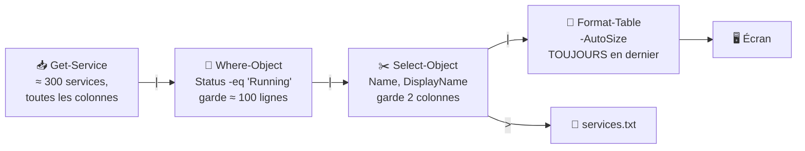
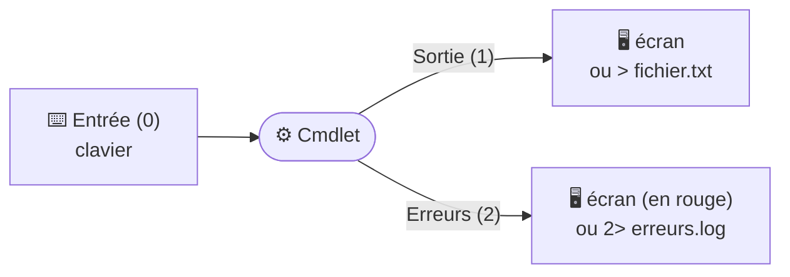

# Module 11 : Aller plus loin avec PowerShell

*Cours : [Cours 2 - Système client Microsoft](../index.md)*

## 🎯 Objectif du module

À la fin de ce module, tu sais :

- **rediriger** un résultat ou des erreurs vers un fichier (`>`, `>>`, `2>`) ;
- **enchaîner** des commandes avec le **pipeline** `|` ;
- **filtrer** des résultats avec `Where-Object` et les **opérateurs de comparaison** ;
- **mettre en forme** l'affichage (`Format-Table`, `Format-List`).

!!! abstract "En clair : la chaîne de montage"
    En PowerShell, on construit une commande comme une **chaîne de montage** : chaque cmdlet fait **une seule chose**, puis **passe le résultat** à la suivante grâce au **`|`** (le *pipe*, ou « tuyau »).

    1. **On récupère** des objets (`Get-…`) ;
    2. **on trie** les lignes (`Where-Object`) ;
    3. **on choisit** les colonnes (`Select-Object`) ;
    4. **on met en forme** ou **on enregistre** (`Format-Table`, `> fichier`).

## 🖼️ Résumé visuel

**① Le pipeline : chaque étape travaille sur le résultat de la précédente**



**② Les 3 flux d'une commande**



## 📖 Cours consolidé

### 1. Rediriger vers un fichier

Une commande a **3 flux** : **entrée** `0` (clavier) · **sortie** `1` (le résultat, à l'écran) · **erreurs** `2` (messages rouges, à l'écran).

| Syntaxe | Effet | Exemple |
|---|---|---|
| **`>`** | Résultat dans un fichier, **écrasé** | `Get-LocalUser > C:\Temp\users.txt` |
| **`>>`** | **Ajoute** à la fin | `Get-Date >> C:\Temp\journal.txt` |
| **`2>`** | **Seulement les erreurs** dans un fichier | `Get-Item C:\inexistant 2> C:\Temp\erreurs.log` |
| **`2>&1`** | Erreurs **au même endroit** que le résultat | `commande > tout.txt 2>&1` |
| **`2>$null`** | **Jette** les erreurs | `Get-ChildItem C:\ -Recurse 2>$null` |

💡 Le fichier est **créé s'il n'existe pas** ; lecture : `Get-Content` (alias `cat`). Alternative à `>` : **`| Out-File chemin`**.

---

### 2. Le pipeline `|`

Le **`|`** donne le **résultat** de gauche **en entrée** à la commande de droite.

```powershell
Get-NetAdapter | Select-Object Name, Status, LinkSpeed
```

```text
Name                            Status         LinkSpeed
----                            ------         ---------
Ethernet0                       Up             1 Gbps
Wi-Fi                           Disconnected   0 bps
```

---

### 3. Filtrer avec `Where-Object` (alias `where`, `?`)

Garde **seulement** les objets qui respectent une condition.

| Opérateur | Signifie | Exemple |
|---|---|---|
| **`-eq`** / **`-ne`** | égal / différent | `Status -eq "Running"` |
| **`-gt`** / **`-ge`** | plus grand / ou égal | `Length -gt 1MB` |
| **`-lt`** / **`-le`** | plus petit / ou égal | `CPU -lt 10` |
| **`-like`** / **`-notlike`** | ressemble (avec **jokers** `*`) / ne ressemble pas | `Name -like "*Windows*"` |

- Pas de différence **majuscules / minuscules** (sauf avec un **`c`** : `-ceq`, `-clike`).
- ⚠️ `-like` a besoin de **jokers** : `"*up*"` = contient « up », `"up"` = exactement « up ».

```powershell
Get-NetAdapter | Where-Object Status -eq "Up"                                   # 1 condition
Get-Service | Where-Object { $_.Status -eq "Running" -and $_.StartType -eq "Automatic" }   # plusieurs
Get-ChildItem $HOME\Downloads | Where-Object { $_.Length -gt 100MB } | Select-Object Name, Length
```

| Élément | Signification |
|---|---|
| `{ … }` | Le **bloc de filtre** |
| **`$_`** | « **l'objet en cours** » ; `$_.Status` = sa propriété Status |
| **`-and`** / **`-or`** | **ET** (les deux) / **OU** (au moins une) |

💡 PowerShell comprend **`KB`, `MB`, `GB`** : `100MB` = 104 857 600 octets.

---

### 4. Mettre en forme l'affichage

| Cmdlet | Alias | Affiche… |
|---|---|---|
| **`Format-Table`** | `ft` | En **tableau** (`-AutoSize` ajuste) |
| **`Format-List`** | `fl` | En **liste** : `-Property *` pour **tout voir** |
| **`Format-Wide`** | `fw` | **Une** propriété sur plusieurs colonnes |

```powershell
Get-Service -Name Spooler | Format-List -Property *
Get-Service | Format-Wide -Property Name -Column 4
```

⚠️ **Les `Format-*` toujours en dernier** : après eux, plus de filtre, de tri ni d'export propre. Pour **exporter** : `Select-Object` puis `Export-Csv` ou `Out-File`.

## 📝 Fiche de révision

### 🧠 Les symboles en un tableau

| Symbole | Rôle |
|---|---|
| `>` | Résultat → fichier (écrase) |
| `>>` | Résultat → fichier (ajoute) |
| `2>` | Erreurs → fichier |
| `2>$null` | Jeter les erreurs |
| `|` | Pipeline : passer le résultat à la commande suivante |
| `$_` | L'objet en cours dans le pipeline |
| `*` | Joker avec `-like` |
| `-and` / `-or` | ET / OU |

### 🔁 Le modèle de commande à retenir

```powershell
Get-Quelquechose | Where-Object { $_.Propriete -operateur Valeur } | Select-Object Prop1, Prop2 | Format-Table -AutoSize
#   récupérer          trier les LIGNES                               choisir les COLONNES    afficher (en dernier)
```

### ⚠️ Les pièges

- **`>` écrase** le fichier, **`>>` ajoute** à la fin.
- `-like "up"` = **exactement** « up » ; « contient up » = `-like "*up*"`.
- Un `Format-Table` **au milieu** d'un pipeline casse la suite.
- `$_.Status`, avec **un point** entre `$_` et la propriété.
- Une valeur texte s'écrit **entre guillemets** : `-eq "Running"`.

### ✏️ Entraîne-toi (clique pour voir la correction)

??? question "1. Enregistre la liste des utilisateurs locaux dans C:\Temp\users.txt, puis ajoute la date à la fin du même fichier."
    ```powershell
    Get-LocalUser > C:\Temp\users.txt
    Get-Date >> C:\Temp\users.txt
    ```

??? question "2. Affiche uniquement les services arrêtés, avec leur nom et leur nom d'affichage."
    ```powershell
    Get-Service | Where-Object Status -eq "Stopped" | Select-Object Name, DisplayName
    ```

??? question "3. Affiche les services dont le nom d'affichage contient « Windows » ET qui sont en cours d'exécution."
    ```powershell
    Get-Service | Where-Object { $_.DisplayName -like "*Windows*" -and $_.Status -eq "Running" }
    ```

??? question "4. Pourquoi cette commande ne donne pas un bon fichier : Get-Process | Format-Table | Export-Csv proc.csv ?"
    `Format-Table` transforme les objets en **simple mise en page** : `Export-Csv` ne reçoit plus les vraies données. La bonne version :
    ```powershell
    Get-Process | Select-Object Name, CPU | Export-Csv proc.csv
    ```

## 🧠 Quiz — entraîne-toi

<div id="quiz-cours-02-systeme-client-microsoft-module-11-aller-plus-loin-avec-powershell"></div>

<script type="application/json" id="quiz-cours-02-systeme-client-microsoft-module-11-aller-plus-loin-avec-powershell-data">
[
  {
    "question": "Quel est le numéro du flux standard correspondant à l'entrée standard (Stdin) en PowerShell ?",
    "options": [
      "0",
      "1",
      "2",
      "3"
    ],
    "correctIndex": 0,
    "explanation": "L'entrée standard, ou Stdin, correspond au flux numéro 0 : c'est par défaut le clavier qui fournit l'ordre à la cmdlet."
  },
  {
    "question": "Par défaut, où est renvoyé le résultat d'une cmdlet (la sortie standard, Stdout:1) ?",
    "options": [
      "Dans un fichier journal automatique",
      "À l'écran",
      "Vers l'entrée standard d'une autre cmdlet",
      "Dans la base de registre"
    ],
    "correctIndex": 1,
    "explanation": "Par défaut, le résultat d'une cmdlet (sortie standard, Stdout:1) est affiché à l'écran, tout comme les erreurs (Stderr:2) par défaut."
  },
  {
    "question": "Quel symbole permet de rediriger la sortie standard d'une cmdlet vers le début d'un fichier (en écrasant son contenu existant) ?",
    "options": [
      "Le double chevron >>",
      "Le pipe |",
      "Le simple chevron >",
      "Le symbole &"
    ],
    "correctIndex": 2,
    "explanation": "Le simple chevron (>) permet de rediriger la sortie standard vers un fichier, en écrasant son contenu s'il existe déjà ; le système crée le fichier automatiquement s'il n'existe pas."
  },
  {
    "question": "Quelle est la différence entre le simple chevron (>) et le double chevron (>>) pour la redirection de sortie ?",
    "options": [
      "Il n'y a aucune différence, les deux fonctionnent de façon identique",
      "Le simple chevron redirige les erreurs, le double chevron redirige la sortie standard",
      "Le double chevron ne fonctionne qu'avec des fichiers .log",
      "Le simple chevron écrase le contenu du fichier, le double chevron ajoute le résultat à la fin du fichier existant"
    ],
    "correctIndex": 3,
    "explanation": "Le simple chevron redirige la sortie standard au début d'un fichier, tandis que le double chevron ajoute le résultat à la fin d'un fichier existant, sans écraser son contenu précédent."
  },
  {
    "question": "Quel chiffre précède le chevron pour rediriger spécifiquement le flux d'erreur d'une commande vers un fichier ?",
    "options": [
      "2",
      "0",
      "1",
      "3"
    ],
    "correctIndex": 0,
    "explanation": "Le chiffre 2 symbolise le flux d'erreur (Stderr) : on utilise donc 2> ou 2>> pour rediriger les erreurs d'une commande vers un fichier plutôt que de les voir apparaître à l'écran."
  },
  {
    "question": "Quelle variable spéciale peut être utilisée comme destination de redirection pour supprimer purement et simplement une sortie (par exemple les erreurs) ?",
    "options": [
      "$true",
      "$null",
      "$error",
      "$output"
    ],
    "correctIndex": 1,
    "explanation": "La variable $null peut être utilisée comme fichier de destination pour supprimer une sortie : rediriger les erreurs vers $null revient à les faire disparaître (les rediriger dans le vide)."
  },
  {
    "question": "Quelle cmdlet permet de vérifier le contenu d'un fichier dans lequel on a redirigé le résultat d'une commande précédente, comme LocalUserList.txt ?",
    "options": [
      "Get-Item",
      "Get-ChildItem",
      "Get-Content",
      "Get-Process"
    ],
    "correctIndex": 2,
    "explanation": "La cmdlet Get-Content permet de vérifier le contenu d'un fichier, par exemple pour contrôler qu'une redirection de sortie standard s'est bien déroulée."
  },
  {
    "question": "Que fait le pipeline (le symbole |) entre deux cmdlets PowerShell ?",
    "options": [
      "Il exécute les deux cmdlets en parallèle sans lien entre elles",
      "Il compare les résultats de deux cmdlets et n'affiche que les différences",
      "Il redirige systématiquement le résultat vers un fichier",
      "Il transmet le résultat de la sortie standard d'une cmdlet vers l'entrée standard de la cmdlet suivante"
    ],
    "correctIndex": 3,
    "explanation": "Le pipeline transmet le résultat de la sortie standard d'une cmdlet vers l'entrée standard de la cmdlet suivante, l'ordre donné à cette dernière étant en fait le résultat de la précédente."
  },
  {
    "question": "Dans la commande Get-NetAdapter | select Name,Status,Linkspeed, à quoi correspond \"select\" ?",
    "options": [
      "Un raccourci de la cmdlet Select-Object, permettant de n'afficher que certaines propriétés",
      "Une commande qui supprime les objets non sélectionnés définitivement",
      "Un alias obligatoire du pipeline lui-même",
      "Une cmdlet réservée uniquement aux objets réseau"
    ],
    "correctIndex": 0,
    "explanation": "\"select\" est un raccourci de la cmdlet Select-Object, qui permet de ne conserver et afficher que certaines propriétés des objets reçus via le pipeline, ici Name, Status et Linkspeed."
  },
  {
    "question": "Quelle cmdlet (ou son diminutif \"where\") permet de réaliser un filtrage basique, en filtrant sur la valeur d'une seule propriété ?",
    "options": [
      "Select-Object",
      "Where-Object",
      "Format-Table",
      "Get-Content"
    ],
    "correctIndex": 1,
    "explanation": "Le filtrage basique repose sur la cmdlet Where-Object, diminutif \"where\", qui ne permet de filtrer qu'une seule propriété à la fois, par exemple Status -like up."
  },
  {
    "question": "Quels opérateurs de comparaison sont adaptés pour rechercher une valeur dans une chaîne de caractères, d'après le tableau du module ?",
    "options": [
      "-eq et -ne uniquement",
      "-gt et -lt uniquement",
      "-like et -notlike",
      "-and et -or"
    ],
    "correctIndex": 2,
    "explanation": "Pour effectuer des recherches à l'aide de chaînes de caractères, le module indique les opérateurs -like (contient) et -notlike (ne contient pas)."
  },
  {
    "question": "Dans quel cas doit-on obligatoirement utiliser la syntaxe du filtrage avancé (-FilterScript{}) plutôt que le filtrage basique ?",
    "options": [
      "Dès que l'on souhaite filtrer sur 2 valeurs ou plus",
      "Dès que l'on souhaite simplement afficher une seule propriété",
      "Uniquement lorsqu'on travaille avec des cmdlets de formatage",
      "Le filtrage avancé n'est jamais nécessaire, le filtrage basique suffit toujours"
    ],
    "correctIndex": 0,
    "explanation": "Dès que l'on doit filtrer deux valeurs ou plus (par exemple le statut ET la vitesse de liaison), il faut utiliser la syntaxe du filtrage avancé avec le paramètre -FilterScript{}."
  },
  {
    "question": "Quel opérateur permet de combiner deux conditions de filtrage avancé qui doivent être vraies simultanément ?",
    "options": [
      "-or",
      "-not",
      "-and",
      "-xor"
    ],
    "correctIndex": 2,
    "explanation": "L'opérateur -and permet de faire une recherche cumulée, c'est-à-dire de combiner deux conditions qui doivent toutes les deux être vraies, comme le statut up ET un linkspeed supérieur à 100 Mbps."
  },
  {
    "question": "Pourquoi les cmdlets de formatage (Format-List, Format-Table, Format-Wide) doivent-elles être utilisées en dernier dans un pipeline ?",
    "options": [
      "Parce qu'elles ralentissent considérablement l'exécution du script",
      "Parce qu'elles ne fonctionnent qu'avec la cmdlet Where-Object",
      "Parce qu'elles nécessitent des privilèges d'administrateur",
      "Parce qu'elles dénaturent les objets, les rendant très difficilement réutilisables ensuite dans un pipeline"
    ],
    "correctIndex": 3,
    "explanation": "Les cmdlets de formatage transforment (dénaturent) les objets en vue de leur affichage, ce qui les rend ensuite très difficilement réutilisables dans la suite d'un pipeline : elles doivent donc être placées en dernier."
  },
  {
    "question": "Quelle cmdlet de formatage permet d'afficher un résultat sous forme de liste plutôt que de tableau ?",
    "options": [
      "Format-List",
      "Format-Table",
      "Format-Wide",
      "Select-Object"
    ],
    "correctIndex": 0,
    "explanation": "Format-List (raccourci fl) permet d'obtenir un résultat sous la forme d'une liste, par opposition à Format-Table qui l'affiche sous forme de tableau."
  },
  {
    "question": "Quelle particularité possède la cmdlet Format-Wide par rapport à Format-List et Format-Table ?",
    "options": [
      "Elle affiche obligatoirement toutes les propriétés d'un objet",
      "Elle ne peut travailler qu'avec une seule propriété à la fois",
      "Elle ne peut être utilisée qu'avec des services système",
      "Elle redirige automatiquement le résultat dans un fichier"
    ],
    "correctIndex": 1,
    "explanation": "Format-Wide se distingue en ne travaillant qu'avec une seule propriété sélectionnée au préalable, dont elle met en forme les valeurs, éventuellement sur plusieurs colonnes."
  },
  {
    "question": "À quoi sert le paramètre -autosize utilisé avec Format-Table ou Format-Wide ?",
    "options": [
      "Il trie automatiquement les résultats par ordre alphabétique",
      "Il limite le nombre de résultats affichés à l'écran",
      "Il dimensionne automatiquement la largeur des colonnes selon leur contenu et la console",
      "Il convertit automatiquement le résultat en fichier CSV"
    ],
    "correctIndex": 2,
    "explanation": "Le paramètre -autosize permet de dimensionner automatiquement la largeur des colonnes en fonction des valeurs qu'elles contiennent et de la largeur de la console PowerShell."
  },
  {
    "question": "Quel opérateur de comparaison insensible à la casse correspond à \"égal\" (equal) dans le tableau du module ?",
    "options": [
      "-ne",
      "-ceq",
      "-like",
      "-eq"
    ],
    "correctIndex": 3,
    "explanation": "L'opérateur -eq (equal) correspond au test d'égalité insensible à la casse ; sa version sensible à la casse équivalente est -ceq."
  },
  {
    "question": "Que renvoie la condition Name -like \"up\" pour une carte réseau nommée « Setup-LAN » ?",
    "options": [
      "Vrai, car le nom contient « up »",
      "Faux, car sans joker -like cherche une correspondance exacte",
      "Une erreur de syntaxe",
      "Vrai seulement avec -clike"
    ],
    "correctIndex": 1,
    "explanation": "-like compare à un modèle : sans joker, il faut une correspondance exacte. Pour « contient up », on écrit -like \"*up*\"."
  },
  {
    "question": "Quelle commande affiche uniquement les services en cours d'exécution ?",
    "options": [
      "Get-Service | Select-Object Running",
      "Get-Service | Where-Object Status -eq \"Running\"",
      "Get-Service > Running",
      "Get-Service | Format-Table Running"
    ],
    "correctIndex": 1,
    "explanation": "Where-Object garde les objets dont la propriété Status est égale (-eq) à « Running ». Select-Object, lui, choisit des colonnes, pas des lignes."
  }
]
</script>

<script>
  document.addEventListener("DOMContentLoaded", function () {
    TSSRQuiz.init({
      containerId: "quiz-cours-02-systeme-client-microsoft-module-11-aller-plus-loin-avec-powershell",
      dataId: "quiz-cours-02-systeme-client-microsoft-module-11-aller-plus-loin-avec-powershell-data",
    });
  });
</script>
