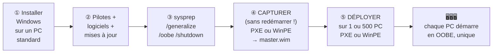

# Module 12 : Introduction à la capture et au déploiement d'images

*Cours : [Cours 2 - Système client Microsoft](../index.md)*

## 🎯 Objectif du module

À la fin de ce module, tu sais :

- expliquer l'intérêt d'un **master** (image de référence) ;
- préparer un master avec **sysprep** ;
- **capturer** une image `.wim` (PXE ou WinPE + `dism`) ;
- **déployer** une image sur un ou plusieurs postes.

!!! abstract "En clair : le moule à gâteaux"
    Installer Windows, les pilotes, Office et les logiciels métier **sur chaque PC**, c'est **des heures** par poste. L'idée : on prépare **un PC parfait une seule fois** (le **master**), on en fait une **photo** (une **image** `.wim`), puis on **colle cette photo** sur des dizaines de PC en quelques minutes.

    Le **master** est le **moule** ; chaque PC déployé est un **gâteau** identique… mais il faut que chaque gâteau ait **son propre nom** : c'est le rôle de **sysprep**.

## 🖼️ Résumé visuel

**Le cycle de vie d'un master**



## 📖 Cours consolidé

### 1. Pourquoi des images ?

Une équipe informatique veut **gagner du temps** pour le consacrer à d'autres projets.

| Levier | Idée | Réalité |
|---|---|---|
| **Matériel identique** | Tous les PC du même modèle | Rarement possible |
| **Logiciel identique** | Un seul OS à gérer (Windows 11 partout) | Réaliste |
| **PC prêts à l'emploi** | Un nouvel arrivant ou un PC en panne → un PC prêt en quelques minutes | ✅ C'est ce que permettent les **masters** |

---

### 2. Construire un master

| Étape | Ce qu'on fait |
|---|---|
| **① Installer Windows** | Sur un PC (ou une VM) **le plus standard possible** |
| **② Configurer** | Pilotes, mises à jour Windows Update, réglages de l'entreprise |
| **③ Installer les logiciels** *(facultatif)* | Navigateur, suite bureautique, logiciels métier **validés par la DSI** |
| **④ Généraliser avec sysprep** | Rendre le système **clonable** |

💡 Le **mode Audit** de sysprep permet de redémarrer le master pour **ajouter** des logiciels ou des pilotes **avant** la généralisation finale.

---

### 3. Sysprep : rendre le master clonable

**Sysprep** (`C:\Windows\System32\Sysprep\sysprep.exe`) **retire tout ce qui est propre à ce PC** : son identifiant de sécurité (**SID** machine), son nom, l'activation, les pilotes de son matériel précis… Au démarrage suivant, chaque PC cloné **repart comme un PC neuf** (écran OOBE) et reçoit **sa propre identité**.

```
sysprep /generalize /oobe /shutdown
```

| Option | Rôle |
|---|---|
| **`/generalize`** | **Généraliser** : supprimer les identifiants uniques (SID machine…) |
| **`/oobe`** | Au prochain démarrage, afficher l'**écran de première configuration** (région, compte…) |
| **`/shutdown`** | **Éteindre** le PC à la fin (pour capturer « à froid ») |

⚠️ **LA règle d'or : après sysprep, NE PAS redémarrer le master sur son Windows.** Sinon, il se « personnalise » à nouveau et **tout le sysprep est à refaire**. On le démarre **sur un autre système** (PXE ou WinPE) pour capturer l'image.

**Les pièges de sysprep**

| Problème | Solution |
|---|---|
| Sysprep échoue à cause des **applications du Microsoft Store** installées pour un utilisateur | Les **désinstaller** avant ; le détail est dans les journaux `C:\Windows\System32\Sysprep\Panther\setupact.log` |
| Les **pilotes** installés à la main sont **supprimés** | Ajouter **`/PersistAllDevicesInstall`**, ou les mettre dans le **magasin de pilotes** (module 9) |
| Les **comptes utilisateurs** locaux **ne sont pas supprimés** | Les **supprimer à la main** avant (sauf les comptes de service nécessaires) |
| Certains **rôles serveur** ne supportent pas sysprep | Vérifier la documentation Microsoft |

---

### 4. Capturer l'image

Le master est éteint après sysprep. Pour faire sa « photo » **sans démarrer son Windows**, on le fait démarrer **sur autre chose** :

| Méthode | Principe | Quand ? |
|---|---|---|
| **Démarrage PXE** (sur le réseau) | La **carte réseau** démarre le PC en chargeant un système depuis un **serveur de déploiement** (WDS, MDT : cours 17), qui **capture** l'image et la **stocke** | En entreprise, avec un serveur |
| **Clé WinPE** | On démarre sur une clé contenant **WinPE** (*Windows Preinstallation Environment*), un **mini-Windows en ligne de commande**, et on capture avec **`dism`** | Sans serveur, au cas par cas |

**Capturer avec `dism` (depuis WinPE)**

```
dism /Capture-Image /ImageFile:E:\master.wim /CaptureDir:C:\ /Name:"Master Win11 Compta"
```

| Paramètre | Signification |
|---|---|
| `/ImageFile:E:\master.wim` | Où **enregistrer** l'image (ici sur un disque externe `E:`) |
| `/CaptureDir:C:\` | Le **disque à photographier** (le Windows du master) |
| `/Name:"…"` | Un **nom** pour s'y retrouver |

💡 **Mettre à jour l'image sans la redéployer** : `dism` sait ouvrir une image `.wim` **hors ligne** (*offline*) pour y ajouter des **mises à jour (KB)**, des **pilotes** ou des fonctionnalités. Le master reste à jour sans être recréé.

---

### 5. Déployer l'image

| Méthode | Déroulé | Pour… |
|---|---|---|
| **Serveur de déploiement** | Le PC démarre en **PXE** (souvent ++f12++ au démarrage) → se connecte au serveur → on **choisit l'image** → installation automatique | **Beaucoup de PC** (10, 50, 500…) en même temps |
| **WinPE + `dism`** | Démarrer sur la clé WinPE → **préparer le disque** (`diskpart`) → **appliquer** l'image → rendre le disque **démarrable** | **Un PC** de temps en temps |

**Déployer à la main avec WinPE**

```
diskpart                                   ← préparer le disque : partitions + formatage (module 4), lettre W:
dism /Apply-Image /ImageFile:E:\master.wim /Index:1 /ApplyDir:W:\    ← copier l'image sur W:
bcdboot W:\Windows                         ← rendre le disque démarrable
```

Au redémarrage, le PC affiche l'écran **OOBE** : il devient **un PC unique**, prêt à être nommé et joint au domaine.

💡 **Avant de déployer**, vérifie que le PC cible respecte les **prérequis** de l'OS (module 2 : TPM 2.0 pour Windows 11, par exemple).

## 📝 Fiche de révision

### 🧠 L'essentiel en un tableau

| Notion | À retenir |
|---|---|
| **Master** | Image de référence, prête à être clonée |
| **`.wim`** | Format d'image Windows |
| **sysprep** | Généralise le système : `/generalize /oobe /shutdown` |
| **OOBE** | L'écran de première configuration |
| **Mode Audit** | Personnaliser le master avant la généralisation |
| **`/PersistAllDevicesInstall`** | Garder les pilotes |
| **Panther** | Dossier des journaux sysprep |
| **PXE** | Démarrage par le réseau sur un serveur de déploiement |
| **WinPE** | Mini-Windows de déploiement (clé USB) |
| **dism** | Capturer, appliquer, mettre à jour une image |
| **bcdboot** | Rendre un disque démarrable |

### ⚠️ Les pièges

- **Redémarrer le master après sysprep** = sysprep à refaire.
- Sysprep **ne supprime pas** les comptes utilisateurs locaux.
- Sysprep **supprime** les pilotes ajoutés à la main (sauf option).
- Les **applications du Store** font échouer sysprep : regarder les journaux de **Panther**.
- Après `dism /Apply-Image`, sans **`bcdboot`**, le PC ne démarre pas.

### ✏️ Entraîne-toi (clique pour voir la correction)

??? question "1. Tu as lancé sysprep sur le master, il s'est éteint. Un collègue le rallume « pour vérifier ». Que se passe-t-il ?"
    Le master démarre l'OOBE et **se re-personnalise** : la généralisation est **perdue**. Il faut **refaire le sysprep** avant de capturer.

??? question "2. Écris la commande sysprep pour généraliser, préparer l'OOBE et éteindre, en gardant les pilotes."
    ```
    sysprep /generalize /oobe /shutdown /PersistAllDevicesInstall
    ```

??? question "3. Ton entreprise doit installer 80 PC identiques la semaine prochaine. Quelle méthode ?"
    Un **serveur de déploiement** (WDS / MDT) : les 80 PC démarrent en **PXE** et reçoivent le master **en parallèle**. WinPE + dism, poste par poste, prendrait beaucoup trop de temps.

??? question "4. Sysprep échoue avec une erreur. Où chercher la cause ?"
    Dans les journaux : **`C:\Windows\System32\Sysprep\Panther\setupact.log`** (et `setuperr.log`). La cause la plus fréquente : une **application du Microsoft Store** installée pour un utilisateur, à désinstaller.

## 🧠 Quiz — entraîne-toi

<div id="quiz-cours-02-systeme-client-microsoft-module-12-introduction-a-la-capture-et-au-deploiement-d-images"></div>

<script type="application/json" id="quiz-cours-02-systeme-client-microsoft-module-12-introduction-a-la-capture-et-au-deploiement-d-images-data">
[
  {
    "question": "Pourquoi une équipe technique cherche-t-elle à tendre vers un parc informatique et un parc de systèmes d'exploitation homogènes ?",
    "options": [
      "Pour réduire les configurations à gérer et le temps de maintien, gagnant ainsi en productivité",
      "Pour augmenter artificiellement le coût du matériel",
      "Parce que la loi l'impose dans toutes les entreprises",
      "Pour empêcher les utilisateurs d'installer des logiciels"
    ],
    "correctIndex": 0,
    "explanation": "Un parc homogène (matériel et systèmes d'exploitation) permet de réduire le nombre de configurations différentes à gérer et le temps de maintien, ce qui se traduit par un gain de productivité pour l'équipe technique."
  },
  {
    "question": "Qu'est-ce qu'une image de référence, aussi appelée \"master\" ?",
    "options": [
      "Une sauvegarde complète des données personnelles des utilisateurs",
      "Un OS prêt à démarrer, à jour, et dans l'idéal muni des logiciels de l'entreprise prêts à l'emploi",
      "Un fichier de configuration du pare-feu partagé entre tous les postes",
      "Une licence Windows unique valable pour tout le parc informatique"
    ],
    "correctIndex": 1,
    "explanation": "Une image de référence, ou master, est un OS prêt à être démarré, à jour, et possédant dans l'idéal les logiciels de l'entreprise déjà installés et prêts à l'emploi."
  },
  {
    "question": "Sur quel type de poste doit-on installer l'OS lors de la création d'un master ?",
    "options": [
      "Sur n'importe quel poste, peu importe sa configuration matérielle",
      "Uniquement sur un serveur dédié, jamais sur un poste client",
      "Sur un ordinateur possédant la configuration matérielle la plus standard de l'entreprise",
      "Uniquement sur une machine virtuelle, jamais sur du matériel physique"
    ],
    "correctIndex": 2,
    "explanation": "La création d'un master commence par l'installation de l'OS sur un ordinateur possédant la configuration matérielle la plus standard possible dans l'entreprise, afin de maximiser la compatibilité lors du déploiement."
  },
  {
    "question": "Quel est le rôle principal de l'outil natif sysprep lors de la préparation d'un master ?",
    "options": [
      "Installer automatiquement tous les pilotes manquants depuis Internet",
      "Chiffrer l'intégralité du disque dur du master",
      "Supprimer définitivement le système d'exploitation après utilisation",
      "Réinitialiser les paramètres personnalisés du master pour rendre les postes uniques dans l'entreprise"
    ],
    "correctIndex": 3,
    "explanation": "Sysprep a pour but de réinitialiser les paramètres personnalisés du master, afin que chaque poste déployé à partir de cette image reste unique dans l'entreprise, notamment via la génération d'un nouveau SID."
  },
  {
    "question": "À quoi correspond le mode OOBE (Out-of-Box Experience) évoqué lors de l'utilisation de sysprep ?",
    "options": [
      "À un mode de diagnostic réseau avancé",
      "Au mode qui permet de saisir les premières configurations après un démarrage \"sortie d'usine\"",
      "À un mode de sauvegarde automatique des données",
      "À l'interface de gestion des pilotes de périphériques"
    ],
    "correctIndex": 1,
    "explanation": "Le mode OOBE (Out-of-Box Experience) est le mode qui permet de saisir les premières configurations après un démarrage \"sortie d'usine\", comme lors de la première installation d'une VM Windows 10."
  },
  {
    "question": "Quelles options de la commande sysprep en ligne de commande permettent de réaliser les mêmes étapes que via l'interface graphique (OOBE, généralisation, extinction) ?",
    "options": [
      "/install /update /restart",
      "/configure /reset /boot",
      "/oobe /generalize /shutdown",
      "/audit /capture /deploy"
    ],
    "correctIndex": 2,
    "explanation": "En ligne de commande, les mêmes étapes sont réalisées avec l'exécutable sysprep suivi des options /oobe /generalize /shutdown."
  },
  {
    "question": "Dans quel dossier peut-on consulter les journaux générés par sysprep pour diagnostiquer un problème éventuel ?",
    "options": [
      "c:\\Windows\\inf",
      "c:\\Windows\\system32\\DriverStore",
      "c:\\Users\\Public\\Logs",
      "c:\\Windows\\system32\\sysprep\\Panther"
    ],
    "correctIndex": 3,
    "explanation": "Les journaux de sysprep se trouvent dans le dossier c:\\Windows\\system32\\sysprep, dans le sous-dossier Panther."
  },
  {
    "question": "Pourquoi les applications installées depuis le Microsoft Store posent-elles problème avec sysprep ?",
    "options": [
      "Elles sont liées au profil de l'utilisateur et doivent être désinstallées avant la généralisation",
      "Elles ne sont jamais compatibles avec Windows 10",
      "Elles nécessitent une connexion Internet permanente",
      "Elles bloquent systématiquement l'extinction du système"
    ],
    "correctIndex": 0,
    "explanation": "Les applications issues du Microsoft Store sont liées au profil de l'utilisateur ; elles doivent être désinstallées avant la généralisation, sous peine de provoquer des erreurs détaillées dans les journaux sysprep."
  },
  {
    "question": "Que fait sysprep par défaut avec les pilotes installés manuellement sur le master ?",
    "options": [
      "Il les conserve systématiquement, sans option particulière",
      "Il les supprime, dans le but de tendre vers la plus grande standardisation possible",
      "Il les chiffre pour éviter tout accès non autorisé",
      "Il les copie automatiquement sur un serveur distant"
    ],
    "correctIndex": 1,
    "explanation": "Par défaut, sysprep supprime les pilotes installés manuellement afin de tendre vers la plus grande standardisation du master ; il faut utiliser l'option /PersistAllDevicesInstall pour les conserver."
  },
  {
    "question": "Quelle option de la commande sysprep permet de conserver les pilotes installés manuellement plutôt que de les supprimer ?",
    "options": [
      "/generalize",
      "/oobe",
      "/PersistAllDevicesInstall",
      "/shutdown"
    ],
    "correctIndex": 2,
    "explanation": "L'option /PersistAllDevicesInstall permet de conserver les pilotes installés manuellement sur le master, qui seraient sinon supprimés par défaut lors de la généralisation."
  },
  {
    "question": "Que se passe-t-il concernant les comptes utilisateurs de la base SAM lors de l'exécution de sysprep ?",
    "options": [
      "Ils sont tous automatiquement supprimés, y compris le compte administrateur",
      "Ils sont fusionnés en un seul compte générique",
      "Sysprep les migre automatiquement vers Active Directory",
      "Ils ne sont pas supprimés par Windows, seul le compte administrateur est réinitialisé par sysprep"
    ],
    "correctIndex": 3,
    "explanation": "Les comptes utilisateurs de la base SAM ne sont pas supprimés par Windows : seul le compte administrateur est réinitialisé par sysprep. La bonne pratique consiste à utiliser ce compte admin pour supprimer manuellement les autres utilisateurs et leurs profils."
  },
  {
    "question": "Que faut-il faire si le poste de référence (master), après exécution de sysprep, est redémarré par mégarde avant la capture de son image ?",
    "options": [
      "Il faut refaire un sysprep, car les avantages de la préparation précédente sont perdus",
      "Rien, cela n'a aucune conséquence sur la capture",
      "Il faut immédiatement réinstaller l'OS depuis zéro",
      "Il faut recréer un nouveau SID manuellement via PowerShell"
    ],
    "correctIndex": 0,
    "explanation": "Si le poste de référence est redémarré par mégarde après le sysprep et avant la capture de l'image, tous les avantages de la préparation sont perdus et il faut refaire un sysprep."
  },
  {
    "question": "Qu'est-ce que l'amorçage PXE (PreBoot Execution Environment) utilisé pour capturer une image sans redémarrer la machine de référence sur son propre OS ?",
    "options": [
      "Un mode de démarrage accéléré du BIOS",
      "Un démarrage via la carte réseau vers un serveur de déploiement dédié",
      "Une technique de chiffrement du disque au démarrage",
      "Un protocole de synchronisation de l'horloge système"
    ],
    "correctIndex": 1,
    "explanation": "L'amorçage PXE permet à la carte réseau d'aller chercher un OS sur un serveur dédié, appelé serveur de déploiement, qui se charge automatiquement de capturer le système et d'en créer une image."
  },
  {
    "question": "Dans quel format est généralement stockée l'image capturée d'un système (le document mentionne \".win\", ce qui correspond en réalité au format Windows standard) ?",
    "options": [
      "Le format .iso exclusivement",
      "Le format .vhdx exclusivement",
      "Le format .wim (Windows Imaging Format)",
      "Le format .exe"
    ],
    "correctIndex": 2,
    "explanation": "Le format d'image généré et utilisé pour la capture/déploiement Windows est le .wim (Windows Imaging Format) ; le document utilisait l'abréviation \".win\", vraisemblablement une coquille pour ce format bien connu."
  },
  {
    "question": "Que signifie l'acronyme WinPE, utilisé lorsqu'on ne dispose pas de serveur de déploiement pour capturer une image ?",
    "options": [
      "Windows Public Edition",
      "Windows Partition Engine",
      "Windows Printer Explorer",
      "Windows Preinstallation Environment"
    ],
    "correctIndex": 3,
    "explanation": "WinPE signifie Windows Preinstallation Environment : un mini OS en ligne de commande, démarrable depuis un DVD, une clé USB ou un autre support externe, dédié à la capture et au déploiement d'images."
  },
  {
    "question": "Quelle est la commande principale de WinPE, utilisée pour la capture, la mise à jour offline et le déploiement d'images système ?",
    "options": [
      "dism (Deployment Image Servicing and Management)",
      "diskpart",
      "sysprep",
      "bcdboot"
    ],
    "correctIndex": 0,
    "explanation": "La commande dism (Deployment Image Servicing and Management tool) est la commande principale et la plus puissante de WinPE pour la capture, la mise à jour offline et le déploiement d'images système."
  },
  {
    "question": "Que peut-on faire sur une image .wim capturée, en mode offline, à l'aide de la commande dism ?",
    "options": [
      "Modifier uniquement la résolution d'écran par défaut",
      "Y insérer des correctifs Windows Update (KB), des logiciels ou des pilotes",
      "Chiffrer automatiquement l'ensemble de son contenu",
      "La convertir automatiquement en machine virtuelle"
    ],
    "correctIndex": 1,
    "explanation": "La commande dism permet de mettre à jour une image .wim en mode offline, en y insérant par exemple des mises à jour Windows Update (KB), des logiciels ou des pilotes supplémentaires."
  },
  {
    "question": "Parmi les outils suivants disponibles dans WinPE, lequel permet de préparer le volume du poste cible destiné à accueillir le futur système ?",
    "options": [
      "nslookup",
      "ping",
      "diskpart",
      "firewall.cpl"
    ],
    "correctIndex": 2,
    "explanation": "WinPE propose notamment l'outil diskpart (ainsi que mount, PowerShell, net use, bcdboot) pour préparer et s'assurer que le poste cible possède un volume prêt à accueillir les fichiers du futur système."
  },
  {
    "question": "Quel est l'avantage principal d'un serveur de déploiement pour installer un même master sur un grand nombre de postes (10, 50, 200, 500) ?",
    "options": [
      "Il supprime complètement le besoin de créer une image de référence",
      "Il remplace l'usage de sysprep sur le master",
      "Il ne fonctionne que pour des postes identiques au master, sans aucune autre condition",
      "Il permet de déployer en masse sans avoir à installer et valider chaque poste manuellement, pour un gain de temps considérable"
    ],
    "correctIndex": 3,
    "explanation": "Le serveur de déploiement permet de déployer en masse une image sur de nombreux postes clients, sans avoir à s'occuper de l'installation et de la validation de chaque ordinateur individuellement, ce qui représente un gain de temps considérable."
  },
  {
    "question": "Après dism /Apply-Image depuis WinPE, quelle commande rend le disque démarrable ?",
    "options": [
      "sysprep",
      "bcdboot",
      "ipconfig",
      "chkdsk"
    ],
    "correctIndex": 1,
    "explanation": "bcdboot W:\\Windows crée les fichiers de démarrage (BCD) pour le Windows qui vient d'être appliqué. Sans elle, le PC ne sait pas démarrer sur ce Windows."
  }
]
</script>

<script>
  document.addEventListener("DOMContentLoaded", function () {
    TSSRQuiz.init({
      containerId: "quiz-cours-02-systeme-client-microsoft-module-12-introduction-a-la-capture-et-au-deploiement-d-images",
      dataId: "quiz-cours-02-systeme-client-microsoft-module-12-introduction-a-la-capture-et-au-deploiement-d-images-data",
    });
  });
</script>
