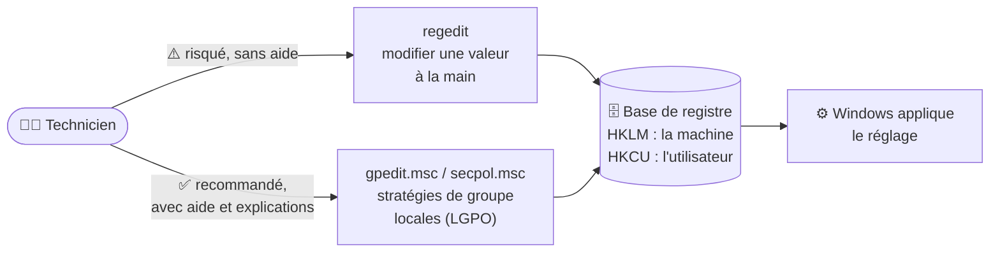

# Module 13 : Les stratégies de groupe locales

*Cours : [Cours 2 - Système client Microsoft](../index.md)*

## 🎯 Objectif du module

À la fin de ce module, tu sais :

- expliquer ce qu'est la **base de registre** et la parcourir avec **`regedit`** ;
- reconnaître les **ruches**, les **clés** et les **valeurs** ;
- configurer le poste avec les **stratégies de groupe locales** (`gpedit.msc`, `secpol.msc`) ;
- lire un paramètre : **Activé / Désactivé / Non configuré**, et « Pris en charge sur ».

!!! abstract "En clair"
    - La **base de registre**, c'est le **grand carnet de réglages** de Windows : des milliers de paramètres (fond d'écran, pilotes, logiciels, sécurité…), que Windows lit en permanence.
    - Le modifier à la main est **risqué** : une erreur peut empêcher Windows de démarrer.
    - Les **stratégies de groupe** (GPO) sont une **interface propre et documentée** pour modifier ces réglages sans aller fouiller dans le registre. Exemples : « interdire le Panneau de configuration », « mot de passe de 12 caractères minimum ».
    - En **local** (LGPO), elles s'appliquent à **un seul PC**. Dans un **domaine** (cours 8), on les applique à **des centaines de PC d'un coup**.

## 🖼️ Résumé visuel

**① Deux chemins vers le même registre**



**② L'organisation du registre : comme des dossiers et des fichiers**

```
HKEY_LOCAL_MACHINE                      ← RUCHE   (comme un disque)
 └─ SOFTWARE                            ← CLÉ     (comme un dossier)
     └─ Microsoft
         └─ Windows
             └─ CurrentVersion
                 ├─ ProgramFilesDir = "C:\Program Files"     ← VALEUR (comme un fichier : nom + type + donnée)
                 └─ ...
```

## 📖 Cours consolidé

### 1. La base de registre

La **base de registre** est une **base de données hiérarchique** (en arbre) où Windows stocke **toute sa configuration** : système, matériel, logiciels, réglages de chaque utilisateur. Elle existe depuis **Windows 95** et contient des **milliers** de paramètres.

Pour l'ouvrir : ++win+r++ → **`regedit`**.

⚠️ **Avant toute modification**, exporte la clé (clic droit → *Exporter*) pour pouvoir **revenir en arrière** : le registre n'a **ni corbeille, ni bouton « Annuler »**.

#### Les 5 ruches

| Ruche | Abréviation | Contient… |
|---|---|---|
| **`HKEY_LOCAL_MACHINE`** | **HKLM** | Les réglages de **l'ordinateur**, communs à **tous les utilisateurs** (matériel, logiciels, sécurité, base SAM) |
| **`HKEY_CURRENT_USER`** | **HKCU** | Les réglages de **l'utilisateur connecté** (son fond d'écran, ses imprimantes…) |
| `HKEY_USERS` | HKU | Les réglages de **tous les profils** chargés (HKCU en est un raccourci) |
| `HKEY_CLASSES_ROOT` | HKCR | Les **associations de fichiers** : quel programme ouvre un `.pdf` |
| `HKEY_CURRENT_CONFIG` | HKCC | Le profil **matériel** utilisé au démarrage |

📌 Les deux ruches à retenir : **HKLM** (la **machine**) et **HKCU** (l'**utilisateur**). Ce sont celles que modifient les stratégies de groupe.

#### Les types de valeurs

| Type | Contient | Exemple |
|---|---|---|
| **`REG_SZ`** | Du **texte** | `Driver Name = "Lexmark XC9200"` |
| **`REG_DWORD`** | Un **nombre** (souvent 0 = non, 1 = oui), affiché en hexadécimal et en décimal | `Shared = 0x00000000 (0)` → l'imprimante **n'est pas** partagée |
| `REG_BINARY` | Des données brutes | |
| `REG_MULTI_SZ` | Une **liste** de textes | |

---

### 2. Les stratégies de groupe locales (LGPO)

**LGPO** = *Local Group Policy Object* (objet de stratégie de groupe local). Ce sont des centaines de réglages **prêts à l'emploi** qui écrivent **proprement** dans le registre.

| Console | Commande | Contenu |
|---|---|---|
| **Éditeur de stratégie de groupe locale** | **`gpedit.msc`** | **Tous** les réglages : poste, utilisateurs, scripts, restrictions |
| **Stratégie de sécurité locale** | **`secpol.msc`** | Seulement la partie **sécurité** : mots de passe, verrouillage, droits, audit |

⚠️ Ces consoles **n'existent pas sous Windows Famille** : il faut l'édition **Pro** ou **Entreprise**.

#### Deux grandes parties

| Partie | Écrit dans… | S'applique… | Exemple |
|---|---|---|---|
| **Configuration ordinateur** | **HKLM** | À la **machine**, quel que soit l'utilisateur | Longueur minimale du mot de passe |
| **Configuration utilisateur** | **HKCU** | À l'**utilisateur** qui se connecte | Interdire l'accès au Panneau de configuration |

💡 En ajoutant le composant « Éditeur d'objets de stratégie de groupe » dans une **console MMC** (`mmc`), on peut cibler en plus les **Administrateurs**, les **Non-administrateurs**, ou **un utilisateur précis** (les autres groupes locaux ne sont pas proposés).

#### Ce qu'on peut faire (exemples)

| Besoin | Où le régler |
|---|---|
| **Mot de passe** d'au moins 12 caractères | `secpol.msc` → Stratégies de comptes → **Stratégie de mot de passe** |
| **Verrouiller le compte** après 5 erreurs | `secpol.msc` → Stratégies de comptes → **Stratégie de verrouillage du compte** |
| Interdire le **Panneau de configuration** | `gpedit.msc` → Configuration utilisateur → Modèles d'administration → Panneau de configuration |
| Imposer un **fond d'écran** | `gpedit.msc` → Configuration utilisateur → Modèles d'administration → Bureau |
| Lancer un **script** à l'ouverture de session | `gpedit.msc` → Configuration utilisateur → Paramètres Windows → **Scripts** |
| Restreindre des **droits d'administration** | `secpol.msc` → Stratégies locales → **Attribution des droits utilisateur** |

---

### 3. Lire et régler un paramètre

Double-clic sur un paramètre :

| Élément | Signification |
|---|---|
| **Non configuré** | **Valeur par défaut** : la stratégie ne touche à rien, Windows garde son comportement normal |
| **Activé** | La stratégie **s'applique** |
| **Désactivé** | La stratégie est **explicitement refusée** |
| **Options** | Des réglages complémentaires (nombre, texte, liste…) |
| **Pris en charge sur** | ⚠️ Les **versions de Windows** sur lesquelles le paramètre **fonctionne** |
| **Aide** | Explique **précisément** l'effet : **à lire avant de toucher** |
| **Commentaire** | Note libre pour **documenter** pourquoi tu as fait ce changement |

!!! warning "Attention à « Activé » ou « Désactivé » sur un paramètre formulé en négatif"
    « **Désactiver** le Gestionnaire des tâches » + **Activé** = le Gestionnaire des tâches est **bloqué**. Lis toujours la phrase **et** l'aide.

⚠️ **« Pris en charge sur »** : un paramètre prévu pour « Windows 7, Vista, Server 2008 » **n'aura aucun effet** sous Windows 10/11, même s'il est activé.

**Appliquer et vérifier** :

| Commande | Rôle |
|---|---|
| **`gpupdate /force`** | Appliquer **immédiatement** les stratégies, sans attendre ni redémarrer |
| **`gpresult /r`** | Afficher les stratégies **réellement appliquées** à l'ordinateur et à l'utilisateur |

## 📝 Fiche de révision

### 🧠 L'essentiel en un tableau

| Notion | À retenir |
|---|---|
| **`regedit`** | Éditeur du registre |
| **Ruche → clé → valeur** | Disque → dossier → fichier |
| **HKLM** | La machine (tous les utilisateurs) |
| **HKCU** | L'utilisateur connecté |
| **REG_SZ / REG_DWORD** | Texte / nombre |
| **`gpedit.msc`** | Stratégie de groupe locale |
| **`secpol.msc`** | Stratégie de sécurité locale |
| **Non configuré** | Comportement par défaut de Windows |
| **Pris en charge sur** | Versions de Windows compatibles |
| **`gpupdate /force`** | Appliquer maintenant |
| **`gpresult /r`** | Voir ce qui est appliqué |

### ⚠️ Les pièges

- Modifier le registre **sans exporter** la clé avant = aucun retour arrière possible.
- **`gpedit.msc` introuvable** ? Le PC est en édition **Famille**.
- Un paramètre **activé** mais « pris en charge sur Windows 7 » = **aucun effet** sous Windows 10/11.
- « **Désactiver** X » + **Activé** = X est **désactivé** (double négation).
- **Non configuré ≠ Désactivé** : « Non configuré » laisse Windows décider.

### ✏️ Entraîne-toi (clique pour voir la correction)

??? question "1. Un réglage doit s'appliquer à tous les utilisateurs du PC. Dans quelle ruche se trouve-t-il, et dans quelle partie de gpedit ?"
    Ruche **HKEY_LOCAL_MACHINE** (HKLM), partie **Configuration ordinateur** de `gpedit.msc`.

??? question "2. On t'a demandé d'imposer des mots de passe de 12 caractères minimum sur un poste. Où vas-tu ?"
    **`secpol.msc`** → Stratégies de comptes → **Stratégie de mot de passe** → *Longueur minimale du mot de passe* = **12**. Puis **`gpupdate /force`**.

??? question "3. Tu as activé une stratégie, mais rien ne change sur le poste. Cite 3 causes possibles."
    - La stratégie n'est **pas encore appliquée** → `gpupdate /force` (ou se déconnecter et se reconnecter pour une stratégie utilisateur).
    - Le paramètre **n'est pas pris en charge** par cette version de Windows (« Pris en charge sur »).
    - Mauvaise compréhension du paramètre (**double négation**) : relire l'aide. Vérifier avec **`gpresult /r`**.

??? question "4. Dans le registre, une valeur Shared de type REG_DWORD vaut 0x00000000 (0) pour une imprimante. Que signifie-t-elle ?"
    `REG_DWORD` = un **nombre** ; ici **0 = non** : l'imprimante **n'est pas partagée**. Avec 1, elle le serait.

## 🧠 Quiz — entraîne-toi

<div id="quiz-cours-02-systeme-client-microsoft-module-13-les-strategies-de-groupe-locales"></div>

<script type="application/json" id="quiz-cours-02-systeme-client-microsoft-module-13-les-strategies-de-groupe-locales-data">
[
  {
    "question": "Comment le module décrit-il la base de registre Windows ?",
    "options": [
      "Une base de données hiérarchique et centrale qui stocke toutes les informations de configuration du système",
      "Un simple fichier texte listant les logiciels installés",
      "Une base de données exclusivement dédiée aux imprimantes",
      "Un service réseau permettant de synchroniser les horloges système"
    ],
    "correctIndex": 0,
    "explanation": "La base de registre est décrite comme une base de données native, hiérarchique et centrale, qui stocke toutes les informations de configuration du système depuis son premier démarrage et pendant toute sa durée de vie."
  },
  {
    "question": "Quelle commande permet de consulter et de modifier manuellement les données de la base de registre ?",
    "options": [
      "gpedit",
      "secpol",
      "regedit",
      "msinfo32"
    ],
    "correctIndex": 2,
    "explanation": "La commande regedit permet de consulter et de modifier manuellement les données de la base de registre, en manipulant cette dernière avec la plus grande précaution."
  },
  {
    "question": "Comment appelle-t-on les 5 grandes catégories dans lesquelles sont regroupées les données de la base de registre ?",
    "options": [
      "Des branches",
      "Des clusters",
      "Des partitions",
      "Des ruches"
    ],
    "correctIndex": 3,
    "explanation": "Les données de la base de registre sont regroupées sous 5 catégories appelées des ruches (HKEY_CLASSES_ROOT, HKEY_CURRENT_USER, HKEY_LOCAL_MACHINE, HKEY_USERS et HKEY_CURRENT_CONFIG)."
  },
  {
    "question": "Quelle ruche de la base de registre contient la configuration relative à l'utilisateur ayant actuellement ouvert une session ?",
    "options": [
      "HKEY_CURRENT_USER",
      "HKEY_LOCAL_MACHINE",
      "HKEY_CLASSES_ROOT",
      "HKEY_CURRENT_CONFIG"
    ],
    "correctIndex": 0,
    "explanation": "La ruche HKEY_CURRENT_USER contient la configuration relative à l'utilisateur actuellement connecté sur l'ordinateur."
  },
  {
    "question": "Quelle ruche contient des informations liées à l'ordinateur et donc communes à tous les utilisateurs ?",
    "options": [
      "HKEY_CLASSES_ROOT",
      "HKEY_LOCAL_MACHINE",
      "HKEY_USERS",
      "HKEY_CURRENT_CONFIG"
    ],
    "correctIndex": 1,
    "explanation": "La ruche HKEY_LOCAL_MACHINE contient des informations en lien avec l'ordinateur lui-même, et donc applicables à tous les utilisateurs de la machine."
  },
  {
    "question": "Avec quelles ruches les équipes systèmes et réseaux travaillent-elles essentiellement pour configurer les stratégies de groupe local ?",
    "options": [
      "HKEY_CLASSES_ROOT et HKEY_CURRENT_CONFIG",
      "HKEY_USERS et HKEY_CURRENT_CONFIG",
      "HKEY_CURRENT_USER et HKEY_LOCAL_MACHINE",
      "Uniquement HKEY_CLASSES_ROOT"
    ],
    "correctIndex": 2,
    "explanation": "Le module précise que les équipes système et réseaux travaillent essentiellement avec les ruches HKEY_CURRENT_USER et HKEY_LOCAL_MACHINE dans le but de configurer les stratégies de groupe local."
  },
  {
    "question": "Que signifie l'acronyme LGPO ?",
    "options": [
      "Local Group Policy Object",
      "Local General Permission Order",
      "Logical Group Process Objective",
      "Local Group Protection Options"
    ],
    "correctIndex": 0,
    "explanation": "LGPO signifie Local Group Policy Object (stratégie de groupe local), qui permet de gérer le comportement du poste de travail et des utilisateurs."
  },
  {
    "question": "Quel composant logiciel enfichable (console MMC) permet de gérer les LGPO pour le poste de travail et les utilisateurs ?",
    "options": [
      "Le gestionnaire de périphériques",
      "L'éditeur d'objets de stratégie de groupe",
      "Le centre réseau et partage",
      "L'observateur d'évènements"
    ],
    "correctIndex": 1,
    "explanation": "L'éditeur d'objets de stratégie de groupe est le composant logiciel enfichable qui permet de gérer le comportement du poste de travail et des utilisateurs via une seule et même console."
  },
  {
    "question": "Quelle autre console MMC, plus orientée sécurité du système, est mentionnée aux côtés de l'éditeur d'objets de stratégie de groupe ?",
    "options": [
      "lusrmgr.msc",
      "diskmgmt.msc",
      "secpol.msc (Stratégie de Sécurité Locale)",
      "compmgmt.msc"
    ],
    "correctIndex": 2,
    "explanation": "La console Stratégie de Sécurité Locale, accessible via secpol.msc, est présentée comme une console complémentaire, plus orientée vers la sécurité du système."
  },
  {
    "question": "Parmi les actions suivantes, laquelle peut être réalisée grâce aux LGPO, d'après le module ?",
    "options": [
      "Formater un disque dur à distance",
      "Créer automatiquement une image de référence (master)",
      "Configurer le forwarder d'un serveur DNS",
      "Renforcer les stratégies de mot de passe et restreindre l'accès à certains menus du système"
    ],
    "correctIndex": 3,
    "explanation": "Les LGPO permettent notamment de renforcer les stratégies de mot de passe, d'agir sur les privilèges d'administration, d'uniformiser l'aspect du poste de travail, et de restreindre l'accès à certains paramètres ou menus."
  },
  {
    "question": "Outre les restrictions de configuration, quel autre type d'action les LGPO permettent-elles de déclencher automatiquement ?",
    "options": [
      "Le lancement de scripts à l'ouverture ou à la fermeture de session utilisateur",
      "L'envoi automatique d'e-mails aux administrateurs",
      "La mise à jour automatique du BIOS",
      "La création automatique de comptes utilisateurs"
    ],
    "correctIndex": 0,
    "explanation": "Les LGPO permettent également de démarrer des scripts à l'ouverture ou à la fermeture des sessions utilisateurs."
  },
  {
    "question": "Sur quelle ruche de la base de registre agit principalement l'éditeur d'objets de stratégie de groupe pour la partie \"ordinateur\" ?",
    "options": [
      "HKEY_CLASSES_ROOT",
      "HKEY_LOCAL_MACHINE",
      "HKEY_CURRENT_CONFIG",
      "HKEY_USERS uniquement"
    ],
    "correctIndex": 1,
    "explanation": "L'éditeur d'objets de stratégie de groupe agit sur la ruche HKEY_LOCAL_MACHINE, éventuellement même celle d'un ordinateur distant, en plus des ruches liées aux utilisateurs."
  },
  {
    "question": "Sur quels groupes prédéfinis l'éditeur d'objets de stratégie de groupe permet-il d'agir, concernant les utilisateurs ?",
    "options": [
      "Tous les groupes locaux existants sur la machine, sans exception",
      "Uniquement le groupe des invités",
      "Les administrateurs et les non-administrateurs uniquement",
      "Uniquement les groupes créés manuellement par l'administrateur"
    ],
    "correctIndex": 2,
    "explanation": "L'éditeur d'objets de stratégie de groupe permet d'agir sur les groupes prédéfinis administrateurs et non-administrateurs ; les autres groupes locaux n'apparaissent pas dans cette console."
  },
  {
    "question": "Quel est l'état par défaut d'un paramètre de stratégie de groupe local qui n'a pas été explicitement configuré ?",
    "options": [
      "Activé par défaut",
      "Désactivé par défaut",
      "Il n'existe pas d'état par défaut, un choix est obligatoire",
      "Non configuré, c'est alors le système qui décide par défaut"
    ],
    "correctIndex": 3,
    "explanation": "Par défaut, chaque paramètre est à l'état \"non configuré\", ce qui signifie que c'est le système qui décide du comportement par défaut tant que l'administrateur n'a pas explicitement activé ou désactivé le paramètre."
  },
  {
    "question": "À quoi correspond le cadre \"pris en charge sur\" affiché pour certains paramètres de stratégie de groupe ?",
    "options": [
      "Aux conditions de compatibilité du paramètre selon les versions de systèmes d'exploitation",
      "À la liste des utilisateurs autorisés à modifier ce paramètre",
      "À la date de dernière modification du paramètre",
      "Au niveau de risque associé à ce paramètre"
    ],
    "correctIndex": 0,
    "explanation": "Le cadre \"pris en charge sur\" indique les conditions de compatibilité d'un paramètre, c'est-à-dire sur quelles versions de systèmes d'exploitation ce paramètre est personnalisable."
  },
  {
    "question": "Dans l'exemple du module concernant la suppression du lien \"jeux\" du menu Démarrer, sur quels systèmes ce paramètre est-il personnalisable ?",
    "options": [
      "Windows 10 et Windows 11 uniquement",
      "Windows Server 2008, Windows 7 et Windows Vista",
      "Tous les systèmes Windows sans exception",
      "Uniquement Windows Server, quelle que soit la version"
    ],
    "correctIndex": 1,
    "explanation": "L'exemple donné précise que ce paramètre concernant le lien jeux du menu Démarrer est personnalisable sur Windows Server 2008, Windows 7 et Windows Vista, mais ne fonctionnera pas sur un OS Windows 10."
  },
  {
    "question": "Pourquoi le module insiste-t-il sur l'importance de lire l'aide associée à chaque paramètre de stratégie de groupe ?",
    "options": [
      "Parce que cette aide est optionnelle et rarement utile",
      "Parce qu'elle remplace entièrement la documentation Technet",
      "Parce qu'elle permet de désactiver automatiquement le paramètre",
      "Parce qu'elle est essentielle et indispensable pour bien comprendre l'effet du paramètre"
    ],
    "correctIndex": 3,
    "explanation": "Le module conclut en précisant que chaque paramètre possède une aide essentielle et indispensable à lire avant toute modification, afin d'en comprendre précisément l'effet."
  },
  {
    "question": "Quel type de valeur du registre contient un nombre, souvent 0 (non) ou 1 (oui) ?",
    "options": [
      "REG_SZ",
      "REG_DWORD",
      "REG_MULTI_SZ",
      "HKEY_LOCAL_MACHINE"
    ],
    "correctIndex": 1,
    "explanation": "REG_DWORD stocke un nombre de 32 bits, souvent utilisé comme interrupteur (0 = désactivé, 1 = activé). REG_SZ stocke du texte."
  },
  {
    "question": "Quelle commande applique immédiatement les stratégies de groupe sans redémarrer ?",
    "options": [
      "gpresult /r",
      "gpupdate /force",
      "regedit",
      "secpol.msc"
    ],
    "correctIndex": 1,
    "explanation": "gpupdate /force réapplique toutes les stratégies tout de suite. gpresult /r sert à vérifier celles qui sont réellement appliquées."
  },
  {
    "question": "Pourquoi gpedit.msc est-il introuvable sur un PC ?",
    "options": [
      "Le pare-feu le bloque",
      "Le PC est en édition Famille, qui ne contient pas l'éditeur de stratégie de groupe",
      "Il faut d'abord lancer regedit",
      "Il n'existe que sur les serveurs"
    ],
    "correctIndex": 1,
    "explanation": "L'éditeur de stratégie de groupe locale (gpedit.msc) et secpol.msc ne sont fournis qu'avec les éditions Pro, Entreprise et Éducation."
  }
]
</script>

<script>
  document.addEventListener("DOMContentLoaded", function () {
    TSSRQuiz.init({
      containerId: "quiz-cours-02-systeme-client-microsoft-module-13-les-strategies-de-groupe-locales",
      dataId: "quiz-cours-02-systeme-client-microsoft-module-13-les-strategies-de-groupe-locales-data",
    });
  });
</script>
