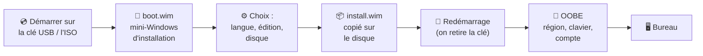

# Module 2 : Installation de Windows 10

*Cours : [Cours 2 - Système client Microsoft](../index.md)*

## 🎯 Objectif du module

À la fin de ce module, tu sais :

- vérifier qu'un PC peut **accueillir Windows** (prérequis) ;
- préparer un **support d'installation** (clé USB, ISO) ;
- choisir entre **nouvelle installation** et **mise à niveau** ;
- dérouler une **installation complète** ;
- **migrer** un utilisateur de son ancien PC vers un nouveau.

!!! abstract "En clair"
    Installer Windows, c'est **copier le système** depuis une clé USB ou un fichier ISO **vers le disque dur** du PC, puis le **personnaliser** : langue, compte utilisateur, réseau. C'est une tâche que tu feras très souvent comme technicien.

## 🖼️ Résumé visuel

**Les étapes d'une installation, du support jusqu'au bureau**



## 📖 Cours consolidé

### 1. Les prérequis matériels

| Composant | Windows 10 (64 bits) | **Windows 11** |
|---|---|---|
| **Processeur** | 1 GHz | 1 GHz, 2 cœurs, **64 bits** et récent |
| **Mémoire vive (RAM)** | 2 Go (1 Go en 32 bits) | **4 Go** |
| **Stockage** | 32 Go (16 Go en 32 bits) | **64 Go** |
| **Démarrage** | BIOS ou UEFI | **UEFI + Secure Boot** obligatoires |
| **Puce de sécurité** | — | **TPM 2.0** obligatoire |

📌 Ce sont des **minimums** : en pratique, prévois **8 Go de RAM** et un **SSD**. L'espace indiqué ne comprend pas les **données** de l'utilisateur.

!!! abstract "En clair : 32 bits ou 64 bits ?"
    Prends **toujours le 64 bits**. Le 32 bits ne peut pas utiliser plus de **4 Go de RAM**, et Windows 11 n'existe qu'en 64 bits. Le 64 bits apporte aussi le **démarrage sécurisé** (*UEFI Secure Boot*) et n'accepte que des **pilotes signés par Microsoft**, ce qui fait moins d'**écrans bleus**.

!!! abstract "En clair : TPM, UEFI, Secure Boot ?"
    - **UEFI** : le logiciel de la carte mère qui démarre le PC (le remplaçant moderne du **BIOS**).
    - **Secure Boot** : l'UEFI vérifie que le système qui démarre est authentique, ce qui bloque les virus de démarrage.
    - **TPM 2.0** : une puce qui garde des clés de sécurité, utilisée notamment par **BitLocker** pour chiffrer le disque.

---

### 2. Le support d'installation

Windows est livré sous forme d'**images** : de gros fichiers `.wim` (*Windows Imaging*) qui contiennent tout le système.

| Fichier | Rôle | Image |
|---|---|---|
| **`boot.wim`** | Un **mini-Windows** qui démarre en premier et lance l'assistant d'installation | Le « livreur » |
| **`install.wim`** | **Tout Windows**, qui sera copié sur le disque | Le « colis » |

**Où trouver l'image ?**

| Support | Usage |
|---|---|
| **Clé USB « bootable »** (sur laquelle le PC peut démarrer) | Le plus courant sur un vrai PC (créée avec l'outil *Media Creation Tool* de Microsoft) |
| **Fichier ISO** | Un « DVD virtuel » : idéal pour les **machines virtuelles** |
| **Partage réseau** | Pour installer **beaucoup de PC** en entreprise (voir module 12) |

---

### 3. Nouvelle installation ou mise à niveau ?

| | **Nouvelle installation** (*Personnalisée*) | **Mise à niveau** |
|---|---|---|
| **Principe** | On **efface** le disque et on repart de zéro | On installe **par-dessus** l'ancien Windows |
| **Données et logiciels** | ❌ Perdus (à sauvegarder avant) | ✅ Conservés |
| **Fiabilité** | ✅ Système propre | ⚠️ Garde les problèmes de l'ancien système |
| **Avis du technicien** | **Recommandée** | À éviter, sauf cas particulier (logiciel qu'on ne sait plus réinstaller) |

⚠️ Impossible de mettre à niveau depuis **Windows XP ou Vista** : il faut faire une nouvelle installation.

---

### 4. Le déroulé d'une installation, pas à pas

| # | Écran | Ce que tu fais |
|---|---|---|
| ① | Démarrage | Le PC démarre sur la clé ou l'ISO (« *Press any key to boot from CD or DVD* » → appuie sur une touche) |
| ② | Langue | Français, puis **Installer maintenant** |
| ③ | Clé de produit | La saisir, ou **« Je n'ai pas de clé de produit »** : Windows fonctionne sans être activé, et on l'active plus tard |
| ④ | Édition | Ex. **Windows 10 Professionnel**. L'édition **N** est la même, mais **sans le lecteur multimédia** (pour le marché européen) |
| ⑤ | Licence | Accepter le **CLUF** |
| ⑥ | Type | **Personnalisé** (nouvelle installation) |
| ⑦ | Disque | Choisir le disque. Il sera formaté en **NTFS** |
| ⑧ | Copie | Windows copie les fichiers, puis **redémarre tout seul** |
| ⑨ | **OOBE** | La « première mise en route » (*Out-Of-Box Experience*) : région, clavier, réseau |
| ⑩ | Compte | Création du **premier utilisateur** (il sera **administrateur**), mot de passe, questions de sécurité |

💡 À l'étape ⑨, choisir **« Je n'ai pas Internet »** permet de créer un **compte local**, sans compte Microsoft (pratique en machine virtuelle).

!!! tip "Astuce Windows 11 : installer sans compte Microsoft"
    Windows 11 impose un compte Microsoft en ligne. Pour créer un compte local : sur l'écran du choix de la région, appuie sur ++shift+f10++, puis tape `start ms-cxh:localonly` et Entrée. Microsoft change régulièrement ces astuces : elle peut ne plus marcher sur les versions récentes.

---

### 5. Migrer un utilisateur vers un nouveau PC

Quand on remplace le PC d'un utilisateur, il doit **retrouver son environnement** : ses fichiers, ses réglages et ses logiciels.

| À transférer | Comment |
|---|---|
| **Fichiers et dossiers** | La **sauvegarde centralisée** de l'entreprise, ou à défaut l'outil Windows **Sauvegarder et restaurer (Windows 7)** |
| **Comptes, profils, paramètres** (fond d'écran, favoris, réglages Outlook…) | **USMT** (*User State Migration Tool*) de Microsoft |
| **Logiciels** | À **réinstaller** sur le nouveau poste |

USMT fonctionne en **2 commandes** :

```
scanstate \\serveur\migration\dupont /i:migapp.xml /i:miguser.xml   ← sur l'ANCIEN PC : capture
loadstate \\serveur\migration\dupont /i:migapp.xml /i:miguser.xml   ← sur le NOUVEAU PC : restauration
```

📌 Une migration réussie, c'est un utilisateur qui **retrouve tout** et **ne perd pas de temps de travail**.

## 📝 Fiche de révision

### 🧠 L'essentiel en un tableau

| Notion | À retenir |
|---|---|
| **Prérequis W10 (64 bits)** | 1 GHz · 2 Go · 32 Go |
| **Prérequis W11** | 1 GHz 2 cœurs · 4 Go · 64 Go · UEFI/Secure Boot · TPM 2.0 |
| **ISO** | DVD virtuel contenant Windows |
| **boot.wim / install.wim** | Mini-Windows d'installation / Windows complet |
| **Édition N** | Sans lecteur multimédia |
| **Personnalisé** | = nouvelle installation |
| **OOBE** | La première mise en route après installation |
| **CLUF** | Contrat de licence à accepter |
| **USMT** | Migration des profils : `scanstate` (capture) → `loadstate` (restauration) |

### ⚠️ Les pièges

- La **mise à niveau** garde les problèmes de l'ancien Windows : on préfère la **nouvelle installation**.
- Pas de mise à niveau depuis **XP / Vista**.
- Sans **TPM 2.0** ni **Secure Boot**, Windows 11 refuse de s'installer.
- Une nouvelle installation **efface le disque** : **sauvegarder avant** !
- Le **32 bits** est limité à **4 Go de RAM**.

### ✏️ Entraîne-toi (clique pour voir la correction)

??? question "1. Un PC a 4 Go de RAM, un disque de 128 Go, un BIOS ancien sans TPM. Peut-on installer Windows 11 ? Windows 10 ?"
    - **Windows 11 : non**, il manque le **TPM 2.0** et l'**UEFI avec Secure Boot**.
    - **Windows 10 64 bits : oui**, 4 Go ≥ 2 Go et 128 Go ≥ 32 Go.

??? question "2. Un utilisateur a un Windows 7 très lent et plein d'erreurs. Mise à niveau ou nouvelle installation ?"
    **Nouvelle installation** (après avoir **sauvegardé ses données**). La mise à niveau conserverait les problèmes de l'ancien système.

??? question "3. Tu remplaces le PC de Mme Dupont. Liste ce qu'il faut transférer, et avec quoi."
    - **Ses fichiers** : sauvegarde centralisée (ou l'outil Sauvegarder et restaurer).
    - **Son profil et ses paramètres** : **USMT**, avec `scanstate` sur l'ancien PC puis `loadstate` sur le nouveau.
    - **Ses logiciels** : à réinstaller sur le nouveau PC.

??? question "4. À l'installation, tu n'as pas la clé de produit. Peux-tu continuer ?"
    **Oui** : clique sur **« Je n'ai pas de clé de produit »**. Windows s'installe et fonctionne. On l'**active plus tard**, en saisissant la clé ou par activation en volume (KMS) en entreprise.

## 🧠 Quiz — entraîne-toi

<div id="quiz-cours-02-systeme-client-microsoft-module-2-installation-de-windows-10"></div>

<script type="application/json" id="quiz-cours-02-systeme-client-microsoft-module-2-installation-de-windows-10-data">
[
  {
    "question": "Quelle configuration processeur minimale est requise pour installer Windows 10 ?",
    "options": [
      "Un processeur capable de fournir une puissance de calcul d'1 GHz",
      "Un processeur multicœur cadencé à au moins 2 GHz",
      "Un processeur 64 bits exclusivement",
      "Un processeur compatible avec la virtualisation matérielle"
    ],
    "correctIndex": 0,
    "explanation": "Windows 10 nécessite au minimum un processeur capable de fournir une puissance de calcul d'1 GHz, quelle que soit l'architecture (32 ou 64 bits)."
  },
  {
    "question": "Quelle quantité de mémoire vive minimale est requise pour installer une version 64 bits de Windows 10 ?",
    "options": [
      "1 Go",
      "2 Go",
      "4 Go",
      "512 Mo"
    ],
    "correctIndex": 1,
    "explanation": "Windows 10 nécessite 1 Go de RAM pour un système 32 bits et 2 Go pour un système 64 bits, bien qu'il soit recommandé de prévoir davantage selon l'usage."
  },
  {
    "question": "Quel espace de stockage minimal est requis pour installer une version 64 bits de Windows 10 ?",
    "options": [
      "16 Go",
      "8 Go",
      "32 Go",
      "64 Go"
    ],
    "correctIndex": 2,
    "explanation": "L'installation de Windows 10 nécessite 16 Go d'espace pour un système 32 bits et 32 Go pour un système 64 bits, afin d'accueillir le système et ses mises à jour."
  },
  {
    "question": "Quel avantage majeur un système Windows 10 64 bits offre-t-il par rapport à un système 32 bits en matière de mémoire ?",
    "options": [
      "Il divise automatiquement la RAM disponible par deux",
      "Il n'a besoin d'aucune mémoire vive pour fonctionner",
      "Il limite la RAM utilisable à 4 Go maximum",
      "Il peut gérer nativement plus de 4 Go de mémoire vive"
    ],
    "correctIndex": 3,
    "explanation": "Contrairement à un système 32 bits limité à environ 4 Go de RAM adressable, un système Windows 10 64 bits peut gérer de manière native plus de 4 Go de mémoire vive."
  },
  {
    "question": "Quelle technologie de firmware un système Windows 10 64 bits utilise-t-il pour offrir un démarrage sécurisé ?",
    "options": [
      "L'UEFI",
      "Le BIOS traditionnel uniquement",
      "Le protocole USMT",
      "Le système de fichiers NTFS"
    ],
    "correctIndex": 0,
    "explanation": "Les systèmes 64 bits intègrent le démarrage sécurisé grâce au firmware UEFI, ce qui renforce la protection du système dès son démarrage."
  },
  {
    "question": "Pourquoi un système Windows 10 64 bits réduit-il le risque d'écran bleu (blue screen of death) lié aux pilotes ?",
    "options": [
      "Parce qu'il désactive automatiquement tous les pilotes tiers",
      "Parce qu'il ne prend en charge que les pilotes signés et approuvés par Microsoft",
      "Parce qu'il n'utilise aucun pilote pour fonctionner",
      "Parce qu'il limite le nombre de périphériques connectés simultanément"
    ],
    "correctIndex": 1,
    "explanation": "Un système 64 bits n'accepte que les pilotes dont la signature a été approuvée par Microsoft, ce qui améliore la fiabilité et réduit le risque d'erreurs critiques comme le blue screen of death."
  },
  {
    "question": "Quel fichier contient l'ensemble des fichiers système déployés sur le disque dur lors de l'installation de Windows ?",
    "options": [
      "boot.wim",
      "migration.xml",
      "install.wim",
      "logfile.log"
    ],
    "correctIndex": 2,
    "explanation": "L'image install.wim (Windows Imaging Format) regroupe l'ensemble des fichiers système qui seront déployés sur le disque dur de l'ordinateur lors de l'installation."
  },
  {
    "question": "Quel est le rôle du fichier boot.wim lors du démarrage sur un support d'installation Windows ?",
    "options": [
      "Il contient l'ensemble des fichiers système finaux de Windows",
      "Il enregistre les journaux d'erreurs de l'installation",
      "Il stocke les scripts de migration USMT",
      "Il lance un mini système d'exploitation permettant de démarrer l'environnement d'installation"
    ],
    "correctIndex": 3,
    "explanation": "boot.wim est un mini système d'exploitation, très léger, qui se lance au démarrage du support d'installation et permet d'afficher l'environnement d'installation avant même que Windows ne soit installé sur le disque."
  },
  {
    "question": "Pourquoi une mise à niveau (upgrade) vers Windows 10 est-elle généralement déconseillée par les techniciens ?",
    "options": [
      "Parce qu'installer Windows 10 par-dessus un système existant réduit la fiabilité du système",
      "Parce qu'elle est plus lente qu'une installation propre",
      "Parce qu'elle nécessite obligatoirement une connexion Internet",
      "Parce qu'elle efface systématiquement toutes les données de l'utilisateur"
    ],
    "correctIndex": 0,
    "explanation": "La mise à niveau consiste à installer Windows 10 par-dessus un Windows existant ; ce type d'installation réduit la fiabilité du système et est donc généralement évité, sauf cas particuliers."
  },
  {
    "question": "Depuis quels systèmes d'exploitation n'est-il pas possible de réaliser une mise à niveau directe vers Windows 10 ?",
    "options": [
      "Windows 7 ou Windows 8",
      "Windows XP ou Windows Vista",
      "Windows 8 ou Windows 8.1",
      "Windows Server 2012 ou Windows Server 2016"
    ],
    "correctIndex": 1,
    "explanation": "Il n'est pas possible de réaliser une mise à niveau vers Windows 10 depuis un ordinateur équipé de Windows XP ou de Windows Vista, contrairement à une mise à niveau depuis Windows 7 ou 8."
  },
  {
    "question": "En quel système de fichiers le volume destiné à accueillir Windows 10 doit-il être formaté ?",
    "options": [
      "FAT32",
      "exFAT",
      "NTFS",
      "ext4"
    ],
    "correctIndex": 2,
    "explanation": "Lors de l'installation, le volume choisi pour accueillir le système d'exploitation doit être formaté en NTFS, que ce soit un volume existant ou nouvellement créé."
  },
  {
    "question": "Quels éléments doit-on typiquement prévoir de migrer lors du remplacement d'un poste de travail par un nouvel ordinateur ?",
    "options": [
      "Les comptes et profils utilisateurs, les configurations logicielles, les paramètres systèmes et les fichiers/dossiers",
      "Uniquement le fond d'écran et les raccourcis du bureau",
      "Uniquement les licences d'activation Windows",
      "Uniquement les pilotes des périphériques réseau"
    ],
    "correctIndex": 0,
    "explanation": "La migration doit prendre en compte les comptes et profils des utilisateurs, les configurations des logiciels installés, les outils bureautiques, les paramètres systèmes (pilotes, messagerie, polices) ainsi que les fichiers et dossiers."
  },
  {
    "question": "À quoi servent les scripts USMT (User State Migration Tools) ?",
    "options": [
      "À activer une licence Windows sans clé de produit",
      "À formater automatiquement le disque dur avant installation",
      "À migrer les comptes, profils et configurations des utilisateurs et logiciels vers un nouvel ordinateur",
      "À vérifier l'intégrité de l'image install.wim"
    ],
    "correctIndex": 2,
    "explanation": "USMT permet de migrer les comptes, les profils et les configurations logicielles d'un ancien poste vers un nouvel ordinateur, à l'aide de scripts comme USMT /capture /i:migration.xml /l:logfile.log."
  },
  {
    "question": "Lors de l'installation de Windows 10, de combien de jours dispose-t-on généralement avant d'activer le système avec une clé de produit, tout en bénéficiant de toutes les fonctionnalités ?",
    "options": [
      "7 jours",
      "90 jours",
      "180 jours",
      "30 jours (délai de grâce)"
    ],
    "correctIndex": 3,
    "explanation": "L'installateur propose un délai de grâce de 30 jours durant lequel Windows fonctionne avec toutes ses fonctionnalités disponibles, même sans clé d'activation renseignée."
  },
  {
    "question": "Quelle particularité distingue l'édition N de Windows 10 des autres éditions ?",
    "options": [
      "Elle est dépouillée de certaines fonctionnalités multimédia",
      "Elle intègre des fonctionnalités multimédia supplémentaires",
      "Elle ne peut pas être activée avec une licence OEM",
      "Elle est réservée exclusivement aux serveurs d'entreprise"
    ],
    "correctIndex": 0,
    "explanation": "L'édition N de Windows 10 est une variante dépouillée de certaines fonctionnalités multimédia, proposée notamment pour répondre à des exigences réglementaires dans certaines régions."
  },
  {
    "question": "Quel document doit être accepté pour poursuivre l'installation de Windows 10, après le choix de l'édition ?",
    "options": [
      "Le script de migration USMT",
      "Le CLUF (Contrat de Licence Utilisateur Final)",
      "Le fichier boot.wim",
      "Le rapport de télémétrie Windows Insider"
    ],
    "correctIndex": 1,
    "explanation": "Avant de poursuivre l'installation, l'utilisateur doit accepter le CLUF (Contrat de Licence Utilisateur Final), qui définit les règles d'utilisation du système."
  },
  {
    "question": "Quel type d'installation choisit-on typiquement lorsqu'un ordinateur ne possède encore aucun système d'exploitation ?",
    "options": [
      "Une mise à niveau",
      "Une installation via USMT",
      "Une installation via l'outil de sauvegarde et restauration Windows 7",
      "Une installation personnalisée"
    ],
    "correctIndex": 3,
    "explanation": "En l'absence de système d'exploitation existant, on procède à une installation personnalisée, qui permet de choisir précisément où déployer Windows sur le disque dur, plutôt qu'une mise à niveau qui suppose un OS déjà présent."
  },
  {
    "question": "Quel composant est obligatoire pour installer Windows 11, mais pas Windows 10 ?",
    "options": [
      "Une carte graphique dédiée",
      "Une puce TPM 2.0",
      "Un lecteur DVD",
      "Une connexion Wi-Fi"
    ],
    "correctIndex": 1,
    "explanation": "Windows 11 exige une puce de sécurité TPM 2.0, ainsi qu'un démarrage UEFI avec Secure Boot, 4 Go de RAM et 64 Go de stockage. Windows 10 n'avait pas ces exigences."
  },
  {
    "question": "Avec USMT, quelle commande capture le profil d'un utilisateur sur l'ancien PC ?",
    "options": [
      "loadstate",
      "scanstate",
      "ipconfig /all",
      "sysprep"
    ],
    "correctIndex": 1,
    "explanation": "USMT fonctionne en deux temps : scanstate capture les profils et paramètres sur l'ancien poste, puis loadstate les restaure sur le nouveau."
  }
]
</script>

<script>
  document.addEventListener("DOMContentLoaded", function () {
    TSSRQuiz.init({
      containerId: "quiz-cours-02-systeme-client-microsoft-module-2-installation-de-windows-10",
      dataId: "quiz-cours-02-systeme-client-microsoft-module-2-installation-de-windows-10-data",
    });
  });
</script>
