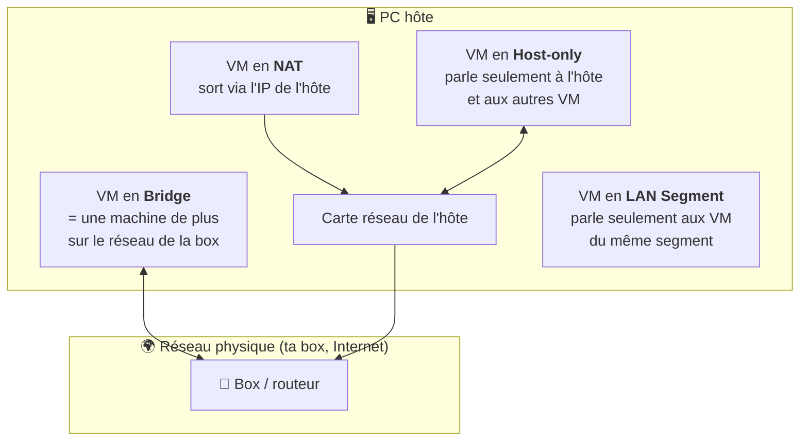

# Module 2bis : VMware Workstation

*Cours : [Cours 2 - Système client Microsoft](../index.md)*

## 🎯 Objectif du module

À la fin de ce module, tu sais :

- expliquer la **virtualisation** : hôte, machine virtuelle, hyperviseur ;
- **créer une VM** dans VMware Workstation et régler ses ressources (CPU, RAM, disque) ;
- choisir le bon **mode réseau** (Bridge, NAT, Host-only, LAN Segment) ;
- utiliser les **snapshots**, les **clones** et l'**import/export** de VM.

!!! abstract "En clair : c'est quoi la virtualisation ?"
    Normalement, un PC fait tourner **un seul** système d'exploitation. La **virtualisation** permet de faire tourner **plusieurs ordinateurs « faux »** (des **machines virtuelles**, ou **VM**) **à l'intérieur** de ton vrai PC, chacun avec son propre Windows ou Linux.

    C'est l'outil indispensable de la formation : tu pourras **tester, casser et recommencer** sans abîmer ton vrai PC.

## 🖼️ Résumé visuel

**① Qui fait quoi dans la virtualisation**

  

    💻
    VM 1 · VM 2 · VM 3
    Les ordinateurs virtuels, avec leur OS « invité » (Windows 10, Debian…)
    Invités
  

  

    🧠
    Hyperviseur
    Partage le matériel entre les VM et les isole les unes des autres (ici VMware Workstation)
    Arbitre
  

  

    🪟
    OS de l'hôte
    Ton Windows habituel
    Hôte
  

  

    🖥️
    Ton vrai PC
    Processeur, RAM, disque, carte réseau, partagés entre tout le monde
    Matériel
  

**② Les modes réseau : qui peut parler à qui ?**

## 📖 Cours consolidé

### 1. Le vocabulaire

| Mot | En clair |
|---|---|
| **Hôte** | Le **vrai PC**, qui possède le matériel |
| **VM** (machine virtuelle) | Un **ordinateur virtuel**, isolé des autres, avec son propre OS |
| **OS invité** | Le système installé **dans** la VM |
| **Hyperviseur** | Le logiciel qui **fait tourner les VM** et partage le matériel entre elles. Sans lui, pas de virtualisation |

**Deux familles d'hyperviseurs :**

| Type | Installé… | Exemple | Usage |
|---|---|---|---|
| **Type 2** (logiciel) | **sur un Windows ou un Linux** existant | **VMware Workstation**, VirtualBox | Tests, formation, maquettes |
| **Type 1** (« bare metal ») | **directement sur le serveur**, à la place de l'OS | **VMware ESXi**, Hyper-V | Production en entreprise (voir cours 13) |

---

### 2. Les ressources d'une VM

Une VM a besoin des mêmes choses qu'un vrai PC : **processeur, RAM, disque, carte réseau**.

| Ressource | À savoir |
|---|---|
| **Processeur (CPU)** | Ne donne pas trop de processeurs à une VM : elle peut **devenir plus lente**, car elle attend que les cœurs soient libres. Se modifie **VM éteinte** |
| **RAM** | Elle est **prise sur l'hôte dès que la VM démarre**. Une VM à 4 Go retire 4 Go à ton PC. ⚠️ Vérifie que l'hôte en a assez **avant** de démarrer |
| **Disque** | C'est **un simple fichier** (`.vmdk`) sur l'hôte. Il est **dynamique** : un disque de 60 Go ne pèse que quelques Go au début, et grossit au fur et à mesure (sans jamais dépasser 60 Go) |

| État de la VM | La RAM de l'hôte… |
|---|---|
| **Allumée** | est réservée à la VM |
| **En pause** (suspendue) | est libérée : son contenu est enregistré dans un fichier, et restauré à la reprise |
| **Éteinte** | est libérée |

⚠️ Si le disque **de l'hôte** est plein, les VM peuvent **se figer** ou **s'abîmer**. Range tes VM sur un disque avec de la place (idéalement un **SSD**).

---

### 3. Les modes réseau

Chaque VM a une **carte réseau virtuelle**, branchée sur un **switch virtuel** (appelé **VMnet**).

| Mode | Switch virtuel | La VM peut joindre… | Quand l'utiliser ? |
|---|---|---|---|
| **Bridge** (pont) | VMnet0 | Le **vrai réseau** : la box, Internet, les autres PC. Elle reçoit une IP de ta box | La VM doit être vue comme un vrai PC du réseau |
| **NAT** | **VMnet8** | Internet, **en empruntant l'IP de l'hôte** (comme une box) | Donner Internet à une VM, simplement |
| **Host-only** (hôte uniquement) | **VMnet1** | **L'hôte et les autres VM** de ce réseau, **pas Internet** | Labo isolé, avec accès depuis ton PC |
| **LAN Segment** | Segment nommé | **Uniquement les VM du même segment** (ni l'hôte, ni Internet) | Simuler des réseaux d'entreprise séparés (« Compta », « Serveurs »…) reliés par un routeur virtuel |

💡 Il existe **20 switchs virtuels** (VMnet0 à VMnet19), modifiables dans **Edit → Virtual Network Editor**. Côté hôte, les cartes « **VMware Network Adapter VMnet1 / VMnet8** » apparaissent dans `ncpa.cpl`.

---

### 4. Les fonctions qui font gagner du temps

| Fonction | À quoi ça sert | Exemple |
|---|---|---|
| **Snapshot** (instantané) | **Photographier** la VM à un instant T pour **revenir en arrière** si ça tourne mal | Snapshot **avant** une mise à jour risquée → ça plante → retour au snapshot en 10 secondes |
| **Clone** | **Dupliquer** une VM modèle | Créer 5 postes Windows en quelques minutes |
| **Pause** (suspend) | Mettre la VM en veille et **libérer les ressources** | Reprendre le TP le lendemain là où on l'a laissé |
| **VMware Tools** | Pilotes à installer **dans** la VM : meilleur affichage, copier-coller et glisser-déposer avec l'hôte | À installer après chaque nouvelle VM |

!!! tip "Les raccourcis indispensables"
    - Cliquer dans la VM **capture** le clavier et la souris : ++ctrl+alt++ pour **revenir sur l'hôte**.
    - Pour faire un ++ctrl+alt+del++ **dans la VM** : ++ctrl+alt+insert++, ou le bouton dédié dans la barre de Workstation.

---

### 5. Créer une VM, pas à pas

| # | Étape | Conseil |
|---|---|---|
| ① | **File → New Virtual Machine** → *Typical* | |
| ② | Source de l'OS | Choisir **« I will install the operating system later »** : tu gardes la main sur les réglages |
| ③ | OS invité | Ex. Windows 10 x64 : Workstation propose alors des réglages adaptés |
| ④ | Nom et dossier | Un dossier par VM, sur un disque rapide |
| ⑤ | Disque | Taille proposée (ex. 60 Go), **« Store virtual disk as a single file »** |
| ⑥ | **Customize Hardware** | Ajuster RAM et CPU, **monter l'ISO** dans le lecteur CD, choisir le **mode réseau** |
| ⑦ | Démarrer | La VM démarre sur l'ISO → installation de l'OS (voir [module 2](../module-2-installation-de-windows-10/index.md)) |

**Les fichiers d'une VM** (dans son dossier) :

| Fichier | Contenu |
|---|---|
| **`.vmx`** | La **configuration** (RAM, CPU, réseau…), un simple fichier texte |
| **`.vmdk`** | Le **disque dur** virtuel |

---

### 6. Importer et exporter une VM

Une VM, c'est **un dossier de fichiers** : on peut donc la **copier** comme n'importe quel dossier.

| Je veux… | Comment |
|---|---|
| **Ouvrir une VM existante** | Double-clic sur son fichier **`.vmx`** (ou File → Open) |
| **Importer une VM toute prête** | File → Open → fichier **`.ova`** / **`.ovf`** (format standard d'échange de VM) |
| **Exporter une VM** | **File → Export to OVF** (choisir `.ova` pour obtenir un seul fichier) |
| **Sauvegarder une VM** | Copier son dossier (VM éteinte) |

⚠️ À l'ouverture d'une VM copiée, Workstation demande : **« I moved it »** ou **« I copied it »**. Si l'original existe encore, réponds **« I copied it »** : la copie reçoit une **nouvelle adresse MAC**, ce qui évite un conflit sur le réseau.

📌 Workstation est fait pour les **tests et maquettes**, pas pour faire tourner des serveurs de **production** (on utilise alors ESXi ou Hyper-V). Depuis fin 2024, **VMware Workstation Pro est gratuit**, y compris pour un usage professionnel.

## ✅ Points clés à retenir

- **Hôte** = vrai PC · **VM** = ordinateur virtuel · **Hyperviseur** = le logiciel qui fait tourner et isole les VM.
- **Type 2** (Workstation, sur un OS) pour les tests ; **Type 1** (ESXi, Hyper-V, directement sur le serveur) pour la production.
- La **RAM** d'une VM est prise sur l'hôte **dès le démarrage** ; le **disque** est un fichier `.vmdk` **dynamique**.
- Réseau : **Bridge** (vrai réseau) · **NAT / VMnet8** (Internet via l'hôte) · **Host-only / VMnet1** (hôte + VM) · **LAN Segment** (VM entre elles uniquement).
- **Snapshot avant toute action risquée** ; **clone** pour dupliquer ; **VMware Tools** à installer dans chaque VM.
- Une VM = **`.vmx`** (configuration) + **`.vmdk`** (disque) ; échange au format **OVA / OVF**.

## 📝 Fiche de révision

### 🧠 L'essentiel en un tableau

| Notion | À retenir |
|---|---|
| **Hyperviseur type 2** | Logiciel sur un OS : Workstation, VirtualBox |
| **Hyperviseur type 1** | Directement sur le serveur : ESXi, Hyper-V |
| **RAM** | Réservée sur l'hôte dès le démarrage de la VM |
| **Disque `.vmdk`** | Fichier dynamique, grossit à l'usage |
| **`.vmx`** | Configuration de la VM (texte) |
| **OVA / OVF** | Format d'import / export de VM |
| **Snapshot** | Point de retour en arrière |
| **Clone** | Copie d'une VM |
| ++ctrl+alt++ | Libérer souris et clavier |

### 🌐 Les modes réseau en un coup d'œil

| Mode | Internet ? | Hôte ? | Autres VM ? |
|---|---|---|---|
| **Bridge** | ✅ (IP de la box) | ✅ | ✅ |
| **NAT** (VMnet8) | ✅ (via l'hôte) | ✅ | ✅ (en NAT) |
| **Host-only** (VMnet1) | ❌ | ✅ | ✅ (en Host-only) |
| **LAN Segment** | ❌ | ❌ | ✅ (même segment) |

### ⚠️ Les pièges

- Trop de **CPU** pour une VM peut la **ralentir**.
- Lancer plusieurs VM **sans assez de RAM sur l'hôte** fait tout ramer.
- **LAN Segment** : **l'hôte ne voit pas** les VM.
- VM copiée : répondre **« I copied it »** pour éviter les **adresses MAC en double**.
- Un **snapshot n'est pas une sauvegarde** : s'il y a un problème sur le disque de l'hôte, tu perds tout.

### ✏️ Entraîne-toi (clique pour voir la correction)

??? question "1. Ton PC a 16 Go de RAM. Tu veux lancer 3 VM à 6 Go chacune. Que va-t-il se passer ?"
    3 × 6 = **18 Go**, alors que l'hôte n'en a que 16 (et en utilise lui-même). La RAM est réservée **au démarrage** de chaque VM : la 3ᵉ VM ne démarrera pas, ou tout sera très lent. Réduis la RAM de chaque VM (par exemple 4 Go).

??? question "2. Tu veux un labo avec un serveur et un client qui se parlent, isolés d'Internet, mais que tu puisses joindre depuis ton PC. Quel mode réseau ?"
    **Host-only (VMnet1)** : les VM se parlent entre elles et avec l'hôte, mais n'ont **pas accès à Internet**.

??? question "3. Tu vas installer une mise à jour risquée sur ta VM de TP. Quel réflexe ?"
    Prendre un **snapshot** juste avant. Si la mise à jour casse quelque chose, tu **reviens au snapshot** en quelques secondes.

??? question "4. Ta VM doit récupérer une IP de la box, comme un vrai PC du réseau. Quel mode ?"
    **Bridge** : la VM est branchée directement sur le réseau physique et reçoit une adresse du serveur DHCP de la box.

## 🧠 Quiz — entraîne-toi

