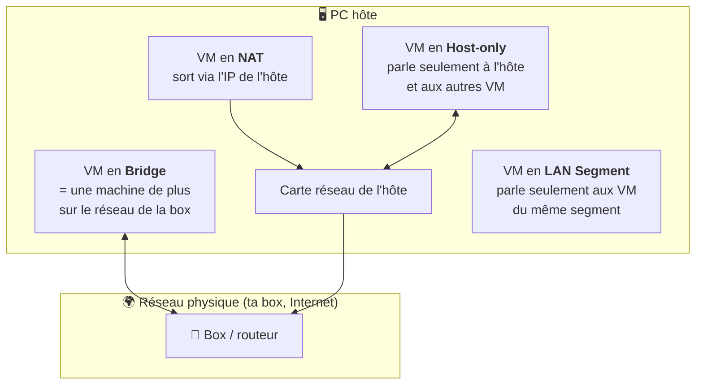

# Module 2bis : VMware Workstation

*Cours : [Cours 2 - Système client Microsoft](../index.md)*

## 🎯 Objectif du module

À la fin de ce module, tu sais :

- expliquer la **virtualisation** : hôte, machine virtuelle, hyperviseur ;
- **créer une VM** dans VMware Workstation et régler ses ressources (CPU, RAM, disque) ;
- choisir le bon **mode réseau** (Bridge, NAT, Host-only, LAN Segment) ;
- utiliser les **snapshots**, les **clones** et l'**import/export** de VM.

!!! abstract "En clair : c'est quoi la virtualisation ?"
    Normalement, un PC fait tourner **un seul** système d'exploitation. La **virtualisation** permet de faire tourner **plusieurs ordinateurs « faux »** (des **machines virtuelles**, ou **VM**) **à l'intérieur** de ton vrai PC, chacun avec son propre Windows ou Linux.

    C'est l'outil indispensable de la formation : tu pourras **tester, casser et recommencer** sans abîmer ton vrai PC.

## 🖼️ Résumé visuel

**① Qui fait quoi dans la virtualisation**

  

    💻
    VM 1 · VM 2 · VM 3
    Les ordinateurs virtuels, avec leur OS « invité » (Windows 10, Debian…)
    Invités
  

  

    🧠
    Hyperviseur
    Partage le matériel entre les VM et les isole les unes des autres (ici VMware Workstation)
    Arbitre
  

  

    🪟
    OS de l'hôte
    Ton Windows habituel
    Hôte
  

  

    🖥️
    Ton vrai PC
    Processeur, RAM, disque, carte réseau, partagés entre tout le monde
    Matériel
  

**② Les modes réseau : qui peut parler à qui ?**

## 📖 Cours consolidé

### 1. Le vocabulaire

| Mot | En clair |
|---|---|
| **Hôte** | Le **vrai PC**, qui possède le matériel |
| **VM** (machine virtuelle) | Un **ordinateur virtuel** isolé, avec son propre OS (**OS invité**) |
| **Hyperviseur** | Le logiciel qui **fait tourner les VM** et partage le matériel |

| Hyperviseur | Installé… | Exemples | Usage |
|---|---|---|---|
| **Type 2** | **sur** un Windows / Linux | **VMware Workstation**, VirtualBox | Tests, formation |
| **Type 1** (« bare metal ») | **directement** sur le serveur | **ESXi**, Hyper-V | Production ([cours 13](../../cours-13-virtualisation-de-serveurs/index.md)) |

---

### 2. Les ressources d'une VM

| Ressource | À savoir |
|---|---|
| **CPU** | Trop de processeurs peut **ralentir** la VM. Se modifie **VM éteinte** |
| **RAM** | **Prise sur l'hôte** au démarrage de la VM (VM à 4 Go = 4 Go en moins). Libérée quand la VM est **en pause** ou **éteinte** |
| **Disque** | Un **fichier** `.vmdk`, **dynamique** : il grossit au fur et à mesure, jusqu'à sa taille maximale |

⚠️ Disque **de l'hôte** plein = VM qui **se figent** ou **s'abîment**. Range-les sur un disque avec de la place (SSD).

---

### 3. Les modes réseau

Chaque VM a une carte réseau virtuelle, branchée sur un **switch virtuel** (**VMnet**).

| Mode | Switch | La VM joint… | Quand ? |
|---|---|---|---|
| **Bridge** (pont) | VMnet0 | Le **vrai réseau** (IP donnée par ta box) | La VM doit être vue comme un vrai PC |
| **NAT** | **VMnet8** | Internet, **via l'IP de l'hôte** | Donner Internet simplement |
| **Host-only** | **VMnet1** | L'**hôte** et les autres VM, **pas Internet** | Labo isolé |
| **LAN Segment** | Nommé | **Seulement les VM du segment** | Simuler des réseaux séparés reliés par un routeur virtuel |

💡 20 switchs (VMnet0 à 19), réglables dans **Edit → Virtual Network Editor**. Côté hôte, les cartes « VMware Network Adapter VMnet1 / VMnet8 » sont dans `ncpa.cpl`.

---

### 4. Les fonctions qui font gagner du temps

| Fonction | À quoi ça sert |
|---|---|
| **Snapshot** | **Photo** de la VM pour **revenir en arrière** (à faire avant une mise à jour risquée) |
| **Clone** | **Dupliquer** une VM modèle (5 postes en quelques minutes) |
| **Pause** | Mettre en veille et **libérer les ressources** |
| **VMware Tools** | Pilotes **dans** la VM : affichage, copier-coller avec l'hôte. À installer sur chaque VM |

- ++ctrl+alt++ : **rendre la main** clavier/souris à l'hôte.
- ++ctrl+alt+insert++ : faire un ++ctrl+alt+del++ **dans** la VM.

---

### 5. Créer une VM

| # | Étape | Conseil |
|---|---|---|
| ① | **File → New Virtual Machine** → *Typical* | |
| ② | Source | **« I will install the operating system later »** (tu gardes la main) |
| ③ | OS invité | Ex. Windows 10 x64 → réglages adaptés proposés |
| ④ | Nom, dossier | Un dossier par VM, sur un disque rapide |
| ⑤ | Disque | Ex. 60 Go, **« single file »** |
| ⑥ | **Customize Hardware** | RAM, CPU, **ISO** dans le lecteur, **mode réseau** |
| ⑦ | Démarrer | Installation de l'OS ([module 2](../module-2-installation-de-windows-10/index.md)) |

Dans le dossier de la VM : **`.vmx`** = la **configuration** (fichier texte) · **`.vmdk`** = le **disque**.

---

### 6. Importer et exporter

| Je veux… | Comment |
|---|---|
| Ouvrir une VM | Double-clic sur le **`.vmx`** |
| Importer une VM toute prête | File → Open → **`.ova`** / **`.ovf`** (format standard) |
| Exporter | **File → Export to OVF** (`.ova` = un seul fichier) |
| Sauvegarder | Copier son dossier, **VM éteinte** |

- ⚠️ VM copiée : répondre **« I copied it »** si l'original existe encore → nouvelle **MAC**, pas de conflit réseau.
- 📌 Workstation = **tests et maquettes**, pas la production (ESXi, Hyper-V). **Gratuit** depuis fin 2024, même en entreprise.

## 📝 Fiche de révision

### 🧠 L'essentiel en un tableau

| Notion | À retenir |
|---|---|
| **Hyperviseur type 2** | Logiciel sur un OS : Workstation, VirtualBox |
| **Hyperviseur type 1** | Directement sur le serveur : ESXi, Hyper-V |
| **RAM** | Réservée sur l'hôte dès le démarrage de la VM |
| **Disque `.vmdk`** | Fichier dynamique, grossit à l'usage |
| **`.vmx`** | Configuration de la VM (texte) |
| **OVA / OVF** | Format d'import / export de VM |
| **Snapshot** | Point de retour en arrière |
| **Clone** | Copie d'une VM |
| ++ctrl+alt++ | Libérer souris et clavier |

### 🌐 Les modes réseau en un coup d'œil

| Mode | Internet ? | Hôte ? | Autres VM ? |
|---|---|---|---|
| **Bridge** | ✅ (IP de la box) | ✅ | ✅ |
| **NAT** (VMnet8) | ✅ (via l'hôte) | ✅ | ✅ (en NAT) |
| **Host-only** (VMnet1) | ❌ | ✅ | ✅ (en Host-only) |
| **LAN Segment** | ❌ | ❌ | ✅ (même segment) |

### ⚠️ Les pièges

- Trop de **CPU** pour une VM peut la **ralentir**.
- Lancer plusieurs VM **sans assez de RAM sur l'hôte** fait tout ramer.
- **LAN Segment** : **l'hôte ne voit pas** les VM.
- VM copiée : répondre **« I copied it »** pour éviter les **adresses MAC en double**.
- Un **snapshot n'est pas une sauvegarde** : s'il y a un problème sur le disque de l'hôte, tu perds tout.

### ✏️ Entraîne-toi (clique pour voir la correction)

??? question "1. Ton PC a 16 Go de RAM. Tu veux lancer 3 VM à 6 Go chacune. Que va-t-il se passer ?"
    3 × 6 = **18 Go**, alors que l'hôte n'en a que 16 (et en utilise lui-même). La RAM est réservée **au démarrage** de chaque VM : la 3ᵉ VM ne démarrera pas, ou tout sera très lent. Réduis la RAM de chaque VM (par exemple 4 Go).

??? question "2. Tu veux un labo avec un serveur et un client qui se parlent, isolés d'Internet, mais que tu puisses joindre depuis ton PC. Quel mode réseau ?"
    **Host-only (VMnet1)** : les VM se parlent entre elles et avec l'hôte, mais n'ont **pas accès à Internet**.

??? question "3. Tu vas installer une mise à jour risquée sur ta VM de TP. Quel réflexe ?"
    Prendre un **snapshot** juste avant. Si la mise à jour casse quelque chose, tu **reviens au snapshot** en quelques secondes.

??? question "4. Ta VM doit récupérer une IP de la box, comme un vrai PC du réseau. Quel mode ?"
    **Bridge** : la VM est branchée directement sur le réseau physique et reçoit une adresse du serveur DHCP de la box.

## 🧠 Quiz — entraîne-toi

