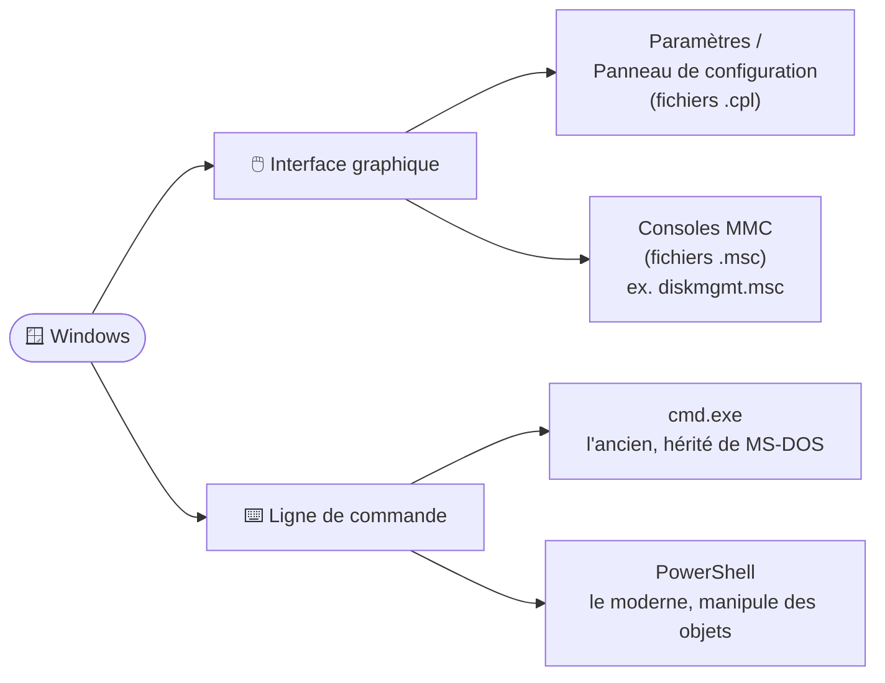
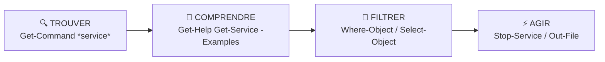

# Module 3 : Interagir avec Windows 10

*Cours : [Cours 2 - Système client Microsoft](../index.md)*

## 🎯 Objectif du module

À la fin de ce module, tu sais :

- trouver les **outils d'administration** de Windows (consoles MMC, panneau de configuration) ;
- utiliser l'**invite de commandes** (`cmd`) et lire l'**aide** d'une commande ;
- comprendre la logique de **PowerShell** : les cmdlets **Verbe-Nom** et les **objets** ;
- appliquer la méthode **trouver → comprendre → filtrer → agir**.

!!! abstract "En clair"
    Il y a **deux façons** de piloter Windows :

    - **À la souris**, avec l'interface graphique : simple, mais lent quand il faut répéter une action.
    - **Au clavier**, en tapant des commandes : plus rapide, **automatisable** (scripts), et parfois **la seule solution**.

    Un technicien utilise les deux. Ce module t'apprend les bases du clavier.

## 🖼️ Résumé visuel

**① Où trouver les outils ?**



**② La méthode PowerShell en 4 temps**



## 📖 Cours consolidé

### 1. Les outils graphiques

| Outil | À quoi ça sert | Comment l'ouvrir |
|---|---|---|
| **Paramètres** | Réglages modernes (réseau, mises à jour, comptes…) | ++win+i++ |
| **Panneau de configuration** | Réglages classiques : chaque icône est un fichier **`.cpl`** dans `C:\Windows\System32` | Taper « panneau » dans la recherche |
| **Consoles MMC** | **Outils d'administration** : chaque console est un fichier **`.msc`** | Clic droit sur le menu Démarrer, ou ++win+r++ |
| **Gestionnaire des tâches** | Voir les applications qui tournent, le processeur, la mémoire | ++ctrl+shift+esc++ |

**Les consoles à connaître** (à taper dans ++win+r++) :

| Console | Ouvre… |
|---|---|
| `compmgmt.msc` | **Gestion de l'ordinateur** (regroupe beaucoup d'outils) |
| `diskmgmt.msc` | Gestion des **disques** |
| `devmgmt.msc` | Gestionnaire de **périphériques** |
| `lusrmgr.msc` | **Utilisateurs et groupes** locaux |
| `eventvwr.msc` | Observateur d'**événements** (les journaux) |
| `services.msc` | Les **services** |
| `ncpa.cpl` | Les **cartes réseau** |

💡 **MMC** (*Microsoft Management Console*) : tape `mmc` pour créer **ta propre console** en y ajoutant les outils (« composants logiciels enfichables ») dont tu as besoin, puis enregistre-la.

---

### 2. L'invite de commandes (`cmd`)

**Les 3 règles d'une commande**

1. Le **premier mot** est **toujours la commande**.
2. Les éléments sont séparés par des **espaces**.
3. Les **options** commencent par **`/`** sous cmd (`dir /s`) et par **`-`** sous PowerShell.

```
C:\Users\Demo> copy rapport.txt D:\Sauvegarde /y
   └─ prompt ─┘ └cmd┘ └─source─┘ └destination┘ └option┘
```

**Lire l'aide d'une commande** : `help copy` (ou `copy /?`). La syntaxe utilise des symboles :

| Dans l'aide | Signifie | Exemple |
|---|---|---|
| Texte **sans crochets** | **Obligatoire** | `COPY source destination` |
| **`[ ]`** | **Facultatif** | `[/Y]` |
| **`|`** | **Un choix** parmi plusieurs | `[/A | /B]` : l'un ou l'autre |
| **`...`** | **Répétable** | `source [+ source ...]` |

**Quelques commandes utiles**

| Commande | Effet |
|---|---|
| `help` | Liste les commandes |
| `cls` | Efface l'écran |
| `dir` | Liste le contenu du dossier |
| `cd C:\Windows` | Change de dossier |
| `notepad` | Lance le Bloc-notes |
| `ipconfig > reseau.txt` | **`>`** envoie le résultat **dans un fichier** au lieu de l'écran |

⚠️ Pour **modifier le système** (créer un utilisateur, arrêter un service…), il faut **lancer cmd en tant qu'administrateur** : clic droit → *Exécuter en tant qu'administrateur*, puis accepter la fenêtre de confirmation (**UAC**, le contrôle de compte d'utilisateur).

---

### 3. PowerShell : le shell moderne

!!! abstract "En clair : la différence avec cmd"
    `cmd` renvoie **du texte** : pour en extraire une info, il faut le « découper ». **PowerShell** renvoie des **objets** : des fiches bien rangées avec des champs (nom, état, taille…). On peut alors **trier, filtrer et choisir** facilement ce qu'on veut afficher.

| | cmd | PowerShell |
|---|---|---|
| **Résultats** | Du texte | Des **objets** (.NET) |
| **Commandes** | `dir`, `copy`, `ipconfig` | **Cmdlets** `Verbe-Nom` : `Get-ChildItem`, `Copy-Item` |
| **Options** | `/option` | `-Parametre valeur` |
| **Versions** | — | **5.1** intégrée à Windows · **7** (moderne, à installer, fonctionne aussi sous Linux) |

**Outils pour écrire du PowerShell** : la console PowerShell, **PowerShell ISE** (éditeur de scripts, ++f5++ pour exécuter), **Windows Terminal**, **Visual Studio Code**.

#### Les cmdlets : toujours `Verbe-Nom`

| Verbe | Rôle | Exemple |
|---|---|---|
| **Get** | Afficher | `Get-Service` (liste les services) |
| **Set** | Modifier | `Set-Date` |
| **New** | Créer | `New-LocalUser` |
| **Remove** | Supprimer | `Remove-Item` |
| **Start / Stop** | Démarrer / arrêter | `Stop-Service` |

```powershell
Get-ChildItem -Path C:\Users     # liste le dossier C:\Users
#   └ cmdlet ┘ └paramètre┘ └valeur┘
```

📌 PowerShell **ne fait pas la différence entre majuscules et minuscules**, et la touche ++tab++ **complète automatiquement** les commandes.

💡 Les **alias** sont des raccourcis : `dir`, `ls` et `gci` lancent tous `Get-ChildItem`. Liste complète : `Get-Alias`.

#### Les objets : des propriétés et des méthodes

| Notion | Définition | Avec un ballon | Avec un service Windows |
|---|---|---|---|
| **Propriétés** | Ce qu'il **est** | couleur, taille, forme | `Name`, `Status`, `DisplayName` |
| **Méthodes** | Ce qu'on peut lui **faire** | lancer, gonfler | `Start()`, `Stop()` |

```powershell
Get-Process                                   # affiche les propriétés principales des processus
Get-Process -Name notepad | Select-Object *   # TOUTES les propriétés de Notepad (* = tout)
Get-Process | Select-Object Name, CPU         # seulement le nom et le CPU
```

📌 Le **`|`** (« pipe ») **transmet le résultat** d'une commande à la suivante.

---

### 4. L'aide de PowerShell

| Commande | Effet |
|---|---|
| `Get-Command *service*` | **Trouver** les commandes qui parlent de « service » |
| `Get-Help Get-Service` | **L'aide** d'une commande (alias : `help`, `man`) |
| `Get-Help Get-Service -Examples` | **Des exemples** concrets (le plus utile !) |
| `Get-Help Get-Service -Online` | L'aide à jour sur le site de Microsoft |
| `Update-Help` | **Télécharger** l'aide (en administrateur, avec Internet) |
| `Get-Help about_Variables` | Les chapitres **`about_`** expliquent les concepts du langage |

⚠️ Depuis PowerShell 3, l'aide **n'est pas installée** par défaut : il faut lancer **`Update-Help`** une fois (en administrateur). Seule l'aide en **anglais** est à jour.

---

### 5. Cas pratique : la méthode complète

**Mission** : arrêter le **service de géolocalisation**, puis enregistrer le nom et le SID (identifiant unique) d'un utilisateur dans un fichier.

```powershell
# 1. TROUVER la bonne commande
Get-Command *service*

# 2. COMPRENDRE comment elle marche
Get-Help Get-Service -Examples

# 3. FILTRER pour trouver le service (Where-Object garde les lignes qui correspondent)
Get-Service | Where-Object { $_.DisplayName -like "*géolocalisation*" }
#   → Name : lfsvc   DisplayName : Service de géolocalisation   Status : Running

# 4. AGIR (console lancée en administrateur)
Stop-Service -Name lfsvc

# Bonus : choisir des propriétés et les exporter dans un fichier
Get-LocalUser demo-user | Select-Object Name, SID | Out-File C:\Users\demo-user\identite.txt
```

| Cmdlet | Rôle |
|---|---|
| **`Where-Object`** | Garde **les lignes** qui respectent une condition (`$_` = « l'objet en cours ») |
| **`Select-Object`** | Garde **les colonnes** (propriétés) choisies |
| **`Out-File`** | Envoie le résultat **dans un fichier** |

## 📝 Fiche de révision

### 🧠 cmd et PowerShell côte à côte

| Je veux… | cmd | PowerShell |
|---|---|---|
| Lister un dossier | `dir` | `Get-ChildItem` (alias `ls`, `dir`) |
| Changer de dossier | `cd` | `Set-Location` (alias `cd`) |
| Copier | `copy` | `Copy-Item` |
| Effacer l'écran | `cls` | `Clear-Host` (alias `cls`) |
| L'aide | `help copy` · `copy /?` | `Get-Help Copy-Item -Examples` |
| Écrire dans un fichier | `commande > fichier.txt` | `commande | Out-File fichier.txt` |
| Voir la version | `ver` | `$PSVersionTable` |

### 🔧 Les 6 cmdlets indispensables

| Cmdlet | Rôle |
|---|---|
| `Get-Command` | Trouver une commande |
| `Get-Help` | Lire l'aide (`-Examples`) |
| `Get-Member` | Voir les propriétés et méthodes d'un objet |
| `Where-Object` | Filtrer les **lignes** |
| `Select-Object` | Choisir les **colonnes** |
| `Out-File` | Exporter dans un fichier |

### ⚠️ Les pièges

- Modifier le système **sans être administrateur** → « Accès refusé ».
- `Update-Help` a besoin des **droits administrateur** et d'**Internet** (une VM en Host-only n'a pas Internet).
- **`Where-Object` filtre les lignes**, **`Select-Object` choisit les colonnes** : ne pas les confondre.
- Le **premier mot** doit toujours être une commande.

### ✏️ Entraîne-toi (clique pour voir la correction)

??? question "1. Quelle console ouvrir pour gérer les utilisateurs locaux ? Et pour les disques ?"
    - Utilisateurs et groupes locaux : **`lusrmgr.msc`**
    - Disques : **`diskmgmt.msc`**

    Les deux sont aussi accessibles dans **Gestion de l'ordinateur** (`compmgmt.msc`).

??? question "2. Dans l'aide : XCOPY source [destination] [/S [/E]]. Qu'est-ce qui est obligatoire ?"
    Seulement **`XCOPY`** et **`source`**. Tout ce qui est entre `[ ]` (destination, `/S`, `/E`) est **facultatif**. Et `/E` n'a de sens qu'avec `/S`, car il est imbriqué dans ses crochets.

??? question "3. Tu veux la liste des services arrêtés. Écris la commande PowerShell."
    ```powershell
    Get-Service | Where-Object { $_.Status -eq "Stopped" }
    ```
    `Where-Object` garde les lignes dont la propriété `Status` **est égale** (`-eq`) à `Stopped`.

??? question "4. Tu ne connais pas la commande pour lister les utilisateurs locaux en PowerShell. Comment la trouver ?"
    ```powershell
    Get-Command *user*
    ```
    Tu trouveras **`Get-LocalUser`**. Ensuite : `Get-Help Get-LocalUser -Examples` pour voir comment l'utiliser.

## 🧠 Quiz — entraîne-toi

<div id="quiz-cours-02-systeme-client-microsoft-module-3-interagir-avec-windows-10"></div>

<script type="application/json" id="quiz-cours-02-systeme-client-microsoft-module-3-interagir-avec-windows-10-data">
[
  {
    "question": "Quel raccourci clavier permet de basculer rapidement entre les applications ouvertes sous Windows 10 ?",
    "options": [
      "Ctrl + Alt + Suppr",
      "Windows + Tabulation",
      "Windows + R",
      "Alt + F4"
    ],
    "correctIndex": 1,
    "explanation": "La combinaison Windows + Tabulation permet de basculer facilement d'une application à l'autre, en complément de la barre des tâches, sur un système d'exploitation multi-tâches comme Windows 10."
  },
  {
    "question": "Dans quel dossier système trouve-t-on les fichiers avec l'extension .cpl utilisés par le panneau de configuration ?",
    "options": [
      "Windows\\Temp",
      "Program Files\\Common Files",
      "Windows\\System32",
      "Users\\Public"
    ],
    "correctIndex": 2,
    "explanation": "Les éléments du panneau de configuration sont lancés grâce à des fichiers portant l'extension .cpl, disponibles dans le dossier Windows System32."
  },
  {
    "question": "Que signifie l'acronyme MMC, utilisé pour les consoles de gestion sous Windows 10 ?",
    "options": [
      "Multiple Management Center",
      "Microsoft Monitoring Console",
      "Main Menu Configuration",
      "Microsoft Management Console"
    ],
    "correctIndex": 3,
    "explanation": "MMC signifie Microsoft Management Console ; ces consoles regroupent des outils essentiels pour les techniciens, que l'on peut retrouver via des fichiers .msc ou créer sur mesure."
  },
  {
    "question": "Quels sont les deux principaux shells disponibles nativement dans Windows 10 ?",
    "options": [
      "cmd.exe et PowerShell",
      "Bash et Zsh",
      "PowerShell et Python",
      "cmd.exe et Bash"
    ],
    "correctIndex": 0,
    "explanation": "Windows 10 propose principalement deux shells : cmd.exe, héritier historique de MS-DOS, et PowerShell, un interpréteur de commandes plus moderne et orienté objet."
  },
  {
    "question": "Dans la syntaxe d'aide d'une commande, que signifie un élément placé entre crochets [ ] ?",
    "options": [
      "Cet élément est obligatoire",
      "Cet élément est facultatif",
      "Cet élément doit être répété plusieurs fois",
      "Cet élément est une commande interne uniquement"
    ],
    "correctIndex": 1,
    "explanation": "Tout texte qui n'est pas entre crochets ou accolades est obligatoire, tandis que ce qui se trouve entre crochets (ou accolades) est facultatif."
  },
  {
    "question": "Dans la syntaxe COPY source destination [/options], quels éléments sont obligatoires pour exécuter la commande ?",
    "options": [
      "Uniquement le mot COPY",
      "Uniquement les options",
      "COPY, la source et la destination",
      "COPY et les options, mais pas la destination"
    ],
    "correctIndex": 2,
    "explanation": "Dans cette syntaxe, le mot COPY ainsi que la source et la destination sont des paramètres obligatoires ; les options, entre crochets, restent facultatives."
  },
  {
    "question": "Pourquoi doit-on lancer cmd.exe en tant qu'administrateur pour modifier la configuration du système ?",
    "options": [
      "Parce que cmd.exe ne fonctionne pas du tout sans droits administratifs",
      "Parce que PowerShell impose cette contrainte à cmd.exe",
      "Parce que les commandes internes nécessitent toujours une connexion Internet",
      "Parce qu'un simple utilisateur ne dispose pas des privilèges nécessaires, pour des raisons de sécurité et de fiabilité"
    ],
    "correctIndex": 3,
    "explanation": "Pour des raisons de sécurité et de fiabilité, un simple utilisateur ne peut pas apporter de modifications au système ; il est donc nécessaire de lancer le shell avec des privilèges d'administration pour ce type d'opération."
  },
  {
    "question": "Sur quelle technologie PowerShell s'appuie-t-il, ce qui en fait un shell orienté objet ?",
    "options": [
      "Le .NET Framework",
      "Le noyau Linux",
      "Le protocole ICMP",
      "Le système de fichiers NTFS"
    ],
    "correctIndex": 0,
    "explanation": "PowerShell s'appuie sur des bibliothèques .NET Framework, ce qui lui permet d'être orienté objet et de créer des scripts plus ou moins élaborés."
  },
  {
    "question": "Quelle est la structure typique d'une commandlet (cmdlet) PowerShell ?",
    "options": [
      "Un nom suivi d'un verbe, séparés par un point",
      "Un verbe suivi d'un nom, séparés par un tiret (par exemple Get-Service)",
      "Deux verbes séparés par une barre verticale",
      "Un nombre suivi d'une lettre"
    ],
    "correctIndex": 1,
    "explanation": "Les commandlets PowerShell suivent une structure intuitive composée d'un verbe (comme Get, Set, Remove, Add, New) suivi d'un nom, séparés par un tiret."
  },
  {
    "question": "Quelle variable PowerShell permet d'afficher la version de PowerShell installée sur le poste, ainsi que des informations de compatibilité ?",
    "options": [
      "$PSHome",
      "$Error",
      "$PSVersionTable",
      "$Profile"
    ],
    "correctIndex": 2,
    "explanation": "La variable $PSVersionTable fournit plusieurs informations, dont la version de PowerShell installée et la valeur PSCompatibleVersion, utile pour vérifier la rétrocompatibilité des scripts."
  },
  {
    "question": "Quelle commande permet de mettre à jour les sections d'aide de PowerShell depuis les dépôts officiels de Microsoft ?",
    "options": [
      "Update-Help",
      "Get-Help",
      "Install-Module",
      "Set-ExecutionPolicy"
    ],
    "correctIndex": 0,
    "explanation": "Update-Help télécharge les sections d'aide depuis Internet (dépôts officiels de Microsoft) ou depuis un dépôt local ; cette opération nécessite des privilèges d'administration."
  },
  {
    "question": "À partir de quelle version de PowerShell l'aide n'est-elle plus intégrée nativement et doit-elle être téléchargée manuellement ?",
    "options": [
      "À partir de la version 1",
      "À partir de la version 3",
      "Dès la toute première version",
      "Elle a toujours été intégrée nativement"
    ],
    "correctIndex": 1,
    "explanation": "Avec les versions 1 et 2 de PowerShell, l'aide était intégrée nativement ; à partir de la version 3, Microsoft a changé d'approche et il est nécessaire de télécharger les sections d'aide pour disposer d'informations actualisées."
  },
  {
    "question": "Quelle option de la commande Get-Help permet d'afficher des exemples d'utilisation d'une commande spécifique ?",
    "options": [
      "-ShowWindow",
      "-Online",
      "-Examples",
      "-Verbose"
    ],
    "correctIndex": 2,
    "explanation": "L'option -Examples de Get-Help affiche des exemples pertinents pour l'utilisation d'une commande spécifique, ce qui est utile lorsqu'on connaît déjà la commande mais qu'on a un doute sur sa syntaxe."
  },
  {
    "question": "Dans l'analogie PowerShell utilisant l'objet « ballon », à quoi correspondent des caractéristiques comme la forme, les dimensions ou la masse ?",
    "options": [
      "Aux méthodes de l'objet",
      "Aux cmdlets associées à l'objet",
      "Aux verbes disponibles pour l'objet",
      "Aux propriétés de l'objet"
    ],
    "correctIndex": 3,
    "explanation": "Les caractéristiques d'un objet, comme sa forme, ses dimensions ou sa masse, correspondent à ses propriétés en PowerShell ; les actions que l'on peut mener sur cet objet, comme le lancer ou le gonfler, correspondent quant à elles à ses méthodes."
  },
  {
    "question": "Quelle cmdlet PowerShell permet d'afficher la liste des services de l'ordinateur local ou distant ?",
    "options": [
      "Get-Service",
      "Get-Process",
      "Get-LocalUser",
      "Get-Command"
    ],
    "correctIndex": 0,
    "explanation": "La cmdlet Get-Service affiche les services de l'ordinateur local ou distant ; on peut ensuite filtrer son résultat, par exemple avec Where-Object, pour cibler un service précis."
  },
  {
    "question": "Quelle cmdlet permet d'arrêter un service en cours d'exécution sous PowerShell ?",
    "options": [
      "Remove-Service",
      "Stop-Service",
      "Disable-Service",
      "End-Process"
    ],
    "correctIndex": 1,
    "explanation": "Stop-Service permet d'arrêter un ou plusieurs services en cours d'exécution, comme illustré par l'exemple d'arrêt du service de géolocalisation dans la démonstration."
  },
  {
    "question": "Dans une commande PowerShell utilisant le symbole |, que réalise-t-on ?",
    "options": [
      "On sépare deux commandes totalement indépendantes exécutées en parallèle",
      "On commente une ligne de code sans l'exécuter",
      "On transmet (pipe) le résultat d'une commande à une autre commande pour le traiter davantage",
      "On indique une valeur facultative dans la syntaxe d'aide"
    ],
    "correctIndex": 2,
    "explanation": "Le symbole | (pipe) transmet le résultat d'une commande à la commande suivante, comme dans get-service | where-object {...}, qui filtre les services affichés selon une condition."
  },
  {
    "question": "Quelle cmdlet permet d'exporter un résultat PowerShell vers un fichier texte, comme dans l'exemple sauvegardant le nom et le SID d'un utilisateur ?",
    "options": [
      "Export-Csv",
      "Send-File",
      "Save-Content",
      "Out-File"
    ],
    "correctIndex": 3,
    "explanation": "Out-File permet de rediriger le résultat d'une commande PowerShell vers un fichier, comme dans l'exemple get-localuser demo-user | select name, SID | out-file \"identity.txt\", qui enregistre les informations affichées dans un fichier texte."
  },
  {
    "question": "Quelle différence y a-t-il entre Where-Object et Select-Object ?",
    "options": [
      "Aucune, ce sont des alias",
      "Where-Object filtre les lignes selon une condition, Select-Object choisit les propriétés (colonnes) à afficher",
      "Where-Object crée un objet, Select-Object le supprime",
      "Where-Object exporte dans un fichier"
    ],
    "correctIndex": 1,
    "explanation": "Where-Object garde les objets qui respectent une condition (ex. Status -eq 'Stopped'), tandis que Select-Object choisit quelles propriétés afficher (ex. Name, SID)."
  },
  {
    "question": "Quelle console ouvre la gestion des utilisateurs et groupes locaux ?",
    "options": [
      "diskmgmt.msc",
      "devmgmt.msc",
      "lusrmgr.msc",
      "ncpa.cpl"
    ],
    "correctIndex": 2,
    "explanation": "lusrmgr.msc (Local Users and Groups Manager) gère les utilisateurs et groupes locaux. diskmgmt gère les disques, devmgmt les périphériques, ncpa.cpl les cartes réseau."
  }
]
</script>

<script>
  document.addEventListener("DOMContentLoaded", function () {
    TSSRQuiz.init({
      containerId: "quiz-cours-02-systeme-client-microsoft-module-3-interagir-avec-windows-10",
      dataId: "quiz-cours-02-systeme-client-microsoft-module-3-interagir-avec-windows-10-data",
    });
  });
</script>
