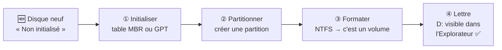

# Module 4 : La gestion du stockage

*Cours : [Cours 2 - Système client Microsoft](../index.md)*

## 🎯 Objectif du module

À la fin de ce module, tu sais :

- expliquer les 3 étapes pour rendre un disque utilisable : **partitionner, formater, attribuer une lettre** ;
- choisir entre **MBR** et **GPT** ;
- choisir un **système de fichiers** : NTFS, FAT32, exFAT, ReFS ;
- faire la différence entre **disque de base** et **disque dynamique** ;
- gérer les disques avec **`diskmgmt.msc`**, **`diskpart`** et **PowerShell**.

!!! abstract "En clair : préparer un disque, c'est comme aménager une armoire"
    1. **Partitionner** = poser des **cloisons** pour découper l'armoire en compartiments (les **partitions**). La liste des compartiments est écrite dans une **table** : **MBR** ou **GPT**.
    2. **Formater** = installer des **étagères et un classement** dans un compartiment : c'est le **système de fichiers** (NTFS…). Le compartiment devient un **volume**.
    3. **Attribuer une lettre** = coller une **étiquette** (`D:`, `E:`) pour le retrouver dans l'Explorateur.

## 🖼️ Résumé visuel

**① Les 3 étapes pour utiliser un nouveau disque**



**② MBR ou GPT ?**

<div class="tssr-hop">
  <div class="tssr-hop-frames">
    <div class="tssr-hop-frame">
      <small>MBR : l'ancien (avec le BIOS)</small>
      <span class="is-mac">Partitions : <b>4 maximum</b></span>
      <span class="is-mac">Taille de disque : <b>2,2 To maximum</b></span>
      <span class="is-mac">Table : <b>1 seul exemplaire</b> au début du disque</span>
    </div>
    <div class="tssr-hop-frame">
      <small>GPT : le moderne (avec l'UEFI) ✅</small>
      <span class="is-ip">Partitions : <b>128</b> sous Windows</span>
      <span class="is-ip">Taille : <b>bien au-delà de 2,2 To</b></span>
      <span class="is-ip">Table : <b>copiée</b> au début et à la fin (plus solide)</span>
    </div>
  </div>
</div>

## 📖 Cours consolidé

### 1. La table de partitions : MBR ou GPT

Le **sommaire** du disque, qui liste ses partitions.

| | **MBR** | **GPT** |
|---|---|---|
| **Démarrage** | **BIOS** | **UEFI** |
| **Partitions** | **4 principales** max | **128** |
| **Taille du disque** | **2,2 To** max | Pratiquement illimitée |
| **Solidité** | Table en 1 exemplaire | Table **en double** |
| **Aujourd'hui** | Vieux PC, petites clés | ✅ **Par défaut** (obligatoire pour Windows 11) |

Pour dépasser 4 partitions en MBR : une **partition étendue** qui contient des **lecteurs logiques**.

```
Disque MBR :  [ Principale 1 ][ Principale 2 ][ Principale 3 ][ ÉTENDUE ──────────────── ]
                                                              [ Logique 1 ][ Logique 2 ]
```

---

### 2. Disque de base ou dynamique

| | **De base** ✅ | **Dynamique** |
|---|---|---|
| **Zones** | Partitions | **Volumes** |
| **Agrandir** | Seulement avec l'espace **juste à côté** | Avec de l'espace **n'importe où**, même sur un **autre disque** |
| **Usage** | Le cas normal | Regrouper des disques, **RAID** logiciel |

- Base → dynamique : **sans perte**. Dynamique → base : **tout effacer**.
- Microsoft conseille aujourd'hui les **espaces de stockage** (*Storage Spaces*).

---

### 3. Le système de fichiers

**Formater** = installer un **système de fichiers** (qui retient **où est chaque fichier**). ⚠️ Formater **efface** tout.

| Système | Points forts | Limites | Pour… |
|---|---|---|---|
| **NTFS** | **Droits** (ACL), **chiffrement** (EFS), compression, quotas | Mal lu par TV, consoles, Mac | **Disque Windows** |
| **FAT32** | Lu **partout** | **Fichiers de 4 Go max**, aucun droit | Petite clé USB |
| **exFAT** | Lu presque partout, **pas de limite de 4 Go** | Aucun droit | **Grosse clé**, disque externe, carte SD |
| **ReFS** | Très robuste, s'auto-répare | Ne démarre pas Windows | **Serveurs** de stockage |

💡 Ailleurs : **ext4** (Linux), **VMFS** (ESXi), **APFS** (Mac).

---

### 4. Les disques virtuels VHD / VHDX

- Le disque virtuel de Microsoft (**`.vhdx`** = version récente), utilisé par **Hyper-V** : un **simple fichier**, comme le `.vmdk` de [VMware](../module-2bis-vmware-workstation/index.md).
- Taille **fixe** ou **dynamique** · se **monte** d'un double-clic · on peut même **démarrer** dessus.

---

### 5. Les outils

| Je veux… | Graphique (`diskmgmt.msc`) | `diskpart` | PowerShell |
|---|---|---|---|
| Voir les disques | Ouvrir la console | `list disk` | `Get-Disk` |
| Initialiser | *Initialiser le disque* | `convert gpt` | `Initialize-Disk -Number 1 -PartitionStyle GPT` |
| Créer une partition | *Nouveau volume simple* | `create partition primary` | `New-Partition -DiskNumber 1 -UseMaximumSize -AssignDriveLetter` |
| Formater | *Formater* | `format fs=ntfs quick` | `Format-Volume -DriveLetter E -FileSystem NTFS` |
| Agrandir / réduire | *Étendre* / *Réduire* | `extend` / `shrink` | `Resize-Partition` |

**Préparer un 2ᵉ disque en PowerShell** :

```powershell
Get-Disk                                                         # 1. repérer le disque (ici 1, état « RAW »)
Initialize-Disk -Number 1 -PartitionStyle GPT                    # 2. table GPT
New-Partition -DiskNumber 1 -UseMaximumSize -AssignDriveLetter   # 3. partition + lettre (ex. E:)
Format-Volume -DriveLetter E -FileSystem NTFS -NewFileSystemLabel "Donnees"   # 4. NTFS
```

⚠️ `diskpart` et ces cmdlets agissent **tout de suite, sans corbeille** : vérifie **deux fois le numéro du disque**.

## 📝 Fiche de révision

### 🧠 L'essentiel en un tableau

| Notion | À retenir |
|---|---|
| **Partitionner** | Découper le disque en zones |
| **Formater** | Installer un système de fichiers (efface le contenu) |
| **Volume** | Une partition formatée (ou une zone d'un disque dynamique) |
| **MBR** | BIOS · 4 partitions principales · 2,2 To |
| **GPT** | UEFI · 128 partitions · plus de 2,2 To · standard actuel |
| **Partition étendue** | Contient des lecteurs logiques (MBR) |
| **NTFS** | Windows · droits ACL · EFS |
| **FAT32** | Universel · fichiers de 4 Go maximum · aucun droit |
| **exFAT** | Universel · pas de limite de 4 Go |
| **VHDX** | Disque virtuel Microsoft (Hyper-V) |

### ⚠️ Les pièges

- **Formater efface tout.**
- Un fichier de **5 Go ne passe pas** sur une clé en **FAT32** : formate-la en **exFAT** ou en NTFS.
- Un disque de **4 To en MBR** : seuls **2,2 To** sont utilisables → il faut du **GPT**.
- Une partition **de base** ne s'agrandit qu'avec l'espace libre **juste après** elle.
- Repasser un disque **dynamique en disque de base** oblige à **effacer** le disque.

### ✏️ Entraîne-toi (clique pour voir la correction)

??? question "1. Tu branches un disque neuf de 4 To. Il n'apparaît pas dans l'Explorateur. Que fais-tu ?"
    Dans **`diskmgmt.msc`**, le disque est « **Non initialisé** » :

    1. **Initialiser** en **GPT** (il fait plus de 2,2 To) ;
    2. créer un **Nouveau volume simple** ;
    3. **formater en NTFS** ;
    4. **attribuer une lettre** (ex. `E:`).

??? question "2. Un utilisateur n'arrive pas à copier une vidéo de 6 Go sur sa clé USB. Pourquoi ?"
    Sa clé est sûrement en **FAT32**, qui refuse les **fichiers de plus de 4 Go**. Solution : sauvegarder ce qu'il y a sur la clé, puis la **formater en exFAT** (lisible presque partout) ou en NTFS.

??? question "3. Sur un disque MBR, tu as déjà 4 partitions principales. Comment en créer une 5ᵉ ?"
    Impossible en partition principale. Il faut une **partition étendue** (qui prend la place de l'une des 4) dans laquelle on crée des **lecteurs logiques**. Ou mieux : passer le disque en **GPT** (128 partitions).

??? question "4. Quel système de fichiers pour : le disque système de Windows, une carte SD d'appareil photo de 128 Go, un serveur de stockage ?"
    - Disque système : **NTFS**
    - Carte SD de 128 Go : **exFAT**
    - Serveur de stockage : **ReFS** (ou NTFS)

## 🧠 Quiz — entraîne-toi

<div id="quiz-cours-02-systeme-client-microsoft-module-4-la-gestion-du-stockage"></div>

<script type="application/json" id="quiz-cours-02-systeme-client-microsoft-module-4-la-gestion-du-stockage-data">
[
  {
    "question": "À quoi sert la table de partitionnement d'un disque dur ?",
    "options": [
      "Elle sert de sommaire indiquant où se trouvent les différentes partitions du disque",
      "Elle stocke une copie de sauvegarde de tous les fichiers du disque",
      "Elle chiffre automatiquement les données du disque",
      "Elle gère la vitesse de rotation du disque dur"
    ],
    "correctIndex": 0,
    "explanation": "La table de partitionnement fonctionne comme un sommaire du disque, permettant à l'ordinateur de savoir où se trouvent les différentes partitions présentes sur le disque dur."
  },
  {
    "question": "Que signifie l'acronyme MBR, l'un des deux formats de table de partitionnement ?",
    "options": [
      "Main Backup Registry",
      "Master Boot Record",
      "Memory Block Reference",
      "Master Binary Record"
    ],
    "correctIndex": 1,
    "explanation": "MBR signifie Master Boot Record ; c'est le format historique indispensable pour qu'un BIOS puisse localiser la partition contenant les fichiers du système d'exploitation à charger en RAM."
  },
  {
    "question": "Sur combien de partitions maximum le format MBR peut-il référencer un disque ?",
    "options": [
      "2 partitions",
      "8 partitions",
      "4 partitions",
      "128 partitions"
    ],
    "correctIndex": 2,
    "explanation": "Le MBR est situé sur le premier secteur du disque, avec une taille maximale de 512 octets, et ne peut référencer que 4 partitions, sur des disques durs de 2,2 To maximum."
  },
  {
    "question": "Comment peut-on dépasser la limite de 4 partitions imposée par le MBR sur un disque de base ?",
    "options": [
      "En convertissant directement le disque au format NTFS",
      "En installant un second BIOS sur la machine",
      "En formatant systématiquement le disque en FAT32",
      "En créant une partition étendue, qui peut contenir des lecteurs logiques"
    ],
    "correctIndex": 3,
    "explanation": "Une partition étendue agit comme un contenant capable d'accueillir des lecteurs logiques ; ces derniers stockent des données mais ne sont pas référencés directement dans le MBR, ce qui permet de dépasser la limite de 4 partitions."
  },
  {
    "question": "Comment appelle-t-on les partitions présentes sur un disque dynamique, selon la terminologie Microsoft ?",
    "options": [
      "Des volumes",
      "Des lecteurs logiques",
      "Des secteurs",
      "Des index"
    ],
    "correctIndex": 0,
    "explanation": "Pour Microsoft, les partitions contenues sur un disque dynamique sont appelées des volumes, et peuvent être étendues à l'aide d'espace libre non contigu, y compris sur un autre disque dynamique."
  },
  {
    "question": "Quel avantage un disque dynamique offre-t-il par rapport à un disque de base pour étendre un volume ?",
    "options": [
      "Il impose que l'espace libre utilisé soit obligatoirement contigu",
      "Il permet d'utiliser de l'espace libre non contigu, y compris sur un autre disque dynamique",
      "Il empêche toute extension de volume après sa création",
      "Il nécessite un formatage complet du disque à chaque extension"
    ],
    "correctIndex": 1,
    "explanation": "Sur un disque dynamique, un volume peut être étendu grâce à de l'espace libre non contigu, y compris disponible sur un autre disque dynamique, ce qui ouvre la voie aux technologies RAID."
  },
  {
    "question": "Est-il possible de convertir un disque de base en disque dynamique sans perdre de données ?",
    "options": [
      "Non, la conversion entraîne systématiquement une perte de données",
      "Non, cette conversion n'est techniquement pas possible",
      "Oui, cette conversion est possible sans perte de données",
      "Oui, mais uniquement si le disque est vide"
    ],
    "correctIndex": 2,
    "explanation": "Il est possible de convertir un disque de base en disque dynamique sans problème et sans perte de données."
  },
  {
    "question": "Que signifie l'acronyme GPT, le second format de table de partitionnement ?",
    "options": [
      "Global Partition Type",
      "General Purpose Table",
      "Generic Partition Track",
      "GUID Partition Table"
    ],
    "correctIndex": 3,
    "explanation": "GPT signifie GUID Partition Table ; ce format plus récent gomme les limites du MBR en étant sauvegardé sur plusieurs secteurs du disque plutôt que sur un seul."
  },
  {
    "question": "Combien de partitions maximum le format GPT permet-il, contre 4 pour le MBR ?",
    "options": [
      "4 partitions",
      "128 partitions",
      "16 partitions",
      "512 partitions"
    ],
    "correctIndex": 1,
    "explanation": "Le format GPT permet de créer jusqu'à 128 partitions, une limite bien supérieure aux 4 partitions maximum autorisées par le MBR."
  },
  {
    "question": "Que signifie concrètement « formater une partition » ?",
    "options": [
      "Supprimer définitivement la table de partitionnement du disque",
      "Convertir automatiquement un disque de base en disque dynamique",
      "Installer un système de fichiers sur cette partition",
      "Chiffrer l'ensemble des données de la partition"
    ],
    "correctIndex": 2,
    "explanation": "Formater une partition consiste à y installer un système de fichiers (FS) ; ce dernier organise les données grâce à un index contenant notamment les adresses physiques de chaque fichier."
  },
  {
    "question": "Comment appelle-t-on une partition une fois qu'elle a été formatée ?",
    "options": [
      "Un secteur",
      "Une table de partitionnement",
      "Un lecteur logique uniquement",
      "Un volume"
    ],
    "correctIndex": 3,
    "explanation": "Une fois formatée, une partition prend le nom de volume, terme également utilisé pour désigner les partitions présentes sur un disque dynamique."
  },
  {
    "question": "Grâce à quel mécanisme le système de fichiers NTFS est-il nativement sécurisé ?",
    "options": [
      "Les ACL (Access Control List), contenues dans l'index et définissant les autorisations d'accès aux fichiers",
      "Un mot de passe unique appliqué à l'ensemble du volume",
      "Un chiffrement matériel intégré au disque dur",
      "Une signature numérique du BIOS"
    ],
    "correctIndex": 0,
    "explanation": "NTFS est nativement sécurisé grâce aux ACL (Access Control List), dont les autorisations d'accès à chaque fichier sont contenues dans l'index du système de fichiers."
  },
  {
    "question": "Quelle fonctionnalité native de NTFS permet de chiffrer les données d'un fichier ou d'un dossier ?",
    "options": [
      "BitLocker To Go",
      "EFS (Encrypting File System)",
      "ACL (Access Control List)",
      "ReFS"
    ],
    "correctIndex": 1,
    "explanation": "NTFS permet nativement de chiffrer les données grâce à EFS (Encrypting File System), en complément de la compression et des informations de duplication qu'il peut également gérer."
  },
  {
    "question": "Quelle est une limite bien connue du système de fichiers FAT32, historique et compatible avec de nombreux systèmes d'exploitation ?",
    "options": [
      "Il ne peut être lu que par des systèmes d'exploitation Microsoft",
      "Il ne permet de créer qu'une seule partition par disque",
      "Il ne peut pas stocker de fichier individuel dépassant 4 Go",
      "Il ne peut pas être utilisé sur une clé USB"
    ],
    "correctIndex": 2,
    "explanation": "Le FAT32 est très répandu et lisible par de nombreux systèmes d'exploitation, notamment sur une clé USB, mais il n'est pas sécurisé nativement et ne peut pas stocker de fichier individuel de plus de 4 Go."
  },
  {
    "question": "À quoi correspond ReFS, mentionné comme une évolution de NTFS ?",
    "options": [
      "Un format de partitionnement remplaçant le GPT",
      "Un outil de sauvegarde intégré à Windows 7",
      "Un protocole de chiffrement réseau",
      "Un système de fichiers plutôt réservé aux gros volumes de stockage"
    ],
    "correctIndex": 3,
    "explanation": "ReFS est présenté comme une évolution de NTFS, plutôt destinée aux gros volumes de stockage, aux côtés d'autres systèmes de fichiers comme ext4, VMFS ou UDF."
  },
  {
    "question": "Quelles sont les extensions de fichiers utilisées par Microsoft pour ses disques durs virtuels, notamment dans Hyper-V ?",
    "options": [
      ".vhd et .vhdx",
      ".iso et .img",
      ".wim et .esd",
      ".vmdk et .vdi"
    ],
    "correctIndex": 0,
    "explanation": "Microsoft utilise les extensions .vhd et .vhdx pour ses disques durs virtuels, notamment dans sa solution de virtualisation Hyper-V ; ces disques sont manipulables comme de simples fichiers."
  },
  {
    "question": "Quelle commande graphique permet d'ouvrir la console de gestion des disques sous Windows ?",
    "options": [
      "diskpart.msc",
      "diskmgmt.msc",
      "compmgmt.exe",
      "devmgmt.msc"
    ],
    "correctIndex": 1,
    "explanation": "La console graphique de gestion des disques s'ouvre avec la commande diskmgmt.msc, que l'on peut aussi intégrer comme composant dans une console MMC personnalisée."
  },
  {
    "question": "Quel outil en ligne de commande, distinct de PowerShell, permet également d'administrer les disques sous Windows ?",
    "options": [
      "netstat",
      "tracert",
      "diskpart",
      "ipconfig"
    ],
    "correctIndex": 2,
    "explanation": "En complément des consoles graphiques et des cmdlets PowerShell, il est possible d'administrer les disques en ligne de commande avec l'outil diskpart."
  },
  {
    "question": "Quelle cmdlet PowerShell permet d'installer une table de partition sur un disque nouvellement détecté ?",
    "options": [
      "Get-Disk",
      "New-Partition",
      "Format-Volume",
      "Initialize-Disk"
    ],
    "correctIndex": 3,
    "explanation": "Initialize-Disk permet d'installer une table de partition sur un disque, après avoir éventuellement utilisé Get-Disk pour relever son numéro ; New-Partition crée ensuite une partition et Format-Volume la formate pour obtenir un volume utilisable."
  },
  {
    "question": "Quelle est la taille maximale de disque exploitable avec une table de partitions MBR ?",
    "options": [
      "32 Go",
      "2,2 To",
      "128 To",
      "Illimitée"
    ],
    "correctIndex": 1,
    "explanation": "Le MBR ne peut adresser que 2,2 To. Pour un disque plus grand, il faut une table GPT."
  },
  {
    "question": "Quel système de fichiers choisir pour une clé USB de 128 Go qui doit contenir des fichiers de plus de 4 Go et être lue sur Windows et Mac ?",
    "options": [
      "FAT32",
      "exFAT",
      "ReFS",
      "ext4"
    ],
    "correctIndex": 1,
    "explanation": "exFAT est reconnu par la plupart des systèmes et n'a pas la limite de 4 Go par fichier de FAT32. NTFS fonctionnerait aussi sous Windows, mais il est moins bien géré par les Mac."
  },
  {
    "question": "Dans quel ordre prépare-t-on un disque neuf ?",
    "options": [
      "Formater → partitionner → initialiser",
      "Initialiser (MBR/GPT) → partitionner → formater → attribuer une lettre",
      "Attribuer une lettre → formater → initialiser",
      "Partitionner → attribuer une lettre → initialiser"
    ],
    "correctIndex": 1,
    "explanation": "On donne d'abord une table de partitions au disque (initialisation), puis on crée une partition, on la formate (elle devient un volume) et on lui attribue une lettre."
  }
]
</script>

<script>
  document.addEventListener("DOMContentLoaded", function () {
    TSSRQuiz.init({
      containerId: "quiz-cours-02-systeme-client-microsoft-module-4-la-gestion-du-stockage",
      dataId: "quiz-cours-02-systeme-client-microsoft-module-4-la-gestion-du-stockage-data",
    });
  });
</script>
