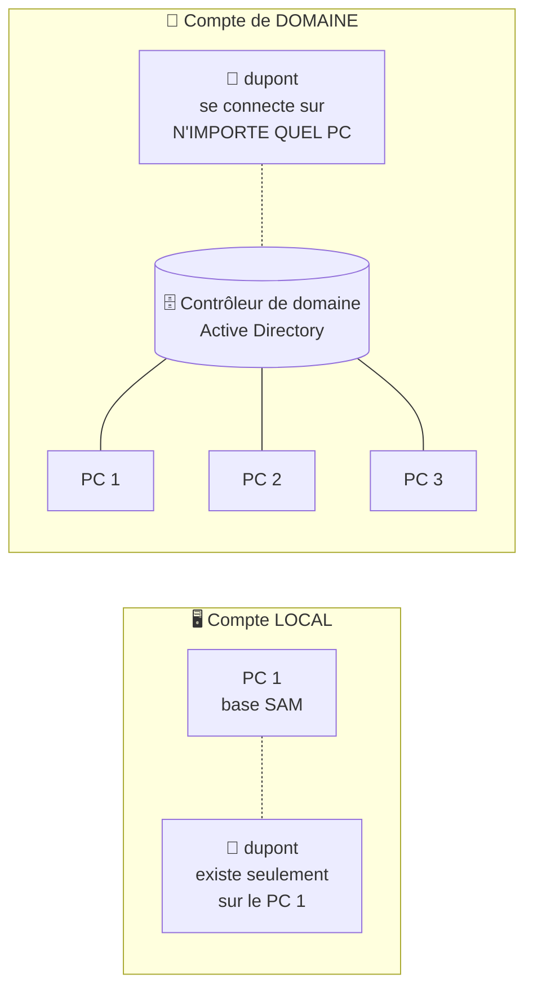

# Module 5 : Les utilisateurs et les groupes

*Cours : [Cours 2 - Système client Microsoft](../index.md)*

## 🎯 Objectif du module

À la fin de ce module, tu sais :

- faire la différence entre **compte local** et **compte de domaine** ;
- distinguer les types de comptes : **standard, administrateur, invité** ;
- comprendre le **SID**, les **groupes** et le **jeton d'accès** ;
- gérer les **profils** sans les abîmer ;
- expliquer l'**UAC** (la fenêtre « Voulez-vous autoriser… ») ;
- créer des utilisateurs et des groupes **en graphique, avec `net user` et en PowerShell**.

!!! abstract "En clair"
    Un **compte utilisateur**, c'est le **badge** d'une personne dans le système : il dit **qui elle est** (identification) et **ce qu'elle a le droit de faire** (autorisations).

    Un **groupe**, c'est une **liste de badges** qui ont les mêmes droits. On donne les droits **au groupe**, pas à chaque personne : si un nouveau comptable arrive, on l'ajoute au groupe « Compta » et il a tout de suite les bons accès.

    📌 **Règle d'or : 1 personne = 1 compte.** Jamais de compte partagé.

## 🖼️ Résumé visuel

**① Compte local ou compte de domaine ?**



**② Le jeton d'accès : la « carte d'identité » présentée à chaque accès**

<div class="tssr-hop">
  <div class="tssr-hop-frames">
    <div class="tssr-hop-frame">
      <small>À l'ouverture de session de Marie, Windows fabrique son jeton :</small>
      <span class="is-ip">Son SID : <b>S-1-5-21-…-1001</b> <em>Marie</em></span>
      <span class="is-mac">+ SID du groupe <b>Utilisateurs</b></span>
      <span class="is-mac">+ SID du groupe <b>Compta</b></span>
      <span class="is-mac">+ SID de <b>Tout le monde</b> (automatique)</span>
    </div>
    <div class="tssr-hop-frame">
      <small>Quand Marie ouvre un fichier, Windows compare :</small>
      <span class="is-ip">Les SID de son <b>jeton</b></span>
      <span class="is-ip">avec la liste des droits du <b>fichier</b></span>
      <span class="is-ip">→ un SID autorisé = <b>accès accordé ✅</b></span>
    </div>
  </div>
</div>

## 📖 Cours consolidé

### 1. Compte local ou compte de domaine

| | **Compte local** | **Compte de domaine** |
|---|---|---|
| **Stocké dans** | La base **SAM** du PC | **Active Directory**, sur un **contrôleur de domaine** |
| **Valable sur** | **Ce PC** | **Tous les PC** joints au domaine |
| **Pour qui ?** | Particulier, compte de secours | **Entreprise** ([cours 8](../../cours-08-les-services-reseau-en-environnement-microsoft/index.md)) |
| **Connexion** | Son nom + mot de passe | `DOMAINE\utilisateur` + mot de passe, vérifié par le serveur |

- Chaque compte a un **SID** unique (ex. `S-1-5-21-…-1001`) : Windows travaille avec le **SID**, pas le nom. Supprimer puis recréer « dupont » = **nouveau SID**, **plus aucun ancien droit**.
- Un PC joint au domaine **garde ses comptes locaux** (connexion avec `.\nom`).
- **MFA** (authentification multifacteur) : mot de passe **+** un 2ᵉ facteur (carte à puce, empreinte, code SMS ou appli).

---

### 2. Les types de comptes

| Type | Il peut… | Groupe |
|---|---|---|
| **Standard** | Utiliser le PC et ses fichiers | **Utilisateurs** |
| **Administrateur** | Tout ça **+ modifier le système** | **Administrateurs** |
| **Invité** | Usage très limité, **sans mot de passe** | **Invités** |

- ⚠️ Les comptes intégrés **« Administrateur »** (nom connu des pirates) et **« Invité »** (sans mot de passe) sont **désactivés par défaut**.
- ✅ Au quotidien : un compte **standard** ; un compte administrateur **personnel** pour l'administration.

---

### 3. Les groupes et le jeton d'accès

- Tout utilisateur est dans **au moins un groupe** ; chaque groupe a un **SID**.
- À l'ouverture de session, Windows crée le **jeton d'accès** = **SID de l'utilisateur + SID de ses groupes**, comparé aux droits de chaque fichier ([module 6](../module-6-la-securite-ntfs-et-les-acl/index.md)).
- ⚠️ Ajout à un groupe = effectif à la **prochaine ouverture de session** (le jeton est recalculé).

| Type de groupe | Rôle | Exemples |
|---|---|---|
| **Locaux** (créés par toi) | Donner des **droits sur des ressources** | « Compta », « Direction » |
| **Prédéfinis** | **Déléguer une tâche** sans rendre administrateur | **Opérateurs de sauvegarde**, **Lecteurs des journaux d'événements**, **Utilisateurs du Bureau à distance** |
| **Identités spéciales** | Attribués **automatiquement** par Windows | **Tout le monde**, **Utilisateurs authentifiés**, **Interactif**, **Réseau** |

**Exemple** : le stagiaire doit lire les journaux sans rien modifier → groupe **Lecteurs des journaux d'événements**, surtout **pas** Administrateurs.

---

### 4. Les profils

À la **1re connexion**, Windows crée le profil **`C:\Users\nom`** (Bureau, Documents, réglages).

- **Default** (`C:\Users\Default`, caché) : le **modèle** de chaque nouveau profil.
- **Public** (`C:\Users\Public`) : visible par **tous** les utilisateurs.
- ⚠️ **Ne jamais supprimer un profil directement dans `C:\Users`** (il est aussi dans le registre → **profil corrompu**). ✅ Passer par `sysdm.cpl` → **Profils des utilisateurs**.

---

### 5. L'UAC : « Voulez-vous autoriser… ? »

Même un administrateur travaille **avec des droits standard**. Une action qui **modifie le système** (signalée par un **bouclier** 🛡️) affiche une confirmation : l'**UAC** (*User Account Control*). Un virus ne peut donc rien modifier en douce.

| Tu es… | L'UAC demande… |
|---|---|
| **Administrateur** | Une **confirmation** (« Oui ») |
| **Standard** | Le **nom et le mot de passe d'un administrateur** |

⚠️ **Ne jamais désactiver l'UAC** : le niveau par défaut convient.

---

### 6. Les outils de gestion

| Je veux… | cmd | PowerShell |
|---|---|---|
| Lister les utilisateurs | `net user` | `Get-LocalUser` |
| Créer un utilisateur | `net user dupont MotDePasse1! /add` | `New-LocalUser -Name dupont -Password (Read-Host -AsSecureString)` |
| Désactiver un compte | `net user dupont /active:no` | `Disable-LocalUser -Name dupont` |
| Lister / créer un groupe | `net localgroup` · `net localgroup Compta /add` | `Get-LocalGroup` · `New-LocalGroup -Name Compta` |
| Ajouter au groupe | `net localgroup Compta dupont /add` | `Add-LocalGroupMember -Group Compta -Member dupont` |
| Voir les membres | `net localgroup Administrateurs` | `Get-LocalGroupMember -Group Administrateurs` |

- En graphique : tout se fait dans **`lusrmgr.msc`**.
- 💡 **Ton SID et tes groupes** : `whoami /user` et `whoami /groups`.

## 📝 Fiche de révision

### 🧠 L'essentiel en un tableau

| Notion | À retenir | Exemple |
|---|---|---|
| **SAM** | Base des comptes **locaux** | |
| **Active Directory** | Annuaire des comptes **de domaine** | `ENTREPRISE\dupont` |
| **SID** | Identifiant unique d'un compte ou d'un groupe | `S-1-5-21-…-1001` |
| **Jeton d'accès** | SID de l'utilisateur + SID de ses groupes | `whoami /groups` |
| **Groupe prédéfini** | Délègue une tâche précise | Opérateurs de sauvegarde |
| **Identité spéciale** | Groupe automatique | Tout le monde |
| **Profil** | `C:\Users\nom` | |
| **UAC** | Confirmation avant une modification du système | Le bouclier 🛡️ |

### 🔧 Les commandes à connaître

| cmd | PowerShell |
|---|---|
| `net user` | `Get-LocalUser` |
| `net user dupont P@ss1 /add` | `New-LocalUser` |
| `net localgroup Compta dupont /add` | `Add-LocalGroupMember -Group Compta -Member dupont` |
| `whoami /groups` | |

### ⚠️ Les pièges

- Un ajout dans un groupe ne compte qu'**après une nouvelle ouverture de session**.
- Supprimer puis recréer un compte avec le même nom **ne redonne pas les anciens droits** (nouveau SID).
- Ne **jamais supprimer un profil** directement dans `C:\Users`.
- Ne **jamais désactiver l'UAC**.
- Donner les droits **aux groupes**, pas aux utilisateurs un par un.

### ✏️ Entraîne-toi (clique pour voir la correction)

??? question "1. Écris les commandes cmd pour créer l'utilisateur « martin », créer le groupe « Compta » et y mettre martin."
    ```
    net user martin Azerty123! /add
    net localgroup Compta /add
    net localgroup Compta martin /add
    ```

??? question "2. Tu as ajouté Paul au groupe Compta, mais il n'a toujours pas accès au dossier de la compta. Pourquoi ?"
    Son **jeton d'accès** a été créé **à l'ouverture de sa session**, avant l'ajout. Il doit **fermer sa session et la rouvrir** pour que le SID du groupe Compta y soit ajouté.

??? question "3. Une technicienne doit pouvoir faire les sauvegardes du PC, sans être administratrice. Que fais-tu ?"
    Tu l'ajoutes au groupe prédéfini **Opérateurs de sauvegarde**. Elle reçoit **uniquement** ce droit-là : c'est le principe du **moindre privilège**.

??? question "4. Un utilisateur standard veut installer un logiciel. Que se passe-t-il ?"
    L'**UAC** s'affiche et demande **l'identifiant et le mot de passe d'un administrateur**. Sans eux, l'installation est refusée.

## 🧠 Quiz — entraîne-toi

<div id="quiz-cours-02-systeme-client-microsoft-module-5-les-utilisateurs-et-les-groupes"></div>

<script type="application/json" id="quiz-cours-02-systeme-client-microsoft-module-5-les-utilisateurs-et-les-groupes-data">
[
  {
    "question": "Quelle est la « règle d'or » énoncée concernant la relation entre collaborateurs et utilisateurs du système d'information ?",
    "options": [
      "1 collaborateur de l'entreprise = 1 utilisateur du système d'information",
      "1 utilisateur peut être partagé par plusieurs collaborateurs",
      "1 collaborateur peut posséder autant d'utilisateurs qu'il le souhaite",
      "1 utilisateur correspond à 1 ordinateur, quel que soit le nombre de collaborateurs"
    ],
    "correctIndex": 0,
    "explanation": "La règle d'or de la gestion des utilisateurs est qu'à chaque collaborateur de l'entreprise doit correspondre un seul utilisateur du système d'information, ce qui permet de tracer précisément les droits et les actions de chacun."
  },
  {
    "question": "Dans quelle base de données locale les utilisateurs locaux d'un ordinateur sont-ils stockés ?",
    "options": [
      "Active Directory",
      "La base SAM (Security Account Manager)",
      "Le registre système uniquement",
      "La base MMC"
    ],
    "correctIndex": 1,
    "explanation": "Les utilisateurs locaux sont propres à un ordinateur et sont stockés dans la base de données locale SAM (Security Account Manager) ; ils ne peuvent utiliser que les ressources de cet ordinateur."
  },
  {
    "question": "Où sont stockés les utilisateurs de domaine dans un réseau d'entreprise ?",
    "options": [
      "Dans la base SAM locale de chaque poste",
      "Dans le registre de chaque ordinateur du domaine",
      "Dans une base de données commune, Active Directory, hébergée sur le contrôleur de domaine",
      "Dans un fichier texte partagé sur le réseau"
    ],
    "correctIndex": 2,
    "explanation": "Les utilisateurs de domaine sont stockés dans une base de données commune, Active Directory, centralisée sur un serveur appelé contrôleur de domaine, ce qui permet leur reconnaissance par plusieurs ordinateurs et serveurs."
  },
  {
    "question": "Quel code permet de reconnaître un utilisateur de manière unique dans le système, qu'il soit local ou de domaine ?",
    "options": [
      "Le GUID de la carte réseau",
      "Le jeton d'accès",
      "Le numéro de série du disque dur",
      "Le SID (Security Identifier)"
    ],
    "correctIndex": 3,
    "explanation": "Quel que soit son type, un utilisateur est reconnu dans le système grâce à un code unique, le SID (Security Identifier)."
  },
  {
    "question": "Que doit-on faire au préalable pour pouvoir ouvrir une session avec un utilisateur de domaine sur un ordinateur ?",
    "options": [
      "Joindre l'ordinateur au domaine, c'est-à-dire l'intégrer dans l'annuaire",
      "Désactiver tous les utilisateurs locaux de l'ordinateur",
      "Supprimer la base SAM locale",
      "Configurer l'UAC en mode désactivé"
    ],
    "correctIndex": 0,
    "explanation": "Pour ouvrir une session avec un utilisateur de domaine, l'ordinateur doit au préalable être joint au domaine, c'est-à-dire intégré dans l'annuaire Active Directory."
  },
  {
    "question": "Que deviennent les utilisateurs locaux d'un ordinateur après que celui-ci a été joint à un domaine ?",
    "options": [
      "Ils sont automatiquement supprimés de la base SAM",
      "Ils restent présents et identifiables, mais n'apparaissent plus sur l'écran d'accueil",
      "Ils sont transférés dans Active Directory",
      "Ils continuent d'apparaître normalement sur l'écran d'accueil"
    ],
    "correctIndex": 1,
    "explanation": "Les utilisateurs locaux restent toujours présents et identifiables après une jonction de domaine, mais ils n'apparaissent plus sur l'écran d'accueil de Windows dès lors que l'ordinateur a été joint au domaine."
  },
  {
    "question": "Quelles sont les trois catégories d'utilisateurs présentées dans ce module ?",
    "options": [
      "Local, domaine et prestataire",
      "Standard, invité et prestataire",
      "Standard, administrateur et invité",
      "Administrateur, invité et service"
    ],
    "correctIndex": 2,
    "explanation": "Le module distingue trois catégories d'utilisateurs : les utilisateurs standards, les utilisateurs administrateurs et le compte invité, chacun ayant des privilèges différents."
  },
  {
    "question": "À quel groupe un utilisateur doit-il appartenir pour être considéré comme un utilisateur standard ?",
    "options": [
      "Le groupe Administrateurs",
      "Le groupe Invités",
      "Le groupe Opérateurs de sauvegarde",
      "Le groupe Utilisateurs"
    ],
    "correctIndex": 3,
    "explanation": "Un utilisateur est considéré comme standard dès lors qu'il devient membre du groupe Utilisateurs, ce qui lui permet d'ouvrir une session et d'utiliser les ressources de l'ordinateur sans pouvoir modifier le système."
  },
  {
    "question": "Pourquoi le compte générique « Administrateur » de la base SAM est-il désactivé par défaut ?",
    "options": [
      "Parce qu'il n'identifie aucune personne physique dans l'entreprise, ce qui représente une faille de sécurité",
      "Parce qu'il ne dispose d'aucun privilège d'administration",
      "Parce qu'il est automatiquement supprimé après l'installation",
      "Parce qu'il ne peut être utilisé que par un utilisateur de domaine"
    ],
    "correctIndex": 0,
    "explanation": "Le compte générique « Administrateur » de la base SAM ne correspond à aucune personne physique identifiable de l'entreprise, ce qui constitue une faille de sécurité ; il est donc désactivé par défaut."
  },
  {
    "question": "Pourquoi le compte invité est-il considéré comme non identifié ?",
    "options": [
      "Parce qu'il n'a pas de SID associé",
      "Parce qu'il ne possède pas de mot de passe",
      "Parce qu'il ne peut jamais être activé",
      "Parce qu'il appartient obligatoirement au groupe Administrateurs"
    ],
    "correctIndex": 1,
    "explanation": "Le compte invité est un compte non identifié car il ne possède pas de mot de passe ; c'est un compte générique, désactivé par défaut, qui peut être activé temporairement pour des besoins restreints."
  },
  {
    "question": "Dans quel dossier système les profils des utilisateurs ayant ouvert une session sur un ordinateur sont-ils stockés ?",
    "options": [
      "C:\\Windows\\System32",
      "C:\\ProgramData",
      "C:\\Users",
      "C:\\Documents"
    ],
    "correctIndex": 2,
    "explanation": "Chaque utilisateur possède un sous-dossier dans C:\\Users dès lors qu'il a ouvert une session pour la première fois sur le poste ; ce sous-dossier contient l'ensemble de ses paramètres et données personnelles."
  },
  {
    "question": "Que contient le profil public, commun à tous les utilisateurs d'un ordinateur ?",
    "options": [
      "Uniquement les paramètres du compte invité",
      "Une copie de sauvegarde de la base SAM",
      "Les journaux d'événements du système",
      "Des éléments qui se répercutent sur l'ensemble des profils utilisateurs"
    ],
    "correctIndex": 3,
    "explanation": "Le profil public est un profil commun à tous les utilisateurs : ce qu'il contient se répercute sur l'ensemble des profils utilisateurs de l'ordinateur."
  },
  {
    "question": "Pourquoi est-il fortement déconseillé de manipuler directement les profils depuis le dossier C:\\Users ?",
    "options": [
      "Parce que chaque sous-dossier est lié à des jointures avec le disque dur et la base SAM, elle-même liée à la base de registre",
      "Parce que ce dossier est en lecture seule par défaut",
      "Parce que cela désactive automatiquement l'UAC",
      "Parce que ce dossier n'est accessible qu'aux utilisateurs de domaine"
    ],
    "correctIndex": 0,
    "explanation": "Chaque sous-dossier de C:\\Users est lié à un utilisateur et comporte des jointures avec le disque dur, notamment avec la base SAM, elle-même contenue dans la base de registre ; il faut donc passer par les paramètres système avancés pour gérer proprement les profils."
  },
  {
    "question": "Quelle console MMC permet de gérer les utilisateurs et groupes locaux d'un ordinateur ?",
    "options": [
      "compmgmt.msc",
      "lusrmgr.msc",
      "diskmgmt.msc",
      "gpedit.msc"
    ],
    "correctIndex": 1,
    "explanation": "La console lusrmgr.msc (gestion des utilisateurs et groupes locaux) permet de créer, modifier ou supprimer des utilisateurs et des groupes, en complément de compmgmt.msc qui offre une gestion plus large de l'ordinateur."
  },
  {
    "question": "Quelle commande cmd.exe permet de gérer les utilisateurs en ligne de commande ?",
    "options": [
      "net localgroup",
      "diskpart",
      "net user",
      "lusrmgr"
    ],
    "correctIndex": 2,
    "explanation": "La commande net user permet de gérer les utilisateurs en ligne de commande sous cmd.exe, tandis que net localgroup sert à gérer les groupes locaux."
  },
  {
    "question": "Que représente le jeton d'accès (access token) d'un utilisateur ?",
    "options": [
      "Le mot de passe chiffré de l'utilisateur",
      "La liste des fichiers modifiés récemment par l'utilisateur",
      "Le nom de l'ordinateur sur lequel l'utilisateur s'est connecté",
      "L'ensemble des SID associés à cet utilisateur, y compris ceux des groupes auxquels il appartient"
    ],
    "correctIndex": 3,
    "explanation": "Le jeton d'accès contient le SID de l'utilisateur ainsi que tous les SID des groupes auxquels il appartient ; lorsqu'un utilisateur est ajouté à un groupe, le SID de ce groupe enrichit son jeton d'accès."
  },
  {
    "question": "Que permettent les groupes prédéfinis de Windows, par exemple pour gérer les sauvegardes ou configurer la carte réseau ?",
    "options": [
      "Déléguer de façon granulaire des tâches d'administration à un utilisateur standard",
      "Remplacer totalement le groupe Administrateurs",
      "Désactiver automatiquement l'UAC pour leurs membres",
      "Supprimer la nécessité d'un SID pour leurs membres"
    ],
    "correctIndex": 0,
    "explanation": "Les groupes prédéfinis permettent de déléguer de manière granulaire certaines tâches d'administration à un utilisateur standard, comme gérer les sauvegardes, configurer la carte réseau ou lire les journaux d'événements."
  },
  {
    "question": "Qu'est-ce qui caractérise les entités intégrées de sécurité sous Windows ?",
    "options": [
      "Ce sont des groupes que l'administrateur doit créer manuellement pour chaque utilisateur",
      "Ce sont des groupes transparents, affectés automatiquement à l'utilisateur par Windows pour la gestion des permissions",
      "Ce sont des groupes réservés exclusivement aux utilisateurs de domaine",
      "Ce sont des groupes qui remplacent la base SAM"
    ],
    "correctIndex": 1,
    "explanation": "Les entités intégrées de sécurité sont des groupes transparents, affectés automatiquement par Windows à l'utilisateur pour la gestion des permissions, sans intervention manuelle de l'administrateur."
  },
  {
    "question": "Sans action particulière, avec quel niveau de privilège le système traite-t-il les actions de tous les utilisateurs, y compris les administrateurs ?",
    "options": [
      "Un niveau d'administrateur complet en permanence",
      "Un niveau invité",
      "Un niveau d'utilisateur standard",
      "Aucun contrôle de privilège n'est appliqué par défaut"
    ],
    "correctIndex": 2,
    "explanation": "Sans action particulière, toute action réalisée sur le système est considérée comme celle d'un utilisateur standard, même si la personne est membre du groupe Administrateurs ; c'est l'UAC qui gère l'élévation de privilèges lorsque nécessaire."
  },
  {
    "question": "Quel symbole visuel signale généralement qu'une action nécessite une élévation de privilèges via l'UAC ?",
    "options": [
      "Un cadenas rouge",
      "Une étoile jaune",
      "Un point d'exclamation orange",
      "Un bouclier"
    ],
    "correctIndex": 3,
    "explanation": "L'élévation de pouvoir accordée par l'UAC (User Account Control) est symbolisée par un bouclier ; un membre du groupe Administrateurs doit alors valider l'action, tandis qu'un utilisateur standard doit s'authentifier avec les identifiants d'un compte disposant des privilèges nécessaires."
  },
  {
    "question": "Tu ajoutes un utilisateur connecté à un groupe. Quand ses nouveaux droits s'appliquent-ils ?",
    "options": [
      "Immédiatement",
      "À sa prochaine ouverture de session",
      "Au prochain redémarrage du serveur",
      "Jamais, il faut recréer le compte"
    ],
    "correctIndex": 1,
    "explanation": "Le jeton d'accès (SID de l'utilisateur + SID de ses groupes) est créé à l'ouverture de session. Il faut donc se déconnecter et se reconnecter pour qu'il contienne le nouveau groupe."
  },
  {
    "question": "Quelle commande cmd ajoute l'utilisateur dupont au groupe local Compta ?",
    "options": [
      "net user Compta dupont /add",
      "net localgroup Compta dupont /add",
      "Add-LocalUser dupont Compta",
      "net group dupont Compta"
    ],
    "correctIndex": 1,
    "explanation": "net localgroup <groupe> <utilisateur> /add ajoute un membre à un groupe local. En PowerShell : Add-LocalGroupMember -Group Compta -Member dupont."
  }
]
</script>

<script>
  document.addEventListener("DOMContentLoaded", function () {
    TSSRQuiz.init({
      containerId: "quiz-cours-02-systeme-client-microsoft-module-5-les-utilisateurs-et-les-groupes",
      dataId: "quiz-cours-02-systeme-client-microsoft-module-5-les-utilisateurs-et-les-groupes-data",
    });
  });
</script>
