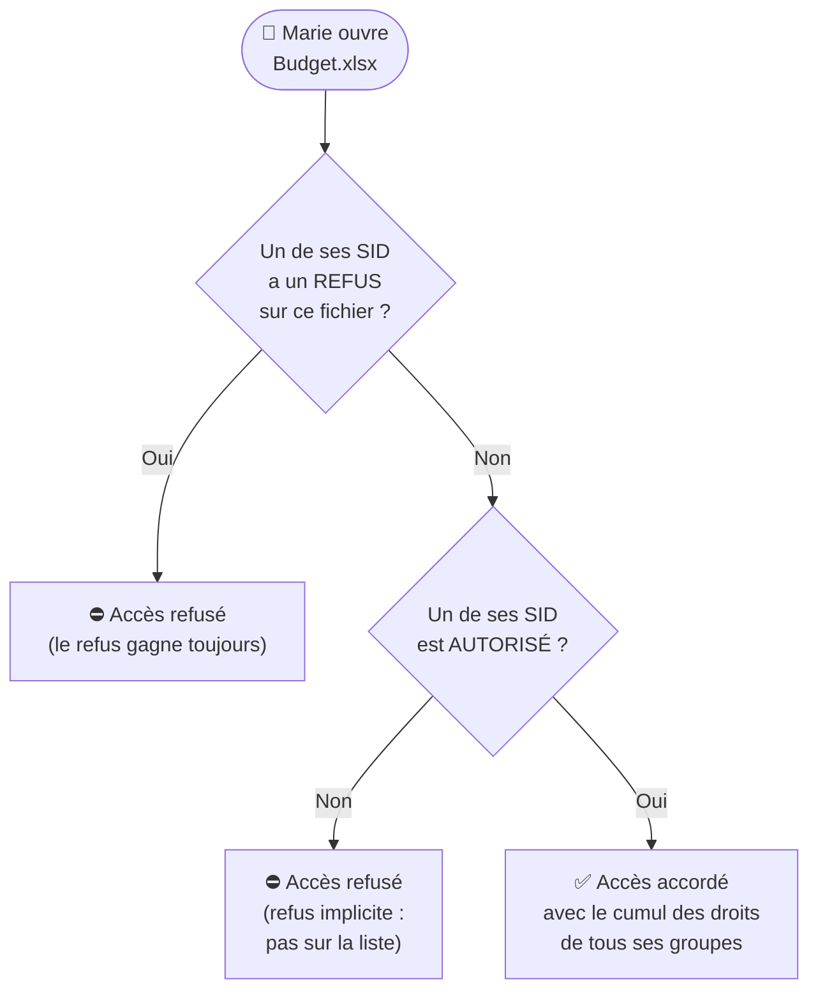
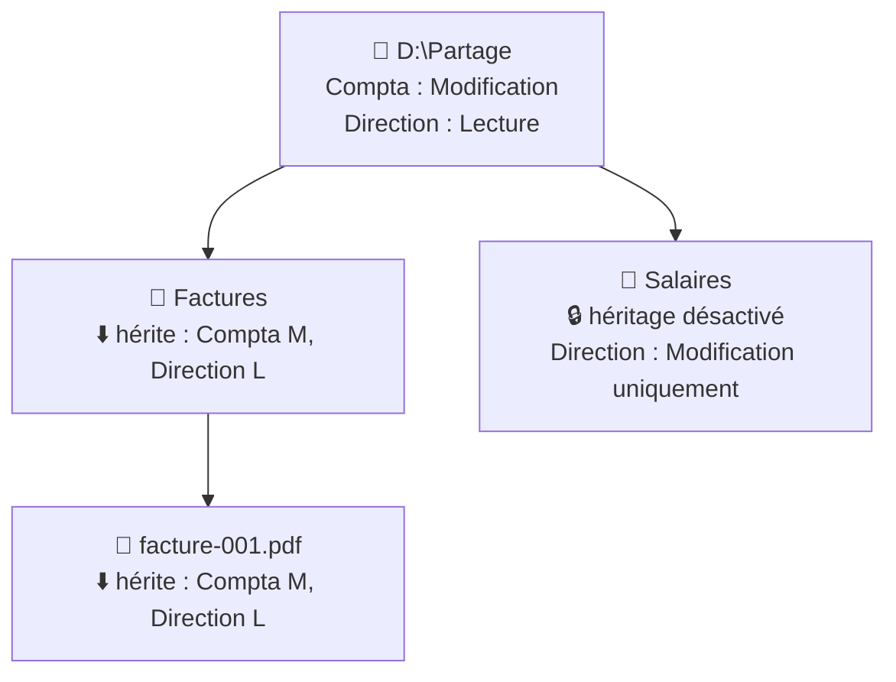

# Module 6 : La sécurité NTFS et les ACL

*Cours : [Cours 2 - Système client Microsoft](../index.md)*

## 🎯 Objectif du module

À la fin de ce module, tu sais :

- expliquer ce qu'est une **ACL** et comment Windows décide d'**autoriser ou refuser** un accès ;
- utiliser les **3 niveaux de droits** de base : Lecture, Modification, Contrôle total ;
- appliquer les **règles de calcul** : cumul, refus prioritaire, refus implicite ;
- maîtriser l'**héritage** et ce qui se passe quand on **copie ou déplace** un fichier ;
- **vérifier** les droits d'un utilisateur avec l'**accès effectif**.

!!! abstract "En clair"
    Chaque fichier et dossier d'un disque **NTFS** porte une **liste d'invités** : l'**ACL** (*Access Control List*). Elle dit **qui** peut entrer et **ce qu'il a le droit d'y faire** (lire, modifier, tout contrôler).

    Quand tu ouvres un fichier, tu présentes ton **badge** (le **jeton d'accès** du [module 5](../module-5-les-utilisateurs-et-les-groupes/index.md) : ton SID et ceux de tes groupes). Windows le compare à la liste. Si tu n'es **pas sur la liste**, c'est **non**.

## 🖼️ Résumé visuel

**① Comment Windows décide**



**② L'héritage : les droits descendent dans l'arborescence**



## 📖 Cours consolidé

### 1. L'ACL : la liste des droits

Clic droit sur un fichier ou dossier → **Propriétés** → onglet **Sécurité**.

| Élément | En clair |
|---|---|
| **ACL** | La **liste des droits** d'un objet |
| **DACL** | La partie qui liste les **utilisateurs et groupes** autorisés ou refusés |
| **ACE** | **Une ligne** : « tel groupe → tels droits » |

```
ACL de D:\Partage\Compta
 ├─ ACE : Administrateurs → Contrôle total
 ├─ ACE : GRP_Compta      → Modification
 └─ ACE : GRP_Direction   → Lecture
```

📌 Dans une ACL, on met des **groupes**, presque jamais des personnes : quand quelqu'un change de service, on le change **de groupe**, sans toucher aux ACL.

---

### 2. Les 3 niveaux de droits (cumulatifs)

| Niveau | L'utilisateur peut… | Pour qui ? |
|---|---|---|
| **Lecture** (et exécution) | **Ouvrir**, lire, lancer les programmes | Consultation |
| **Modification** | Lecture **+ créer, modifier, supprimer** | Ceux qui **travaillent** dans le dossier |
| **Contrôle total** | Modification **+ changer les droits**, devenir propriétaire | **Administrateurs uniquement** |

- Les **autorisations spéciales** (bouton **Avancé**) existent, mais 95 % des besoins se règlent avec ces 3 niveaux.
- ⚠️ **Jamais de Contrôle total** pour un utilisateur standard : il pourrait retirer l'accès aux autres.

---

### 3. Les règles de calcul

| Règle | Exemple |
|---|---|
| **① Refus implicite** : pas dans la liste = **pas d'accès** | Stagiaires absents de l'ACL → refusés |
| **② Cumul** : plusieurs groupes → on garde le **plus fort** | Lecture (Utilisateurs) + Modification (Compta) → **Modification** |
| **③ Le refus gagne** : un **Refuser coché** bat toutes les autorisations | Modification (Compta) + **Refus** (Stagiaires) → **refusé** |

- ✅ Préfère le **refus implicite** (ne pas mettre le groupe) au **refus explicite** (cases « Refuser » difficiles à retrouver).
- Ordre exact : refus explicite > autorisation explicite > refus hérité > autorisation héritée.

---

### 4. L'héritage

- Un dossier **transmet ses droits** à tout son contenu : on pose les droits **en haut**, ils **descendent**.
- Les droits hérités sont **grisés** (non modifiables à cet endroit).

| Pour les changer… | Quand ? |
|---|---|
| **Modifier le dossier parent** | Pour **tout** le contenu |
| **Désactiver l'héritage** (*Avancé* → « Convertir en autorisations explicites ») | **Un seul** sous-dossier différent (ex. `Salaires`) |

---

### 5. Copier ou déplacer : que deviennent les droits ?

| Action | Les droits… |
|---|---|
| **Déplacer sur le même disque** (`D:` → `D:`) | ✅ **sont conservés** (seul le chemin change) |
| **Déplacer vers un autre disque** (`D:` → `E:`) | 🔄 **ceux de la destination** (copie + suppression) |
| **Copier** (n'importe où) | 🔄 **ceux de la destination** (nouveau fichier) |

**À retenir** : **seul le couper-coller sur le même disque garde les droits.**

---

### 6. Vérifier les droits

- **Accès effectif** : Sécurité → **Avancé** → **Accès effectif** → choisir un utilisateur : Windows **simule** ses droits réels, sans son mot de passe.
- Encore mieux : **tester avec l'utilisateur** lui-même.

```
icacls D:\Partage\Compta                                  ← afficher l'ACL
icacls D:\Partage\Compta /grant GRP_Compta:(OI)(CI)M      ← Modification pour GRP_Compta, sur tout le contenu
icacls D:\Partage\Compta /remove GRP_Stagiaires           ← retirer un groupe
```

Droits : **R** = Lecture · **M** = Modification · **F** = Contrôle total. Héritage : **(OI)** = fichiers contenus · **(CI)** = sous-dossiers.

⚠️ Modification de droits refusée alors que tu es administrateur ? C'est l'**UAC** ([module 5](../module-5-les-utilisateurs-et-les-groupes/index.md)) : lance l'outil **en tant qu'administrateur**.

## 📝 Fiche de révision

### 🧠 L'essentiel en un tableau

| Notion | À retenir |
|---|---|
| **ACL / DACL** | La liste des droits d'un objet |
| **ACE** | Une ligne : groupe → droits |
| **Lecture** | Ouvrir, lire, exécuter |
| **Modification** | + créer, modifier, supprimer |
| **Contrôle total** | + changer les droits (administrateurs) |
| **Refus implicite** | Absent de la liste = refusé |
| **Cumul** | On garde le droit le plus fort |
| **Refus explicite** | Gagne sur les autorisations |
| **Héritage** | Le parent transmet ses droits (grisés) |
| **Accès effectif** | Simule les droits réels d'un utilisateur |

### 🧮 Calculer un droit : 3 exemples

| Marie est dans… | Résultat |
|---|---|
| Utilisateurs (**Lecture**) + Compta (**Modification**) | **Modification** (cumul) |
| Compta (**Modification**) + Stagiaires (**Refus** Lecture) | **Refusé** (le refus gagne) |
| Aucun groupe de la liste | **Refusé** (refus implicite) |

### 📦 Copier / déplacer

| | Même disque | Autre disque |
|---|---|---|
| **Couper-coller** | ✅ Droits **conservés** | 🔄 Droits de la **destination** |
| **Copier-coller** | 🔄 Droits de la **destination** | 🔄 Droits de la **destination** |

### ⚠️ Les pièges

- Le **refus explicite** l'emporte même si un autre groupe donne le Contrôle total.
- Un fichier **copié** perd ses droits d'origine.
- **Contrôle total** à un utilisateur = il peut **retirer l'accès aux autres**.
- Une modification de groupe ne s'applique qu'à la **prochaine ouverture de session** (jeton).

### ✏️ Entraîne-toi (clique pour voir la correction)

??? question "1. Paul est dans GRP_Compta (Modification) et GRP_Direction (Lecture). Quels droits a-t-il ?"
    **Modification** : les autorisations se **cumulent** et on garde la plus forte.

??? question "2. Même Paul, mais on ajoute un Refus « Écriture » pour le groupe Stagiaires, dont il fait aussi partie. Que se passe-t-il ?"
    Paul ne peut **plus écrire** : le **refus explicite l'emporte** sur la Modification. Il garde seulement la lecture.

??? question "3. Tu déplaces (couper-coller) un fichier de D:\Compta vers D:\Public. Les droits changent-ils ? Et si tu le copies ?"
    - **Couper-coller sur le même disque** (D: → D:) : les droits sont **conservés**. Attention, des personnes non autorisées dans Public ne le verront pas forcément !
    - **Copie** : le fichier prend les droits du dossier **Public**.

??? question "4. Le dossier Partage donne Lecture à tous. Le sous-dossier Salaires ne doit être visible que par la Direction. Comment faire ?"
    Sur **Salaires** : *Avancé* → **Désactiver l'héritage** → *Convertir en autorisations explicites*, puis **retirer** les groupes qui ne doivent pas y accéder et ne laisser que **Direction** (et les Administrateurs). Vérifie ensuite avec l'**Accès effectif**.

## 🧠 Quiz — entraîne-toi

<div id="quiz-cours-02-systeme-client-microsoft-module-6-la-securite-ntfs-et-les-acl"></div>

<script type="application/json" id="quiz-cours-02-systeme-client-microsoft-module-6-la-securite-ntfs-et-les-acl-data">
[
  {
    "question": "Sur quel système de fichiers les ACL (Access Control List) sont-elles utilisées pour sécuriser les fichiers et dossiers ?",
    "options": [
      "NTFS",
      "FAT32",
      "exFAT",
      "ReFS"
    ],
    "correctIndex": 0,
    "explanation": "Sur un volume formaté en NTFS, tous les répertoires et fichiers sont soumis à la sécurité NTFS, dont les autorisations d'accès sont définies par les ACL et stockées dans l'index du système de fichiers."
  },
  {
    "question": "Où sont stockées les autorisations NTFS d'un fichier ou d'un dossier ?",
    "options": [
      "Dans la base SAM de l'ordinateur",
      "Dans l'index du système de fichiers NTFS",
      "Dans le fichier lui-même, sous forme de métadonnées cachées",
      "Dans le registre système exclusivement"
    ],
    "correctIndex": 1,
    "explanation": "Les autorisations NTFS sont stockées dans l'index du système de fichiers, consultables et modifiables depuis l'onglet Sécurité de chaque objet."
  },
  {
    "question": "Que contient la DACL (Discretionary Access Control List) d'un objet NTFS ?",
    "options": [
      "Uniquement les fichiers journalisés par le système",
      "Le code source du système de fichiers NTFS",
      "Les utilisateurs et groupes concernés par les autorisations, en pratique surtout des groupes",
      "La liste des pilotes installés sur l'ordinateur"
    ],
    "correctIndex": 2,
    "explanation": "La DACL contient les utilisateurs et groupes auxquels s'appliquent des autorisations ; en bonne pratique, on évite d'y insérer directement des utilisateurs, car il est plus simple de gérer un nombre restreint de groupes qu'un grand nombre d'utilisateurs individuels."
  },
  {
    "question": "Pourquoi est-il recommandé d'éviter d'insérer directement des utilisateurs dans une DACL, en privilégiant les groupes ?",
    "options": [
      "Parce que les utilisateurs ne peuvent techniquement pas être ajoutés à une DACL",
      "Parce que cela désactive automatiquement l'héritage NTFS",
      "Parce que les groupes offrent toujours un contrôle total, sans possibilité de restriction",
      "Parce qu'il est plus simple de gérer un nombre restreint de groupes qu'un grand nombre d'utilisateurs individuels"
    ],
    "correctIndex": 3,
    "explanation": "Il est plus facile de gérer, par exemple, une dizaine de groupes plutôt qu'une centaine d'utilisateurs individuels ; c'est pourquoi la bonne pratique consiste à privilégier l'insertion de groupes dans les DACL."
  },
  {
    "question": "Que définissent les ACE (Access Control Entry) au sein d'une ACL ?",
    "options": [
      "Les actions possibles sur l'objet pour un groupe ou un utilisateur donné",
      "La liste des utilisateurs autorisés à se connecter au domaine",
      "Le chemin d'accès physique du fichier sur le disque",
      "La taille maximale autorisée pour un fichier"
    ],
    "correctIndex": 0,
    "explanation": "Les ACE définissent, pour chaque groupe ou utilisateur présent dans la DACL, les actions possibles sur l'objet concerné (lecture, modification, contrôle total, etc.)."
  },
  {
    "question": "Quel niveau d'accès NTFS de base permet à un utilisateur de lire des fichiers, d'exécuter des programmes et d'afficher le contenu d'un dossier ?",
    "options": [
      "Le niveau Modification",
      "Le niveau Lecture",
      "Le niveau Contrôle total",
      "Les autorisations spéciales"
    ],
    "correctIndex": 1,
    "explanation": "Le niveau Lecture est le premier niveau d'accès de base : il permet de lire des fichiers, d'exécuter des programmes et d'afficher le contenu d'un dossier."
  },
  {
    "question": "En plus des droits du niveau Lecture, que permet le niveau Modification ?",
    "options": [
      "Gérer soi-même les ACL de l'objet",
      "Configurer les autorisations spéciales uniquement",
      "Modifier les fichiers, ainsi que créer et supprimer des objets dans le répertoire",
      "Désactiver l'héritage NTFS"
    ],
    "correctIndex": 2,
    "explanation": "Le niveau Modification conserve les droits du niveau Lecture, tout en permettant à l'utilisateur de modifier les fichiers ainsi que de créer et supprimer des objets dans le répertoire."
  },
  {
    "question": "Qu'est-ce qui distingue le niveau Contrôle total des niveaux Lecture et Modification ?",
    "options": [
      "Il empêche toute modification des fichiers existants",
      "Il n'accorde que des droits de lecture seule",
      "Il ne s'applique qu'aux entités intégrées de sécurité",
      "Il permet en plus à l'utilisateur de gérer lui-même les ACL de l'objet"
    ],
    "correctIndex": 3,
    "explanation": "Le Contrôle total accorde les mêmes droits que le niveau Modification, mais permet en plus à l'utilisateur de gérer lui-même les ACL de l'objet en question."
  },
  {
    "question": "Depuis quel bouton de l'onglet Sécurité peut-on configurer des autorisations spéciales plus fines, comme autoriser la création de fichiers sans autoriser leur impression ?",
    "options": [
      "Le bouton Avancé",
      "Le bouton Modifier",
      "Le bouton Propriétaire",
      "Le bouton Hérité"
    ],
    "correctIndex": 0,
    "explanation": "Les autorisations spéciales, qui permettent d'affiner les accès au-delà des trois niveaux de base, sont disponibles depuis le bouton Avancé de l'onglet Sécurité."
  },
  {
    "question": "Que se passe-t-il pour un groupe absent de la DACL d'un objet ?",
    "options": [
      "L'accès lui est automatiquement accordé en lecture seule",
      "L'accès lui est refusé implicitement",
      "Il hérite systématiquement du niveau Contrôle total",
      "Le système génère une erreur bloquant l'accès à tous les utilisateurs"
    ],
    "correctIndex": 1,
    "explanation": "Les permissions NTFS reposent sur des règles explicites : un groupe absent de la DACL se voit refuser l'accès de manière implicite."
  },
  {
    "question": "Lorsqu'un utilisateur appartient à plusieurs groupes présents dans la DACL avec des niveaux d'accès différents (sans refus explicite), quelle autorisation l'emporte ?",
    "options": [
      "L'autorisation du groupe qui possède le plus bas niveau d'accès",
      "L'autorisation du groupe ajouté en dernier à la DACL",
      "L'autorisation du groupe qui possède le plus haut niveau d'accès",
      "Aucune autorisation ne s'applique, l'accès est bloqué par défaut"
    ],
    "correctIndex": 2,
    "explanation": "Lorsque plusieurs groupes d'un même utilisateur figurent dans une DACL avec des niveaux d'accès différents, c'est le niveau d'accès le plus élevé qui l'emporte, sauf en cas de refus explicite."
  },
  {
    "question": "Si un utilisateur appartient à un groupe autorisant la lecture et à un autre groupe refusant explicitement la lecture, quelle règle l'emporte ?",
    "options": [
      "L'autorisation l'emporte toujours sur le refus explicite",
      "Le système accorde l'accès en lecture seule par défaut",
      "Le conflit doit être résolu manuellement par l'administrateur avant tout accès",
      "Le refus explicite l'emporte sur l'autorisation"
    ],
    "correctIndex": 3,
    "explanation": "Un refus coché explicitement l'emporte sur les autorisations, pour des raisons de sécurité. Nuance (cas avancé) : une autorisation posée directement sur l'objet l'emporte sur un refus seulement hérité du dossier parent."
  },
  {
    "question": "Par défaut, comment un répertoire NTFS transmet-il ses autorisations à ses objets enfants (sous-répertoires et fichiers contenus) ?",
    "options": [
      "Il les propage automatiquement par héritage",
      "Il ne les transmet jamais automatiquement, chaque objet doit être configuré manuellement",
      "Il les transmet uniquement si l'UAC est désactivé",
      "Il les transmet uniquement aux utilisateurs, jamais aux groupes"
    ],
    "correctIndex": 0,
    "explanation": "Par défaut, un répertoire propage ses autorisations à ses objets enfants par héritage ; ces autorisations héritées apparaissent grisées et ne sont pas modifiables directement sur l'objet enfant."
  },
  {
    "question": "Comment reconnaît-on visuellement, dans l'onglet Sécurité, une autorisation héritée d'un objet parent ?",
    "options": [
      "Elle apparaît en rouge et clignotante",
      "Elle apparaît grisée et n'est pas directement modifiable",
      "Elle est précédée d'un astérisque",
      "Elle n'apparaît pas du tout dans la liste"
    ],
    "correctIndex": 1,
    "explanation": "Les autorisations héritées apparaissent grisées dans l'onglet Sécurité et ne peuvent pas être modifiées directement sur l'objet enfant ; il faut agir sur le dossier parent ou désactiver l'héritage."
  },
  {
    "question": "Que se passe-t-il au niveau des autorisations NTFS lorsqu'on déplace un fichier par couper/coller au sein d'un même volume ?",
    "options": [
      "Les autorisations sont systématiquement réinitialisées aux valeurs par défaut",
      "Le fichier hérite automatiquement des autorisations du nouveau dossier de destination",
      "Les autorisations d'accès sont conservées, car c'est le même index du système de fichiers qui est concerné",
      "Toutes les autorisations spéciales sont supprimées"
    ],
    "correctIndex": 2,
    "explanation": "Lors d'un déplacement au sein d'un même volume, les autorisations d'accès sont conservées, car il s'agit toujours du même index de système de fichiers."
  },
  {
    "question": "Que se passe-t-il au niveau des autorisations NTFS lorsqu'on copie un objet vers un autre volume, ou qu'on le déplace vers un volume différent ?",
    "options": [
      "Les autorisations d'origine sont automatiquement conservées à l'identique",
      "L'opération est bloquée par défaut pour des raisons de sécurité",
      "Seules les autorisations spéciales sont conservées, les niveaux de base sont réinitialisés",
      "L'objet est considéré comme nouveau et hérite des conditions d'accès du dossier de destination"
    ],
    "correctIndex": 3,
    "explanation": "Lorsqu'un objet est copié vers un autre volume ou déplacé sur un volume différent, il est considéré comme un nouvel objet par le système de fichiers, et ce sont les conditions d'accès héritées du dossier de destination qui s'appliquent."
  },
  {
    "question": "Depuis quel onglet un administrateur peut-il tester les accès effectifs d'un utilisateur ou d'un groupe sur un objet NTFS ?",
    "options": [
      "L'onglet Accès effectif, disponible depuis l'onglet Avancé",
      "L'onglet Général",
      "L'onglet Propriétés réseau",
      "L'onglet Compatibilité"
    ],
    "correctIndex": 0,
    "explanation": "L'onglet Accès effectif, accessible depuis l'onglet Avancé de la sécurité d'un objet, permet de tester les accès réels d'un utilisateur ou d'un groupe, en complément de vérifications directement avec les utilisateurs concernés."
  },
  {
    "question": "Parmi les bonnes pratiques de gestion des ACL rappelées en conclusion, laquelle concerne le choix entre refus implicite et refus explicite ?",
    "options": [
      "Toujours cocher les cases de refus explicite pour plus de clarté",
      "Privilégier le refus implicite plutôt que de cocher des cases de refus explicite",
      "Ne jamais utiliser le refus, qu'il soit implicite ou explicite",
      "Privilégier le refus explicite car il est plus rapide à configurer"
    ],
    "correctIndex": 1,
    "explanation": "Parmi les bonnes pratiques, il est recommandé de privilégier le refus implicite (absence du groupe dans la DACL) plutôt que de cocher explicitement des cases de refus, ce qui simplifie la gestion et limite les risques d'erreur."
  },
  {
    "question": "Pourquoi l'UAC peut-il avoir un effet indésirable pour un administrateur manipulant des ACL ?",
    "options": [
      "Parce que l'UAC supprime automatiquement toutes les ACL configurées",
      "Parce que l'UAC empêche définitivement toute modification des ACL",
      "Parce que même membre du groupe Administrateurs, le système le considère d'abord comme un utilisateur standard, pour des raisons de sécurité",
      "Parce que l'UAC ne concerne que les utilisateurs de domaine, jamais les administrateurs locaux"
    ],
    "correctIndex": 2,
    "explanation": "L'UAC fait en sorte que même un membre du groupe Administrateurs soit d'abord considéré comme un utilisateur standard par le système, ce qui peut produire des effets indésirables lors de la manipulation des ACL si l'élévation de privilèges n'est pas correctement gérée."
  },
  {
    "question": "Que recommande le module de faire systématiquement avant d'annoncer qu'un partage est en production ?",
    "options": [
      "Désactiver l'héritage NTFS sur l'ensemble du volume",
      "Supprimer tous les groupes prédéfinis de la DACL",
      "Activer le compte Administrateur générique",
      "Tester les accès des utilisateurs sur les ACL configurées"
    ],
    "correctIndex": 3,
    "explanation": "Il est recommandé de toujours tester les accès des utilisateurs, si possible directement avec eux, avant d'annoncer qu'un partage est en production, afin de vérifier que les ACL configurées produisent le résultat attendu."
  },
  {
    "question": "Marie est dans le groupe Compta (Modification) et dans le groupe Utilisateurs (Lecture). Aucun refus n'est défini. Quel droit a-t-elle ?",
    "options": [
      "Lecture",
      "Modification",
      "Contrôle total",
      "Aucun"
    ],
    "correctIndex": 1,
    "explanation": "Les autorisations se cumulent : on garde le niveau le plus élevé, ici Modification."
  },
  {
    "question": "Quelle commande en ligne affiche ou modifie les autorisations NTFS d'un dossier ?",
    "options": [
      "ipconfig",
      "icacls",
      "net share",
      "diskpart"
    ],
    "correctIndex": 1,
    "explanation": "icacls affiche l'ACL d'un fichier ou d'un dossier, et permet d'accorder (/grant) ou de retirer (/remove) des droits."
  }
]
</script>

<script>
  document.addEventListener("DOMContentLoaded", function () {
    TSSRQuiz.init({
      containerId: "quiz-cours-02-systeme-client-microsoft-module-6-la-securite-ntfs-et-les-acl",
      dataId: "quiz-cours-02-systeme-client-microsoft-module-6-la-securite-ntfs-et-les-acl-data",
    });
  });
</script>
