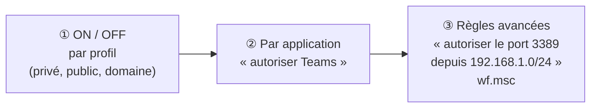

# Module 7 : La gestion du réseau et du pare-feu

*Cours : [Cours 2 - Système client Microsoft](../index.md)*

## 🎯 Objectif du module

À la fin de ce module, tu sais :

- choisir le bon **profil réseau** : privé, public ou domaine ;
- configurer une carte réseau en **IP fixe** ou en **DHCP** ;
- **diagnostiquer** un problème réseau avec les bonnes commandes ;
- régler le **pare-feu Windows** à ses 3 niveaux.

!!! abstract "En clair"
    - La **carte réseau** est la « prise » qui relie le PC au réseau. Elle a besoin d'une **adresse IP**, d'un **masque**, d'une **passerelle** et d'un **DNS** (voir le [cours 1](../../cours-01-bases-des-reseaux/index.md)).
    - Le **pare-feu** est le **vigile** du PC : il regarde chaque connexion qui **entre** ou qui **sort** et décide si elle passe.
    - Le **profil réseau** dit au vigile **où tu es** : à la maison ou au bureau (réseau de confiance), ou dans un café (réseau public, prudence).

## 🖼️ Résumé visuel

**① Le profil réseau règle la sévérité du pare-feu**

<div class="tssr-layers">
  <div class="tssr-layer" style="--layer-color:#10b981;">
    <span class="tssr-layer-num">🏢</span>
    <span class="tssr-layer-name">Domaine</span>
    <span class="tssr-layer-desc">Le PC est au bureau et voit son contrôleur de domaine · automatique</span>
    <span class="tssr-layer-tag">Confiance +++</span>
  </div>
  <div class="tssr-layer" style="--layer-color:#3b82f6;">
    <span class="tssr-layer-num">🏠</span>
    <span class="tssr-layer-name">Privé</span>
    <span class="tssr-layer-desc">Réseau connu (maison, petite entreprise) · choisi par toi</span>
    <span class="tssr-layer-tag">Confiance ++</span>
  </div>
  <div class="tssr-layer" style="--layer-color:#ef4444;">
    <span class="tssr-layer-num">☕</span>
    <span class="tssr-layer-name">Public</span>
    <span class="tssr-layer-desc">Gare, hôtel, café · le PC se cache et bloque un maximum</span>
    <span class="tssr-layer-tag">Méfiance</span>
  </div>
</div>

**② Les 3 niveaux de réglage du pare-feu, du plus large au plus précis**



## 📖 Cours consolidé

### 1. Les profils réseau

À chaque nouvelle connexion, Windows associe la carte réseau à un **profil** (ou « emplacement réseau »). Le **pare-feu adapte ses règles** à ce profil.

| Profil | Quand ? | Le pare-feu… |
|---|---|---|
| **Domaine** | **Automatique** dès que le PC (joint au domaine) joint son **contrôleur de domaine**. On ne peut pas le changer à la main | Laisse passer les échanges avec le domaine |
| **Privé** | Choisi **par toi** pour un réseau de **confiance** | Autorise la découverte du réseau et le partage |
| **Public** | Par défaut sur un réseau inconnu (ou sans passerelle) | **Bloque** au maximum ; le PC est **invisible** pour les autres |

💡 Pour changer le profil : **Paramètres → Réseau et Internet** → propriétés de la connexion → *Public* / *Privé*. Le **Centre Réseau et partage** (Panneau de configuration) affiche le profil de chaque carte.

⚠️ Un PC qui n'arrive pas à **partager un dossier** ou à **être vu** sur le réseau est souvent en profil **Public**.

---

### 2. Configurer la carte réseau

Raccourci : ++win+r++ → **`ncpa.cpl`** → clic droit sur la carte → *Propriétés* → **Protocole Internet version 4 (TCP/IPv4)**.

| Mode | Principe | Pour qui ? |
|---|---|---|
| **Dynamique** (« Obtenir une adresse IP automatiquement ») | Un serveur **DHCP** (la box, un serveur) donne IP, masque, passerelle et DNS | ✅ **Postes clients**, cas normal |
| **Statique** (fixe) | Tu saisis **toi-même** IP, masque, passerelle, DNS | **Serveurs**, imprimantes, routeurs : ils doivent garder **la même adresse** |

📌 **APIPA** : en DHCP, si aucun serveur ne répond, Windows se donne une adresse **169.254.x.x** (réseau `169.254.0.0/16`). Il ne peut alors parler qu'aux autres postes en 169.254 : **pas d'Internet**. C'est le signe d'un **problème DHCP**.

**Exemple de configuration statique**

| Champ | Valeur | Rôle |
|---|---|---|
| Adresse IP | `192.168.1.50` | L'adresse du poste |
| Masque | `255.255.255.0` | Le réseau est 192.168.1.0/24 |
| Passerelle | `192.168.1.1` | Le routeur, pour sortir du réseau |
| DNS préféré | `192.168.1.1` | Le serveur qui traduit les noms en adresses |

**En PowerShell :**

```powershell
Get-NetIPConfiguration                                         # voir la config (comme ipconfig)
New-NetIPAddress -InterfaceAlias "Ethernet" -IPAddress 192.168.1.50 -PrefixLength 24 -DefaultGateway 192.168.1.1
Set-DnsClientServerAddress -InterfaceAlias "Ethernet" -ServerAddresses 192.168.1.1
```

---

### 3. Diagnostiquer

L'assistant **« Résoudre les problèmes »** de Windows est pratique pour un utilisateur, mais un technicien utilise **les commandes** (détaillées dans le [module 5 du cours 1](../../cours-01-bases-des-reseaux/module-5-les-premieres-commandes/index.md)) :

| Commande | Question à laquelle elle répond |
|---|---|
| `ipconfig /all` | Quelle est ma configuration ? (APIPA ?) |
| `ping` | Cette machine répond-elle ? |
| `tracert` | Par où passent mes paquets ? |
| `nslookup google.fr` | Le **DNS** traduit-il bien ce nom ? |
| `arp -a` | Quelles adresses MAC mon PC connaît-il ? |
| `netstat -an` | Quelles connexions et quels ports sont ouverts ? |

⚠️ **Le pare-feu Windows bloque le ping entrant par défaut.** Un PC qui ne répond pas au ping **n'est pas forcément éteint**.

---

### 4. Le pare-feu Windows

Activé **par défaut**, il fonctionne ainsi :

| Sens | Par défaut |
|---|---|
| **Entrant** (quelqu'un essaie de se connecter à ton PC) | ⛔ **Bloqué**, sauf ce qui est autorisé par une règle |
| **Sortant** (ton PC se connecte ailleurs, ex. un site web) | ✅ **Autorisé** |

**Les 3 niveaux de réglage**

| Niveau | Où ? | Exemple |
|---|---|---|
| **① Activer / désactiver** par profil | `firewall.cpl` → *Activer ou désactiver le Pare-feu* | Actif sur les 3 profils (recommandé) |
| **② Autoriser une application** | `firewall.cpl` → *Autoriser une application…* | Autoriser « Partage de fichiers et d'imprimantes » sur le profil Privé |
| **③ Règles avancées** (entrantes / sortantes) | **`wf.msc`** (*Pare-feu Windows avec fonctions avancées de sécurité*) | Autoriser le **port TCP 3389** (Bureau à distance) **seulement depuis** 192.168.1.0/24 |

Une règle avancée précise : **le sens** (entrant / sortant), **le programme ou le port**, **les adresses** concernées, **l'action** (autoriser / bloquer) et **les profils**.

**Exemple : autoriser le ping (ICMP) en entrée**

```powershell
# avec la règle prédéfinie (sur un Windows en français, elle s'appelle « Partage de fichiers et d'imprimantes (Demande d'écho - Trafic entrant ICMPv4) ») :
Enable-NetFirewallRule -DisplayName "*Demande d'écho*ICMPv4*"

# ou en créant sa propre règle :
New-NetFirewallRule -DisplayName "Autoriser ping" -Direction Inbound -Protocol ICMPv4 -IcmpType 8 -Action Allow
```

⚠️ **Ne désactive jamais complètement le pare-feu** pour « régler » un problème : **ouvre seulement ce qui est nécessaire**, avec une règle.

## ✅ Points clés à retenir

- 3 profils réseau : **Domaine** (automatique, confiance maximale), **Privé** (réseau de confiance, choisi par toi), **Public** (par défaut, pare-feu le plus strict, PC invisible).
- Carte réseau : **`ncpa.cpl`** ; **DHCP** pour les postes clients, **IP fixe** pour les serveurs et imprimantes.
- **169.254.x.x** = APIPA = **aucun serveur DHCP** n'a répondu.
- Diagnostic : `ipconfig /all`, `ping`, `tracert`, `nslookup`, `arp -a`, `netstat -an`.
- Pare-feu **activé par défaut** : **entrant bloqué**, **sortant autorisé**. Il **bloque le ping entrant**.
- 3 niveaux de réglage : **ON/OFF par profil** → **par application** (`firewall.cpl`) → **règles avancées** (**`wf.msc`**).

## 📝 Fiche de révision

### 🧠 L'essentiel en un tableau

| Notion | À retenir |
|---|---|
| **Profil Domaine** | Automatique quand le contrôleur de domaine est joignable |
| **Profil Privé** | Réseau de confiance, partage possible |
| **Profil Public** | Par défaut, le plus strict |
| **`ncpa.cpl`** | Les cartes réseau |
| **`firewall.cpl`** | Pare-feu simple (ON/OFF, applications) |
| **`wf.msc`** | Pare-feu avancé (règles, ports) |
| **DHCP** | Adresse automatique (postes clients) |
| **Statique** | Adresse fixe (serveurs, imprimantes) |
| **APIPA** | 169.254.x.x = pas de DHCP |

### ⚠️ Les pièges

- **Ping sans réponse ≠ PC éteint** : le pare-feu bloque le ping entrant par défaut.
- Un partage invisible ? Vérifie que le profil n'est pas **Public**.
- Un **serveur en DHCP** risque de changer d'adresse : mets-le en **IP fixe**.
- **Désactiver le pare-feu** n'est jamais la solution : crée une **règle**.
- En IP fixe, un **DNS oublié** = Internet marche par IP, mais pas par nom.

### ✏️ Entraîne-toi (clique pour voir la correction)

??? question "1. Un portable se connecte au Wi-Fi d'un hôtel. Quel profil doit-il avoir, et pourquoi ?"
    **Public** : le réseau n'est pas de confiance. Le pare-feu bloque un maximum de connexions entrantes et le PC est **invisible** pour les autres clients de l'hôtel.

??? question "2. Tu dois installer une imprimante réseau. DHCP ou IP fixe ?"
    **IP fixe** (ou une réservation DHCP). Les postes s'y connectent par son adresse : si elle changeait, plus personne ne pourrait imprimer.

??? question "3. Tu fais un ping vers un collègue : « Délai d'attente dépassé ». Pourtant son PC fonctionne. Explication ?"
    Le **pare-feu Windows de son PC bloque le ping entrant** (ICMP) par défaut. Pour tester, il faut activer la règle **« Demande d'écho ICMPv4 – Trafic entrant »** sur son poste (dans `wf.msc`).

??? question "4. Il faut autoriser le Bureau à distance (port 3389) uniquement depuis le réseau des techniciens 10.0.5.0/24. Quel outil ?"
    **`wf.msc`** → *Règles de trafic entrant* → *Nouvelle règle* → **Port TCP 3389** → *Autoriser* → dans *Étendue*, adresse distante **10.0.5.0/24**. C'est le niveau ③, les règles avancées.

## 🧠 Quiz — entraîne-toi

<div id="quiz-cours-02-systeme-client-microsoft-module-7-la-gestion-du-reseau-et-du-pare-feu"></div>

<script type="application/json" id="quiz-cours-02-systeme-client-microsoft-module-7-la-gestion-du-reseau-et-du-pare-feu-data">
[
  {
    "question": "Depuis où peut-on accéder au Centre Réseau et partage sous Windows 10 ?",
    "options": [
      "Depuis l'icône réseau de la barre de notification ou depuis le panneau de configuration",
      "Uniquement depuis la commande diskmgmt.msc",
      "Uniquement depuis le gestionnaire des tâches",
      "Uniquement depuis l'invite de commande"
    ],
    "correctIndex": 0,
    "explanation": "Le Centre Réseau et partage est disponible depuis l'icône réseau de la barre de notification, mais aussi depuis le panneau de configuration."
  },
  {
    "question": "À quoi sert principalement le profil réseau (emplacement réseau) associé à une carte réseau ?",
    "options": [
      "À définir automatiquement l'adresse MAC de la carte réseau",
      "À faire en sorte que le pare-feu du système s'adapte à l'emplacement dans lequel on se connecte",
      "À choisir la vitesse de transmission de la carte réseau",
      "À attribuer un nom d'hôte permanent à l'ordinateur"
    ],
    "correctIndex": 1,
    "explanation": "Le but premier du profil réseau est de faire en sorte que le pare-feu du système s'adapte à l'emplacement dans lequel on se connecte, ce qui est particulièrement pratique dans un contexte de mobilité."
  },
  {
    "question": "Quel comportement adopte le pare-feu pour l'emplacement réseau « privé » ?",
    "options": [
      "Il bloque systématiquement toutes les communications entrantes et sortantes",
      "Il désactive complètement le pare-feu sans possibilité de le réactiver",
      "Il laisse passer un bon nombre de communications, car ce réseau est considéré de confiance",
      "Il applique les mêmes règles strictes que pour le réseau public"
    ],
    "correctIndex": 2,
    "explanation": "Le réseau privé est considéré comme un réseau de confiance à la connectivité maîtrisée ; le pare-feu s'adapte donc en laissant passer un bon nombre de communications."
  },
  {
    "question": "Pourquoi le profil réseau avec domaine n'est-il plus modifiable une fois l'ordinateur joint au domaine de l'entreprise ?",
    "options": [
      "Parce que Windows verrouille tous les profils réseau dès l'installation",
      "Parce qu'il n'existe techniquement qu'un seul profil réseau possible sur un ordinateur",
      "Parce que ce profil doit être configuré manuellement avant toute jonction au domaine",
      "Parce que ce profil de plus grande confiance est automatiquement appliqué et géré par la jonction au domaine"
    ],
    "correctIndex": 3,
    "explanation": "L'emplacement réseau avec domaine est un profil de plus grande confiance, laissant passer davantage de communications notamment avec le contrôleur de domaine ; il n'est plus modifiable une fois l'ordinateur joint au domaine de l'entreprise."
  },
  {
    "question": "Dans quel cas le profil réseau public s'applique-t-il automatiquement ?",
    "options": [
      "Par défaut, sur un réseau inconnu ou non approuvé (gare, hôtel, nouveau Wi-Fi)",
      "Lorsque l'ordinateur est joint à un domaine d'entreprise",
      "Lorsque l'utilisateur active manuellement le mode avion",
      "Lorsque le pare-feu Windows est complètement désactivé"
    ],
    "correctIndex": 0,
    "explanation": "Windows applique le profil Public à tout réseau qu'on ne lui a pas indiqué comme sûr : c'est le réglage le plus prudent. On passe un réseau en Privé à la main ; le profil Domaine s'applique tout seul quand le contrôleur de domaine est joignable."
  },
  {
    "question": "Quelle commande permet d'accéder rapidement aux propriétés des cartes réseau sous Windows 10 ?",
    "options": [
      "firewall.cpl",
      "ncpa.cpl",
      "diskmgmt.msc",
      "lusrmgr.msc"
    ],
    "correctIndex": 1,
    "explanation": "La commande ncpa.cpl permet d'accéder rapidement aux propriétés des cartes réseau, en complément du panneau de configuration ou du Centre Réseau et partage."
  },
  {
    "question": "Comment appelle-t-on le mode de configuration d'une carte réseau où l'on renseigne manuellement l'adresse IP, le masque et la passerelle ?",
    "options": [
      "L'adressage dynamique",
      "L'adressage APIPA",
      "L'adressage statique",
      "L'adressage par proxy"
    ],
    "correctIndex": 2,
    "explanation": "Lorsqu'on renseigne manuellement l'adresse IP, le masque, la passerelle par défaut et le serveur DNS, on configure la carte réseau de manière statique, par opposition à l'adressage dynamique fourni automatiquement."
  },
  {
    "question": "Quels services peuvent fournir automatiquement les informations réseau (adresse IP, masque, passerelle) dans le cadre de l'adressage dynamique ?",
    "options": [
      "Le service DNS ou le service NTP",
      "Le pare-feu Windows ou l'UAC",
      "Le service Active Directory ou le service WSUS",
      "Le serveur DHCP ou le service APIPA"
    ],
    "correctIndex": 3,
    "explanation": "En adressage dynamique, les informations réseau sont automatiquement fournies soit par un serveur DHCP, soit par le service APIPA lorsque aucun serveur DHCP n'est joignable."
  },
  {
    "question": "Quel est le réseau réservé au service APIPA sous Windows ?",
    "options": [
      "169.254.0.0/16",
      "10.0.0.0/8",
      "192.168.0.0/16",
      "127.0.0.0/8"
    ],
    "correctIndex": 0,
    "explanation": "Le service APIPA, natif sous Windows, utilise le réseau réservé 169.254.0.0/16 pour fournir une configuration temporaire lorsque aucun serveur DHCP n'est joignable."
  },
  {
    "question": "Avec quelles machines un ordinateur configuré en APIPA peut-il éventuellement communiquer ?",
    "options": [
      "Avec n'importe quelle machine disposant d'un accès Internet",
      "Avec les autres machines de son réseau local également adressées en APIPA",
      "Uniquement avec le contrôleur de domaine de l'entreprise",
      "Avec aucune autre machine, APIPA isole totalement l'ordinateur"
    ],
    "correctIndex": 1,
    "explanation": "Un ordinateur adressé en APIPA peut éventuellement communiquer avec les autres machines de son réseau local qui sont elles aussi adressées en APIPA, mais pas au-delà."
  },
  {
    "question": "Quelle commande affiche la configuration réseau et permet d'interagir avec le DNS et le DHCP (comme /flushdns ou /release) ?",
    "options": [
      "arp",
      "netstat",
      "nslookup",
      "ipconfig"
    ],
    "correctIndex": 3,
    "explanation": "ipconfig affiche la configuration réseau d'un poste et permet d'interagir avec les services DNS et DHCP, par exemple pour vider le cache DNS ou libérer/renouveler une adresse IP."
  },
  {
    "question": "Pourquoi la commande ping peut-elle parfois échouer par défaut sur un poste Windows, même si la machine cible est bien joignable ?",
    "options": [
      "Parce que le pare-feu Windows bloque par défaut certaines requêtes ICMP entrantes",
      "Parce que ping ne fonctionne que sur les réseaux IPv6",
      "Parce que ping nécessite obligatoirement des privilèges d'administrateur",
      "Parce que ping est incompatible avec le protocole TCP/IP"
    ],
    "correctIndex": 0,
    "explanation": "Le protocole utilisé par ping (ICMP) est bloqué par défaut par le pare-feu Windows, ce qui peut expliquer l'absence de réponse même lorsque la machine cible est correctement joignable."
  },
  {
    "question": "Quelle commande permet de diagnostiquer la résolution de noms d'hôtes, par exemple pour vérifier qu'un domaine se résout bien en une adresse IP ?",
    "options": [
      "tracert",
      "nslookup",
      "netstat",
      "arp"
    ],
    "correctIndex": 1,
    "explanation": "nslookup permet de diagnostiquer la résolution de noms d'hôtes, en interrogeant directement un serveur DNS pour vérifier la correspondance entre un nom de domaine et une adresse IP."
  },
  {
    "question": "Quelle commande permet de vérifier les informations relatives à la couche 4 (Transport) du modèle OSI, comme les connexions et ports actifs ?",
    "options": [
      "tracert",
      "arp",
      "netstat",
      "ipconfig"
    ],
    "correctIndex": 2,
    "explanation": "netstat permet de vérifier les informations relatives à la couche 4 (Transport) du modèle OSI, notamment les connexions réseau actives et les ports en écoute."
  },
  {
    "question": "Le pare-feu Windows est-il activé par défaut sur un système Windows 10 ?",
    "options": [
      "Non, il doit systématiquement être activé manuellement après l'installation",
      "Non, il n'est disponible que sur les éditions Entreprise de Windows 10",
      "Oui, mais uniquement pour le profil réseau public",
      "Oui, le pare-feu est activé par défaut"
    ],
    "correctIndex": 3,
    "explanation": "Windows 10 embarque nativement un pare-feu qui est activé par défaut, permettant au système de se protéger contre les accès non autorisés dès l'installation."
  },
  {
    "question": "Quel comportement par défaut adopte le pare-feu Windows concernant les connexions entrantes et sortantes ?",
    "options": [
      "Il bloque certaines connexions entrantes et laisse passer les connexions sortantes",
      "Il bloque systématiquement toutes les connexions, entrantes comme sortantes",
      "Il laisse passer toutes les connexions, entrantes comme sortantes, par défaut",
      "Il bloque uniquement les connexions sortantes, sans jamais filtrer les connexions entrantes"
    ],
    "correctIndex": 0,
    "explanation": "Par défaut, le pare-feu Windows bloque certaines connexions en entrée tout en laissant passer les connexions sortantes, ce comportement s'appuyant sur des règles prédéfinies par le système."
  },
  {
    "question": "Que permet le premier niveau de configuration du pare-feu Windows ?",
    "options": [
      "Filtrer précisément le trafic entrant en fonction des adresses IP sources",
      "Activer ou désactiver totalement le fonctionnement du pare-feu selon le profil réseau détecté",
      "Autoriser granulairement le trafic généré par une application spécifique",
      "Créer des règles personnalisées basées sur les ports de destination"
    ],
    "correctIndex": 1,
    "explanation": "Le premier niveau de configuration du pare-feu Windows permet d'activer ou de désactiver totalement son fonctionnement, et ce en fonction du profil réseau détecté (privé, domaine ou public)."
  },
  {
    "question": "Que permet le deuxième niveau de configuration du pare-feu Windows, plus précis que le premier ?",
    "options": [
      "Activer ou désactiver totalement le pare-feu",
      "Filtrer le trafic entrant selon les adresses IP sources ou les ports de destination",
      "Autoriser granulairement le trafic réseau généré par une application particulière",
      "Configurer le profil réseau de la carte réseau"
    ],
    "correctIndex": 2,
    "explanation": "Le deuxième niveau de configuration du pare-feu Windows permet d'autoriser de manière granulaire le trafic généré par une application particulière, en la retrouvant dans la liste proposée."
  },
  {
    "question": "Quelle commande permet d'accéder rapidement aux consoles de gestion du pare-feu Windows ?",
    "options": [
      "ncpa.cpl",
      "timedate.cpl",
      "lusrmgr.msc",
      "firewall.cpl"
    ],
    "correctIndex": 3,
    "explanation": "Les trois consoles de gestion du pare-feu Windows sont accessibles depuis le panneau de configuration, ou plus rapidement grâce à la commande firewall.cpl."
  },
  {
    "question": "Quelle console permet de créer des règles de pare-feu avancées, par port et par adresse IP ?",
    "options": [
      "ncpa.cpl",
      "wf.msc",
      "diskmgmt.msc",
      "lusrmgr.msc"
    ],
    "correctIndex": 1,
    "explanation": "wf.msc ouvre le « Pare-feu Windows avec fonctions avancées de sécurité », où l'on crée des règles entrantes et sortantes précises (port, programme, adresses, profils)."
  },
  {
    "question": "Quel mode d'adressage choisir pour un serveur ou une imprimante réseau ?",
    "options": [
      "DHCP, pour simplifier",
      "Une adresse IP fixe (statique)",
      "APIPA",
      "Aucune adresse"
    ],
    "correctIndex": 1,
    "explanation": "Les serveurs et imprimantes doivent toujours garder la même adresse pour que les postes les retrouvent : on leur donne une IP fixe (ou une réservation DHCP)."
  }
]
</script>

<script>
  document.addEventListener("DOMContentLoaded", function () {
    TSSRQuiz.init({
      containerId: "quiz-cours-02-systeme-client-microsoft-module-7-la-gestion-du-reseau-et-du-pare-feu",
      dataId: "quiz-cours-02-systeme-client-microsoft-module-7-la-gestion-du-reseau-et-du-pare-feu-data",
    });
  });
</script>
