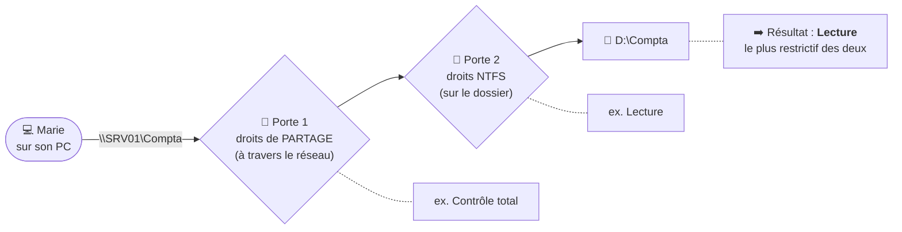

# Module 8 : Le partage de ressources

*Cours : [Cours 2 - Système client Microsoft](../index.md)*

## 🎯 Objectif du module

À la fin de ce module, tu sais :

- **partager un dossier** proprement (partage avancé) ;
- calculer les droits réels avec la **double vérification partage + NTFS** ;
- **accéder** à un partage : chemin UNC, lecteur réseau ;
- reconnaître les **partages administratifs** (`C$`, `ADMIN$`) ;
- utiliser et configurer le **Bureau à distance** (RDP).

!!! abstract "En clair"
    **Partager**, c'est rendre un dossier (ou une imprimante) d'un PC **accessible aux autres** à travers le réseau. Il y a toujours **4 acteurs** :

    - la **ressource** (le dossier « Compta ») ;
    - le **serveur** qui l'héberge (le PC ou le serveur qui a le dossier) ;
    - le **client** qui y accède (le PC de Marie) ;
    - le **réseau** entre les deux.

## 🖼️ Résumé visuel

**① La double porte : partage puis NTFS. Le plus strict gagne.**



**② Le chemin UNC : l'adresse d'un partage**

```
\\SRV01\Compta\Factures\2026.xlsx
  └─┬─┘ └─┬──┘ └──────┬─────────┘
 serveur partage    chemin dans le partage
 (ou IP : \\192.168.1.10\Compta)
```

## 📖 Cours consolidé

### 1. Que peut-on partager ?

| Ressource | Exemple |
|---|---|
| **Des fichiers** | Un dossier, une arborescence ou un volume entier |
| **Des imprimantes** | L'imprimante branchée sur un poste, partagée à tout le service (module 9) |

N'importe quel appareil peut jouer le rôle de **serveur** : un PC sous Windows 10/11, un Windows Server, un NAS, un copieur… ⚠️ **Créer un partage modifie le système** : il faut être **administrateur**.

---

### 2. Les deux niveaux de droits

Quand Marie ouvre un dossier partagé, Windows vérifie **deux fois** :

| Niveau | Où le régler ? | S'applique… |
|---|---|---|
| **① Droits de partage** | Propriétés → Partage → *Partage avancé* → **Autorisations** | **Seulement** à travers le **réseau** |
| **② Droits NTFS** ([module 6](../module-6-la-securite-ntfs-et-les-acl/index.md)) | Propriétés → **Sécurité** | **Toujours** : en réseau et en local |

Les deux proposent **Lecture / Modifier / Contrôle total**, et **c'est le plus restrictif des deux qui gagne**.

| Partage | NTFS | **Droit final** |
|---|---|---|
| Lecture | Modification | **Lecture** |
| Contrôle total | Modification | **Modification** |
| Contrôle total | Lecture | **Lecture** |
| Modifier | *(absent de l'ACL)* | **Aucun accès** |

!!! tip "La bonne pratique des techniciens"
    Pour ne gérer les droits **qu'à un seul endroit** :

    1. **Partage** : retirer **Tout le monde** (qui inclut le compte Invité) et mettre **Utilisateurs authentifiés → Contrôle total**.
    2. **NTFS** : régler les **vrais** droits, groupe par groupe (Compta : Modification, Direction : Lecture…).

    Ce n'est pas dangereux : comme **le plus strict gagne**, ce sont les droits NTFS qui décident.

---

### 3. Créer un partage

| Méthode | Comment | Pour qui ? |
|---|---|---|
| **Partage simplifié** | Clic droit → *Accorder l'accès à* | Utilisateurs (peu de contrôle) : un technicien ne l'utilise pas |
| **Partage avancé** | Propriétés → **Partage** → *Partage avancé* → cocher « Partager ce dossier » → **Autorisations** | ✅ Technicien |
| **Console « Dossiers partagés »** | `fsmgmt.msc` (aussi dans `compmgmt.msc`) | Voir **tous** les partages, **qui est connecté** et **quels fichiers sont ouverts** |
| **cmd** | `net share Compta=D:\Compta /GRANT:"Utilisateurs authentifiés",FULL` | Script |
| **PowerShell** | `New-SmbShare -Name Compta -Path D:\Compta -FullAccess "Utilisateurs authentifiés"` | Script |

💡 Un nom de partage **qui finit par `$`** (ex. `Compta$`) le rend **caché** : il n'apparaît pas quand on parcourt le réseau, mais reste accessible si on connaît son nom.

#### Les partages administratifs

Windows crée **tout seul** des partages cachés, **réservés aux administrateurs** :

| Partage | Contenu |
|---|---|
| **`C$`**, `D$`… | La **racine** de chaque disque |
| **`ADMIN$`** | Le dossier `C:\Windows` |
| **`IPC$`** | La communication entre programmes (pas un dossier) |

Exemple : un technicien tape `\\PC-COMPTA05\C$` pour aller chercher un fichier sur ce poste, sans se déplacer.

---

### 4. Accéder à un partage

| Besoin | Comment |
|---|---|
| **Accès ponctuel** | Taper le chemin **UNC** dans l'Explorateur ou dans ++win+r++ : `\\SRV01\Compta` |
| **Accès permanent** | **Connecter un lecteur réseau** (Explorateur → *Ce PC* → *Connecter un lecteur réseau*) : `Z:` → `\\SRV01\Compta`, en cochant « Se reconnecter à la connexion » |

| Je veux… | cmd | PowerShell |
|---|---|---|
| Voir les partages d'un serveur | `net view \\SRV01` | `Get-SmbShare` (sur le serveur) |
| Connecter un lecteur réseau | `net use Z: \\SRV01\Compta /persistent:yes` | `New-SmbMapping -LocalPath Z: -RemotePath \\SRV01\Compta` |
| Voir mes lecteurs réseau | `net use` | `Get-SmbMapping` |
| Déconnecter | `net use Z: /delete` | `Remove-SmbMapping -LocalPath Z:` |

---

### 5. Le Bureau à distance (RDP)

!!! abstract "En clair"
    Le **Bureau à distance** permet de **prendre la main sur un PC entier** depuis un autre PC, comme si tu étais assis devant. Idéal pour **dépanner sans te déplacer**, ou pour travailler sur ton PC du bureau depuis chez toi (à travers un **VPN**).

**Côté poste à contrôler (à activer, car désactivé par défaut)** :

1. **Paramètres → Système → Bureau à distance → Activer** (ou `sysdm.cpl` → onglet *Utilisation à distance*).
2. Garder l'option **NLA** cochée (*Authentification au niveau du réseau*) : l'utilisateur doit prouver son identité **avant** d'obtenir l'écran de connexion, ce qui est plus sûr.
3. **Qui peut se connecter ?** Par défaut, les **administrateurs**. Pour les autres : les ajouter au groupe **Utilisateurs du Bureau à distance**.
4. Le **pare-feu** s'ouvre automatiquement (port **TCP 3389**).

⚠️ Le PC à contrôler doit être en **édition Pro ou Entreprise** : l'édition Famille ne peut pas recevoir de connexion Bureau à distance.

**Côté technicien** : lancer **`mstsc`** (Connexion Bureau à distance), saisir le nom ou l'IP du poste. L'onglet *Ressources locales* permet de rapatrier le **presse-papiers**, les **imprimantes** et les **clés USB** dans la session.

| Limite | Détail |
|---|---|
| **Poste client** (Windows 10/11) | **1 seule session** à la fois : si tu te connectes, l'utilisateur présent est **déconnecté** |
| **Serveur** | **2 sessions** d'administration en même temps. Au-delà, il faut le rôle **RDS** (*Remote Desktop Services*, cours 17) |

💡 **Pour aider un utilisateur en le voyant travailler** (sans le déconnecter), on utilise un outil de **prise en main partagée** : **Assistance rapide** (intégrée à Windows, ++ctrl+win+q++), TeamViewer, AnyDesk, VNC…

## ✅ Points clés à retenir

- Un partage = **ressource + serveur + client + réseau**. Créer un partage nécessite d'être **administrateur**.
- **Double vérification** : droits de **partage** (réseau seulement) puis droits **NTFS** → **le plus restrictif gagne**.
- Bonne pratique : partage = **Utilisateurs authentifiés en Contrôle total** (sans « Tout le monde »), et les vrais droits en **NTFS**.
- Chemin **UNC** : `\\serveur\partage` ; lecteur réseau : `net use Z: \\serveur\partage`.
- Partages **administratifs** cachés : **`C$`**, **`ADMIN$`**, **`IPC$`** (le `$` cache un partage).
- **Bureau à distance** : protocole **RDP**, port **TCP 3389**, désactivé par défaut, **NLA** recommandée, client **`mstsc`** ; **1 session** sur un poste client, **2** sur un serveur (plus avec **RDS**).

## 📝 Fiche de révision

### 🧠 L'essentiel en un tableau

| Notion | À retenir |
|---|---|
| **UNC** | `\\serveur\partage` |
| **Partage + NTFS** | Le plus restrictif gagne |
| **Bonne pratique** | Partage : Utilisateurs authentifiés = Contrôle total · NTFS : les vrais droits |
| **`$` à la fin** | Partage caché |
| **`C$` / `ADMIN$`** | Partages administratifs automatiques |
| **`fsmgmt.msc`** | Dossiers partagés, sessions, fichiers ouverts |
| **RDP** | Bureau à distance, port TCP 3389 |
| **`mstsc`** | Le client Bureau à distance |
| **NLA** | Authentification avant l'ouverture de session distante |
| **RDS** | Plus de 2 sessions sur un serveur |

### 🔧 Les commandes

| Action | cmd | PowerShell |
|---|---|---|
| Créer un partage | `net share Nom=D:\Dossier /GRANT:"Utilisateurs authentifiés",FULL` | `New-SmbShare -Name Nom -Path D:\Dossier -FullAccess "Utilisateurs authentifiés"` |
| Lister les partages | `net share` | `Get-SmbShare` |
| Lecteur réseau | `net use Z: \\SRV\Nom` | `New-SmbMapping -LocalPath Z: -RemotePath \\SRV\Nom` |
| Voir les partages d'un serveur | `net view \\SRV` | |

### ⚠️ Les pièges

- Droits de partage en **Lecture** = **personne ne peut écrire** à travers le réseau, même avec la Modification en NTFS.
- Les droits de partage **ne s'appliquent pas en local** : seuls les droits NTFS protègent quelqu'un **assis devant** le PC.
- Bureau à distance sur un **poste client** = l'utilisateur présent est **déconnecté**.
- Bureau à distance impossible **vers** une édition **Famille**.

### ✏️ Entraîne-toi (clique pour voir la correction)

??? question "1. Partage : Utilisateurs authentifiés = Contrôle total. NTFS : Compta = Modification, Direction = Lecture. Quels droits pour un comptable en réseau ? Pour un directeur ?"
    - Comptable : min(Contrôle total, Modification) = **Modification**.
    - Directeur : min(Contrôle total, Lecture) = **Lecture**.

??? question "2. Partage : Tout le monde = Lecture. NTFS : Compta = Modification. Un comptable n'arrive pas à enregistrer. Pourquoi, et que corriger ?"
    Le droit de **partage en Lecture** est **plus restrictif** que le NTFS : le comptable n'a donc que la **Lecture**. Corrige le **partage** : retirer *Tout le monde*, ajouter **Utilisateurs authentifiés → Contrôle total**. Les droits NTFS s'appliqueront alors.

??? question "3. Connecte le partage Compta du serveur SRV01 sur la lettre Z:, de façon permanente, en ligne de commande."
    ```
    net use Z: \\SRV01\Compta /persistent:yes
    ```

??? question "4. Tu dois dépanner un utilisateur en voyant ce qu'il fait, sans le déconnecter. Bureau à distance ?"
    **Non** : le Bureau à distance sur un poste client **déconnecte l'utilisateur**. Utilise un outil de **prise en main partagée** : **Assistance rapide** (intégrée à Windows), TeamViewer, AnyDesk…

## 🧠 Quiz — entraîne-toi

<div id="quiz-cours-02-systeme-client-microsoft-module-8-le-partage-de-ressources"></div>

<script type="application/json" id="quiz-cours-02-systeme-client-microsoft-module-8-le-partage-de-ressources-data">
[
  {
    "question": "Quels sont les 4 éléments essentiels derrière la notion de partage de ressources ?",
    "options": [
      "La ressource, le serveur, le client et le réseau",
      "Le pare-feu, l'utilisateur, le mot de passe et le domaine",
      "Le disque, la partition, le volume et le système de fichiers",
      "Le routeur, la passerelle, le DNS et le DHCP"
    ],
    "correctIndex": 0,
    "explanation": "Partager, c'est permettre d'accéder à une ressource hébergée par un serveur depuis un OS client en passant par le réseau : les 4 éléments essentiels sont donc la ressource, le serveur, le client et le réseau."
  },
  {
    "question": "Selon la définition Microsoft citée dans le module, quels types de ressources peut-on partager sur le réseau ?",
    "options": [
      "Uniquement des bases de données SQL",
      "Des fichiers (dossiers, arborescences ou volumes entiers) et des imprimantes",
      "Uniquement de la mémoire RAM via le réseau",
      "Uniquement des connexions Internet partagées"
    ],
    "correctIndex": 1,
    "explanation": "D'après la définition Microsoft citée, les ressources partageables sont des fichiers via le partage de dossiers, d'arborescences ou de volumes entiers, ainsi que des imprimantes."
  },
  {
    "question": "Quels privilèges sont nécessaires pour pouvoir partager une ressource sur un système ?",
    "options": [
      "Aucun privilège particulier n'est requis",
      "Uniquement une authentification en tant qu'utilisateur invité",
      "Des privilèges d'administrateur, car partager revient à modifier le système",
      "Un abonnement Microsoft 365 actif"
    ],
    "correctIndex": 2,
    "explanation": "Le module précise que partager une ressource revient à modifier le système, ce qui nécessite donc des privilèges d'administrateur."
  },
  {
    "question": "Quels sont les trois niveaux d'accès possibles lors du partage d'un dossier ou d'un volume ?",
    "options": [
      "Lecture, écriture et exécution",
      "Public, privé et restreint",
      "Invité, standard et administrateur",
      "Lecture, modification et contrôle total"
    ],
    "correctIndex": 3,
    "explanation": "Le module précise que 3 niveaux d'accès sont possibles pour le partage d'un dossier ou d'un volume : lecture, modification et contrôle total."
  },
  {
    "question": "Combien de fois l'identité d'un utilisateur est-elle vérifiée lorsqu'il accède à une ressource partagée, et à quels niveaux ?",
    "options": [
      "Deux fois : au niveau du partage, puis au niveau des droits NTFS",
      "Une seule fois, au niveau du partage uniquement",
      "Trois fois : partage, NTFS et pare-feu",
      "Aucune vérification n'est faite si l'utilisateur est sur le réseau local"
    ],
    "correctIndex": 0,
    "explanation": "L'identité de l'utilisateur est vérifiée deux fois : d'abord au niveau du partage, puis au niveau des droits NTFS de la ressource."
  },
  {
    "question": "Si John a l'autorisation \"lecture\" au niveau du partage et \"modification\" au niveau des droits NTFS, quel droit final obtiendra-t-il ?",
    "options": [
      "Modification, car les droits NTFS sont toujours prioritaires",
      "Lecture, car les autorisations du partage sont restrictives",
      "Contrôle total, car les deux niveaux se cumulent",
      "Aucun accès, car les deux niveaux sont en conflit"
    ],
    "correctIndex": 1,
    "explanation": "Le module illustre que les autorisations du partage sont restrictives : même si John a un droit de modification au niveau NTFS, il n'aura finalement qu'un accès en lecture, car c'est le niveau le plus restrictif entre les deux qui s'applique."
  },
  {
    "question": "Quel type de chemin permet d'accéder momentanément à une ressource partagée depuis l'explorateur Windows, en indiquant le nom ou l'IP du serveur puis le nom du partage ?",
    "options": [
      "Un chemin FQDN complet",
      "Une URL HTTP",
      "Un chemin UNC (Universal Naming Convention)",
      "Un chemin relatif au répertoire courant"
    ],
    "correctIndex": 2,
    "explanation": "Le chemin UNC (Universal Naming Convention), contenant le nom ou l'adresse IP du serveur suivi du nom du partage, permet d'accéder momentanément à une ressource partagée depuis l'explorateur Windows."
  },
  {
    "question": "Quelle commande en ligne de commande permet de lister tous les partages disponibles sur un serveur donné ?",
    "options": [
      "net use",
      "net share",
      "New-SmbMapping",
      "net view"
    ],
    "correctIndex": 3,
    "explanation": "La commande net view permet de lister tous les partages disponibles sur le serveur auquel on souhaite accéder."
  },
  {
    "question": "Quelle cmdlet PowerShell permet de mapper un lecteur réseau vers un partage existant ?",
    "options": [
      "New-SmbMapping",
      "New-SmbShare",
      "Get-SmbShare",
      "Set-SmbServerConfiguration"
    ],
    "correctIndex": 0,
    "explanation": "La cmdlet PowerShell New-SmbMapping permet de mapper un lecteur réseau, équivalent à la commande net use en ligne de commande classique."
  },
  {
    "question": "Pourquoi un technicien évite-t-il généralement le menu \"accorder l'accès à\" et le bouton \"partager\" simplifié de l'explorateur Windows pour créer des partages ?",
    "options": [
      "Parce qu'elle nécessite obligatoirement PowerShell",
      "Parce que cette méthode est orientée utilisateur et moins précise que le partage avancé",
      "Parce qu'elle ne fonctionne que sur les serveurs, pas sur les postes clients",
      "Parce qu'elle désactive automatiquement le pare-feu"
    ],
    "correctIndex": 1,
    "explanation": "Le partage simplifié via le menu déroulant est orienté utilisateur ; un technicien privilégie plutôt le bouton partage avancé pour un contrôle plus fin des autorisations."
  },
  {
    "question": "Quelle bonne pratique de sécurité le module recommande-t-il concernant l'entité \"Tout le monde\", qui possède par défaut un accès en lecture sur un partage ?",
    "options": [
      "La conserver telle quelle, elle ne pose aucun risque",
      "La remplacer par le groupe Administrateurs uniquement",
      "La supprimer (car elle inclut le groupe et l'utilisateur invité) et ajouter à la place l'entité des « Utilisateurs authentifiés »",
      "Lui donner un accès en contrôle total pour simplifier la gestion"
    ],
    "correctIndex": 2,
    "explanation": "La bonne pratique consiste à supprimer l'entité \"Tout le monde\" (qui contient le groupe et l'utilisateur invité) et à la remplacer par l'entité des « Utilisateurs authentifiés », en leur accordant le contrôle total : cela ne pose pas de risque car les autorisations seront ensuite affinées grâce aux droits NTFS appliqués directement sur la ressource."
  },
  {
    "question": "Qu'est-ce qu'un partage administratif, comme ceux se terminant par un \"$\" ?",
    "options": [
      "Un partage visible par tous les utilisateurs du réseau",
      "Un partage réservé exclusivement à l'impression",
      "Un partage temporaire supprimé automatiquement après chaque redémarrage",
      "Un partage caché, créé automatiquement par le système, réservé aux membres du groupe Administrateurs"
    ],
    "correctIndex": 3,
    "explanation": "Les partages administratifs, dont le nom se termine par un $, sont cachés et n'apparaissent pas sur le réseau ; seul le compte administrateur peut y accéder, et ils sont créés automatiquement par le système."
  },
  {
    "question": "Quelle commande en ligne de commande permet de créer un partage en précisant son nom, son emplacement et les droits d'accès ?",
    "options": [
      "net share",
      "net view",
      "net use",
      "sharing /create"
    ],
    "correctIndex": 0,
    "explanation": "La commande net share permet de créer un partage en spécifiant son nom, son emplacement, et en appliquant la bonne pratique consistant à donner l'accès en contrôle total aux utilisateurs identifiés."
  },
  {
    "question": "Quelle fonctionnalité Windows permet d'accéder à un poste entier à distance, et pas seulement à certaines ressources partagées ?",
    "options": [
      "Le partage de fichiers simplifié",
      "Le bureau à distance",
      "Le service APIPA",
      "Le composant dossiers partagés"
    ],
    "correctIndex": 1,
    "explanation": "Le bureau à distance permet, une fois activé, d'accéder à un poste entier à partir du réseau, et de bénéficier du même niveau de fonctionnement que sur une session locale."
  },
  {
    "question": "Quelle est la principale limite du bureau à distance natif pour un usage de support utilisateur en temps réel ?",
    "options": [
      "Il ne fonctionne que sur les serveurs, jamais sur les postes clients",
      "Il nécessite obligatoirement une connexion VPN même sur le réseau local",
      "Une seule session locale ou distante est permise à la fois sur un poste client, ce qui empêche d'assister l'utilisateur sans fermer sa session",
      "Il ne peut être utilisé qu'en ligne de commande"
    ],
    "correctIndex": 2,
    "explanation": "Le bureau à distance ne permet qu'une seule session (locale ou distante) à la fois sur un poste client, ce qui le rend inadapté au support en temps réel ; des outils comme TeamViewer, VNC, LogMeIn ou Microsoft Remote Assistance sont alors privilégiés."
  },
  {
    "question": "Que faut-il activer pour permettre à plus de deux utilisateurs de se connecter simultanément en bureau à distance sur un serveur ?",
    "options": [
      "Le service APIPA",
      "La fonctionnalité NLA",
      "Le protocole SMB3",
      "Le rôle Microsoft RDS (ou une solution tierce équivalente)"
    ],
    "correctIndex": 3,
    "explanation": "Au-delà de deux sessions simultanées sur un serveur, il faut activer le rôle Microsoft RDS (Remote Desktop Services) ou recourir à une autre solution tierce."
  },
  {
    "question": "Quelle commande permet de lancer l'outil natif \"Connexion Bureau à distance\" depuis la ligne de commande ?",
    "options": [
      "mstsc",
      "rdp.exe",
      "remotedesktop.exe",
      "tsclient"
    ],
    "correctIndex": 0,
    "explanation": "L'outil natif de connexion bureau à distance est accessible en ligne de commande via mstsc."
  },
  {
    "question": "Par défaut, qui est autorisé à ouvrir une session de bureau à distance sur un poste cible ?",
    "options": [
      "Tous les utilisateurs du poste, sans restriction",
      "Uniquement les administrateurs, sauf ajout d'autres utilisateurs au groupe \"Utilisateurs du Bureau à distance\"",
      "Uniquement l'utilisateur invité",
      "Personne, cette fonctionnalité ne peut jamais être activée"
    ],
    "correctIndex": 1,
    "explanation": "Par défaut, seuls les administrateurs sont autorisés à ouvrir une session de bureau à distance ; il est possible d'étendre cet accès à d'autres utilisateurs via le groupe prédéfini \"Utilisateurs du Bureau à distance\"."
  },
  {
    "question": "Sur quel port TCP écoute le protocole RDP utilisé par le bureau à distance ?",
    "options": [
      "Le port 22",
      "Le port 443",
      "Le port 3389",
      "Le port 3306"
    ],
    "correctIndex": 2,
    "explanation": "Le protocole RDP (Remote Desktop Protocol), qui assure l'interaction entre le poste local et le poste distant, écoute sur le port 3389 ; l'activation du bureau à distance ouvre automatiquement l'accès correspondant dans le pare-feu."
  },
  {
    "question": "Qu'apporte le niveau d'authentification NLA (Network Level Authentication) par rapport au niveau standard, pour une connexion en bureau à distance ?",
    "options": [
      "Il supprime totalement le besoin de s'authentifier",
      "Il permet de se connecter sans mot de passe via une clé USB",
      "Il n'a aucun impact sur la sécurité, seulement sur l'affichage",
      "Il repose sur une double authentification : d'abord sur le réseau, puis sur la machine distante, pour plus de sécurité"
    ],
    "correctIndex": 3,
    "explanation": "Le niveau NLA repose sur une double authentification, d'abord sur le réseau, puis sur la machine distante, offrant un niveau de sécurité supérieur à l'authentification standard, tout en restant compatible avec le client Connexion Bureau à distance."
  },
  {
    "question": "Droits de partage : Contrôle total. Droits NTFS : Lecture. Quel droit a l'utilisateur en accédant par le réseau ?",
    "options": [
      "Contrôle total",
      "Modification",
      "Lecture",
      "Aucun"
    ],
    "correctIndex": 2,
    "explanation": "Les droits de partage et NTFS se combinent de façon restrictive : le plus strict des deux s'applique, ici Lecture."
  },
  {
    "question": "Quelle commande connecte le partage \\\\SRV01\\Compta sur la lettre Z: ?",
    "options": [
      "net share Z: \\\\SRV01\\Compta",
      "net use Z: \\\\SRV01\\Compta",
      "net view Z:",
      "mstsc Z:"
    ],
    "correctIndex": 1,
    "explanation": "net use <lettre> <chemin UNC> connecte un lecteur réseau. net share crée un partage, net view liste les partages d'un serveur."
  },
  {
    "question": "Que représente le partage administratif C$ ?",
    "options": [
      "Un partage créé par l'utilisateur",
      "La racine du disque C:, partagée automatiquement et réservée aux administrateurs",
      "Le dossier Windows",
      "Une imprimante"
    ],
    "correctIndex": 1,
    "explanation": "C$ est un partage caché créé automatiquement par Windows, qui donne accès à la racine du disque C: aux seuls administrateurs. ADMIN$ correspond au dossier C:\\Windows."
  }
]
</script>

<script>
  document.addEventListener("DOMContentLoaded", function () {
    TSSRQuiz.init({
      containerId: "quiz-cours-02-systeme-client-microsoft-module-8-le-partage-de-ressources",
      dataId: "quiz-cours-02-systeme-client-microsoft-module-8-le-partage-de-ressources-data",
    });
  });
</script>
