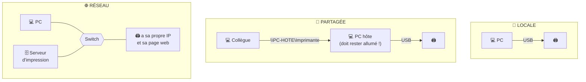

# Module 9 : Les pilotes et imprimantes

*Cours : [Cours 2 - Système client Microsoft](../index.md)*

## 🎯 Objectif du module

À la fin de ce module, tu sais :

- expliquer le rôle d'un **pilote** et le gérer dans le **Gestionnaire de périphériques** ;
- retrouver le pilote d'un **périphérique inconnu** (VEN / DEV) ;
- utiliser le **magasin de pilotes** et `pnputil` ;
- distinguer **imprimante**, **périphérique d'impression**, imprimante **locale / partagée / réseau** ;
- comprendre le **spouleur**, le **serveur d'impression** et le **pool d'impression**.

!!! abstract "En clair : c'est quoi un pilote ?"
    Windows ne connaît pas à l'avance les milliers de modèles d'imprimantes, de cartes graphiques ou de webcams. Le **pilote** (*driver*) est le **mode d'emploi** que le fabricant fournit à Windows pour qu'il sache **parler à ce matériel**.

    - Sans pilote : le matériel apparaît avec un **⚠️ point d'exclamation jaune**, et il ne fonctionne pas.
    - Avec un pilote **générique** (fourni par Windows) : il fonctionne, mais seulement pour les **fonctions de base**.
    - Avec le pilote **du fabricant** : **toutes** les fonctions sont disponibles.

## 🖼️ Résumé visuel

**① Le trajet d'une impression**


**② Locale, partagée ou réseau ?**



## 📖 Cours consolidé

### 1. Le Gestionnaire de périphériques

Ouvre-le avec **`devmgmt.msc`** (ou clic droit sur le menu Démarrer). Il liste **tout le matériel** et signale les problèmes.

| Ce que tu vois | Ça veut dire… |
|---|---|
| ⚠️ **Point d'exclamation jaune** | Le pilote est **absent** ou **en erreur** |
| ⬇️ **Flèche vers le bas** | Le périphérique est **désactivé** |
| « **Périphérique inconnu** » | Windows ne sait pas ce que c'est : **aucun pilote** |

**Clic droit sur un périphérique → Propriétés → onglet *Pilote*** :

| Bouton | Quand l'utiliser ? |
|---|---|
| **Mettre à jour le pilote** | Installer une version plus récente |
| **Restaurer le pilote** | ✅ **La nouvelle version pose problème** → revenir à la précédente |
| **Désactiver** | Couper le matériel sans le désinstaller |
| **Désinstaller** | Supprimer le périphérique (et son pilote) pour le réinstaller proprement |

**Comment le matériel est détecté :**

| Type | Exemple | Détection |
|---|---|---|
| **Plug & Play « à chaud »** | Clé USB, souris, casque Bluetooth | **Immédiate**, au branchement |
| **Interne** (carte **PCIe**) | Carte graphique, carte réseau | PC **éteint** pour l'installer, détectée **au démarrage** |

---

### 2. Retrouver le pilote d'un périphérique inconnu

Chaque matériel a une **carte d'identité** : Propriétés → onglet **Détails** → *ID du matériel*.

```
PCI\VEN_8086&DEV_15B8&SUBSYS_...
       └─┬──┘ └──┬──┘
   fabricant   modèle
   (8086 = Intel)
```

| Code | Signification |
|---|---|
| **`VEN_`** (*vendor*) | Le **fabricant** |
| **`DEV_`** (*device*) | Le **modèle** de matériel chez ce fabricant |

💡 Tape ces codes dans un moteur de recherche (ou sur un site comme **pcilookup.com**) pour trouver le fabricant et le modèle, puis télécharge le pilote **sur le site officiel du fabricant**.

---

### 3. Comment est fait un pilote

| Fichier | Rôle |
|---|---|
| **`.inf`** | La « notice d'installation », en texte : dit à Windows quels fichiers copier |
| **`.sys`** | Le **pilote** lui-même |
| **`.cat`** | Le **certificat** : la **signature** qui prouve que le pilote est authentique |

**Installer un pilote** : clic droit sur le fichier **`.inf`** → *Installer*, ou lancer le `setup.exe` du fabricant (qui installe souvent un logiciel en plus).

📌 **Pilotes signés** : Windows 64 bits **exige** des pilotes **signés** (certifiés). C'est pour cela que les **écrans bleus** sont devenus rares : autrefois, la plupart venaient de pilotes mal conçus.

#### Le magasin de pilotes (DriverStore)

Windows embarque des **milliers de pilotes génériques** dans `C:\Windows\System32\DriverStore`. C'est grâce à eux qu'une souris ou une imprimante courante **fonctionne dès le branchement**. Ils sont mis à jour par **Windows Update**.

| Commande | Rôle |
|---|---|
| `pnputil /enum-drivers` | Lister les pilotes ajoutés au magasin |
| `pnputil /add-driver pilote.inf /install` | **Ajouter** un pilote au magasin et l'installer |
| `pnputil /delete-driver oem12.inf` | **Supprimer** un pilote du magasin |
| `driverquery` | Lister les pilotes **chargés** |
| `msinfo32` | Fiche complète du PC : matériel, composants, logiciels |

---

### 4. Le vocabulaire de l'impression

!!! abstract "En clair : « imprimante » ne veut pas dire « la machine »"
    Pour Windows, l'**imprimante** est **logicielle** : c'est l'icône dans *Imprimantes et scanners*, avec son pilote, ses réglages, sa file d'attente et son port. La **machine physique** s'appelle le **périphérique d'impression**.

| Terme | Définition |
|---|---|
| **Périphérique d'impression** | La **machine** qui sort les feuilles |
| **Imprimante** | La partie **logicielle** dans Windows : pilote + réglages + file d'attente + port |
| **Spouleur** (*spooler*) | Le **service** qui gère la **file d'attente** : il traduit les documents pour la machine et les envoie **un par un** |
| **Port** | Par où partent les données : **USB** ou **adresse IP** |

| Type | Branchement | ✅ | ⚠️ |
|---|---|---|---|
| **Locale** | En **USB** sur un PC | Simple | Un seul utilisateur |
| **Partagée** | Locale, puis **partagée** par le PC hôte (onglet *Partage*) | Plusieurs utilisateurs | Le **PC hôte doit rester allumé** |
| **Réseau** | Directement sur le **réseau** (câble ou Wi-Fi), avec **sa propre IP** et une **page web** de réglages | Indépendante de tout PC | Plus chère |

---

### 5. Configurer et sécuriser une imprimante

Dans **Paramètres → Imprimantes et scanners** (ou `control printers`) :

- voir la **file d'attente** et annuler un document bloqué ;
- choisir l'**imprimante par défaut** ;
- dans les **Propriétés** : nom, **emplacement** (« Bâtiment B, 2ᵉ étage », pratique sur un grand site), **horaires** d'utilisation, **partage**.

**Les autorisations d'une imprimante** (onglet *Sécurité* de l'imprimante, comme pour un dossier) :

| Autorisation | Permet de… | Pour qui ? |
|---|---|---|
| **Imprimer** | Envoyer des documents | Tout le monde |
| **Gérer les documents** | Mettre en pause, annuler **les documents des autres** | La personne référente du service |
| **Gérer l'imprimante** | Tout régler (pilote, partage, droits) | Techniciens |

🩺 **Le dépannage n°1** : un document reste **bloqué** dans la file d'attente et plus rien ne sort → **redémarrer le spouleur**.

```powershell
Restart-Service -Name Spooler        # PowerShell (en administrateur)
```
```
net stop spooler && net start spooler   ← cmd (en administrateur)
```

---

### 6. L'impression en entreprise

Le **serveur d'impression** centralise toutes les imprimantes réseau :

- **un seul endroit** pour installer les pilotes, partager et régler les droits ;
- **suivi** : journaux, niveaux de toner, bacs vides ;
- côté poste : on tape **`\\SRV-IMPRESSION`** dans l'Explorateur → clic droit sur l'imprimante → **Connecter**. Le pilote s'installe **tout seul** depuis le serveur.

#### Le pool d'impression

!!! abstract "En clair"
    Un **pool** = **une seule imprimante** (logicielle) reliée à **plusieurs machines identiques**. Les utilisateurs envoient sur « Imprimante-Accueil » et le spouleur **répartit** les documents sur la première machine libre. C'est comme **plusieurs caisses avec une seule file d'attente** au supermarché.

    Condition : les machines doivent être **du même modèle** (même pilote) et **côte à côte**, car l'utilisateur ne sait pas laquelle va imprimer.

Mise en place : Propriétés de l'imprimante → **Ports** → cocher **« Activer le pool d'imprimantes »** → cocher les ports des différentes machines.

## ✅ Points clés à retenir

- Un **pilote** = le mode d'emploi d'un matériel pour Windows. Gestion dans **`devmgmt.msc`** : mettre à jour, **restaurer**, désactiver, désinstaller.
- ⚠️ jaune = problème de pilote ; « Périphérique inconnu » = pas de pilote → chercher **`VEN_`** (fabricant) et **`DEV_`** (modèle).
- Fichiers d'un pilote : **`.inf`** (notice), **`.sys`** (pilote), **`.cat`** (signature). Windows 64 bits exige des **pilotes signés**.
- **Magasin de pilotes** (`DriverStore`) = pilotes génériques (fonctions de base), géré avec **`pnputil`**.
- **Imprimante** = logiciel (pilote + file d'attente + port) ≠ **périphérique d'impression** = la machine.
- Locale (USB) · **partagée** (le PC hôte doit rester allumé) · **réseau** (sa propre IP).
- Le **spouleur** gère la file d'attente ; impression bloquée → **redémarrer le spouleur**.
- **Serveur d'impression** = gestion centralisée ; **pool** = 1 imprimante logique pour plusieurs machines identiques.

## 📝 Fiche de révision

### 🧠 L'essentiel en un tableau

| Notion | À retenir |
|---|---|
| **`devmgmt.msc`** | Gestionnaire de périphériques |
| **Restaurer le pilote** | Revenir à la version précédente |
| **VEN_ / DEV_** | Fabricant / modèle du matériel |
| **`.inf` · `.sys` · `.cat`** | Notice · pilote · signature |
| **DriverStore** | Pilotes génériques de Windows |
| **`pnputil`** | Gérer le magasin de pilotes |
| **`msinfo32`** | Fiche complète du PC |
| **Spouleur** | Service de file d'attente d'impression |
| **Imprimante partagée** | Le PC hôte doit être allumé |
| **Pool d'impression** | 1 imprimante logique → plusieurs machines identiques |

### ⚠️ Les pièges

- « Imprimante » = la partie **logicielle**, pas la machine.
- Une imprimante **partagée** ne marche plus si le **PC hôte est éteint**.
- Un pilote **générique** ne donne que les **fonctions de base** (pas de recto-verso, pas d'agrafage…).
- Toujours télécharger les pilotes sur le **site officiel du fabricant**.
- Un **pool** ne fonctionne qu'avec des machines **du même modèle**.

### ✏️ Entraîne-toi (clique pour voir la correction)

??? question "1. Après une mise à jour du pilote graphique, l'écran clignote. Que fais-tu ?"
    `devmgmt.msc` → *Cartes graphiques* → Propriétés → onglet *Pilote* → **Restaurer le pilote**. On revient à la version précédente, qui fonctionnait.

??? question "2. Un « Périphérique inconnu » apparaît après l'installation de Windows. Comment trouver son pilote ?"
    Propriétés → onglet **Détails** → *ID du matériel*. Relève les codes **VEN_** (fabricant) et **DEV_** (modèle), cherche-les sur Internet, puis télécharge le pilote **sur le site officiel du fabricant**.

??? question "3. Plus personne ne peut imprimer, et la file d'attente affiche un document « Erreur » impossible à supprimer. Que fais-tu ?"
    **Redémarre le spouleur** en administrateur : `Restart-Service Spooler` (ou `net stop spooler` puis `net start spooler`). Si le document est toujours là, arrête le spouleur, vide le dossier `C:\Windows\System32\spool\PRINTERS`, puis redémarre-le.

??? question "4. L'accueil a 3 imprimantes identiques côte à côte, et une file d'attente toujours pleine. Quelle solution ?"
    Un **pool d'impression** : une seule imprimante logique « Accueil » reliée aux **3 ports** (Propriétés → Ports → *Activer le pool d'imprimantes*). Le spouleur répartit les documents sur la machine libre.

## 🧠 Quiz — entraîne-toi

<div id="quiz-cours-02-systeme-client-microsoft-module-9-les-pilotes-et-imprimantes"></div>

<script type="application/json" id="quiz-cours-02-systeme-client-microsoft-module-9-les-pilotes-et-imprimantes-data">
[
  {
    "question": "Comment un périphérique branché sur un port USB est-il généralement pris en charge par le système ?",
    "options": [
      "À chaud, en tant que périphérique plug & play",
      "Uniquement après un redémarrage complet du système",
      "Uniquement via une installation manuelle obligatoire",
      "Il n'est jamais reconnu sans pilote tiers"
    ],
    "correctIndex": 0,
    "explanation": "Un périphérique connecté via USB ou une connectique sans fil est généralement pris en charge à chaud, ce qu'on appelle un périphérique plug & play, contrairement à un périphérique interne sur port PCI qui nécessite souvent un redémarrage pour être reconnu."
  },
  {
    "question": "Quelle console Windows permet de visualiser les périphériques pris en charge et non pris en charge, de mettre à jour ou désinstaller un pilote ?",
    "options": [
      "Le gestionnaire des tâches",
      "Le gestionnaire de périphériques",
      "Le panneau de configuration des imprimantes",
      "L'observateur d'événements"
    ],
    "correctIndex": 1,
    "explanation": "Le gestionnaire de périphériques permet de visualiser les périphériques pris en charge et non pris en charge, de mettre à jour, désactiver, désinstaller un pilote ou d'éditer ses propriétés."
  },
  {
    "question": "Dans l'identifiant d'un périphérique affiché dans ses propriétés détaillées, à quoi correspondent les parties VEN_ et DEV_ ?",
    "options": [
      "VEN_ identifie la version du pilote, DEV_ la date d'installation",
      "VEN_ et DEV_ désignent tous les deux le même numéro de série",
      "VEN_ identifie le fabricant, DEV_ identifie le matériel chez ce fabricant",
      "VEN_ est l'adresse IP du périphérique, DEV_ son adresse MAC"
    ],
    "correctIndex": 2,
    "explanation": "L'identifiant d'un périphérique est composé d'un identifiant de fabricant (VEN_, pour vendor) et d'un identifiant du matériel chez ce fabricant (DEV_, pour device), un peu comme un numéro de série."
  },
  {
    "question": "Pourquoi Microsoft privilégie-t-il aujourd'hui les pilotes signés ?",
    "options": [
      "Parce que le certificat de conformité associé garantit la stabilité du système et limite l'apparition des écrans bleus",
      "Parce qu'ils sont toujours gratuits, contrairement aux pilotes non signés",
      "Parce qu'ils s'installent automatiquement sans redémarrage",
      "Parce qu'ils ne nécessitent pas de fichier .inf"
    ],
    "correctIndex": 0,
    "explanation": "Les pilotes signés sont accompagnés d'un certificat de conformité garantissant la stabilité du système ; depuis leur généralisation, les écrans bleus liés à des pilotes mal conçus ou défaillants sont devenus plus rares."
  },
  {
    "question": "Parmi les fichiers composant un pilote, lequel contient la définition du pilote au format texte ?",
    "options": [
      ".sys",
      ".inf",
      ".cat",
      ".dll"
    ],
    "correctIndex": 1,
    "explanation": "Le fichier .inf contient la définition du pilote au format texte, tandis que le fichier .sys est le pilote compilé directement utilisable par le système, et le fichier .cat le certificat fourni par Microsoft ou un tiers de confiance."
  },
  {
    "question": "Quel fichier d'un pilote correspond au certificat de conformité fourni par Microsoft ou un tiers de confiance ?",
    "options": [
      ".inf",
      ".sys",
      ".cat",
      ".exe"
    ],
    "correctIndex": 2,
    "explanation": "Le fichier .cat correspond au certificat de conformité fourni par Microsoft ou un tiers de confiance, attestant la signature du pilote."
  },
  {
    "question": "Dans quel dossier retrouve-t-on tous les fichiers .inf des pilotes installés sur un système Windows ?",
    "options": [
      "c:\\Windows\\system32\\DriverStore",
      "c:\\Windows\\system32\\drivers",
      "c:\\ProgramData\\drivers",
      "c:\\Windows\\inf"
    ],
    "correctIndex": 3,
    "explanation": "Tous les fichiers .inf des pilotes des périphériques sont disponibles dans le dossier c:\\Windows\\inf, tandis que les autres fichiers associés se trouvent dans system32 ou SysWOW64."
  },
  {
    "question": "Qu'est-ce que le \"magasin de pilotes\" (DriverStore) de Windows ?",
    "options": [
      "Un ensemble de pilotes génériques disponibles dès l'installation du système, stockés dans c:\\Windows\\system32\\DriverStore",
      "Une boutique en ligne pour acheter des pilotes certifiés Microsoft",
      "Un service qui télécharge automatiquement tous les pilotes disponibles sur Internet",
      "Une sauvegarde cloud des pilotes installés par l'utilisateur"
    ],
    "correctIndex": 0,
    "explanation": "Le magasin de pilotes (ou pilotes génériques) est un ensemble de pilotes disponibles dès l'installation du système, stocké dans c:\\Windows\\system32\\DriverStore, et qui permet au système de faire fonctionner un périphérique sans installer le pilote du fabricant."
  },
  {
    "question": "Quelle commande permet de gérer (lister, ajouter, supprimer) les pilotes présents dans le magasin de pilotes Windows ?",
    "options": [
      "msinfo32",
      "pnputil",
      "driverquery",
      "devcon"
    ],
    "correctIndex": 1,
    "explanation": "La commande pnputil permet de gérer le magasin de pilotes Windows : lister, ajouter ou supprimer des pilotes."
  },
  {
    "question": "Quelle commande affiche une fenêtre graphique contenant des informations détaillées sur le matériel, les périphériques et le système ?",
    "options": [
      "pnputil",
      "driverquery",
      "msinfo32",
      "devmgmt.msc"
    ],
    "correctIndex": 2,
    "explanation": "La commande msinfo32 permet d'afficher une fenêtre graphique regroupant de nombreuses informations détaillées sur le matériel, les périphériques et le système."
  },
  {
    "question": "Dans la terminologie précisée par le module, qu'est-ce qui correspond réellement à une \"imprimante\", par opposition au périphérique d'impression ?",
    "options": [
      "La feuille de papier imprimée elle-même",
      "Le câble USB ou réseau reliant l'ordinateur au matériel d'impression",
      "Le toner et le bac à feuilles du matériel",
      "La partie logicielle qui envoie l'ordre d'impression au périphérique d'impression (pilote, configuration, file d'attente, port)"
    ],
    "correctIndex": 3,
    "explanation": "Le module précise qu'une imprimante est en réalité la partie logicielle (pilote, configuration, file d'attente, port d'impression) qui envoie l'ordre d'impression, par opposition au périphérique d'impression qui est le matériel produisant la feuille imprimée."
  },
  {
    "question": "Quel est le rôle du service spouleur (file d'attente d'impression) décrit dans le module ?",
    "options": [
      "Il convertit le document dans un langage brut électronique interprétable par le périphérique et traite les travaux un par un vers le port d'impression",
      "Il stocke physiquement les feuilles imprimées avant leur distribution",
      "Il gère uniquement les autorisations NTFS de l'imprimante",
      "Il remplace entièrement le pilote de l'imprimante"
    ],
    "correctIndex": 0,
    "explanation": "Le spouleur convertit numériquement le document (texte ou image) en un langage brut électronique interprétable par le périphérique d'impression, puis traite les travaux d'impression un à un pour les envoyer vers le port d'impression."
  },
  {
    "question": "Quelle est la différence entre une imprimante locale et une imprimante partagée ?",
    "options": [
      "Il n'y a aucune différence, les deux termes désignent la même chose",
      "L'imprimante locale est reliée directement à l'ordinateur, l'imprimante partagée est cette même imprimante locale rendue accessible sur le réseau via l'OS",
      "L'imprimante partagée possède toujours son propre système d'exploitation",
      "L'imprimante locale ne peut jamais être utilisée par un seul utilisateur"
    ],
    "correctIndex": 1,
    "explanation": "Une imprimante locale est un périphérique d'impression directement relié à l'ordinateur (par exemple en USB), tandis qu'une imprimante partagée est cette même imprimante locale rendue accessible sur le réseau grâce à l'OS de l'ordinateur, qui doit alors être allumé."
  },
  {
    "question": "Qu'est-ce qui caractérise une imprimante réseau, par opposition à une imprimante partagée ?",
    "options": [
      "Elle dépend obligatoirement d'un ordinateur allumé pour fonctionner",
      "Elle ne peut être utilisée que par un seul utilisateur à la fois",
      "Elle est indépendante, possède son propre OS, une interface réseau et un service web de configuration",
      "Elle ne peut pas être administrée à distance"
    ],
    "correctIndex": 2,
    "explanation": "Une imprimante réseau est un périphérique indépendant, possédant son propre système d'exploitation, une interface réseau et un service web permettant sa configuration, contrairement à une imprimante partagée qui dépend d'un ordinateur allumé."
  },
  {
    "question": "Comment un poste client accède-t-il généralement à une imprimante partagée ou à une imprimante centralisée sur un serveur d'impression ?",
    "options": [
      "Via son chemin UNC, comme pour tout autre partage réseau",
      "Uniquement en installant physiquement un câble USB vers chaque poste",
      "Via une adresse IP publique exclusivement",
      "Il n'est pas possible d'accéder à une imprimante partagée depuis un autre poste"
    ],
    "correctIndex": 0,
    "explanation": "Comme pour tout autre partage réseau, on accède à une imprimante partagée ou centralisée sur un serveur d'impression via son chemin UNC."
  },
  {
    "question": "Quel est l'intérêt de centraliser la gestion des imprimantes réseau sur un serveur d'impression en entreprise ?",
    "options": [
      "Cela empêche totalement les pannes matérielles",
      "Cela permet de centraliser les partages, les journaux et les informations d'utilisation (toners, bacs), simplifiant l'accès et la maintenance",
      "Cela supprime le besoin d'un pilote pour chaque imprimante",
      "Cela réduit automatiquement la consommation électrique des imprimantes"
    ],
    "correctIndex": 1,
    "explanation": "Un serveur d'impression permet de centraliser l'ensemble des partages, des journaux (logs) et des informations d'utilisation (toners, bacs de feuilles) des imprimantes réseau, ce qui simplifie leur accès et leur maintenance."
  },
  {
    "question": "Qu'est-ce qu'un pool d'impression, et dans quel but est-il mis en place ?",
    "options": [
      "Un groupe d'utilisateurs autorisés à imprimer sur une imprimante donnée",
      "Une sauvegarde automatique de tous les documents imprimés",
      "Une liaison entre une imprimante et plusieurs périphériques d'impression, permettant de répartir et d'accélérer le traitement d'une file d'attente très chargée",
      "Un espace disque réservé au stockage temporaire des fichiers à imprimer"
    ],
    "correctIndex": 2,
    "explanation": "Un pool d'impression relie une imprimante à plusieurs périphériques d'impression : le spouleur peut alors répartir les travaux entre tous les périphériques disponibles, divisant ainsi le temps de traitement d'une file d'attente très sollicitée."
  },
  {
    "question": "Pourquoi peut-il être utile d'installer le pilote fourni par le constructeur plutôt que de se contenter du pilote générique du magasin de pilotes ?",
    "options": [
      "Le pilote générique empêche totalement le périphérique de fonctionner",
      "Le pilote générique n'est jamais signé et provoque systématiquement des écrans bleus",
      "Il n'y a jamais de différence fonctionnelle entre les deux",
      "Le pilote constructeur, signé, permet de bénéficier de l'ensemble des fonctionnalités du périphérique, ce qui n'est pas toujours le cas avec le pilote générique"
    ],
    "correctIndex": 3,
    "explanation": "Le pilote générique du magasin de pilotes permet de faire fonctionner le périphérique avec ses fonctionnalités de base, mais seul le pilote signé du constructeur permet généralement de profiter de l'ensemble des fonctionnalités du périphérique."
  },
  {
    "question": "Les impressions sont bloquées dans la file d'attente. Quel est le premier réflexe du technicien ?",
    "options": [
      "Réinstaller Windows",
      "Redémarrer le service spouleur (Spooler)",
      "Formater le disque",
      "Désactiver le pare-feu"
    ],
    "correctIndex": 1,
    "explanation": "Le spouleur gère la file d'attente d'impression. Le redémarrer (Restart-Service Spooler, ou net stop/start spooler) débloque la plupart des files coincées."
  },
  {
    "question": "Après la mise à jour d'un pilote, le périphérique fonctionne mal. Quelle option du Gestionnaire de périphériques utiliser ?",
    "options": [
      "Désactiver le périphérique",
      "Restaurer le pilote",
      "Analyser les modifications du matériel",
      "Supprimer le magasin de pilotes"
    ],
    "correctIndex": 1,
    "explanation": "« Restaurer le pilote » (Propriétés → onglet Pilote) réinstalle la version précédente, qui fonctionnait."
  }
]
</script>

<script>
  document.addEventListener("DOMContentLoaded", function () {
    TSSRQuiz.init({
      containerId: "quiz-cours-02-systeme-client-microsoft-module-9-les-pilotes-et-imprimantes",
      dataId: "quiz-cours-02-systeme-client-microsoft-module-9-les-pilotes-et-imprimantes-data",
    });
  });
</script>
