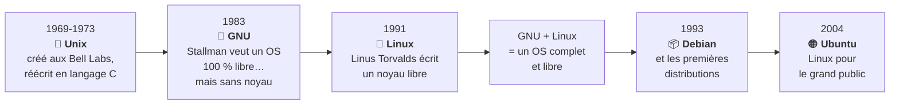

# Module 1 : Introduction à Unix/Linux

*Cours : [Cours 3 - Utilisateur d'une distribution GNU/Linux](../index.md)*

## 🎯 Objectif du module

À la fin de ce module, tu sais :

- raconter en quelques dates **d'où vient Linux** (Unix, GNU, Linus Torvalds) ;
- expliquer pourquoi on dit **GNU/Linux** ;
- dire ce qu'est une **distribution** et citer les principales (Debian, Ubuntu, Red Hat…) ;
- expliquer ce qu'est un **logiciel libre** et les grandes **licences**.

!!! abstract "En clair : c'est quoi Linux ?"
    **Linux** est un système d'exploitation, comme Windows, mais **gratuit**, **libre** (tout le monde peut lire et modifier son code) et **très léger**.

    Tu l'utilises sans le savoir : la plupart des **sites web**, des **serveurs**, les **box Internet**, les **téléphones Android** et beaucoup d'**objets connectés** tournent sous Linux.

    En tant que technicien, tu l'utiliseras surtout **au clavier, en ligne de commande**, sur des **serveurs**.

## 🖼️ Résumé visuel

**① De Unix à Linux en 6 dates**

**② Une distribution = le noyau + les outils + un emballage**

  

    📦
    La distribution
    Debian, Ubuntu, Red Hat… : choisit, assemble, teste et met à jour le tout
    Le paquet cadeau
  

  

    🖥️
    Logiciels et bureau (facultatif)
    Apache, LibreOffice, bureau GNOME ou KDE…
    Applications
  

  

    🗽
    Outils GNU
    Le shell Bash, les commandes ls, cp, grep…
    GNU
  

  

    🐧
    Noyau Linux
    Le cœur, qui pilote le matériel
    Linux
  

## 📖 Cours consolidé

### 1. D'Unix à GNU/Linux

| Année | Ce qui se passe |
|---|---|
| **1969** | Aux **Bell Labs**, **Ken Thompson** et **Dennis Ritchie** créent **Unix** |
| **1973** | Unix est **réécrit en C** (langage inventé par Ritchie) → **portable** sur d'autres machines |
| **1977** | **BSD** à Berkeley (toujours vivant : FreeBSD, une partie de macOS), qui apporte l'éditeur **vi** |
| **1983** | **Richard Stallman** lance **GNU** : un système **100 % libre** (puis la **FSF** en 1985) |
| **1991** | **Linus Torvalds** écrit un **noyau** libre : **Linux** |

- Linux hérite d'Unix : **tout est fichier**, de petites commandes qu'on **enchaîne**, le manuel **`man`**.
- **« GNU/Linux »** : GNU avait **tous les outils sauf le noyau**, Linus avait **le noyau** → ensemble, un système complet. Strictement, **Linux = le noyau**.
- Premières distributions encore vivantes : **Slackware**, **Debian** (1993), **Red Hat**, **SuSE** (1994) ; puis **Ubuntu** (2004), grand public.

---

### 2. Linux aujourd'hui

| Domaine | Exemples |
|---|---|
| **Serveurs web** et **bases de données** | Apache, Nginx · MySQL, MariaDB, PostgreSQL |
| **Cloud** | La plupart des VM chez Amazon, Google, Azure |
| **Smartphones**, objets connectés | **Android** (noyau Linux), box, TV, Raspberry Pi |
| **Superordinateurs** | 100 % des 500 plus puissants |

Un technicien l'utilise surtout **en ligne de commande** (**CLI**), souvent **à distance**. Les bureaux graphiques (**GNOME**, **KDE**, **XFCE**) servent aux postes de travail et aux vieux PC.

| Distribution | À savoir |
|---|---|
| **Debian** | Libre, gratuite, **stable**. ✅ **Celle de la formation** |
| **Ubuntu** | Basée sur Debian, très répandue. Prendre une **LTS** |
| **Red Hat (RHEL)** | Leader en entreprise, **payante** (support) |
| **Rocky / AlmaLinux** | Copies **gratuites** de Red Hat (remplacent CentOS, arrêté en 2021) |
| **SUSE / openSUSE** | Payante / gratuite |
| **Linux Mint**, Zorin OS | Bureau, faciles pour qui vient de Windows |
| **Kali Linux** | **Tests d'intrusion** ⚠️ jamais sur un réseau d'entreprise sans autorisation |
| **SystemRescue** | Clé de secours (réparer, récupérer des données) |

- ⚠️ **Libre ≠ gratuit** : Red Hat est libre, mais son support est payant.
- 📌 **Durée de support** : Ubuntu **LTS** = **5 ans**, version intermédiaire = **9 mois**. En entreprise : **toujours une LTS**.
- **Debian** : noms tirés de **Toy Story** — 10 Buster (supports de cours) · 12 Bookworm · **13 Trixie** (**stable actuelle**, août 2025). Son **contrat social** : rester **totalement libre**, priorité aux utilisateurs.

---

### 3. Les licences libres

**« *Free as in free speech, not as in free beer* »** : libre comme **liberté**, pas comme **gratuit**. Un logiciel libre donne le droit de l'**utiliser, étudier, modifier, partager**.

| Licence | Règle |
|---|---|
| **GNU GPL** | Les **4 libertés** + **copyleft** : une version modifiée et redistribuée **doit rester libre** |
| **BSD** | Presque **sans condition**, **sans copyleft** : on peut en faire un logiciel **fermé** (macOS) |
| **Apache** | Libre, en gardant les mentions de copyright |
| **CeCILL** | Licence libre **française** (CEA, CNRS, INRIA) |
| **Creative Commons** | Pour les **œuvres** (images, textes), pas le code |

## 📝 Fiche de révision

### 🧠 L'essentiel en un tableau

| Notion | À retenir |
|---|---|
| **Unix** | 1969, Bell Labs, réécrit en C en 1973 |
| **BSD** | Branche d'Unix née à Berkeley (1977) |
| **GNU** | Projet d'OS libre de Stallman (1983) |
| **Linux** | Noyau de Linus Torvalds (1991) |
| **GNU/Linux** | Outils GNU + noyau Linux |
| **Distribution** | Le système complet, emballé et maintenu |
| **Debian** | Libre, stable ; noms tirés de Toy Story |
| **LTS** | Version à support long (Ubuntu : 5 ans) |
| **CLI** | La ligne de commande |
| **GPL / copyleft** | Les modifications redistribuées doivent rester libres |

### 🗓️ Les dates à connaître

**1969** Unix · **1973** Unix en C · **1983** GNU · **1991** Linux · **1993** Debian · **2004** Ubuntu

### ⚠️ Les pièges

- **Linux** = seulement le **noyau** ; le système complet est **GNU/Linux**.
- **Libre ≠ gratuit** (Red Hat).
- **CentOS** n'est plus une copie de Red Hat : on utilise **Rocky Linux** ou **AlmaLinux**.
- Ne pas confondre **GPL** (copyleft obligatoire) et **BSD** (pas de copyleft).

### ✏️ Entraîne-toi (clique pour voir la correction)

??? question "1. Explique en une phrase pourquoi on dit « GNU/Linux »."
    Parce que le système complet associe les **outils du projet GNU** (shell, commandes) et le **noyau Linux** de Linus Torvalds. Linux seul n'est que le noyau.

??? question "2. Ton entreprise veut installer un serveur Ubuntu pour 5 ans. Quelle version choisir ?"
    Une version **LTS** (*Long Term Support*), suivie **5 ans**. Une version intermédiaire n'est suivie que 9 mois.

??? question "3. Une entreprise modifie un logiciel sous licence GPL et veut vendre sa version en gardant le code secret. Est-ce permis ?"
    **Non.** La GPL a un **copyleft** : une version modifiée et **redistribuée** doit rester sous GPL, avec son code source. (Avec une licence **BSD**, ce serait permis.)

??? question "4. Cite 4 endroits où l'on trouve Linux en dehors des PC."
    Les **serveurs web**, le **cloud**, les **smartphones Android**, les **box Internet**, les **TV et objets connectés**, les **superordinateurs**…

## 🧠 Quiz — entraîne-toi

