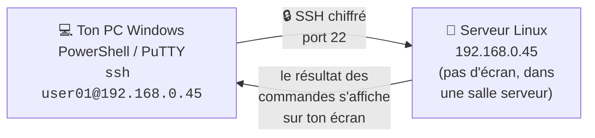

# Module 2 : Découverte du système d'exploitation Linux

*Cours : [Cours 3 - Utilisateur d'une distribution GNU/Linux](../index.md)*

## 🎯 Objectif du module

À la fin de ce module, tu sais :

- expliquer les **couches** d'un système Linux (matériel, noyau, shell, applications) ;
- dire ce qu'est le **shell** (Bash) et lire le **prompt** ;
- distinguer **commande, option et argument** ;
- **te connecter** à un serveur Linux (en console ou à distance avec **SSH**) et **te déconnecter**.

!!! abstract "En clair"
    Sous Linux, on discute avec le système **en tapant des phrases courtes** : les **commandes**. Le programme qui lit ces phrases et les exécute s'appelle le **shell** (le plus courant : **Bash**).

    Les serveurs Linux sont souvent **loin** (dans une salle serveur, dans le cloud) : on s'y connecte **à distance** avec **SSH**, depuis son PC, comme si on était devant.

## 🖼️ Résumé visuel

**① Lire le prompt : le shell te dit qui tu es, où tu es, et qu'il attend**

```
user01@srv-web:~$ ls -l /etc
└─┬──┘ └──┬──┘ │ │ └┬┘└┬┘ └┬─┘
  │       │    │ │  │  │   └─ ARGUMENT : sur quoi agir
  │       │    │ │  │  └───── OPTION : comment agir (commence par -)
  │       │    │ │  └──────── COMMANDE : quoi faire (toujours en 1er)
  │       │    │ └─────────── $ = utilisateur normal   ·   # = root (administrateur) ⚠️
  │       │    └───────────── ~ = dossier actuel (ici : mon dossier personnel)
  │       └────────────────── nom de la machine
  └────────────────────────── nom de l'utilisateur
```

**② Se connecter à distance avec SSH**



## 📖 Cours consolidé

### 1. Un OS en couches

| Couche | Rôle | Sous Linux |
|---|---|---|
| **Applications** | Les logiciels | Firefox, Apache |
| **Shell** | L'**interface** pour donner des ordres | **Bash** |
| **Noyau** (*kernel*) | Partage processeur et mémoire, pilote le matériel | Le noyau **Linux** |
| **Matériel** | Les composants | CPU, RAM, disque, carte réseau |

📌 Linux est **multi-utilisateur** (plusieurs personnes en même temps) et **multitâche** (plusieurs programmes en même temps).

---

### 2. Le shell

Un **interpréteur de commandes** (**CLI**) : tu tapes, il exécute, il affiche.

| Shell | À savoir |
|---|---|
| `sh` (Bourne Shell) | L'ancêtre |
| `csh`, `ksh` | Variantes historiques |
| **`bash`** | ✅ **Par défaut** presque partout : **autocomplétion** (++tab++), **historique** (++arrow-up++), **alias** |

**Les 3 flux** (comme en [PowerShell](../../cours-02-systeme-client-microsoft/module-11-aller-plus-loin-avec-powershell/index.md)) : **`stdin`** (0, clavier) · **`stdout`** (1, écran) · **`stderr`** (2, erreurs à l'écran).

```text
$ cat Bonjour
cat: Bonjour: Aucun fichier ou dossier de ce type     ← message envoyé sur stderr (2)
```

---

### 3. La syntaxe d'une commande

```
commande  [options]  [arguments]
```

| Élément | Rôle | Exemple |
|---|---|---|
| **Commande** | **Quoi** faire (toujours en 1er) | `ls` |
| **Option** | **Comment** : **`-`** courte, **`--`** longue | `-l`, `--all` |
| **Argument** | **Sur quoi** | `/etc` |

```bash
who                          # aucune option, aucun argument
head -n 10 fichier.txt       # option avec valeur + argument : 10 premières lignes
cp fichier.txt /home/user    # 2 arguments : source, destination
ls -l -a  =  ls -la          # options courtes regroupables
```

⚠️ **Sensible à la casse** : `Echo` → « commande introuvable » ; `Rapport.txt` et `rapport.txt` sont **deux fichiers**.

---

### 4. Se connecter à Linux

Un **identifiant** + un **mot de passe**. 💡 Le mot de passe **ne s'affiche pas** (même pas d'étoiles) : c'est normal.

| Méthode | Quand ? |
|---|---|
| **Console** (sur la machine : `login:` puis `Password:`) | Installation, **grosse panne**, pas de réseau |
| **`ssh user01@192.168.0.45`** depuis PowerShell / cmd | ✅ Le plus simple (intégré à Windows 10/11) |
| **PuTTY** (IP, port **22**, *Open*) | Pour **enregistrer** ses connexions ; PSCP / PSFTP copient des fichiers |
| **mRemoteNG** | **Plusieurs connexions** en onglets (SSH et Bureau à distance) |

**1re connexion SSH** : confirmer l'**empreinte** du serveur avec **`yes`** (si elle change plus tard : méfiance !).

```text
PS C:\> ssh user01@192.168.0.45
Are you sure you want to continue connecting (yes/no)? yes
user01@192.168.0.45's password:            ← mot de passe (invisible)
user01@srv-web:~$                          ← connecté !
```

- 💡 IP du serveur (depuis sa console) : **`ip a`**, ligne `inet` de la carte (ex. `ens33`).
- **Se déconnecter** : **`exit`** (partout), `logout` ou ++ctrl+d++.

## 📝 Fiche de révision

### 🧠 L'essentiel en un tableau

| Notion | À retenir |
|---|---|
| **Noyau** | Cœur du système, gère le matériel et les tâches |
| **Shell / CLI** | Interpréteur de commandes |
| **Bash** | Le shell par défaut |
| **`$` / `#`** | Utilisateur normal / root |
| **`~`** | Ton dossier personnel |
| **Option** | `-l`, `--all` : modifie la commande |
| **Argument** | Ce sur quoi la commande agit |
| **SSH** | Connexion à distance chiffrée, port 22 |
| **PuTTY** | Client SSH pour Windows |
| **`exit`** | Se déconnecter |

### 🔧 Les commandes du module

| Commande | Rôle |
|---|---|
| `echo "texte"` | Afficher un texte |
| `who` | Qui est connecté |
| `ls -l /etc` | Lister un dossier, en format long |
| `ip a` | Voir les adresses IP |
| `ssh user@IP` | Se connecter à distance |
| `exit` | Se déconnecter |

### ⚠️ Les pièges

- **`Echo` ≠ `echo`** : Linux respecte la casse.
- Le **mot de passe est invisible** quand on le tape.
- Un prompt qui finit par **`#`** = tu es **root** : chaque commande peut tout casser.
- Un espace oublié entre la commande et l'option : `ls-l` → commande introuvable.

### ✏️ Entraîne-toi (clique pour voir la correction)

??? question "1. Dans « tar -xzvf sauvegarde.tar.gz », repère la commande, les options et l'argument."
    - Commande : **`tar`**
    - Options : **`-xzvf`** (4 options courtes regroupées : x, z, v, f)
    - Argument : **`sauvegarde.tar.gz`**

??? question "2. Que t'apprend ce prompt : root@srv-bdd:/var/log# ?"
    Tu es connecté en **root** (administrateur, d'où le **`#`**), sur la machine **srv-bdd**, dans le dossier **`/var/log`**. Prudence : toutes tes commandes ont les pleins pouvoirs.

??? question "3. Depuis ton PC Windows, connecte-toi au serveur 10.0.0.12 avec le compte « tech »."
    Dans PowerShell (ou dans l'invite de commandes) :
    ```
    ssh tech@10.0.0.12
    ```
    Réponds `yes` à la première connexion, puis tape le mot de passe (il ne s'affiche pas).

??? question "4. Tu tapes « Ls /home » et tu obtiens « commande introuvable ». Pourquoi ?"
    Linux **respecte la casse** : la commande s'appelle **`ls`** en minuscules. `Ls` n'existe pas.

## 🧠 Quiz — entraîne-toi

<div id="quiz-cours-03-utilisateur-d-une-distribution-gnu-linux-module-2-decouverte-du-systeme-d-exploitation-linux"></div>

<script type="application/json" id="quiz-cours-03-utilisateur-d-une-distribution-gnu-linux-module-2-decouverte-du-systeme-d-exploitation-linux-data">
[
  {
    "question": "Comment le module définit-il un système d'exploitation ?",
    "options": [
      "Le composant logiciel principal qui gère les interactions avec le matériel et permet d'exécuter les logiciels",
      "Un périphérique matériel permettant de stocker des données",
      "Un protocole de communication réseau",
      "Un simple navigateur web intégré au système"
    ],
    "correctIndex": 0,
    "explanation": "Le système d'exploitation est défini comme le composant logiciel principal qui gère les interactions avec le matériel (clavier, souris, écran, son) et permet à l'utilisateur de lancer des logiciels."
  },
  {
    "question": "À quelle catégorie de systèmes d'exploitation appartiennent Windows, Mac OS X, Unix et Linux ?",
    "options": [
      "Systèmes propriétaires fermés",
      "Systèmes ouverts, multi-utilisateurs et multitâches",
      "Systèmes ouverts, monopostes et monotâches",
      "Systèmes embarqués uniquement"
    ],
    "correctIndex": 1,
    "explanation": "Windows, Mac OS X, Unix et Linux appartiennent à la catégorie des systèmes ouverts, multi-utilisateurs et multitâches, permettant à plusieurs utilisateurs de se connecter et de faire fonctionner plusieurs applications simultanément."
  },
  {
    "question": "Dans le modèle en couches décrit pour comprendre le fonctionnement d'un OS, quel est le rôle du noyau ?",
    "options": [
      "Afficher les fenêtres graphiques des applications",
      "Stocker les données personnelles de l'utilisateur",
      "Gérer les échanges entre le matériel et les couches logicielles",
      "Interpréter uniquement les commandes tapées au clavier"
    ],
    "correctIndex": 2,
    "explanation": "Le noyau est le cœur du système, chargé de gérer les échanges entre le matériel et les couches logicielles, en ordonnant les tâches et en évitant qu'une seule tâche n'accapare toutes les ressources."
  },
  {
    "question": "Dans le modèle en couches, quelle couche correspond, sous Linux, principalement à la ligne de commande avec le shell Bash ?",
    "options": [
      "Le matériel",
      "Le noyau",
      "Les applications",
      "Le shell"
    ],
    "correctIndex": 3,
    "explanation": "Le shell est l'interface principale par laquelle l'utilisateur interagit avec le système : sous Windows, cela correspond à l'interface graphique, tandis que sous Linux, c'est principalement la ligne de commande avec le shell Bash."
  },
  {
    "question": "Que signifie l'acronyme CLI, autre nom donné au Shell en tant qu'interpréteur de commandes ?",
    "options": [
      "Command Line Interface",
      "Computer Language Index",
      "Central Logic Interpreter",
      "Control Level Interface"
    ],
    "correctIndex": 0,
    "explanation": "Le Shell est également désigné par l'acronyme CLI, pour Command Line Interface, c'est-à-dire la ligne de commande."
  },
  {
    "question": "Quel numéro de flux correspond au flux d'entrée standard (stdin), généralement la saisie au clavier ?",
    "options": [
      "1",
      "0",
      "2",
      "3"
    ],
    "correctIndex": 1,
    "explanation": "Le flux d'entrée standard, stdin, porte le numéro 0 : par défaut, le Shell lit une commande à partir de ce flux, correspondant à une saisie au clavier."
  },
  {
    "question": "Dans l'exemple de la commande \"cat Bonjour\" où le fichier \"Bonjour\" n'existe pas, sur quel flux le message d'erreur est-il affiché ?",
    "options": [
      "stdin (flux 0)",
      "stdout (flux 1)",
      "stderr (flux 2)",
      "Aucun flux, l'erreur reste invisible"
    ],
    "correctIndex": 2,
    "explanation": "Lorsque la commande cat Bonjour échoue car le fichier n'existe pas, le message d'erreur est affiché via le flux stderr (standard error output), qui porte le numéro 2."
  },
  {
    "question": "Quel shell, écrit par Brian Fox, est une réécriture du Bourne Shell et constitue le shell principal de la plupart des distributions Linux ?",
    "options": [
      "C-Shell (csh)",
      "Korn Shell (ksh)",
      "DOS Shell",
      "Bash (Bourne Again Shell)"
    ],
    "correctIndex": 3,
    "explanation": "Bash, pour Bourne Again Shell, écrit par Brian Fox, est une réécriture du Bourne Shell original et constitue le shell principal utilisé dans la plupart des distributions Linux, avec des améliorations comme l'autocomplétion et l'historique des commandes."
  },
  {
    "question": "Qui a créé le C-Shell (csh), inspiré du langage C ?",
    "options": [
      "Bill Joy",
      "Steve Bourne",
      "David Korn",
      "Brian Fox"
    ],
    "correctIndex": 0,
    "explanation": "Le C-Shell (csh), inspiré du langage C, a été écrit par Bill Joy, également à l'origine de la branche BSD d'Unix."
  },
  {
    "question": "Pourquoi la commande \"Echo \\\"Bonjour le monde\\\"\" (avec un E majuscule) renvoie-t-elle une erreur sous Bash, alors que \"echo\" fonctionne ?",
    "options": [
      "Parce que Bash ne reconnaît que les commandes en majuscules",
      "Parce que la ligne de commande sous Linux est sensible à la casse",
      "Parce que la commande echo n'existe pas réellement sous Linux",
      "Parce qu'il manque un argument à la commande"
    ],
    "correctIndex": 1,
    "explanation": "La ligne de commande sous Linux est sensible à la casse : \"Echo\" avec un E majuscule n'est pas reconnu comme la commande echo, ce qui provoque l'erreur \"commande introuvable\"."
  },
  {
    "question": "Dans la commande \"ls -l\", à quoi correspond \"-l\" ?",
    "options": [
      "Un argument désignant le répertoire à afficher",
      "Le nom d'un fichier à lister",
      "Une option qui modifie le comportement de la commande, ici pour un affichage sous forme longue",
      "Le nom d'utilisateur à utiliser pour la commande"
    ],
    "correctIndex": 2,
    "explanation": "\"-l\" est une option de la commande ls qui modifie son comportement : elle demande ici un affichage sous forme longue (avec davantage de détails sur chaque fichier)."
  },
  {
    "question": "Dans la commande \"ls /etc\", à quoi correspond \"/etc\" ?",
    "options": [
      "Une option de la commande",
      "Le nom d'utilisateur connecté",
      "Le nom du shell utilisé",
      "Un argument précisant le répertoire à lister"
    ],
    "correctIndex": 3,
    "explanation": "\"/etc\" est un argument de la commande ls : il précise le répertoire que l'on souhaite lister, par opposition à une option qui modifierait le comportement général de la commande."
  },
  {
    "question": "Quel mode de connexion à un serveur Linux, souvent qualifié de \"boîte noire\", est généralement utilisé lors de la première installation ou en cas de panne majeure ?",
    "options": [
      "La connexion via la console en mode terminal, directement sur le serveur",
      "La connexion SSH via PuTTY",
      "La connexion via Remote Desktop (RDP)",
      "La connexion via une interface web"
    ],
    "correctIndex": 0,
    "explanation": "La connexion directe à la console d'un serveur ou d'une VM, en mode terminal, est parfois appelée \"boîte noire\" en raison de ses capacités limitées (pas de souris, interface restreinte), et il est conseillé de l'éviter autant que possible."
  },
  {
    "question": "Quelle commande SSH permet de se connecter à un serveur Linux d'adresse 192.168.0.45 avec l'utilisateur user01 ?",
    "options": [
      "ssh 192.168.0.45/user01",
      "ssh user01@192.168.0.45",
      "connect user01:192.168.0.45",
      "ssh -user01 192.168.0.45"
    ],
    "correctIndex": 1,
    "explanation": "La syntaxe de connexion SSH présentée dans le module est ssh suivi du nom d'utilisateur, d'un arobase (@), puis du nom ou de l'adresse IP de la machine cible : ssh user01@192.168.0.45."
  },
  {
    "question": "Quels modules complémentaires de PuTTY permettent la copie de fichiers ?",
    "options": [
      "WinSCP et FileZilla",
      "KITTY et EmryMod NG",
      "rsync et scp",
      "PSCP et PSFTP"
    ],
    "correctIndex": 3,
    "explanation": "PuTTY permet d'utiliser des modules complémentaires comme PSCP et PSFTP, dédiés à la copie de fichiers vers ou depuis un serveur distant."
  },
  {
    "question": "Quelle commande, compatible avec presque tous les shells, est la méthode la plus courante pour se déconnecter d'une session Linux ?",
    "options": [
      "logout",
      "exit",
      "shutdown",
      "disconnect"
    ],
    "correctIndex": 1,
    "explanation": "La commande exit est la méthode la plus courante pour se déconnecter, et elle est compatible avec presque tous les shells, contrairement à logout qui ne fonctionne pas sous SH Bourne."
  },
  {
    "question": "Quel raccourci clavier, noté ^D, peut également être utilisé pour fermer une session Linux ?",
    "options": [
      "Ctrl + C",
      "Ctrl + Z",
      "Ctrl + D",
      "Alt + F4"
    ],
    "correctIndex": 2,
    "explanation": "Le raccourci Ctrl + D, couramment noté ^D, peut également être utilisé pour fermer une session, en plus des commandes exit et logout."
  },
  {
    "question": "Dans la démonstration du module, quelle commande est utilisée depuis la console du serveur pour afficher l'adresse IP de la machine (ici 192.168.0.45 sur l'interface ens33) ?",
    "options": [
      "ifconfig",
      "netstat -r",
      "hostname -I",
      "ip a"
    ],
    "correctIndex": 3,
    "explanation": "Dans la démonstration, la commande ip a est utilisée pour afficher la configuration réseau et révéler que l'interface ens33 possède l'adresse IP 192.168.0.45."
  },
  {
    "question": "Que signifie le caractère # à la fin du prompt (ex. root@srv:~#) ?",
    "options": [
      "Que la commande précédente a échoué",
      "Que tu es connecté en root, l'administrateur",
      "Que tu es dans ton dossier personnel",
      "Que le shell est en pause"
    ],
    "correctIndex": 1,
    "explanation": "Un prompt qui se termine par # indique le compte root (administrateur). Un utilisateur normal a un prompt qui se termine par $."
  },
  {
    "question": "Sur quel port TCP écoute SSH par défaut ?",
    "options": [
      "21",
      "22",
      "80",
      "3389"
    ],
    "correctIndex": 1,
    "explanation": "SSH (Secure Shell) utilise le port TCP 22. Le port 3389 est celui du Bureau à distance Windows (RDP)."
  }
]
</script>

<script>
  document.addEventListener("DOMContentLoaded", function () {
    TSSRQuiz.init({
      containerId: "quiz-cours-03-utilisateur-d-une-distribution-gnu-linux-module-2-decouverte-du-systeme-d-exploitation-linux",
      dataId: "quiz-cours-03-utilisateur-d-une-distribution-gnu-linux-module-2-decouverte-du-systeme-d-exploitation-linux-data",
    });
  });
</script>
