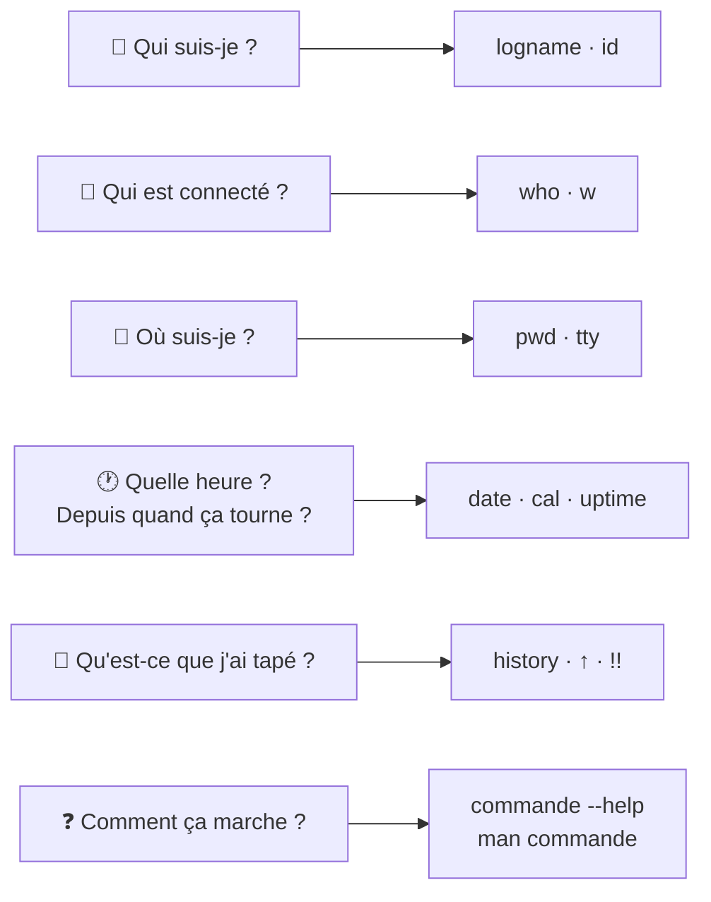

# Module 3 : Découverte du shell et premières commandes

*Cours : [Cours 3 - Utilisateur d'une distribution GNU/Linux](../index.md)*

## 🎯 Objectif du module

À la fin de ce module, tu sais :

- répondre à **« qui suis-je ? »** (`logname`, `id`, `who`, `w`) et **« où suis-je ? »** (`pwd`, `tty`) ;
- changer ton **mot de passe** (`passwd`) ;
- afficher la **date** et le **calendrier** ;
- créer et lire une **variable**, et connaître les **variables d'environnement** (`$HOME`, `$PATH`…) ;
- gagner du temps avec l'**historique**, l'**autocomplétion** ++tab++ et l'**aide** (`--help`, `man`).

!!! abstract "En clair"
    Ce module est ta **trousse de survie** dans le terminal : savoir **qui tu es**, **où tu es**, **retrouver une commande déjà tapée**, et surtout **trouver de l'aide tout seul**. Avec `man` et `--help`, tu n'as pas besoin de tout retenir par cœur.

## 🖼️ Résumé visuel

**Les questions que tu te poses → la commande qui répond**



## 📖 Cours consolidé

### 1. Root : l'administrateur tout-puissant

**root** est le **super-administrateur** de Linux : il peut **tout** faire, y compris tout casser. Son prompt finit par **`#`** (un utilisateur normal : **`$`**).

⚠️ **Les bonnes pratiques :**

- **ne jamais** travailler en root au quotidien ;
- se connecter avec **son compte normal**, puis **demander les droits** seulement quand c'est nécessaire (avec `sudo`, vu dans le cours 4) ;
- **jamais de connexion SSH directe en root** : Debian l'interdit d'ailleurs par défaut.

---

### 2. Qui suis-je, qui est là ?

| Commande | Répond à… | Exemple de résultat |
|---|---|---|
| **`logname`** | Mon nom d'utilisateur | `user30` |
| **`id`** | Mon **UID** (numéro d'utilisateur), mon **GID** (numéro de groupe) et mes **groupes** | `uid=1031(user01) gid=1031(user01) groupes=1031(user01),1002(tssr)` |
| `id -u` · `id -g` · `id -G` | Seulement l'UID · le GID · les groupes | `1031` |
| `id -u user5` | L'UID **d'un autre** utilisateur | `1061` |
| **`who`** | Qui est connecté (et depuis quand) | `user30  pts/0  2026-10-21 10:30` |
| `who -H` · `who -q` | Avec les titres des colonnes · seulement le nombre de connectés | |
| **`w`** | Comme `who`, **plus** ce que fait chacun, son inactivité, la charge de la machine | |
| **`uptime`** | Depuis **combien de temps** la machine tourne | `up 12 days, 3:14` |

💡 **UID** = *User ID*, **GID** = *Group ID*. Ce sont l'équivalent Linux du **SID** de Windows : Linux travaille avec ces **numéros**, pas avec les noms.

#### Changer son mot de passe

```bash
passwd          # demande l'ancien, puis 2 fois le nouveau (rien ne s'affiche quand on tape)
passwd -S       # état du mot de passe : user30 P 06/26/2026 0 99999 7 -1  (P = mot de passe valide)
```

Un bon mot de passe : **long**, avec des **caractères spéciaux**, **pas un mot du dictionnaire**, et **différent du précédent**.

---

### 3. Où suis-je ?

| Commande | Signifie | Exemple de résultat |
|---|---|---|
| **`pwd`** | *Print Working Directory* : **dans quel dossier** je suis | `/home/user30` |
| **`tty`** | **Quel terminal** j'utilise | `/dev/tty1` (directement sur la console) · `/dev/pts/0` (en SSH ou dans une fenêtre graphique) |

📌 Le prompt affiche souvent ton dossier : `user30@deb:~$` → **`~`** veut dire « **mon dossier personnel** » (`/home/user30`).

---

### 4. Date et calendrier

| Commande | Effet |
|---|---|
| `date` | Date et heure actuelles : `mer. 21 oct. 2026 14:20:30 CEST` |
| `date +"%d/%m/%Y"` | Format personnalisé : `21/10/2026` |
| `date +"%Y-%m-%d_%H%M"` | Pratique pour **nommer un fichier** ou un journal : `2026-10-21_1420` |
| `cal` | Calendrier du **mois** en cours |
| `cal 03 2027` · `cal 2027` | Un mois précis · une année entière |

**Les codes de format les plus utiles** (après un **seul** `+`, entre guillemets) :

| Code | Donne | | Code | Donne |
|---|---|---|---|---|
| `%d` | jour (21) | | `%H` | heure (14) |
| `%m` | mois (10) | | `%M` | minutes (20) |
| `%Y` | année (2026) | | `%S` | secondes (30) |
| `%A` | jour en lettres (mercredi) | | `%B` | mois en lettres (octobre) |

```bash
date +"Nous sommes le %A %d %B %Y, il est %H:%M"
# → Nous sommes le mercredi 21 octobre 2026, il est 14:20
```

---

### 5. Les variables

!!! abstract "En clair"
    Une **variable**, c'est une **boîte avec une étiquette** : l'étiquette est le **nom**, et ce qu'il y a dedans est le **contenu**.

    - Pour **remplir** la boîte : `nom=contenu` (**sans `$`**, **sans espaces** autour du `=`).
    - Pour **lire** la boîte : `$nom` (**avec `$`**).

```bash
prenom="Sophie"                   # créer (pas d'espace autour du = !)
echo $prenom                      # lire → Sophie
echo "Bonjour $prenom"            # → Bonjour Sophie
prenom="Romain"                   # changer le contenu
unset prenom                      # supprimer la variable
```

⚠️ `prenom = "Sophie"` (avec des espaces) **ne marche pas** : Bash croit que `prenom` est une commande.

#### Les variables d'environnement

Créées **automatiquement** par le système. Par convention, elles sont en **MAJUSCULES**, et **la casse compte** : `$home` n'existe pas, c'est `$HOME`.

| Variable | Contient | Exemple |
|---|---|---|
| **`$HOME`** | Ton dossier personnel (= `~`) | `/home/user30` |
| **`$USER`** / `$LOGNAME` | Ton nom d'utilisateur | `user30` |
| **`$PATH`** | Les dossiers où Linux **cherche les commandes** | `/usr/local/bin:/usr/bin:/bin` |
| **`$SHELL`** | Ton shell | `/bin/bash` |
| **`$PWD`** | Le dossier actuel (comme `pwd`) | `/home/user30` |
| **`$LANG`** | La langue | `fr_FR.UTF-8` |

| Commande | Affiche |
|---|---|
| `env` | Les variables d'environnement |
| `set` | **Toutes** les variables et fonctions (très long) |

💡 **`$PATH`** explique pourquoi tu peux taper `ls` au lieu de `/usr/bin/ls` : Linux cherche `ls` dans chaque dossier de `$PATH`. Si une commande est « introuvable », elle n'est dans aucun de ces dossiers.

---

### 6. Aller plus vite

#### L'historique

| Raccourci | Effet |
|---|---|
| ++arrow-up++ / ++arrow-down++ | Remonter / redescendre dans les commandes déjà tapées |
| **`history`** | La liste numérotée de tes commandes |
| **`!!`** | Relancer la **dernière** commande |
| `!73` | Relancer la commande **n° 73** |
| `!ssh` | Relancer la dernière commande qui **commence** par « ssh » |
| ++ctrl+r++ | **Rechercher** dans l'historique en tapant un morceau |

📌 L'historique est enregistré dans **`~/.bash_history`**. ⚠️ Ne tape jamais un **mot de passe** directement dans une commande : il y resterait écrit.

#### L'autocomplétion avec ++tab++

| Touche | Effet |
|---|---|
| ++tab++ | **Complète** la commande, le fichier ou la variable s'il n'y a qu'une possibilité |
| ++tab++ ++tab++ | **Liste** les possibilités s'il y en a plusieurs |

```bash
cd /e<Tab>       → cd /etc/
echo $HO<Tab>    → echo $HOME
```

✅ **Utilise ++tab++ tout le temps** : c'est plus rapide, et ça évite les fautes de frappe.

#### Trouver de l'aide

| Méthode | Pour… |
|---|---|
| **`commande --help`** | Un **résumé rapide** des options |
| **`man commande`** | Le **manuel complet** |
| `help commande` | Les commandes **intégrées** à Bash (`cd`, `echo`…) |

**Se déplacer dans `man`** : ++arrow-up++ ++arrow-down++ ou ++space++ pour défiler · **`/mot`** pour chercher · **`n`** pour l'occurrence suivante · **`q`** pour **quitter**.

Le manuel est rangé en **sections**. Les 3 à retenir : **1** = les commandes, **5** = les fichiers de configuration, **8** = les commandes d'administration.

```bash
man passwd          # section 1 : la COMMANDE passwd
man 5 passwd        # section 5 : le FICHIER /etc/passwd
LANG=C man ls       # le manuel en anglais (souvent plus complet)
```

## ✅ Points clés à retenir

- **root** (`#`) = tout-puissant : à éviter au quotidien, **jamais en SSH direct**.
- Qui ? **`logname`**, **`id`** (UID, GID, groupes), **`who`**, **`w`** ; depuis quand ? **`uptime`** ; mot de passe : **`passwd`**.
- Où ? **`pwd`** (dossier), **`tty`** (terminal) ; **`~`** = dossier personnel.
- **`date +"%d/%m/%Y"`** pour formater ; **`cal`** pour le calendrier.
- Variable : **`nom=valeur`** (sans `$`, sans espaces) ; **`$nom`** pour la lire ; **`unset`** pour la supprimer.
- Variables d'environnement en **MAJUSCULES** : **`$HOME`**, **`$USER`**, **`$PATH`**, `$SHELL`, `$PWD`, `$LANG` ; listées par `env`.
- Gagner du temps : ++arrow-up++, **`history`**, **`!!`**, ++ctrl+r++, et **++tab++** partout.
- Aide : **`--help`** (rapide), **`man`** (complet ; `/` pour chercher, `q` pour quitter).

## 📝 Fiche de révision

### 🧠 Les commandes du module

| Commande | Rôle |
|---|---|
| `logname` | Mon nom d'utilisateur |
| `id` | UID, GID, groupes |
| `who` / `w` | Qui est connecté (+ détails) |
| `uptime` | Depuis quand la machine tourne |
| `passwd` | Changer mon mot de passe |
| `pwd` | Mon dossier actuel |
| `tty` | Mon terminal |
| `date` / `cal` | Date / calendrier |
| `env` | Variables d'environnement |
| `unset nom` | Supprimer une variable |
| `history` / `!!` | Historique / relancer la dernière |
| `man` / `--help` | Aide |

### ⚠️ Les pièges

- `nom = valeur` avec des espaces → **erreur**. Écrire `nom=valeur`.
- **`$` pour lire**, **pas de `$` pour créer**.
- `$home` ≠ `$HOME` : la casse compte.
- Pour **quitter `man`** : la touche **`q`**.
- `man passwd` = la **commande** ; `man 5 passwd` = le **fichier**.

### ✏️ Entraîne-toi (clique pour voir la correction)

??? question "1. Affiche la date sous la forme 21-10-2026."
    ```bash
    date +"%d-%m-%Y"
    ```

??? question "2. Crée une variable ville contenant « Nantes », puis affiche « J'habite à Nantes » en l'utilisant."
    ```bash
    ville="Nantes"
    echo "J'habite à $ville"
    ```

??? question "3. Tu as tapé une longue commande ssh il y a 20 minutes. Comment la relancer sans la retaper ?"
    Plusieurs solutions :

    - `!ssh` relance la dernière commande commençant par « ssh » ;
    - ++ctrl+r++, puis taper `ssh`, puis Entrée ;
    - `history`, repérer son numéro (ex. 42), puis `!42`.

??? question "4. Comment connaître ton UID et la liste de tes groupes ?"
    `id` (ou `id -u` pour l'UID seul, `id -G` pour les groupes seuls).

## 🧠 Quiz — entraîne-toi

<div id="quiz-cours-03-utilisateur-d-une-distribution-gnu-linux-module-3-decouverte-du-shell-et-premieres-commandes"></div>

<script type="application/json" id="quiz-cours-03-utilisateur-d-une-distribution-gnu-linux-module-3-decouverte-du-shell-et-premieres-commandes-data">
[
  {
    "question": "Par quel caractère se termine généralement le prompt d'un utilisateur standard, par opposition au compte root ?",
    "options": [
      "Le caractère $",
      "Le caractère %",
      "Le caractère #",
      "Le caractère @"
    ],
    "correctIndex": 0,
    "explanation": "Le prompt d'un utilisateur standard se termine généralement par le caractère $, tandis que celui du compte root se termine par le caractère #, ce qui permet de le reconnaître facilement."
  },
  {
    "question": "Pourquoi est-il fortement déconseillé de se connecter directement avec le compte root, en particulier en session SSH ?",
    "options": [
      "Parce que root ne peut pas exécuter de commandes en ligne de commande",
      "Pour des raisons de sécurité, et certaines distributions comme Debian désactivent même cette connexion par défaut",
      "Parce que le compte root n'existe pas sous Linux",
      "Parce que cela ralentit considérablement le système"
    ],
    "correctIndex": 1,
    "explanation": "Pour des raisons de sécurité, il est déconseillé de se connecter directement en root, notamment en SSH ; certaines distributions comme Debian désactivent même cette possibilité par défaut, préférant une connexion via un compte utilisateur suivie d'une élévation de privilèges si nécessaire."
  },
  {
    "question": "Quelle commande permet d'obtenir uniquement le nom de l'utilisateur actuellement connecté ?",
    "options": [
      "who",
      "id",
      "logname",
      "env"
    ],
    "correctIndex": 2,
    "explanation": "La commande logname permet d'obtenir simplement le nom de l'utilisateur actuellement connecté, par exemple user30."
  },
  {
    "question": "Quelle commande, utilisée avec l'option -u suivie d'un nom d'utilisateur, permet d'obtenir uniquement l'UID de cet utilisateur ?",
    "options": [
      "logname -u",
      "who -u",
      "passwd -u",
      "id -u"
    ],
    "correctIndex": 3,
    "explanation": "La commande id -u, suivie éventuellement d'un nom d'utilisateur (comme id -u user5), permet d'obtenir uniquement l'UID (identifiant numérique) de l'utilisateur concerné."
  },
  {
    "question": "Quelles informations supplémentaires la commande w fournit-elle par rapport à la commande who ?",
    "options": [
      "La charge système, le temps d'inactivité des utilisateurs, les commandes en cours et le CPU consommé",
      "Uniquement la liste des fichiers ouverts par chaque utilisateur",
      "Le mot de passe actuel de chaque utilisateur connecté",
      "La date d'installation du système"
    ],
    "correctIndex": 0,
    "explanation": "En complément de who, la commande w ajoute des informations telles que la charge système, le temps d'inactivité de l'utilisateur, les commandes actuellement en cours (WHAT) et le CPU consommé par les processus."
  },
  {
    "question": "Quelle commande permet de connaître depuis combien de temps le système fonctionne sans interruption ?",
    "options": [
      "tty",
      "uptime",
      "date",
      "cal"
    ],
    "correctIndex": 1,
    "explanation": "La commande uptime indique depuis combien de temps le système fonctionne, sans avoir été redémarré."
  },
  {
    "question": "Quelle option de la commande passwd permet d'obtenir des informations détaillées sur l'état du mot de passe d'un compte, sans le modifier ?",
    "options": [
      "passwd -l",
      "passwd -d",
      "passwd -S",
      "passwd -i"
    ],
    "correctIndex": 2,
    "explanation": "L'option -S de la commande passwd permet de vérifier et d'afficher des informations sur l'état actuel du mot de passe d'un compte, sans procéder à sa modification."
  },
  {
    "question": "Parmi les exigences de complexité des mots de passe mentionnées dans le module, laquelle est correcte ?",
    "options": [
      "Le mot de passe doit obligatoirement comporter uniquement des chiffres",
      "Le mot de passe doit être strictement identique au nom d'utilisateur",
      "Le mot de passe ne doit comporter aucune majuscule",
      "Le mot de passe doit contenir au moins un caractère spécial et ne pas être trop similaire au précédent"
    ],
    "correctIndex": 3,
    "explanation": "Le module mentionne notamment qu'un bon mot de passe doit contenir au moins un caractère spécial, ne pas être trop similaire au précédent, et ne pas utiliser de mots du dictionnaire."
  },
  {
    "question": "Dans le formatage de la commande date, quel symbole permet d'obtenir le nom complet du jour de la semaine ?",
    "options": [
      "%a",
      "%A",
      "%d",
      "%D"
    ],
    "correctIndex": 1,
    "explanation": "Le symbole %A (majuscule) permet d'obtenir le nom complet du jour (par exemple \"mardi\"), tandis que %a donne la version abrégée du nom du jour."
  },
  {
    "question": "Que permet de faire la commande cal lorsqu'on l'utilise sans aucun argument ?",
    "options": [
      "Modifier la date système",
      "Afficher la liste des utilisateurs connectés",
      "Afficher le calendrier du mois en cours, avec le jour actuel en surbrillance",
      "Afficher l'historique des commandes exécutées"
    ],
    "correctIndex": 2,
    "explanation": "Utilisée sans argument, la commande cal affiche le calendrier du mois en cours, avec le jour actuel mis en surbrillance."
  },
  {
    "question": "Que renseigne la commande tty lorsqu'elle est exécutée ?",
    "options": [
      "Le nom d'utilisateur actuellement connecté",
      "L'adresse IP de la machine",
      "La date et l'heure du système",
      "Le nom du terminal ou pseudo-terminal utilisé pour la session en cours"
    ],
    "correctIndex": 3,
    "explanation": "La commande tty renseigne sur le type de terminal ou pseudo-terminal utilisé (par exemple /dev/tty1 en console directe, ou /dev/pts/2 en connexion SSH ou graphique)."
  },
  {
    "question": "Que signifie l'acronyme de la commande pwd, et à quoi sert-elle ?",
    "options": [
      "Print Working Directory, elle affiche le répertoire courant dans l'arborescence",
      "Password, elle sert à changer le mot de passe",
      "Print Weekly Data, elle affiche un résumé hebdomadaire d'activité",
      "Public Working Domain, elle affiche le domaine réseau courant"
    ],
    "correctIndex": 0,
    "explanation": "pwd signifie Print Working Directory : elle affiche le chemin du répertoire courant dans lequel se trouve l'utilisateur."
  },
  {
    "question": "Dans l'exemple var=\"contenu de la variable\" suivi de echo $var, que récupère-t-on concrètement en exécutant echo $var ?",
    "options": [
      "Le nom de la variable, c'est-à-dire \"var\"",
      "Le contenu stocké dans la variable, c'est-à-dire \"contenu de la variable\"",
      "Une erreur, car $var n'existe pas tant qu'on ne l'a pas exportée",
      "Le type de données de la variable"
    ],
    "correctIndex": 1,
    "explanation": "echo $var affiche le contenu stocké dans la variable (le contenant), et non le nom de la variable lui-même : $var est le moyen d'accéder à la donnée mémorisée."
  },
  {
    "question": "Pourquoi la commande echo $home (en minuscules) ne renvoie-t-elle rien, alors que echo $HOME fonctionne ?",
    "options": [
      "Parce qu'il manque des guillemets autour de $home",
      "Parce que la commande echo ne reconnaît que les variables numériques",
      "Parce que la variable $home n'existe pas, les noms de variables d'environnement étant sensibles à la casse et écrits en majuscules par convention",
      "Parce que $home est réservé exclusivement au compte root"
    ],
    "correctIndex": 2,
    "explanation": "Les noms de variables sont sensibles à la casse, et les variables d'environnement sont par convention écrites en majuscules : $home (en minuscules) n'existe donc pas, contrairement à $HOME."
  },
  {
    "question": "Quelle variable d'environnement contient le chemin des répertoires où se trouvent les commandes et scripts utilisables par l'utilisateur ?",
    "options": [
      "$HOME",
      "$LANG",
      "$SHELL",
      "$PATH"
    ],
    "correctIndex": 3,
    "explanation": "La variable $PATH précise les répertoires dans lesquels se trouvent les commandes et scripts utilisables par l'utilisateur courant ; son équivalent sous Windows se récupère avec %PATH%."
  },
  {
    "question": "Quelle commande permet de supprimer (libérer) une variable existante en mémoire ?",
    "options": [
      "unset",
      "clear",
      "rm",
      "delvar"
    ],
    "correctIndex": 0,
    "explanation": "La commande unset (par exemple unset monNom) permet de supprimer une variable existante, dont le contenu ne sera alors plus accessible."
  },
  {
    "question": "Quel raccourci permet de réexécuter directement la dernière commande saisie dans l'historique Bash ?",
    "options": [
      "!?",
      "!!",
      "!n",
      "Ctrl+R"
    ],
    "correctIndex": 1,
    "explanation": "Le double point d'exclamation !! permet de réexécuter immédiatement la dernière commande saisie ; !string rappelle la dernière commande commençant par cette chaîne, et !n rappelle la commande numéro n de l'historique."
  },
  {
    "question": "Dans quel fichier l'historique des commandes Bash est-il mémorisé pour chaque utilisateur ?",
    "options": [
      "/etc/passwd",
      "~/.bashrc",
      "~/.bash_history",
      "/var/log/history.log"
    ],
    "correctIndex": 2,
    "explanation": "L'historique des commandes est mémorisé dans le fichier .bash_history, situé dans le répertoire personnel de chaque utilisateur ; il convient de ne pas y laisser d'informations sensibles."
  },
  {
    "question": "Quelle commande, suivie du nom d'une commande, permet de consulter la documentation détaillée de celle-ci, avec recherche possible via \"/mot\" et sortie via \"q\" ?",
    "options": [
      "help",
      "info",
      "--help",
      "man"
    ],
    "correctIndex": 3,
    "explanation": "La commande man (manuel), suivie du nom de la commande recherchée, permet d'accéder à sa documentation détaillée ; on peut y rechercher un terme avec /mot, passer à l'occurrence suivante avec n, et quitter avec q."
  },
  {
    "question": "Pourquoi la commande prenom = \"Sophie\" provoque-t-elle une erreur ?",
    "options": [
      "Parce que les variables doivent être en majuscules",
      "Parce qu'il ne faut pas d'espaces autour du = : Bash prend « prenom » pour une commande",
      "Parce qu'il faut écrire $prenom = \"Sophie\"",
      "Parce que les guillemets sont interdits"
    ],
    "correctIndex": 1,
    "explanation": "En Bash, on affecte une variable sans espaces : prenom=\"Sophie\". Avec des espaces, Bash cherche une commande nommée « prenom »."
  },
  {
    "question": "Comment quitter l'affichage d'une page de manuel (man) ?",
    "options": [
      "Ctrl + Z",
      "Taper exit",
      "Appuyer sur q",
      "Appuyer sur Échap"
    ],
    "correctIndex": 2,
    "explanation": "Dans man, la touche q (quit) ferme le manuel. On cherche avec /mot et on passe à l'occurrence suivante avec n."
  }
]
</script>

<script>
  document.addEventListener("DOMContentLoaded", function () {
    TSSRQuiz.init({
      containerId: "quiz-cours-03-utilisateur-d-une-distribution-gnu-linux-module-3-decouverte-du-shell-et-premieres-commandes",
      dataId: "quiz-cours-03-utilisateur-d-une-distribution-gnu-linux-module-3-decouverte-du-shell-et-premieres-commandes-data",
    });
  });
</script>
