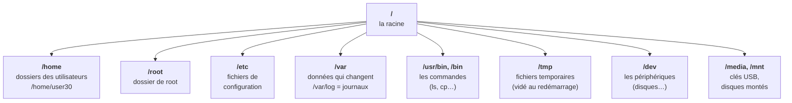

# Module 4 : Fichiers et dossiers sous Linux

*Cours : [Cours 3 - Utilisateur d'une distribution GNU/Linux](../index.md)*

## 🎯 Objectif du module

À la fin de ce module, tu sais :

- te repérer dans l'**arborescence** Linux (`/`, `/home`, `/etc`, `/var`…) ;
- écrire un **chemin absolu** et un **chemin relatif** ;
- te **déplacer** (`cd`) et **lister** (`ls`) ;
- **créer, copier, déplacer, renommer, supprimer** des fichiers et des dossiers ;
- reconnaître les **fichiers cachés** et les **types de fichiers**.

!!! abstract "En clair : pas de C:, tout part de /"
    Sous Windows, chaque disque a sa lettre (`C:`, `D:`). Sous Linux, il n'y a **qu'un seul arbre**, qui part de la **racine** notée **`/`**. Tout est rangé dedans, même les disques et les clés USB, qui apparaissent comme de simples **dossiers**.

    Et sous Linux, **« tout est fichier »** : un document, un dossier, un disque, une imprimante… sont tous vus comme des fichiers.

## 🖼️ Résumé visuel

**① L'arborescence Linux : les dossiers à connaître**



**② Chemin absolu ou relatif ?**

```
Tu es dans /home/user30 et tu veux atteindre /home/user30/Documents/cv.txt

  Chemin ABSOLU  : /home/user30/Documents/cv.txt   ← part de la racine /, marche de partout
  Chemin RELATIF : Documents/cv.txt                ← part de là où tu es (pas de / au début)

  Les raccourcis :   .  = ici      ..  = le dossier parent      ~  = mon dossier personnel
```

## 📖 Cours consolidé

### 1. L'arborescence

Linux range ses dossiers selon une norme commune à toutes les distributions : la **FHS** (*Filesystem Hierarchy Standard*).

| Dossier | Contient | Équivalent Windows (approx.) |
|---|---|---|
| **`/`** | La **racine** : le point de départ de tout | `C:\` |
| **`/home`** | Un dossier **par utilisateur** : `/home/user30` | `C:\Users` |
| **`/root`** | Le dossier personnel de **root** | |
| **`/etc`** | Les **fichiers de configuration** (texte) | Le registre, en partie |
| **`/var`** | Les données **qui varient** : **`/var/log`** (les **journaux**), sites web, mails | |
| **`/usr/bin`**, `/bin` | Les **commandes** (programmes) | `C:\Program Files`, `C:\Windows\System32` |
| **`/tmp`** | Les fichiers **temporaires** | `C:\Windows\Temp` |
| **`/dev`** | Les **périphériques** vus comme des fichiers : `/dev/sda` = 1ᵉʳ disque | |
| **`/media`**, `/mnt` | Les **clés USB** et disques **montés** | `D:`, `E:` |
| `/boot` | Le **noyau** et le démarrage | |
| `/proc` | Des infos **en direct** sur le système (virtuel) | |

---

### 2. Chemins absolus et relatifs

| Type | Commence par… | Exemple | Marche… |
|---|---|---|---|
| **Absolu** | **`/`** | `/etc/ssh/sshd_config` | **De n'importe où** |
| **Relatif** | Pas de `/` | `Documents/cv.txt`, `../user31` | **Depuis le dossier où tu es** |

| Raccourci | Signifie | Exemple |
|---|---|---|
| **`.`** | Le dossier **actuel** | `./script.sh` |
| **`..`** | Le dossier **parent** (au-dessus) | `cd ..` |
| **`~`** | **Mon** dossier personnel | `cd ~` → `/home/user30` |
| `-` | Le dossier **précédent** (avec `cd`) | `cd -` |

⚠️ Sous Linux, le séparateur est **`/`** (pas `\` comme sous Windows), et **la casse compte** : `Documents` ≠ `documents`.

---

### 3. Se déplacer et regarder

| Commande | Effet |
|---|---|
| **`pwd`** | Où suis-je ? |
| **`cd /etc`** | Aller dans `/etc` (absolu) |
| **`cd Documents`** | Aller dans `Documents` depuis ici (relatif) |
| **`cd ..`** | Remonter d'un cran |
| **`cd`** ou **`cd ~`** | Revenir **chez moi** |
| **`ls`** | Lister le dossier actuel |
| **`ls -l`** | Liste **détaillée** (droits, propriétaire, taille, date) |
| **`ls -a`** | Montrer **aussi les fichiers cachés** |
| **`ls -lh`** | Tailles **lisibles** (Ko, Mo, Go) |
| `ls -R` | Lister aussi le contenu des sous-dossiers |
| `ls -lt` | Trier par **date** (le plus récent en haut) |

**Lire un `ls -l`**

```text
-rw-r--r-- 1 user30 user30  2048 21 oct. 10:15 rapport.txt
drwxr-xr-x 2 user30 user30  4096 20 oct. 09:00 Documents
│└───┬───┘   └──┬─┘ └──┬─┘  └┬─┘ └─────┬─────┘ └────┬────┘
│  droits   propriétaire groupe taille   date        nom
└─ type : - = fichier · d = dossier (directory) · l = lien
```

(Les **droits** `rwx` sont expliqués au [module 8](../module-8-mecanismes-avances-de-linux-et-bash/index.md).)

📌 **Les fichiers cachés** : sous Linux, un fichier est **caché** si son nom **commence par un point** : `.bashrc`, `.bash_history`, `.ssh`. On les voit avec **`ls -a`**.

💡 **Les extensions ne comptent pas** pour Linux : un fichier peut s'appeler `rapport` sans `.txt`. Pour savoir **ce qu'il contient vraiment** : **`file rapport`** → `rapport: ASCII text`.

---

### 4. Créer, copier, déplacer, supprimer

| Je veux… | Commande | Exemple |
|---|---|---|
| Créer un **dossier** | **`mkdir`** | `mkdir Projets` |
| Créer **plusieurs niveaux** d'un coup | **`mkdir -p`** | `mkdir -p Projets/2026/Octobre` |
| Créer un **fichier vide** | **`touch`** | `touch notes.txt` |
| **Copier** un fichier | **`cp source destination`** | `cp notes.txt notes-sauvegarde.txt` |
| Copier un **dossier** (et son contenu) | **`cp -r`** | `cp -r Projets /tmp/` |
| **Déplacer** | **`mv source destination`** | `mv notes.txt Documents/` |
| **Renommer** | **`mv ancien nouveau`** | `mv notes.txt idees.txt` |
| **Supprimer** un fichier | **`rm`** | `rm idees.txt` |
| Supprimer un **dossier vide** | **`rmdir`** | `rmdir Vide` |
| Supprimer un **dossier et tout son contenu** | **`rm -r`** | `rm -r Projets` |
| Demander **confirmation** | **`-i`** (interactif) | `rm -i *.txt`, `cp -i`, `mv -i` |

!!! danger "⚠️ Pas de corbeille sous Linux en ligne de commande"
    **`rm` supprime définitivement**, sans demander de confirmation. Et **`rm -rf`** (récursif + forcé) efface **un dossier entier sans poser de question**. Relis **toujours** ta commande avant de valider, surtout en root. Utilise **`-i`** si tu as un doute.

📌 **`mv` sert à la fois à déplacer et à renommer** : il n'y a pas de commande « rename » de base.

⚠️ **Les espaces dans les noms** : `mkdir Mes Documents` crée **deux** dossiers, `Mes` et `Documents`. Il faut écrire `mkdir "Mes Documents"` ou `mkdir Mes\ Documents`. Le plus simple : **éviter les espaces** (`Mes_Documents`).

## 📝 Fiche de révision

### 🧠 Les commandes du module

| Commande | Rôle |
|---|---|
| `pwd` | Où suis-je |
| `cd chemin` / `cd ..` / `cd` | Aller dans / remonter / revenir chez moi |
| `ls -la` / `ls -lh` | Lister tout (cachés compris) / avec tailles lisibles |
| `file fichier` | Type réel d'un fichier |
| `mkdir -p a/b/c` | Créer des dossiers (avec les parents) |
| `touch f` | Créer un fichier vide |
| `cp f1 f2` / `cp -r d1 d2` | Copier un fichier / un dossier |
| `mv f1 f2` | Déplacer **ou** renommer |
| `rm f` / `rm -r d` | Supprimer un fichier / un dossier |
| `rmdir d` | Supprimer un dossier vide |

### ⚠️ Les pièges

- **`rm` ne passe pas par la corbeille.**
- `cp dossier` **sans `-r`** → erreur « omission du répertoire ».
- `rmdir` refuse un dossier **qui n'est pas vide** → `rm -r`.
- `/` est le séparateur (pas `\`), et **la casse compte**.
- Un nom avec des **espaces** → guillemets obligatoires.

### ✏️ Entraîne-toi (clique pour voir la correction)

??? question "1. Tu es dans /home/user30/Documents. Donne le chemin absolu et le chemin relatif vers /home/user30/Images/photo.jpg."
    - Absolu : **`/home/user30/Images/photo.jpg`**
    - Relatif : **`../Images/photo.jpg`** (on remonte dans `/home/user30`, puis on descend dans `Images`)
    - Bonus : **`~/Images/photo.jpg`** marche aussi, de partout.

??? question "2. Crée en une commande l'arborescence ~/tp/linux/module4, puis places-y un fichier vide notes.txt."
    ```bash
    mkdir -p ~/tp/linux/module4
    touch ~/tp/linux/module4/notes.txt
    ```

??? question "3. Renomme rapport.txt en rapport-final.txt, puis copie-le dans /tmp."
    ```bash
    mv rapport.txt rapport-final.txt
    cp rapport-final.txt /tmp/
    ```

??? question "4. Où chercher les fichiers de configuration ? Et les journaux du système ?"
    - Configuration : **`/etc`**
    - Journaux : **`/var/log`**

## 🧠 Quiz — entraîne-toi

<div id="quiz-cours-03-utilisateur-d-une-distribution-gnu-linux-module-4-fichiers-et-dossiers-sous-linux"></div>

<script type="application/json" id="quiz-cours-03-utilisateur-d-une-distribution-gnu-linux-module-4-fichiers-et-dossiers-sous-linux-data">
[
  {
    "question": "Comment s'appelle le point de départ de toute l'arborescence Linux ?",
    "options": [
      "C:",
      "La racine, notée /",
      "Le dossier home",
      "Le noyau"
    ],
    "correctIndex": 1,
    "explanation": "Sous Linux, tout part de la racine /. Il n'y a pas de lettres de lecteur : disques et clés USB sont accessibles comme des dossiers de cet arbre."
  },
  {
    "question": "Dans quel dossier se trouvent les fichiers de configuration du système ?",
    "options": [
      "/home",
      "/etc",
      "/tmp",
      "/dev"
    ],
    "correctIndex": 1,
    "explanation": "/etc contient les fichiers de configuration (en texte) du système et des services, par exemple /etc/ssh/sshd_config."
  },
  {
    "question": "Où sont rangés les journaux (logs) du système ?",
    "options": [
      "/var/log",
      "/etc/log",
      "/home/log",
      "/bin"
    ],
    "correctIndex": 0,
    "explanation": "/var contient les données qui varient ; les journaux du système se trouvent dans /var/log."
  },
  {
    "question": "Lequel de ces chemins est un chemin absolu ?",
    "options": [
      "Documents/cv.txt",
      "../Images",
      "/home/user30/Documents",
      "./script.sh"
    ],
    "correctIndex": 2,
    "explanation": "Un chemin absolu commence par / (la racine) et fonctionne quel que soit le dossier où l'on se trouve. Les autres sont relatifs au dossier actuel."
  },
  {
    "question": "Que représente .. dans un chemin ?",
    "options": [
      "Le dossier actuel",
      "Le dossier parent",
      "Le dossier personnel",
      "La racine"
    ],
    "correctIndex": 1,
    "explanation": ". désigne le dossier actuel, .. le dossier parent (au-dessus), et ~ le dossier personnel."
  },
  {
    "question": "Quelle commande ramène directement dans ton dossier personnel ?",
    "options": [
      "cd /",
      "cd ..",
      "cd (seule) ou cd ~",
      "pwd"
    ],
    "correctIndex": 2,
    "explanation": "cd sans argument, ou cd ~, ramène dans le dossier personnel (/home/utilisateur). cd / va à la racine, cd .. remonte d'un niveau."
  },
  {
    "question": "Comment reconnaît-on un fichier caché sous Linux ?",
    "options": [
      "Il a l'attribut H",
      "Son nom commence par un point (ex. .bashrc)",
      "Il est dans /tmp",
      "Il se termine par .hidden"
    ],
    "correctIndex": 1,
    "explanation": "Tout fichier ou dossier dont le nom commence par un point est caché. On l'affiche avec ls -a."
  },
  {
    "question": "Quelle commande affiche la liste détaillée d'un dossier, avec les fichiers cachés ?",
    "options": [
      "ls",
      "ls -l",
      "ls -la",
      "ls -R"
    ],
    "correctIndex": 2,
    "explanation": "-l donne le format long (droits, propriétaire, taille, date) et -a montre aussi les fichiers cachés. Les options se regroupent : ls -la."
  },
  {
    "question": "Dans un ls -l, que signifie un d en tout premier caractère de la ligne ?",
    "options": [
      "Fichier supprimé",
      "Un dossier (directory)",
      "Un fichier de données",
      "Un disque"
    ],
    "correctIndex": 1,
    "explanation": "Le premier caractère indique le type : - pour un fichier ordinaire, d pour un dossier, l pour un lien symbolique."
  },
  {
    "question": "Quelle commande crée l'arborescence a/b/c en une seule fois, même si a et b n'existent pas ?",
    "options": [
      "mkdir a/b/c",
      "mkdir -p a/b/c",
      "touch a/b/c",
      "cd a/b/c"
    ],
    "correctIndex": 1,
    "explanation": "L'option -p (parents) crée tous les dossiers manquants du chemin. Sans -p, mkdir échoue si a ou b n'existent pas."
  },
  {
    "question": "Comment renommer le fichier notes.txt en idees.txt ?",
    "options": [
      "rename notes.txt idees.txt",
      "cp notes.txt idees.txt",
      "mv notes.txt idees.txt",
      "rm notes.txt idees.txt"
    ],
    "correctIndex": 2,
    "explanation": "mv sert à la fois à déplacer et à renommer. cp créerait une copie en gardant l'original."
  },
  {
    "question": "Pourquoi cp Projets /tmp/ échoue-t-il si Projets est un dossier ?",
    "options": [
      "Parce que /tmp est protégé",
      "Parce qu'il faut l'option -r pour copier un dossier et son contenu",
      "Parce que cp ne copie que des fichiers .txt",
      "Parce qu'il faut être root"
    ],
    "correctIndex": 1,
    "explanation": "Pour copier un dossier, il faut l'option récursive : cp -r Projets /tmp/."
  },
  {
    "question": "Que se passe-t-il avec un fichier supprimé par rm ?",
    "options": [
      "Il va dans la corbeille",
      "Il est supprimé définitivement, sans corbeille",
      "Il est déplacé dans /tmp",
      "Il est caché"
    ],
    "correctIndex": 1,
    "explanation": "En ligne de commande, rm supprime définitivement. Il faut relire sa commande avant de valider, et utiliser -i pour demander une confirmation."
  },
  {
    "question": "Quelle commande supprime un dossier qui contient des fichiers ?",
    "options": [
      "rmdir dossier",
      "rm dossier",
      "rm -r dossier",
      "del dossier"
    ],
    "correctIndex": 2,
    "explanation": "rmdir ne supprime que les dossiers vides, et rm sans -r refuse les dossiers. rm -r supprime le dossier et tout son contenu."
  },
  {
    "question": "Que fait la commande file rapport ?",
    "options": [
      "Crée un fichier rapport",
      "Indique le type réel du contenu du fichier",
      "Supprime le fichier",
      "Affiche son contenu"
    ],
    "correctIndex": 1,
    "explanation": "Linux ne se fie pas aux extensions : file analyse le contenu et indique son type (texte, image, exécutable…)."
  },
  {
    "question": "Que crée la commande mkdir Mes Documents ?",
    "options": [
      "Un dossier « Mes Documents »",
      "Deux dossiers : « Mes » et « Documents »",
      "Une erreur",
      "Un fichier"
    ],
    "correctIndex": 1,
    "explanation": "L'espace sépare les arguments : mkdir reçoit deux noms. Pour un seul dossier, il faut des guillemets : mkdir \"Mes Documents\"."
  }
]
</script>

<script>
  document.addEventListener("DOMContentLoaded", function () {
    TSSRQuiz.init({
      containerId: "quiz-cours-03-utilisateur-d-une-distribution-gnu-linux-module-4-fichiers-et-dossiers-sous-linux",
      dataId: "quiz-cours-03-utilisateur-d-une-distribution-gnu-linux-module-4-fichiers-et-dossiers-sous-linux-data",
    });
  });
</script>
