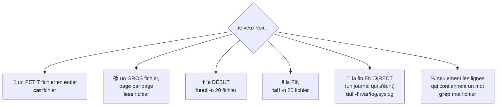

# Module 5 : Utiliser des fichiers sous Linux

*Cours : [Cours 3 - Utilisateur d'une distribution GNU/Linux](../index.md)*

## 🎯 Objectif du module

À la fin de ce module, tu sais :

- **lire** un fichier (`cat`, `less`, `head`, `tail`) et **suivre un journal en direct** (`tail -f`) ;
- **compter**, **trier** et **découper** du texte (`wc`, `sort`, `uniq`, `cut`) ;
- **chercher un mot** dans des fichiers (`grep`) ;
- **retrouver un fichier** sur le disque (`find`) ;
- **comparer** deux fichiers (`diff`).

!!! abstract "En clair"
    Sous Linux, presque tout est **du texte** : la configuration (`/etc`), les journaux (`/var/log`), les listes d'utilisateurs… Un technicien passe donc son temps à **lire**, **filtrer** et **chercher** dans des fichiers texte. Ce module te donne les outils pour ça, sans ouvrir le moindre éditeur.

## 🖼️ Résumé visuel

**Quel outil pour lire un fichier ?**



## 📖 Cours consolidé

### 1. Lire un fichier

| Commande | Effet | Exemple |
|---|---|---|
| **`cat`** (`-n` = numéros de ligne) | Affiche **tout** d'un coup | `cat /etc/hostname` |
| **`less`** | **Page par page** (gros fichiers) | `less /var/log/syslog` |
| **`head`** / **`tail`** | Les **10 premières** / **dernières** lignes (`-n 20`) | `tail -n 50 /var/log/auth.log` |
| **`tail -f`** | La fin **en direct** (++ctrl+c++ pour arrêter) | `tail -f /var/log/syslog` |

- Dans `less` (comme `man`) : ++space++ / ++b++ page suivante / précédente · `/mot` puis `n` · ++g++ / ++shift+g++ début / fin · **`q`** quitter.
- 💡 **`tail -f` = le réflexe de dépannage** : on reproduit le problème et l'erreur **apparaît en direct** dans le journal.

---

### 2. Compter, trier, découper

| Commande | Effet | Exemple |
|---|---|---|
| **`wc -l`** | **Compte** les lignes (`wc` = mots, caractères aussi) | `wc -l /etc/passwd` = nombre de comptes |
| **`sort`** (`-n` numérique, `-r` inversé) | **Trie** les lignes | `sort -nr scores.txt` |
| **`uniq`** (`-c` = compter) | Supprime les doublons **qui se suivent** → après un `sort` | `sort villes.txt | uniq -c` |
| **`cut -d: -f1`** | **Découpe** une colonne (séparateur `:`) | `cut -d: -f1,7 /etc/passwd` |

**`/etc/passwd`** : la liste des comptes, colonnes séparées par `:`.

```text
user30:x:1030:1030:Sophie Martin:/home/user30:/bin/bash
└─┬──┘   └┬─┘ └┬─┘ └─────┬────┘ └─────┬────┘ └───┬───┘
 nom     UID  GID   description   dossier perso    shell
 (-f1)   (-f3)(-f4)    (-f5)         (-f6)         (-f7)
```

(Le **`|`** est expliqué au [module 6](../module-6-specificites-du-shell-bash/index.md).)

---

### 3. Chercher **dans** des fichiers : `grep`

Affiche **seulement les lignes qui contiennent** un mot : `grep user30 /etc/passwd`.

| Option | Effet | Exemple |
|---|---|---|
| **`-i`** | Ignorer la **casse** | `grep -i error /var/log/syslog` |
| **`-n`** | Numéro de ligne | `grep -n Port /etc/ssh/sshd_config` |
| **`-v`** | Les lignes **sans** le mot | `grep -v "^#" fichier.conf` (sans commentaires) |
| **`-r`** | Dans **tout un dossier** (`-l` = juste les noms de fichiers) | `grep -r "PermitRootLogin" /etc/ssh/` |
| **`-c`** | **Compter** les lignes trouvées | `grep -c "Failed password" /var/log/auth.log` |

💡 Motif **entre guillemets** s'il y a des espaces. Motifs avancés (`^`, `$`) : [module 8](../module-8-mecanismes-avances-de-linux-et-bash/index.md).

---

### 4. Retrouver un fichier : `find`

```
find   OÙ   CRITÈRES
find   /etc -name "*.conf"
```

| Critère | Exemple |
|---|---|
| **`-name`** (`-iname` = sans casse) | `find ~ -iname "*facture*"` |
| **`-type f`** / **`-type d`** | Fichiers / dossiers seulement |
| **`-size +500M`** | Plus gros que 500 Mo |
| `-mtime -7` | Modifiés il y a **moins de 7 jours** |
| `-user user30` | Appartenant à user30 |

- ⚠️ Dans `/`, beaucoup de « Permission non accordée » → ajouter **`2>/dev/null`** ([module 6](../module-6-specificites-du-shell-bash/index.md)).
- 💡 **`locate nom`** est bien plus rapide (base de données, mise à jour par `sudo updatedb`), mais pas toujours installé.

---

### 5. Comparer deux fichiers : `diff`

```text
$ diff sshd_config sshd_config.sauvegarde
14c14
< PermitRootLogin no            ← dans le 1er fichier
---
> PermitRootLogin yes           ← dans le 2ᵉ fichier
```

Aucun résultat = fichiers **identiques**. Parfait pour voir **ce qui a changé** dans une configuration.

## 📝 Fiche de révision

### 🧠 Les commandes du module

| Commande | Rôle |
|---|---|
| `cat f` | Tout afficher |
| `less f` | Page par page (`q` pour quitter) |
| `head -n 5 f` / `tail -n 5 f` | 5 premières / dernières lignes |
| `tail -f f` | Suivre en direct |
| `wc -l f` | Compter les lignes |
| `sort f` / `uniq` | Trier / dédoublonner |
| `cut -d: -f1 f` | Garder la 1ʳᵉ colonne (séparateur `:`) |
| `grep -in mot f` | Chercher un mot (sans casse, avec numéros) |
| `grep -r mot dossier` | Chercher dans tout un dossier |
| `find / -name "x*"` | Trouver un fichier |
| `diff f1 f2` | Comparer |

### 🔍 `grep` ou `find` ?

| Je cherche… | Outil |
|---|---|
| Un **mot dans le contenu** des fichiers | **`grep`** |
| Un **fichier** d'après son nom, sa taille, sa date | **`find`** |

### ⚠️ Les pièges

- **`cat` sur un énorme fichier** inonde l'écran → `less`.
- **`uniq` sans `sort` avant** ne trouve pas les doublons éloignés.
- Avec `find -name`, mets le motif **entre guillemets** : `-name "*.conf"`.
- `grep` respecte la casse : « Error » ≠ « error » → `-i`.

### ✏️ Entraîne-toi (clique pour voir la correction)

??? question "1. Affiche les 20 dernières lignes de /var/log/syslog, puis suis-le en direct."
    ```bash
    tail -n 20 /var/log/syslog
    tail -f /var/log/syslog        # Ctrl+C pour arrêter
    ```

??? question "2. Combien y a-t-il de comptes dans /etc/passwd ?"
    ```bash
    wc -l /etc/passwd
    ```
    Une ligne = un compte.

??? question "3. Affiche les lignes de /etc/ssh/sshd_config qui contiennent « port », quelle que soit la casse, avec les numéros de ligne."
    ```bash
    grep -in port /etc/ssh/sshd_config
    ```

??? question "4. Trouve tous les fichiers .log de plus de 100 Mo dans /var, sans afficher les erreurs de permission."
    ```bash
    find /var -name "*.log" -size +100M 2>/dev/null
    ```

## 🧠 Quiz — entraîne-toi

<div id="quiz-cours-03-utilisateur-d-une-distribution-gnu-linux-module-5-utiliser-des-fichiers-sous-linux"></div>

<script type="application/json" id="quiz-cours-03-utilisateur-d-une-distribution-gnu-linux-module-5-utiliser-des-fichiers-sous-linux-data">
[
  {
    "question": "Quelle commande permet de lire un gros fichier page par page ?",
    "options": [
      "cat",
      "less",
      "touch",
      "wc"
    ],
    "correctIndex": 1,
    "explanation": "less affiche le fichier page par page (Espace pour avancer, /mot pour chercher, q pour quitter). cat affiche tout d'un coup."
  },
  {
    "question": "Comment afficher les 5 premières lignes d'un fichier ?",
    "options": [
      "tail -n 5 fichier",
      "head -n 5 fichier",
      "cat -5 fichier",
      "less 5 fichier"
    ],
    "correctIndex": 1,
    "explanation": "head affiche le début d'un fichier (10 lignes par défaut) ; -n 5 en demande 5. tail affiche la fin."
  },
  {
    "question": "Quelle commande suit un fichier journal en direct, en affichant les nouvelles lignes au fur et à mesure ?",
    "options": [
      "tail -f",
      "head -f",
      "cat -f",
      "grep -f"
    ],
    "correctIndex": 0,
    "explanation": "tail -f (follow) reste ouvert et affiche chaque nouvelle ligne ajoutée au fichier. On l'arrête avec Ctrl + C."
  },
  {
    "question": "Comment quitter less ?",
    "options": [
      "Ctrl + C",
      "q",
      "exit",
      "Échap"
    ],
    "correctIndex": 1,
    "explanation": "Comme dans man, la touche q (quit) ferme less."
  },
  {
    "question": "Que renvoie wc -l /etc/passwd ?",
    "options": [
      "Le nombre de mots",
      "Le nombre de lignes, donc de comptes",
      "La taille en octets",
      "La première ligne"
    ],
    "correctIndex": 1,
    "explanation": "wc compte ; -l compte les lignes. Dans /etc/passwd, chaque ligne correspond à un compte."
  },
  {
    "question": "Pourquoi utilise-t-on généralement sort avant uniq ?",
    "options": [
      "Pour aller plus vite",
      "Parce que uniq ne supprime que les doublons qui se suivent",
      "Parce que uniq ne fonctionne qu'avec des nombres",
      "Ce n'est pas nécessaire"
    ],
    "correctIndex": 1,
    "explanation": "uniq compare chaque ligne avec la précédente. Trier d'abord regroupe les doublons pour qu'ils soient tous éliminés (ou comptés avec -c)."
  },
  {
    "question": "Que fait cut -d: -f1 /etc/passwd ?",
    "options": [
      "Supprime la première ligne",
      "Affiche la première colonne (les noms de comptes), en utilisant : comme séparateur",
      "Coupe le fichier en deux",
      "Affiche le premier fichier"
    ],
    "correctIndex": 1,
    "explanation": "-d: indique que les colonnes sont séparées par « : », et -f1 garde la colonne 1, qui contient le nom du compte."
  },
  {
    "question": "Quelle commande affiche les lignes contenant le mot « error » dans un fichier, sans tenir compte des majuscules ?",
    "options": [
      "find -i error fichier",
      "grep -i error fichier",
      "cat error fichier",
      "grep -v error fichier"
    ],
    "correctIndex": 1,
    "explanation": "grep cherche un motif dans le contenu ; -i ignore la casse. -v ferait l'inverse : les lignes qui ne contiennent pas le mot."
  },
  {
    "question": "Que fait l'option -v de grep ?",
    "options": [
      "Affiche la version",
      "Affiche les lignes qui ne contiennent PAS le motif",
      "Mode verbeux",
      "Cherche dans les sous-dossiers"
    ],
    "correctIndex": 1,
    "explanation": "grep -v inverse la sélection. Exemple : grep -v \"^#\" fichier.conf masque les lignes de commentaire."
  },
  {
    "question": "Quelle option de grep cherche dans tous les fichiers d'un dossier ?",
    "options": [
      "-r",
      "-n",
      "-c",
      "-i"
    ],
    "correctIndex": 0,
    "explanation": "-r (récursif) parcourt le dossier et ses sous-dossiers. -n affiche les numéros de ligne, -c compte, -i ignore la casse."
  },
  {
    "question": "Tu cherches un FICHIER nommé facture2026.pdf quelque part dans ton dossier personnel. Quelle commande ?",
    "options": [
      "grep facture2026.pdf ~",
      "find ~ -name \"facture2026.pdf\"",
      "cat ~/facture2026.pdf",
      "ls facture2026.pdf"
    ],
    "correctIndex": 1,
    "explanation": "find cherche des fichiers selon leur nom, taille ou date. grep, lui, cherche dans le contenu des fichiers."
  },
  {
    "question": "Que trouve find /var -size +100M ?",
    "options": [
      "Les fichiers de moins de 100 Mo",
      "Les fichiers de plus de 100 Mo dans /var",
      "100 fichiers au hasard",
      "Les dossiers de /var"
    ],
    "correctIndex": 1,
    "explanation": "-size +100M signifie « plus grand que 100 Mo ». Avec -100M, ce serait « plus petit que »."
  },
  {
    "question": "Quelle commande montre les différences ligne par ligne entre deux fichiers ?",
    "options": [
      "cmp",
      "diff",
      "sort",
      "uniq"
    ],
    "correctIndex": 1,
    "explanation": "diff affiche les lignes qui diffèrent (< pour le premier fichier, > pour le second). S'il n'affiche rien, les fichiers sont identiques."
  },
  {
    "question": "Quelle commande compte le nombre de lignes contenant « Failed password » dans /var/log/auth.log ?",
    "options": [
      "wc \"Failed password\" /var/log/auth.log",
      "grep -c \"Failed password\" /var/log/auth.log",
      "find -c \"Failed password\"",
      "cut -c \"Failed password\""
    ],
    "correctIndex": 1,
    "explanation": "grep -c compte les lignes qui correspondent au motif. Les guillemets sont nécessaires à cause de l'espace."
  }
]
</script>

<script>
  document.addEventListener("DOMContentLoaded", function () {
    TSSRQuiz.init({
      containerId: "quiz-cours-03-utilisateur-d-une-distribution-gnu-linux-module-5-utiliser-des-fichiers-sous-linux",
      dataId: "quiz-cours-03-utilisateur-d-une-distribution-gnu-linux-module-5-utiliser-des-fichiers-sous-linux-data",
    });
  });
</script>
