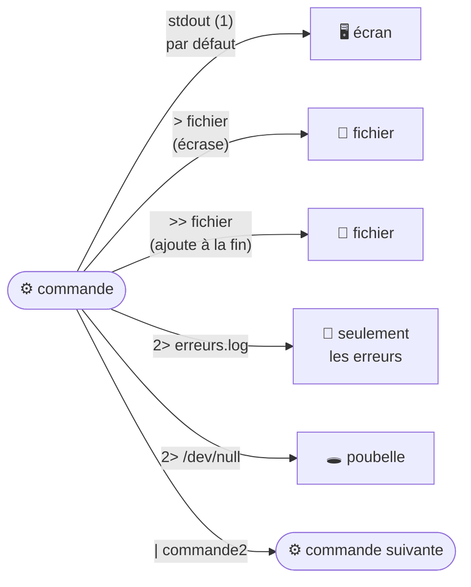

# Module 6 : Spécificités du shell Bash

*Cours : [Cours 3 - Utilisateur d'une distribution GNU/Linux](../index.md)*

## 🎯 Objectif du module

À la fin de ce module, tu sais :

- utiliser les **jokers** (`*`, `?`, `[ ]`) pour désigner plusieurs fichiers d'un coup ;
- **protéger** les caractères spéciaux avec les **guillemets** (`"…"`, `'…'`) et l'antislash `\` ;
- **rediriger** un résultat ou des erreurs vers un fichier (`>`, `>>`, `2>`, `/dev/null`) ;
- **enchaîner** des commandes : le **pipe** `|`, et `;` `&&` `||` ;
- insérer le résultat d'une commande dans une autre : **`$(…)`** ;
- créer des **alias** et personnaliser Bash avec **`~/.bashrc`**.

!!! abstract "En clair"
    Avant d'exécuter ta commande, **Bash la relit et la transforme** : il remplace `*` par une liste de fichiers, `$HOME` par `/home/user30`, `$(date)` par la date… Ce module t'apprend ces « super-pouvoirs » de Bash, et comment l'**empêcher** de transformer quelque chose quand tu ne le veux pas (avec les guillemets).

## 🖼️ Résumé visuel

**① Où va le résultat d'une commande ?**



**② Enchaîner des commandes**

| Écriture | Signifie | Exemple |
|---|---|---|
| `cmd1 ; cmd2` | **Toujours** lancer cmd2 après cmd1 | `cd /tmp ; ls` |
| `cmd1 && cmd2` | Lancer cmd2 **seulement si cmd1 a réussi** | `mkdir test && cd test` |
| `cmd1 || cmd2` | Lancer cmd2 **seulement si cmd1 a échoué** | `ping -c1 srv || echo "serveur injoignable"` |
| `cmd1 | cmd2` | **Donner le résultat** de cmd1 **à** cmd2 | `cat /etc/passwd | wc -l` |

## 📖 Cours consolidé

### 1. Les jokers

Désignent **plusieurs fichiers d'un coup** ; c'est **Bash** qui les remplace par la liste des fichiers, avant de lancer la commande.

| Joker | Remplace | Exemple → correspond à |
|---|---|---|
| **`*`** | **N'importe quoi** (même rien) | `ls *.txt` → `a.txt`, `rapport.txt` |
| **`?`** | **Exactement un** caractère | `fichier?.log` → `fichier1.log` (pas `fichier10.log`) |
| **`[abc]`** · **`[0-9]`** | **Un** caractère de la liste · de l'intervalle | `photo[123].jpg` · `rapport-[0-9].pdf` |
| **`[!abc]`** | **Un** caractère **sauf** ceux-là | `[!a]*` → ne commence **pas** par a |

⚠️ **`rm *`** vide **tout** le dossier : vérifie d'abord avec **`ls *`**.

---

### 2. Protéger les caractères spéciaux

L'espace, `*`, `$`, `>`, `|`, `;`, `&` ont un **sens spécial** pour Bash.

| Protection | Effet | `echo … $USER` donne |
|---|---|---|
| **`"…"`** (doubles, **doux**) | Protège tout **sauf** `$`, `` ` ``, `\` : **variables remplacées** | `"Bonjour $USER"` → `Bonjour user30` |
| **`'…'`** (simples, **stricts**) | Protège **absolument tout** | `'Bonjour $USER'` → `Bonjour $USER` |
| **`\`** | Protège **le seul caractère suivant** | `10\$` → `10$` |

```bash
touch "mon fichier.txt"     # un seul fichier, avec un espace dans le nom
echo "5 * 3"                # sans guillemets, * serait remplacé par les noms de fichiers !
```

---

### 3. Les redirections

Les 3 flux ([module 2](../module-2-decouverte-du-systeme-d-exploitation-linux/index.md)) : **entrée (0)**, **sortie (1)**, **erreurs (2)**.

| Syntaxe | Effet | Exemple |
|---|---|---|
| **`>`** | Sortie → fichier, **écrasé** | `ls -l > liste.txt` |
| **`>>`** | Sortie → **ajout** en fin de fichier | `date >> journal.txt` |
| **`2>`** | **Erreurs** → fichier | `find / -name x 2> erreurs.txt` |
| **`2> /dev/null`** | **Jeter** les erreurs (`/dev/null` = poubelle) | `find / -name "*.conf" 2> /dev/null` |
| **`&>`** | Sortie **et** erreurs → **même** fichier | `apt update &> maj.log` |
| **`<`** | Un fichier devient l'**entrée** | `wc -l < /etc/passwd` |

⚠️ **`>` écrase sans prévenir** : un `>` à la place d'un `>>` efface le fichier.

---

### 4. Le pipe `|` : la chaîne de montage

Le **résultat** de gauche devient l'**entrée** de droite : chaque commande fait une petite tâche, on les **assemble**.

```bash
ls -l /etc | less                             # longue liste, page par page
ps aux | grep ssh                             # les processus « ssh »
history | grep apt                            # retrouver ses commandes apt
cut -d: -f7 /etc/passwd | sort | uniq -c      # combien de comptes par shell ?
```

```text
cut -d: -f7 /etc/passwd   →   /bin/bash  /usr/sbin/nologin  /bin/bash …   (la colonne « shell »)
| sort                    →   /bin/bash  /bin/bash  /usr/sbin/nologin …   (regroupés)
| uniq -c                 →   2 /bin/bash   17 /usr/sbin/nologin           (comptés)
```

---

### 5. Enchaîner selon le résultat : `;` `&&` `||`

Chaque commande renvoie un **code de retour** (**`echo $?`**) : **0 = réussite**, autre = **échec**.

| Opérateur | Lance la 2ᵉ commande… |
|---|---|
| **`;`** | **Toujours** |
| **`&&`** | **Si la 1ʳᵉ a réussi** (« et ensuite ») |
| **`||`** | **Si la 1ʳᵉ a échoué** (« sinon ») |

```bash
sudo apt update && sudo apt upgrade        # mise à jour seulement si la liste est téléchargée
cd /dossier/inexistant || echo "Le dossier n'existe pas"
```

---

### 6. Insérer le résultat d'une commande : `$(…)`

```bash
echo "Nous sommes le $(date +%d/%m/%Y)"           # → Nous sommes le 21/10/2026
cp rapport.txt "rapport-$(date +%Y%m%d).txt"       # → rapport-20261021.txt (sauvegarde datée)
```

💡 Ancienne écriture : `` `date` `` ; préfère **`$(…)`**, plus lisible.

---

### 7. Les alias et `~/.bashrc`

```bash
alias ll='ls -lah'                                 # ll = ls -lah
alias maj='sudo apt update && sudo apt upgrade'
alias                                              # lister · unalias ll = supprimer
```

⚠️ Un alias tapé dans le terminal **disparaît à la déconnexion** : l'écrire dans **`~/.bashrc`** (lu à **chaque ouverture** de terminal), puis **`source ~/.bashrc`**.

| Fichier | Rôle |
|---|---|
| **`~/.bashrc`** | Tes réglages Bash : alias, variables, prompt |
| `~/.bash_history` | Ton historique |
| `~/.profile` | Lu à la **connexion** |

## 📝 Fiche de révision

### 🧠 Les symboles de Bash

| Symbole | Rôle |
|---|---|
| `*` `?` `[ ]` | Jokers |
| `"…"` | Protège, sauf `$` |
| `'…'` | Protège tout |
| `\` | Protège 1 caractère |
| `>` / `>>` | Écrire / ajouter dans un fichier |
| `2>` | Rediriger les erreurs |
| `/dev/null` | La poubelle |
| `|` | Pipe |
| `;` `&&` `||` | Enchaîner : toujours / si OK / si échec |
| `$?` | Code de retour (0 = OK) |
| `$( )` | Résultat d'une commande |
| `~/.bashrc` | Configuration de Bash |

### ⚠️ Les pièges

- **`>` écrase** le fichier ; **`>>` ajoute**.
- `echo '$HOME'` affiche **`$HOME`** tel quel (guillemets simples).
- `rm *` : vérifie d'abord avec `ls *`.
- `uniq` sans `sort` avant ne trouve pas tous les doublons.
- Un alias tapé dans le terminal **est perdu** à la déconnexion → `~/.bashrc`.

### ✏️ Entraîne-toi (clique pour voir la correction)

??? question "1. Liste uniquement les fichiers qui se terminent par .conf dans /etc."
    ```bash
    ls /etc/*.conf
    ```

??? question "2. Quelle différence entre echo \"Je suis $USER\" et echo 'Je suis $USER' ?"
    - Avec **`"…"`** : `Je suis user30` (la variable est remplacée).
    - Avec **`'…'`** : `Je suis $USER` (rien n'est remplacé).

??? question "3. Cherche tous les fichiers nommés sshd_config sur le disque, sans afficher les erreurs, et enregistre le résultat dans resultat.txt."
    ```bash
    find / -name sshd_config 2> /dev/null > resultat.txt
    ```

??? question "4. Crée le dossier sauvegarde puis entre dedans, mais seulement si la création a réussi."
    ```bash
    mkdir sauvegarde && cd sauvegarde
    ```

??? question "5. Copie notes.txt en notes-AAAAMMJJ.txt, avec la date du jour."
    ```bash
    cp notes.txt "notes-$(date +%Y%m%d).txt"
    ```

## 🧠 Quiz — entraîne-toi

<div id="quiz-cours-03-utilisateur-d-une-distribution-gnu-linux-module-6-specificites-du-shell-bash"></div>

<script type="application/json" id="quiz-cours-03-utilisateur-d-une-distribution-gnu-linux-module-6-specificites-du-shell-bash-data">
[
  {
    "question": "Que désigne le motif *.txt ?",
    "options": [
      "Un fichier nommé exactement *.txt",
      "Tous les fichiers dont le nom se termine par .txt",
      "Les fichiers de 1 caractère",
      "Les dossiers txt"
    ],
    "correctIndex": 1,
    "explanation": "Le joker * remplace n'importe quelle suite de caractères (même vide). Bash le remplace par la liste de tous les fichiers en .txt du dossier."
  },
  {
    "question": "Quel joker remplace exactement un seul caractère ?",
    "options": [
      "*",
      "?",
      "#",
      "%"
    ],
    "correctIndex": 1,
    "explanation": "? remplace un caractère et un seul : fichier?.log correspond à fichier1.log mais pas à fichier10.log."
  },
  {
    "question": "Le motif photo[1-3].jpg correspond à…",
    "options": [
      "photo1-3.jpg uniquement",
      "photo1.jpg, photo2.jpg et photo3.jpg",
      "Toutes les photos",
      "photo[1-3].jpg littéralement"
    ],
    "correctIndex": 1,
    "explanation": "[1-3] remplace un seul caractère compris entre 1 et 3."
  },
  {
    "question": "Qu'affiche echo 'Bonjour $USER' (guillemets simples) ?",
    "options": [
      "Bonjour user30",
      "Bonjour $USER",
      "Une erreur",
      "Bonjour"
    ],
    "correctIndex": 1,
    "explanation": "Les guillemets simples protègent tout : la variable n'est pas remplacée. Avec des guillemets doubles, on obtiendrait « Bonjour user30 »."
  },
  {
    "question": "Quelle est la différence entre > et >> ?",
    "options": [
      "Aucune",
      "> écrase le contenu du fichier, >> ajoute à la fin",
      "> ajoute, >> écrase",
      "> redirige les erreurs"
    ],
    "correctIndex": 1,
    "explanation": "> remplace tout le contenu du fichier (ou le crée) ; >> ajoute les nouvelles lignes à la fin sans effacer l'existant."
  },
  {
    "question": "À quoi sert 2> /dev/null ?",
    "options": [
      "À supprimer le fichier null",
      "À jeter les messages d'erreur",
      "À afficher les erreurs en double",
      "À vider le disque"
    ],
    "correctIndex": 1,
    "explanation": "2> redirige le flux d'erreurs (2) ; /dev/null est une « poubelle » qui avale tout. Les erreurs ne s'affichent donc plus."
  },
  {
    "question": "Que fait le pipe | entre deux commandes ?",
    "options": [
      "Il lance les deux en même temps sans lien",
      "Il envoie le résultat de la première commande dans l'entrée de la seconde",
      "Il écrit dans un fichier",
      "Il compare les deux commandes"
    ],
    "correctIndex": 1,
    "explanation": "Le pipe relie la sortie de la commande de gauche à l'entrée de celle de droite. Exemple : cat /etc/passwd | wc -l."
  },
  {
    "question": "Dans mkdir test && cd test, quand cd test est-il exécuté ?",
    "options": [
      "Toujours",
      "Seulement si mkdir test a réussi",
      "Seulement si mkdir test a échoué",
      "Jamais"
    ],
    "correctIndex": 1,
    "explanation": "&& lance la commande suivante seulement si la précédente a réussi (code de retour 0). || la lance seulement en cas d'échec."
  },
  {
    "question": "Que vaut $? juste après une commande qui a réussi ?",
    "options": [
      "1",
      "0",
      "true",
      "OK"
    ],
    "correctIndex": 1,
    "explanation": "$? contient le code de retour de la dernière commande : 0 signifie succès, toute autre valeur indique une erreur."
  },
  {
    "question": "Qu'affiche echo \"Aujourd'hui : $(date +%d/%m)\" le 21 octobre ?",
    "options": [
      "Aujourd'hui : $(date +%d/%m)",
      "Aujourd'hui : 21/10",
      "Une erreur",
      "Aujourd'hui : date"
    ],
    "correctIndex": 1,
    "explanation": "$(commande) est remplacé par le résultat de la commande. Entre guillemets doubles, cette substitution est bien effectuée."
  },
  {
    "question": "Comment rendre un alias permanent ?",
    "options": [
      "Le taper deux fois",
      "L'ajouter dans le fichier ~/.bashrc",
      "Le mettre dans /tmp",
      "Redémarrer le PC"
    ],
    "correctIndex": 1,
    "explanation": "Un alias tapé dans le terminal est perdu à la fermeture. Écrit dans ~/.bashrc, il est recréé à chaque ouverture de Bash (source ~/.bashrc pour l'appliquer tout de suite)."
  },
  {
    "question": "Comment créer un fichier nommé « mon fichier.txt » (avec un espace) ?",
    "options": [
      "touch mon fichier.txt",
      "touch \"mon fichier.txt\"",
      "touch mon_fichier.txt",
      "touch [mon fichier].txt"
    ],
    "correctIndex": 1,
    "explanation": "Sans protection, l'espace sépare deux arguments et crée deux fichiers. Les guillemets (ou mon\\ fichier.txt) en font un seul nom."
  },
  {
    "question": "Que fait wc -l < /etc/passwd ?",
    "options": [
      "Écrit dans /etc/passwd",
      "Compte les lignes de /etc/passwd, en le donnant comme entrée à wc",
      "Supprime /etc/passwd",
      "Affiche le fichier"
    ],
    "correctIndex": 1,
    "explanation": "< prend le contenu d'un fichier comme entrée de la commande. wc -l compte alors les lignes reçues."
  }
]
</script>

<script>
  document.addEventListener("DOMContentLoaded", function () {
    TSSRQuiz.init({
      containerId: "quiz-cours-03-utilisateur-d-une-distribution-gnu-linux-module-6-specificites-du-shell-bash",
      dataId: "quiz-cours-03-utilisateur-d-une-distribution-gnu-linux-module-6-specificites-du-shell-bash-data",
    });
  });
</script>
