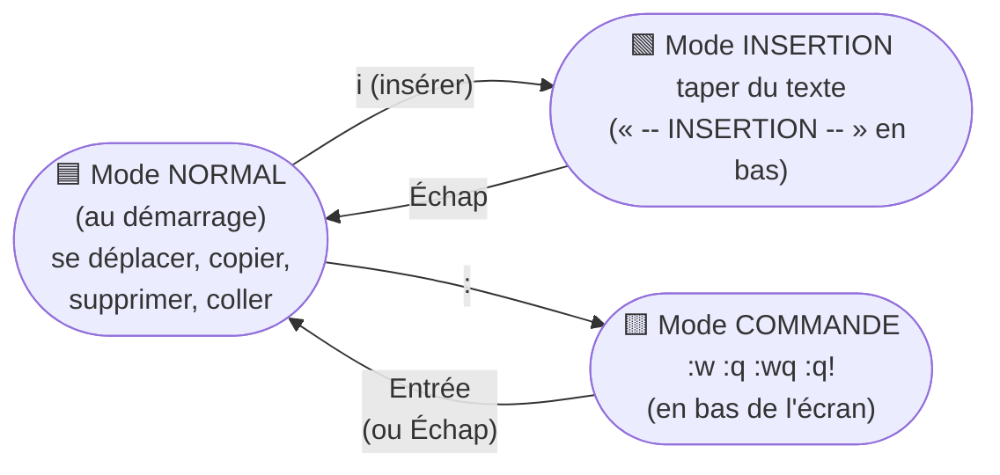

# Module 7 : Éditer du texte sous Linux

*Cours : [Cours 3 - Utilisateur d'une distribution GNU/Linux](../index.md)*

## 🎯 Objectif du module

À la fin de ce module, tu sais :

- modifier un fichier avec **nano**, l'éditeur simple ;
- utiliser **vim** : ses **modes**, **enregistrer**, **quitter**, **copier / coller / supprimer**, **chercher** ;
- éditer un **fichier de configuration** en toute sécurité.

!!! abstract "En clair : pourquoi apprendre un éditeur en ligne de commande ?"
    Sur un serveur Linux, il n'y a **pas de souris ni de Bloc-notes**. Pour modifier un fichier de configuration (dans `/etc`), on utilise un **éditeur de texte dans le terminal**.

    - **nano** : simple, les raccourcis sont **écrits en bas de l'écran**. Parfait pour débuter.
    - **vi / vim** : plus difficile au début, mais **présent sur TOUS les systèmes Linux et Unix**, même les plus minimalistes. Un technicien **doit** savoir au moins **ouvrir, modifier, enregistrer et quitter** avec vim.

## 🖼️ Résumé visuel

**Les 3 modes de vim : on passe toujours par le mode Normal**



**Le kit de survie vim**

| Je veux… | Je tape |
|---|---|
| Ouvrir un fichier | `vim fichier.txt` |
| Écrire du texte | **`i`**, puis je tape |
| Arrêter d'écrire | **Échap** |
| Enregistrer et quitter | **Échap**, puis **`:wq`** + Entrée |
| Quitter **sans** enregistrer | **Échap**, puis **`:q!`** + Entrée |

## 📖 Cours consolidé

### 1. nano : l'éditeur simple

```bash
nano notes.txt                  # ouvre (ou crée) le fichier
sudo nano /etc/hosts            # fichier système : droits d'administration (cours 4)
```

On **tape directement** ; les raccourcis sont en bas (**`^`** = ++ctrl++).

| Raccourci | Effet |
|---|---|
| ++ctrl+o++ puis Entrée | **Enregistrer** |
| ++ctrl+x++ | **Quitter** (`O` = enregistrer, `N` = non) |
| ++ctrl+w++ | **Chercher** |
| ++ctrl+k++ / ++ctrl+u++ | **Couper** la ligne / **coller** |
| ++alt+u++ | **Annuler** |

---

### 2. vim : les 3 modes

**vim** (*Vi IMproved*) = la version moderne de **vi** (1979), installée presque partout. **Les touches changent de rôle selon le mode** : en Normal, `d` **supprime** ; en Insertion, `d` **écrit un d**. **Perdu ? Échap** : retour au mode Normal.

| Mode | Sert à… | Y aller |
|---|---|---|
| **Normal** | Se déplacer, supprimer, copier, coller | **Au démarrage**, ou **Échap** |
| **Insertion** | **Écrire** | **`i`** (avant le curseur), `a` (après), `A` (fin de ligne), **`o`** / `O` (nouvelle ligne dessous / dessus) |
| **Commande** | Enregistrer, quitter, chercher | **`:`** |

---

### 3. Mode Normal : se déplacer et modifier

| Touche | Effet |
|---|---|
| Flèches · `0` / `$` | Se déplacer · début / fin de ligne |
| **`gg`** / **`G`** · `:25` | Début / **fin** du fichier · ligne 25 |
| **`x`** | Supprimer **un caractère** |
| **`dd`** | Supprimer (couper) **la ligne** |
| **`yy`** / **`p`** | **Copier** la ligne / **coller** dessous |
| **`u`** / ++ctrl+r++ | **Annuler** / refaire |

💡 Un **nombre devant** répète : `5dd` = 5 lignes, `3yy` = 3 lignes.

---

### 4. Mode commande (`:`)

| Commande | Effet |
|---|---|
| **`:w`** | **Enregistrer** |
| **`:q`** | **Quitter** (refuse si modifications non enregistrées) |
| **`:wq`** (ou `:x`, `ZZ`) | **Enregistrer et quitter** |
| **`:q!`** | **Quitter sans enregistrer** |
| **`/mot`** puis **`n`** / `N` | **Chercher** · suivant / précédent |
| `:%s/ancien/nouveau/g` | **Remplacer** partout |
| `:set number` | Numéros de ligne |

⚠️ **« E37: No write since last change »** après `:q` : choisir **`:wq`** (enregistrer) ou **`:q!`** (abandonner).

---

### 5. Éditer un fichier de configuration sans risque

1. **Sauvegarder** : `sudo cp /etc/ssh/sshd_config /etc/ssh/sshd_config.bak`
2. **Éditer** : `sudo vim /etc/ssh/sshd_config`
3. **Vérifier** : `diff /etc/ssh/sshd_config.bak /etc/ssh/sshd_config`
4. **Redémarrer le service** ([cours 4](../../cours-04-administration-d-une-distribution-gnu-linux/index.md))
5. Problème ? **Remettre la sauvegarde**.

📌 Une ligne qui commence par **`#`** est un **commentaire** (ignorée). **Décommenter** = retirer le `#` pour l'activer.

## 📝 Fiche de révision

### 🧠 nano et vim côte à côte

| Action | nano | vim |
|---|---|---|
| Ouvrir | `nano f` | `vim f` |
| Écrire | Directement | `i` puis taper |
| Enregistrer | ++ctrl+o++ | `:w` |
| Quitter | ++ctrl+x++ | `:q` |
| Enregistrer + quitter | ++ctrl+o++ puis ++ctrl+x++ | `:wq` |
| Quitter sans enregistrer | ++ctrl+x++ puis `N` | `:q!` |
| Chercher | ++ctrl+w++ | `/mot` |
| Couper / supprimer une ligne | ++ctrl+k++ | `dd` |
| Coller | ++ctrl+u++ | `p` |
| Annuler | ++alt+u++ | `u` |

### ⚠️ Les pièges

- Dans vim, taper du texte **en mode Normal** déclenche des commandes au hasard → **Échap**, puis `u` pour annuler.
- **`:q`** refuse de quitter un fichier modifié → `:wq` ou `:q!`.
- Éditer un fichier de `/etc` **sans les droits** → « readonly » / « Permission non accordée » : il faut `sudo` (cours 4).
- Toujours **sauvegarder l'original** (`.bak`) avant de modifier une configuration.

### ✏️ Entraîne-toi (clique pour voir la correction)

??? question "1. Dans vim, tu as fait des modifications que tu regrettes. Comment quitter sans rien enregistrer ?"
    **Échap**, puis **`:q!`** + Entrée.

??? question "2. Dans vim, supprime 3 lignes, puis colle-les à la fin du fichier."
    En mode Normal : **`3dd`** (coupe 3 lignes) → **`G`** (va à la fin) → **`p`** (colle).

??? question "3. Tu dois modifier /etc/hosts. Écris les étapes sûres."
    ```bash
    sudo cp /etc/hosts /etc/hosts.bak    # 1. sauvegarde
    sudo nano /etc/hosts                 # 2. modification (Ctrl+O, Ctrl+X)
    diff /etc/hosts.bak /etc/hosts       # 3. vérification
    ```

??? question "4. Dans vim, remplace toutes les occurrences de 192.168.1.1 par 192.168.1.254."
    En mode Normal : **`:%s/192.168.1.1/192.168.1.254/g`** + Entrée, puis `:wq`.

## 🧠 Quiz — entraîne-toi

<div id="quiz-cours-03-utilisateur-d-une-distribution-gnu-linux-module-7-editer-du-texte-sous-linux"></div>

<script type="application/json" id="quiz-cours-03-utilisateur-d-une-distribution-gnu-linux-module-7-editer-du-texte-sous-linux-data">
[
  {
    "question": "Dans nano, quel raccourci enregistre le fichier ?",
    "options": [
      "Ctrl + S",
      "Ctrl + O",
      "Ctrl + X",
      ":w"
    ],
    "correctIndex": 1,
    "explanation": "Dans nano, Ctrl + O (Write Out) enregistre, Ctrl + X quitte. Le symbole ^ affiché en bas de l'écran signifie Ctrl."
  },
  {
    "question": "Dans nano, quel raccourci permet de quitter ?",
    "options": [
      "Ctrl + Q",
      "Échap",
      "Ctrl + X",
      ":q"
    ],
    "correctIndex": 2,
    "explanation": "Ctrl + X quitte nano. S'il y a des modifications non enregistrées, nano demande s'il faut les enregistrer."
  },
  {
    "question": "Dans quel mode vim démarre-t-il ?",
    "options": [
      "Insertion",
      "Normal",
      "Commande (:)",
      "Visuel"
    ],
    "correctIndex": 1,
    "explanation": "vim s'ouvre en mode Normal : les touches servent à se déplacer et à agir sur le texte. Pour écrire, il faut passer en mode Insertion (i)."
  },
  {
    "question": "Quelle touche fait passer vim du mode Normal au mode Insertion, avant le curseur ?",
    "options": [
      "Échap",
      "i",
      ":",
      "q"
    ],
    "correctIndex": 1,
    "explanation": "i (insert) permet d'écrire avant le curseur. a écrit après le curseur, o sur une nouvelle ligne en dessous."
  },
  {
    "question": "Quelle touche fait revenir vim au mode Normal ?",
    "options": [
      "Entrée",
      "Échap",
      "Ctrl + C",
      "i"
    ],
    "correctIndex": 1,
    "explanation": "Échap ramène toujours au mode Normal : c'est le réflexe quand on ne sait plus dans quel mode on est."
  },
  {
    "question": "Dans vim, comment enregistrer et quitter ?",
    "options": [
      ":q!",
      ":wq",
      "Ctrl + X",
      ":w!q"
    ],
    "correctIndex": 1,
    "explanation": ":wq écrit (write) puis quitte (quit). :x et ZZ font la même chose."
  },
  {
    "question": "Dans vim, comment quitter SANS enregistrer les modifications ?",
    "options": [
      ":wq",
      ":q!",
      ":w",
      "dd"
    ],
    "correctIndex": 1,
    "explanation": ":q! force la sortie en abandonnant les modifications. :q seul refuse de quitter si le fichier a été modifié."
  },
  {
    "question": "En mode Normal, que fait dd dans vim ?",
    "options": [
      "Duplique la ligne",
      "Supprime (coupe) la ligne entière",
      "Écrit dd",
      "Enregistre"
    ],
    "correctIndex": 1,
    "explanation": "dd supprime la ligne courante en la gardant en mémoire (on peut la recoller avec p). 3dd supprime 3 lignes."
  },
  {
    "question": "En mode Normal, quelles commandes copient puis collent une ligne dans vim ?",
    "options": [
      "Ctrl+C puis Ctrl+V",
      "yy puis p",
      "cc puis vv",
      "dd puis u"
    ],
    "correctIndex": 1,
    "explanation": "yy (yank) copie la ligne, p la colle en dessous du curseur."
  },
  {
    "question": "Comment annuler la dernière action dans vim (mode Normal) ?",
    "options": [
      "Ctrl + Z",
      "u",
      "z",
      ":undo!"
    ],
    "correctIndex": 1,
    "explanation": "u (undo) annule la dernière modification ; Ctrl + R la refait."
  },
  {
    "question": "Comment chercher le mot « Port » dans un fichier ouvert avec vim ?",
    "options": [
      "Ctrl + F Port",
      "/Port puis Entrée",
      "find Port",
      ":grep Port"
    ],
    "correctIndex": 1,
    "explanation": "En mode Normal, /mot cherche vers le bas ; n passe à l'occurrence suivante, N à la précédente."
  },
  {
    "question": "Dans un fichier de configuration, que signifie une ligne qui commence par # ?",
    "options": [
      "Une ligne réservée à root",
      "Un commentaire, ignoré par le programme",
      "Une ligne obligatoire",
      "Une erreur"
    ],
    "correctIndex": 1,
    "explanation": "Le # marque un commentaire. « Décommenter » une ligne, c'est retirer le # pour que le réglage soit pris en compte."
  },
  {
    "question": "Quel est le bon réflexe avant de modifier /etc/ssh/sshd_config ?",
    "options": [
      "Le supprimer",
      "En faire une copie de sauvegarde (ex. sshd_config.bak)",
      "Redémarrer le serveur",
      "Le renommer en .txt"
    ],
    "correctIndex": 1,
    "explanation": "Une copie de l'original permet de revenir en arrière en cas d'erreur, et de comparer les changements avec diff."
  }
]
</script>

<script>
  document.addEventListener("DOMContentLoaded", function () {
    TSSRQuiz.init({
      containerId: "quiz-cours-03-utilisateur-d-une-distribution-gnu-linux-module-7-editer-du-texte-sous-linux",
      dataId: "quiz-cours-03-utilisateur-d-une-distribution-gnu-linux-module-7-editer-du-texte-sous-linux-data",
    });
  });
</script>
