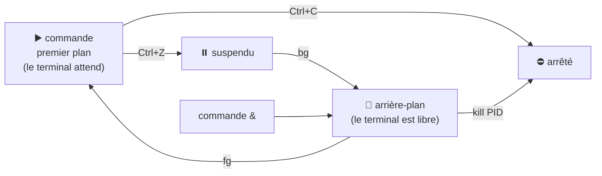

# Module 8 : Mécanismes avancés de Linux et Bash

*Cours : [Cours 3 - Utilisateur d'une distribution GNU/Linux](../index.md)*

## 🎯 Objectif du module

À la fin de ce module, tu sais :

- lire et modifier les **droits** d'un fichier (`rwx`, `chmod`) ;
- créer des **liens** (`ln -s`) ;
- surveiller et arrêter des **processus** (`ps`, `top`, `kill`), lancer une tâche en **arrière-plan** ;
- chercher avec des **expressions régulières** (`grep -E`, `^`, `$`) ;
- **archiver et compresser** (`tar`, `gzip`).

!!! abstract "En clair"
    Ce module rassemble les outils qui font passer de « je tape des commandes » à « **je maîtrise mon système** » :

    - **qui a le droit** de lire ou modifier un fichier ;
    - **quels programmes tournent**, et comment arrêter celui qui bloque ;
    - **chercher intelligemment** dans du texte ;
    - **regrouper et compresser** des fichiers, par exemple pour une sauvegarde.

## 🖼️ Résumé visuel

**① Les droits d'un fichier : 3 publics × 3 droits**

```text
-rwxr-x---  1  user30  compta  2048  21 oct.  script.sh
 └┬┘└┬┘└┬┘      └──┬─┘ └──┬─┘
  │  │  │          │      └── le GROUPE propriétaire
  │  │  │          └───────── l'UTILISATEUR propriétaire
  │  │  └── o (others) : les AUTRES       → ---  : aucun droit
  │  └───── g (group)  : le GROUPE        → r-x  : lire + exécuter
  └──────── u (user)   : le PROPRIÉTAIRE  → rwx  : lire + écrire + exécuter

   r = read (lire) = 4      w = write (écrire) = 2      x = execute (exécuter) = 1
   rwx = 4+2+1 = 7          r-x = 4+0+1 = 5             --- = 0            →  chmod 750
```

**② La vie d'un processus**



## 📖 Cours consolidé

### 1. Les droits sur les fichiers

Chaque fichier a **un propriétaire**, **un groupe**, et des droits pour **3 publics** : **u** (propriétaire), **g** (groupe), **o** (les autres).

| Droit | Lettre | Valeur | Fichier | Dossier |
|---|---|---|---|---|
| **Lecture** | **r** | **4** | Lire | **Lister** (`ls`) |
| **Écriture** | **w** | **2** | Modifier | **Créer / supprimer** dedans |
| **Exécution** | **x** | **1** | **Lancer** | **Entrer** (`cd`) |

**`chmod` en chiffres** (on additionne, un chiffre par public) :

| Chiffres | Droits | Usage |
|---|---|---|
| **755** | `rwxr-xr-x` | Script ou dossier : seul le propriétaire modifie |
| **644** | `rw-r--r--` | Fichier normal |
| **700** | `rwx------` | **Privé** |
| **600** | `rw-------` | **Secret** (clé SSH) |

**`chmod` en lettres** : `qui` `+`/`-`/`=` `quoi`.

```bash
chmod 755 script.sh
chmod u+x script.sh         # + exécution pour le propriétaire
chmod go-w rapport.txt      # − écriture pour groupe et autres
chmod o= secret.txt         # plus aucun droit pour les autres
```

💡 Lancer un script d'ici : `./script.sh` (droit **x** nécessaire). Changer le propriétaire (**`chown`**) : [cours 4](../../cours-04-administration-d-une-distribution-gnu-linux/index.md).

---

### 2. Les liens

| | **Symbolique** (`ln -s`) ✅ | **Physique** (`ln`) |
|---|---|---|
| **Image** | Un **raccourci** | Un **2ᵉ nom** pour le même fichier |
| **Original supprimé** | Lien **cassé** | Fichier **toujours accessible** |
| **Sur un dossier** | ✅ | ❌ |

```bash
ln -s /var/log/apache2 ~/logs-web       # ls -l → logs-web -> /var/log/apache2
```

---

### 3. Les processus

Un **processus** = un **programme en cours**, identifié par son **PID**.

| Commande | Effet |
|---|---|
| **`ps aux`** | **Tous** les processus (`| grep apache` pour en trouver un) |
| **`top`** / **`htop`** | **En direct**, triés par CPU (`q` = quitter) |
| **`kill PID`** | Demander **poliment** l'arrêt |
| **`kill -9 PID`** | **Forcer** (dernier recours : pas de sauvegarde des données) |
| `pkill firefox` | Arrêter **par nom** |

| Action | Effet |
|---|---|
| `commande &` | Lancer **en arrière-plan** |
| ++ctrl+c++ / ++ctrl+z++ | **Arrêter** / **mettre en pause** |
| **`jobs`** · **`bg`** · **`fg`** | Lister les tâches · relancer en arrière-plan · ramener au premier plan |

---

### 4. Les expressions régulières (avec `grep`)

Une **regex** décrit **la forme** d'un texte (« commence par… », « un chiffre puis… »). ⚠️ Rien à voir avec les **jokers** de noms de fichiers ([module 6](../module-6-specificites-du-shell-bash/index.md)) : ici `*` a un autre sens.

| Symbole | Signifie | Exemple |
|---|---|---|
| **`^`** / **`$`** | **Début** / **fin** de ligne | `grep "^root"` · `grep "bash$"` |
| **`.`** | **Un** caractère quelconque | `r..t` → root, rest |
| **`*`** | Le caractère d'avant, **0 fois ou plus** | `ab*c` → ac, abc, abbbc |
| **`[0-9]`** · **`[a-z]`** · `[^…]` | Un chiffre · une minuscule · **sauf** ces caractères | |
| **`|`** · `+` (avec **`-E`**) | **OU** · **1 fois ou plus** | `grep -E "error|fail"` |

```bash
grep -v "^#" /etc/ssh/sshd_config | grep -v "^$"     # config SANS commentaires ni lignes vides
grep -E "error|warning" /var/log/syslog               # erreurs OU avertissements
grep -E "[0-9]{1,3}\.[0-9]{1,3}\.[0-9]{1,3}\.[0-9]{1,3}" fichier   # lignes avec une IPv4
```

---

### 5. Archiver et compresser

- **Archiver** = **regrouper** en un seul fichier (**`tar`**) · **compresser** = **réduire** la taille (**`gzip`**).
- `tar` fait **les deux** : un **`.tar.gz`** (≈ le `.zip` de Windows).

| Option `tar` | Signifie |
|---|---|
| **`c`** / **`x`** / **`t`** | **Créer** / **extraire** / **lister** |
| **`z`** | Avec **gzip** |
| **`v`** | Afficher les fichiers traités |
| **`f`** | Nom de l'archive (toujours **en dernier**) |

```bash
tar -czvf sauvegarde.tar.gz Documents/       # CRÉER
tar -tzvf sauvegarde.tar.gz                  # VOIR le contenu
tar -xzvf sauvegarde.tar.gz -C /tmp          # EXTRAIRE dans /tmp
```

| Outil | Compresser / décompresser | Extension |
|---|---|---|
| **gzip** | `gzip f` / `gunzip f.gz` | `.gz` (le plus courant) |
| bzip2 · xz | `bzip2` / `bunzip2` · `xz` / `unxz` | `.bz2` · `.xz` (plus compacts) |
| zip | `zip -r a.zip dossier` / `unzip a.zip` | `.zip` (compatible Windows) |

⚠️ `gzip` **remplace** le fichier et ne prend **qu'un fichier** : pour un dossier, **`tar -czf`**.

## 📝 Fiche de révision

### 🧠 Les commandes du module

| Commande | Rôle |
|---|---|
| `chmod 755 f` / `chmod u+x f` | Changer les droits |
| `ln -s cible lien` | Lien symbolique |
| `ps aux` | Tous les processus |
| `top` / `htop` | Processus en direct |
| `kill PID` / `kill -9 PID` | Arrêter / forcer |
| `cmd &` / `jobs` / `fg` / `bg` | Arrière-plan |
| `grep "^motif"` / `grep "motif$"` | Début / fin de ligne |
| `grep -E "a|b"` | a OU b |
| `tar -czvf a.tar.gz dossier` | Créer une archive compressée |
| `tar -xzvf a.tar.gz` | Extraire |
| `gzip` / `gunzip` | Compresser / décompresser un fichier |

### 🔢 Calculer des droits

| Droits | Calcul | Chiffre |
|---|---|---|
| `rwx` | 4+2+1 | 7 |
| `rw-` | 4+2 | 6 |
| `r-x` | 4+1 | 5 |
| `r--` | 4 | 4 |
| `---` | 0 | 0 |

### ⚠️ Les pièges

- **`*` dans une regex ≠ `*` joker** de Bash.
- Pas de droit **x** sur un dossier → impossible d'y **entrer**, même avec r.
- **`kill -9`** en dernier recours seulement.
- Avec `tar`, l'option **`f` doit être la dernière**, juste avant le nom de l'archive.
- `gzip` **remplace** le fichier d'origine.

### ✏️ Entraîne-toi (clique pour voir la correction)

??? question "1. Quels droits donne chmod 640 rapport.txt ?"
    6 = `rw-` (propriétaire), 4 = `r--` (groupe), 0 = `---` (autres) → **`rw-r-----`** : le propriétaire lit et modifie, le groupe lit, les autres n'ont rien.

??? question "2. Rends le script sauvegarde.sh exécutable par son propriétaire, puis lance-le."
    ```bash
    chmod u+x sauvegarde.sh
    ./sauvegarde.sh
    ```

??? question "3. Le navigateur est figé. Trouve son PID et arrête-le."
    ```bash
    ps aux | grep firefox       # repérer le PID (2ᵉ colonne), ex. 3810
    kill 3810                   # arrêt normal
    kill -9 3810                # seulement s'il ne s'arrête pas
    ```

??? question "4. Affiche les lignes de /etc/passwd qui commencent par « user »."
    ```bash
    grep "^user" /etc/passwd
    ```

??? question "5. Archive et compresse le dossier ~/projets dans projets.tar.gz, puis extrais-le dans /tmp."
    ```bash
    tar -czvf projets.tar.gz ~/projets
    tar -xzvf projets.tar.gz -C /tmp
    ```

## 🧠 Quiz — entraîne-toi

<div id="quiz-cours-03-utilisateur-d-une-distribution-gnu-linux-module-8-mecanismes-avances-de-linux-et-bash"></div>

<script type="application/json" id="quiz-cours-03-utilisateur-d-une-distribution-gnu-linux-module-8-mecanismes-avances-de-linux-et-bash-data">
[
  {
    "question": "Que signifie rwxr-x--- ?",
    "options": [
      "Tout le monde a tous les droits",
      "Propriétaire : tout ; groupe : lire et exécuter ; autres : rien",
      "Propriétaire : lire ; groupe : écrire ; autres : exécuter",
      "Fichier caché"
    ],
    "correctIndex": 1,
    "explanation": "Les 3 groupes de 3 caractères concernent, dans l'ordre, le propriétaire (rwx), le groupe (r-x) et les autres (---)."
  },
  {
    "question": "Quelle valeur numérique correspond aux droits rwx ?",
    "options": [
      "3",
      "5",
      "7",
      "9"
    ],
    "correctIndex": 2,
    "explanation": "r = 4, w = 2, x = 1 : 4 + 2 + 1 = 7."
  },
  {
    "question": "Que donne chmod 644 fichier ?",
    "options": [
      "rw-r--r--",
      "rwxr-xr-x",
      "rw-------",
      "r--r--r--"
    ],
    "correctIndex": 0,
    "explanation": "6 = rw- pour le propriétaire, 4 = r-- pour le groupe et 4 = r-- pour les autres : c'est le réglage habituel d'un fichier."
  },
  {
    "question": "Sur un dossier, à quoi sert le droit x ?",
    "options": [
      "Supprimer le dossier",
      "Entrer dans le dossier (cd)",
      "Lister son contenu",
      "Rien"
    ],
    "correctIndex": 1,
    "explanation": "Sur un dossier, r permet de lister, w de créer ou supprimer des fichiers dedans, et x d'y entrer."
  },
  {
    "question": "Quelle commande ajoute le droit d'exécution au propriétaire d'un script ?",
    "options": [
      "chmod o+x script.sh",
      "chmod u+x script.sh",
      "chmod 000 script.sh",
      "chown u+x script.sh"
    ],
    "correctIndex": 1,
    "explanation": "u = propriétaire (user), + = ajouter, x = exécution."
  },
  {
    "question": "Que se passe-t-il si on supprime le fichier vers lequel pointe un lien symbolique ?",
    "options": [
      "Le lien devient une copie",
      "Le lien est cassé",
      "Le fichier est restauré",
      "Rien, le lien contient les données"
    ],
    "correctIndex": 1,
    "explanation": "Un lien symbolique (ln -s) n'est qu'un raccourci vers un chemin : si la cible disparaît, le lien ne mène plus nulle part."
  },
  {
    "question": "Quelle commande affiche tous les processus de la machine ?",
    "options": [
      "ps",
      "ps aux",
      "jobs",
      "pwd"
    ],
    "correctIndex": 1,
    "explanation": "ps seul ne montre que les processus du terminal courant ; ps aux les montre tous, avec leur PID, leur propriétaire et leur consommation."
  },
  {
    "question": "Qu'est-ce qu'un PID ?",
    "options": [
      "Un mot de passe",
      "Le numéro unique d'un processus",
      "Un type de fichier",
      "Un port réseau"
    ],
    "correctIndex": 1,
    "explanation": "PID (Process ID) est le numéro unique attribué à chaque processus. C'est lui qu'on donne à kill."
  },
  {
    "question": "Pourquoi essayer kill PID avant kill -9 PID ?",
    "options": [
      "kill -9 n'existe pas",
      "kill demande un arrêt propre ; kill -9 coupe brutalement sans laisser le programme enregistrer",
      "kill -9 est plus lent",
      "kill redémarre le processus"
    ],
    "correctIndex": 1,
    "explanation": "kill envoie un signal d'arrêt que le programme peut traiter proprement. kill -9 le tue immédiatement, au risque de perdre des données : c'est le dernier recours."
  },
  {
    "question": "Comment lancer une commande directement en arrière-plan ?",
    "options": [
      "En ajoutant & à la fin",
      "Avec Ctrl + C",
      "Avec fg",
      "En la tapant en majuscules"
    ],
    "correctIndex": 0,
    "explanation": "Le & final lance la commande en arrière-plan : le terminal reste disponible. jobs liste les tâches, fg en ramène une au premier plan."
  },
  {
    "question": "Dans une expression régulière, que signifie ^ en début de motif ?",
    "options": [
      "Fin de ligne",
      "Début de ligne",
      "N'importe quel caractère",
      "Un chiffre"
    ],
    "correctIndex": 1,
    "explanation": "^ ancre le motif en début de ligne : grep \"^root\" trouve les lignes qui commencent par root. $ ancre en fin de ligne."
  },
  {
    "question": "Quelle commande affiche les lignes de /etc/passwd qui se terminent par bash ?",
    "options": [
      "grep \"^bash\" /etc/passwd",
      "grep \"bash$\" /etc/passwd",
      "grep -v bash /etc/passwd",
      "find bash /etc/passwd"
    ],
    "correctIndex": 1,
    "explanation": "$ signifie fin de ligne. Ces lignes correspondent aux comptes dont le shell est /bin/bash."
  },
  {
    "question": "Comment chercher les lignes contenant « error » OU « fail » ?",
    "options": [
      "grep error fail fichier",
      "grep -E \"error|fail\" fichier",
      "grep \"error&fail\" fichier",
      "grep -v error fichier"
    ],
    "correctIndex": 1,
    "explanation": "Avec -E (regex étendues), | signifie OU. Sans -E, grep prendrait « fail » pour un nom de fichier."
  },
  {
    "question": "Quelle commande crée une archive compressée projets.tar.gz du dossier projets ?",
    "options": [
      "tar -xzvf projets.tar.gz projets",
      "tar -czvf projets.tar.gz projets",
      "gzip projets",
      "zip projets.tar.gz"
    ],
    "correctIndex": 1,
    "explanation": "c = créer, z = compression gzip, v = afficher, f = nom de l'archive (toujours suivi du nom). x servirait à extraire."
  },
  {
    "question": "Quelle commande extrait l'archive sauvegarde.tar.gz dans le dossier courant ?",
    "options": [
      "tar -czvf sauvegarde.tar.gz",
      "tar -xzvf sauvegarde.tar.gz",
      "gzip sauvegarde.tar.gz",
      "tar -tzvf sauvegarde.tar.gz"
    ],
    "correctIndex": 1,
    "explanation": "x = extraire. -tzvf ne fait que lister le contenu, sans rien extraire."
  },
  {
    "question": "Quelle est la différence entre archiver et compresser ?",
    "options": [
      "Aucune",
      "Archiver regroupe plusieurs fichiers en un seul ; compresser réduit la taille",
      "Archiver réduit la taille ; compresser regroupe",
      "Archiver supprime les fichiers"
    ],
    "correctIndex": 1,
    "explanation": "tar regroupe des fichiers (archive) ; gzip, bzip2 ou xz réduisent la taille (compression). tar -z fait les deux à la fois."
  }
]
</script>

<script>
  document.addEventListener("DOMContentLoaded", function () {
    TSSRQuiz.init({
      containerId: "quiz-cours-03-utilisateur-d-une-distribution-gnu-linux-module-8-mecanismes-avances-de-linux-et-bash",
      dataId: "quiz-cours-03-utilisateur-d-une-distribution-gnu-linux-module-8-mecanismes-avances-de-linux-et-bash-data",
    });
  });
</script>
