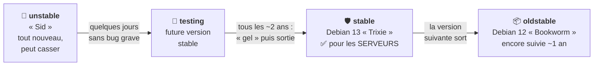

# Module 1 : Présentation de Debian GNU/Linux

*Cours : [Cours 4 - Administration d'une distribution GNU/Linux](../index.md)*

## 🎯 Objectif du module

- Comprendre ce qu'est **Debian** et pourquoi on l'utilise sur les **serveurs**.
- Connaître les **branches** (stable, testing, unstable) et le **cycle de vie** d'une version.
- Savoir ce que fait un **administrateur Linux**, et la différence entre **root** et **sudo**.

!!! abstract "En clair"
    Au [cours 3](../../cours-03-utilisateur-d-une-distribution-gnu-linux/index.md), tu as appris à **utiliser** Linux. Dans ce cours, tu apprends à l'**administrer** : l'installer, le configurer, créer les comptes, gérer les disques et le réseau, et le **maintenir en état de marche**. La distribution utilisée est **Debian**, réputée pour sa **stabilité** : c'est pour ça qu'on la met sur les serveurs.

## 🖼️ Résumé visuel

**Le parcours d'un logiciel dans Debian, du plus récent au plus sûr**

## 📖 Cours consolidé

### 1. Pourquoi Debian ?

| Atout | En clair |
|---|---|
| **Stabilité** | Les logiciels sont **très testés** avant d'arriver en « stable » : un serveur peut tourner des années sans souci |
| **Gratuite et libre** | 100 % logiciel libre, pas de licence à payer |
| **Énorme catalogue** | Plus de **60 000 paquets** (logiciels prêts à installer) |
| **Base de nombreuses distributions** | **Ubuntu**, Linux Mint, Raspberry Pi OS, Kali… sont basées sur Debian : ce que tu apprends ici sert partout |
| **Communauté** | Développée par des milliers de bénévoles, sans entreprise derrière |

---

### 2. Les branches et les versions

| Branche | Contenu | Pour qui ? |
|---|---|---|
| **stable** | La version **officielle**, testée, avec mises à jour de **sécurité** | ✅ **Serveurs, production** |
| **testing** | La **future** stable, en préparation | Tests, curieux |
| **unstable** (« Sid ») | Les logiciels **les plus récents**, peu testés | Développeurs |

| Version | Nom | État en 2026 |
|---|---|---|
| Debian 11 | Bullseye | Fin du support standard, support longue durée (LTS) seulement |
| Debian 12 | Bookworm | **oldstable** |
| **Debian 13** | **Trixie** | **stable** (sortie en août 2025) |

📌 Une nouvelle version sort **environ tous les 2 ans**. Chacune est suivie **environ 3 ans**, puis **2 ans de plus** grâce à l'équipe **Debian LTS**, soit **~5 ans** au total. Les noms viennent des personnages de **Toy Story**.

💡 Connaître sa version : `cat /etc/debian_version` (→ `13.1`) ou `cat /etc/os-release`.

---

### 3. Le métier d'administrateur Linux

| Tâche | Module |
|---|---|
| Installer le système | 2 |
| Comprendre le démarrage, gérer les services | 3 |
| Réparer un système qui ne démarre plus | 4 |
| Configurer le réseau | 5 |
| Installer et mettre à jour des logiciels | 6 |
| Gérer les disques, LVM, systèmes de fichiers | 7 · 8 · 9 |
| Gérer les utilisateurs et les droits | 10 · 11 |
| Surveiller, planifier, lire les journaux | 12 |

---

### 4. root et sudo

!!! abstract "En clair"
    **root** est le compte **tout-puissant**. Plutôt que de se connecter en root (dangereux), on travaille avec **son propre compte** et on **emprunte les droits de root pour une seule commande** grâce à **`sudo`**. On garde ainsi une **trace** de qui a fait quoi, et on évite les erreurs.

| Méthode | Commande | Usage |
|---|---|---|
| **sudo** | `sudo apt update` | ✅ **Recommandé** : une commande en root, avec **ton** mot de passe. Il faut être dans le groupe **`sudo`** |
| **su -** | `su -` (puis `exit`) | Devenir root (mot de passe de **root**). Pratique pour une longue série de commandes |

📌 `sudo` est enregistré dans les journaux (`/var/log/auth.log` ou `journalctl`) : on sait **qui** a lancé **quoi**.

---

### 5. Où trouver de l'aide ?

| Source | Contenu |
|---|---|
| `man commande` / `commande --help` | L'aide intégrée ([cours 3, module 3](../../cours-03-utilisateur-d-une-distribution-gnu-linux/module-3-decouverte-du-shell-et-premieres-commandes/index.md)) |
| **wiki.debian.org** | Le wiki officiel, avec des pages en français |
| **debian.org/doc** | Le **manuel de l'administrateur Debian** (gratuit, en français) |
| `/usr/share/doc/paquet/` | La documentation installée avec chaque logiciel |

## ✅ Points clés à retenir

- **Debian** : libre, gratuite, **très stable** → idéale pour les **serveurs** ; base d'Ubuntu et de beaucoup d'autres.
- Branches : **stable** (production) · **testing** (future stable) · **unstable / Sid** (le plus récent).
- Version actuelle : **Debian 13 « Trixie »** ; une version tous les **~2 ans**, suivie **~5 ans** (avec LTS).
- Version installée : **`cat /etc/debian_version`**.
- **root** = tout-puissant ; on préfère **`sudo commande`** (groupe `sudo`, commande tracée) à `su -`.

## 📝 Fiche de révision

| Notion | À retenir |
|---|---|
| **stable** | Pour les serveurs |
| **testing** | La future stable |
| **unstable (Sid)** | Le plus récent, peut casser |
| **Debian 13** | Trixie, stable actuelle |
| **LTS** | Support longue durée (~5 ans au total) |
| **`sudo`** | Une commande avec les droits root, tracée |
| **`su -`** | Devenir root |
| **`/etc/debian_version`** | Numéro de version |

**⚠️ Les pièges**

- **unstable** n'est **jamais** pour un serveur de production.
- `sudo` demande **ton** mot de passe ; `su` demande celui de **root**.
- Un utilisateur **hors du groupe `sudo`** ne peut pas utiliser `sudo`.

??? question "1. Ton entreprise installe un nouveau serveur web. Quelle branche de Debian ?"
    **stable** (Debian 13 « Trixie ») : testée, stable, avec des mises à jour de sécurité.

??? question "2. Comment connaître la version de Debian d'un serveur ?"
    `cat /etc/debian_version`, ou `cat /etc/os-release` pour le nom complet.

??? question "3. Pourquoi utiliser sudo plutôt que se connecter en root ?"
    On ne prend les pleins pouvoirs **que pour une commande** (moins de risque d'erreur), et chaque commande `sudo` est **enregistrée** avec le nom de la personne.

## 🧠 Quiz — entraîne-toi

