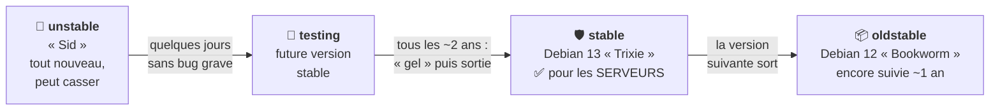

# Module 1 : Présentation de Debian GNU/Linux

*Cours : [Cours 4 - Administration d'une distribution GNU/Linux](../index.md)*

## 🎯 Objectif du module

- Comprendre ce qu'est **Debian** et pourquoi on l'utilise sur les **serveurs**.
- Connaître les **branches** (stable, testing, unstable) et le **cycle de vie** d'une version.
- Savoir ce que fait un **administrateur Linux**, et la différence entre **root** et **sudo**.

!!! abstract "En clair"
    Au [cours 3](../../cours-03-utilisateur-d-une-distribution-gnu-linux/index.md), tu as appris à **utiliser** Linux. Dans ce cours, tu apprends à l'**administrer** : l'installer, le configurer, créer les comptes, gérer les disques et le réseau, et le **maintenir en état de marche**. La distribution utilisée est **Debian**, réputée pour sa **stabilité** : c'est pour ça qu'on la met sur les serveurs.

## 🖼️ Résumé visuel

**Le parcours d'un logiciel dans Debian, du plus récent au plus sûr**

## 📖 Cours consolidé

### 1. Pourquoi Debian ?

- **Stable** : logiciels **très testés**, un serveur tourne des années sans souci.
- **Libre et gratuite**, développée par des **bénévoles**, sans entreprise derrière.
- **Plus de 60 000 paquets** prêts à installer.
- **Base de nombreuses distributions** (Ubuntu, Mint, Raspberry Pi OS, Kali) : ce que tu apprends ici sert partout.

---

### 2. Les branches et les versions

| Branche | Contenu | Pour qui ? |
|---|---|---|
| **stable** | Version **officielle**, testée, avec **correctifs de sécurité** | ✅ **Serveurs** |
| **testing** | La **future** stable | Tests |
| **unstable** (« Sid ») | Les logiciels **les plus récents**, peu testés | Développeurs |

| Version | Nom | En 2026 |
|---|---|---|
| Debian 11 | Bullseye | Support longue durée (LTS) seulement |
| Debian 12 | Bookworm | **oldstable** |
| **Debian 13** | **Trixie** | **stable** (août 2025) |

- 📌 Une version **tous les ~2 ans**, suivie **~3 ans + 2 ans de LTS** = **~5 ans**. Noms tirés de **Toy Story**.
- 💡 Ta version : `cat /etc/debian_version` (→ `13.1`) ou `cat /etc/os-release`.

---

### 3. Le métier d'administrateur Linux (le plan du cours)

Installer (**module 2**) · démarrage et services (**3**) · réparer (**4**) · réseau (**5**) · logiciels (**6**) · disques, LVM, systèmes de fichiers (**7 · 8 · 9**) · utilisateurs et droits (**10 · 11**) · surveiller et planifier (**12**).

---

### 4. root et sudo

On ne se connecte **pas** en root : on travaille avec **son compte** et on **emprunte les droits de root pour une commande** avec **`sudo`**.

| Méthode | Usage |
|---|---|
| **`sudo apt update`** | ✅ **Recommandé** : une commande en root, avec **ton** mot de passe (il faut être dans le groupe **`sudo`**) |
| **`su -`** (puis `exit`) | Devenir root (mot de passe **de root**) pour une longue série de commandes |

📌 `sudo` est **journalisé** (`/var/log/auth.log`, `journalctl`) : on sait **qui** a lancé **quoi**.

---

### 5. Où trouver de l'aide ?

- **`man`** / **`--help`** ([cours 3, module 3](../../cours-03-utilisateur-d-une-distribution-gnu-linux/module-3-decouverte-du-shell-et-premieres-commandes/index.md)) · **`/usr/share/doc/paquet/`**
- **wiki.debian.org** (pages en français) · **debian.org/doc** : le **manuel de l'administrateur Debian** (gratuit, en français)

## 📝 Fiche de révision

| Notion | À retenir |
|---|---|
| **stable** | Pour les serveurs |
| **testing** | La future stable |
| **unstable (Sid)** | Le plus récent, peut casser |
| **Debian 13** | Trixie, stable actuelle |
| **LTS** | Support longue durée (~5 ans au total) |
| **`sudo`** | Une commande avec les droits root, tracée |
| **`su -`** | Devenir root |
| **`/etc/debian_version`** | Numéro de version |

**⚠️ Les pièges**

- **unstable** n'est **jamais** pour un serveur de production.
- `sudo` demande **ton** mot de passe ; `su` demande celui de **root**.
- Un utilisateur **hors du groupe `sudo`** ne peut pas utiliser `sudo`.

??? question "1. Ton entreprise installe un nouveau serveur web. Quelle branche de Debian ?"
    **stable** (Debian 13 « Trixie ») : testée, stable, avec des mises à jour de sécurité.

??? question "2. Comment connaître la version de Debian d'un serveur ?"
    `cat /etc/debian_version`, ou `cat /etc/os-release` pour le nom complet.

??? question "3. Pourquoi utiliser sudo plutôt que se connecter en root ?"
    On ne prend les pleins pouvoirs **que pour une commande** (moins de risque d'erreur), et chaque commande `sudo` est **enregistrée** avec le nom de la personne.

## 🧠 Quiz — entraîne-toi

