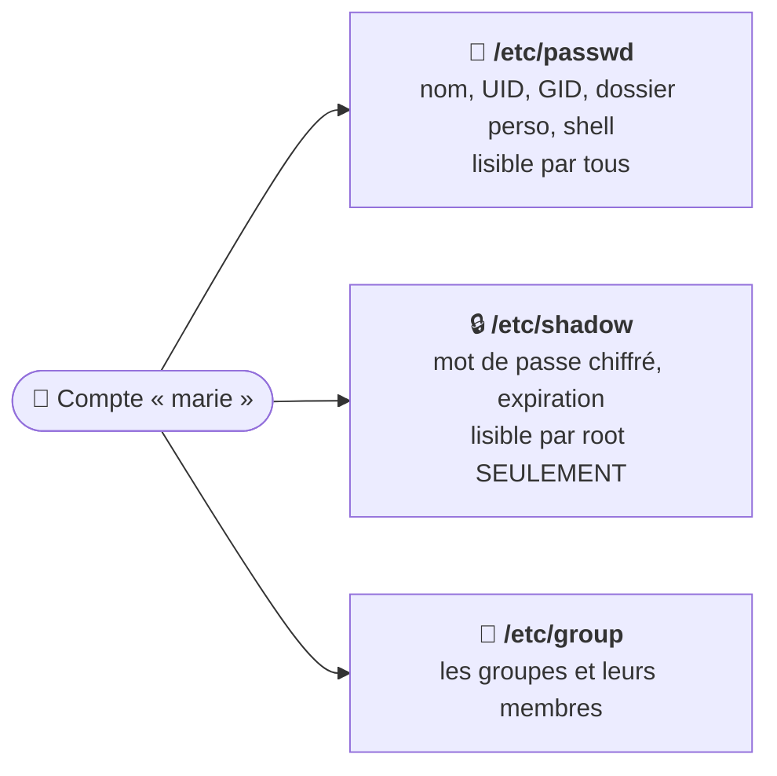

# Module 10 : Gestion des utilisateurs et des groupes

*Cours : [Cours 4 - Administration d'une distribution GNU/Linux](../index.md)*

## 🎯 Objectif du module

- Connaître les **3 fichiers** des comptes : `/etc/passwd`, `/etc/shadow`, `/etc/group`.
- **Créer, modifier, verrouiller, supprimer** un utilisateur.
- Gérer les **groupes** et les **mots de passe**.
- Donner les droits **`sudo`** à un utilisateur.

!!! abstract "En clair"
    Comme sous Windows ([cours 2, module 5](../../cours-02-systeme-client-microsoft/module-5-les-utilisateurs-et-les-groupes/index.md)) : **1 personne = 1 compte**, et on donne les droits **aux groupes**. Sous Linux, il n'y a pas de console graphique : tout est rangé dans **3 fichiers texte**, qu'on modifie avec des **commandes** (jamais à la main).

## 🖼️ Résumé visuel

**Les 3 fichiers des comptes**



## 📖 Cours consolidé

### 1. Les fichiers des comptes

**`/etc/passwd`** : une ligne par compte, 7 colonnes ([cours 3, module 5](../../cours-03-utilisateur-d-une-distribution-gnu-linux/module-5-utiliser-des-fichiers-sous-linux/index.md)).

```text
marie:x:1001:1001:Marie Durand,Compta:/home/marie:/bin/bash
└─┬─┘ │ └─┬┘ └─┬┘ └───────┬────────┘ └────┬────┘ └───┬───┘
 nom  │  UID  GID    commentaire     dossier perso   shell
      └ x = le mot de passe est dans /etc/shadow
```

| UID | Compte |
|---|---|
| **0** | **root** |
| 1 à 999 | **Comptes système** (`www-data`…), souvent avec le shell `nologin` (connexion impossible) |
| **1000+** | **Vrais utilisateurs** |

- **`/etc/shadow`** : mots de passe **chiffrés**, lisibles par **root** seulement (`!` au début = compte **verrouillé**).
- **`/etc/group`** : groupes et membres (`compta:x:1002:marie,paul`).

---

### 2. Gérer les utilisateurs

| Je veux… | Commande |
|---|---|
| **Créer** (assistant Debian) ✅ | **`sudo adduser marie`** : dossier perso + mot de passe |
| Créer (outil de base, scripts) | `sudo useradd -m -s /bin/bash marie` (`-m` = dossier perso), puis `passwd` |
| Mot de passe : le mien / celui de quelqu'un | `passwd` / `sudo passwd marie` |
| **Verrouiller** / déverrouiller | `sudo usermod -L marie` / `-U` |
| Changer shell, commentaire | `sudo usermod -s /bin/bash marie` · `-c "Marie Durand"` |
| **Supprimer** (avec son dossier) | `sudo deluser --remove-home marie` |
| Forcer un nouveau mot de passe à la connexion | `sudo passwd -e marie` (règles : `sudo chage -l marie`) |
| Infos | `id marie` · `getent passwd marie` |

---

### 3. Gérer les groupes

Chaque utilisateur a **un groupe principal** (souvent son nom) et des **groupes secondaires**.

| Je veux… | Commande |
|---|---|
| **Créer** / supprimer un groupe | `sudo groupadd compta` / `groupdel compta` |
| **Ajouter** un utilisateur ✅ | **`sudo usermod -aG compta marie`** (ou `adduser marie compta`) |
| **Retirer** | `sudo deluser marie compta` |
| Voir ses groupes | `groups marie` · `id marie` |

!!! danger "Le piège n°1 : `usermod -G` sans le `-a`"
    **`-aG`** **ajoute** le groupe ; **`-G`** seul **remplace** tous les groupes secondaires → l'utilisateur **perd** ses autres groupes, y compris **`sudo`** !

📌 Un changement de groupe compte à la **prochaine connexion**.

---

### 4. Donner les droits d'administration : `sudo`

- ✅ Ajouter au groupe **`sudo`** : `sudo usermod -aG sudo marie`.
- Règle personnalisée : **`sudo visudo`** (vérifie la syntaxe de `/etc/sudoers`). ⚠️ Jamais un éditeur normal : une faute **bloque `sudo` pour tous**.
- 💡 Connexions : `who` (connectés) · `last` (historique) · `lastlog` (dernière connexion de chaque compte).

## 📝 Fiche de révision

| Commande | Rôle |
|---|---|
| `adduser marie` | Créer (interactif) |
| `useradd -m -s /bin/bash marie` | Créer (script) |
| `passwd marie` | Mot de passe |
| `passwd -e marie` | Forcer le changement |
| `usermod -L` / `-U` | Verrouiller / déverrouiller |
| `deluser --remove-home marie` | Supprimer avec le dossier |
| `groupadd compta` | Créer un groupe |
| `usermod -aG compta marie` | Ajouter à un groupe |
| `id marie` / `groups marie` | Infos / groupes |
| `visudo` | Modifier sudoers sans risque |

**⚠️ Les pièges**

- **`usermod -G` sans `-a`** efface les autres groupes.
- `useradd` **sans `-m`** → pas de dossier personnel.
- Ne **jamais** éditer `/etc/passwd`, `/etc/shadow` ou `/etc/sudoers` à la main.

??? question "1. Crée l'utilisateur paul, le groupe « compta », et mets paul dedans."
    ```bash
    sudo adduser paul
    sudo groupadd compta
    sudo usermod -aG compta paul
    ```

??? question "2. Paul part en congé longue durée. Comment bloquer son compte sans le supprimer ?"
    `sudo usermod -L paul` (et `sudo usermod -U paul` à son retour).

??? question "3. Que signifie UID 0 ? Et un UID de 33 ?"
    **0** = **root**. Un UID entre 1 et 999 (ici 33) = un **compte système** (ex. `www-data`, utilisé par le serveur web).

## 🧠 Quiz — entraîne-toi

<div id="quiz-cours-04-administration-d-une-distribution-gnu-linux-module-10-gestion-des-utilisateurs-et-des-groupes"></div>

<script type="application/json" id="quiz-cours-04-administration-d-une-distribution-gnu-linux-module-10-gestion-des-utilisateurs-et-des-groupes-data">
[
  {
    "question": "Quel fichier contient la liste des comptes (nom, UID, dossier personnel, shell) ?",
    "options": [
      "/etc/shadow",
      "/etc/passwd",
      "/etc/group",
      "/etc/sudoers"
    ],
    "correctIndex": 1,
    "explanation": "/etc/passwd contient une ligne par compte. Malgré son nom, il ne contient plus le mot de passe (un x à la place)."
  },
  {
    "question": "Où sont stockés les mots de passe chiffrés ?",
    "options": [
      "/etc/passwd",
      "/etc/shadow, lisible par root seulement",
      "/home/utilisateur",
      "/var/log/auth.log"
    ],
    "correctIndex": 1,
    "explanation": "/etc/shadow contient les mots de passe chiffrés et les règles d'expiration ; seul root peut le lire."
  },
  {
    "question": "Quel UID a toujours le compte root ?",
    "options": [
      "1",
      "0",
      "1000",
      "999"
    ],
    "correctIndex": 1,
    "explanation": "root a l'UID 0. Les comptes système ont un UID de 1 à 999, les vrais utilisateurs à partir de 1000."
  },
  {
    "question": "Quelle commande Debian crée un utilisateur de façon interactive, avec son dossier personnel ?",
    "options": [
      "adduser marie",
      "useradd marie",
      "newuser marie",
      "mkuser marie"
    ],
    "correctIndex": 0,
    "explanation": "adduser pose les questions (mot de passe, nom complet) et crée le dossier personnel. useradd est l'outil de base : il faut ajouter -m pour le dossier."
  },
  {
    "question": "Quelle commande ajoute marie au groupe compta en gardant ses autres groupes ?",
    "options": [
      "usermod -G compta marie",
      "usermod -aG compta marie",
      "groupadd marie compta",
      "chgrp compta marie"
    ],
    "correctIndex": 1,
    "explanation": "-a (append) ajoute le groupe. Sans -a, -G remplace tous les groupes secondaires de marie, qui perdrait par exemple sudo."
  },
  {
    "question": "Comment verrouiller le compte de paul sans le supprimer ?",
    "options": [
      "deluser paul",
      "usermod -L paul",
      "passwd -d paul",
      "chmod 000 paul"
    ],
    "correctIndex": 1,
    "explanation": "usermod -L (lock) verrouille le mot de passe ; usermod -U le déverrouille. Le compte et ses fichiers restent intacts."
  },
  {
    "question": "Comment donner les droits d'administration (sudo) à marie ?",
    "options": [
      "chmod +sudo marie",
      "usermod -aG sudo marie",
      "passwd sudo marie",
      "Ajouter son nom dans /etc/passwd"
    ],
    "correctIndex": 1,
    "explanation": "Sur Debian, les membres du groupe sudo peuvent utiliser sudo. marie doit se reconnecter pour que ce soit pris en compte."
  },
  {
    "question": "Avec quelle commande modifie-t-on /etc/sudoers sans risque ?",
    "options": [
      "nano /etc/sudoers",
      "visudo",
      "sudo edit",
      "vim -sudo"
    ],
    "correctIndex": 1,
    "explanation": "visudo vérifie la syntaxe avant d'enregistrer. Une faute dans sudoers édité à la main peut bloquer sudo pour tout le monde."
  },
  {
    "question": "Comment supprimer l'utilisateur paul ET son dossier personnel ?",
    "options": [
      "deluser paul",
      "deluser --remove-home paul",
      "rm -r /home/paul",
      "usermod -D paul"
    ],
    "correctIndex": 1,
    "explanation": "deluser seul garde /home/paul ; avec --remove-home, le dossier personnel est supprimé aussi."
  },
  {
    "question": "À partir de quel UID commencent les comptes des utilisateurs humains sur Debian ?",
    "options": [
      "0",
      "100",
      "1000",
      "65535"
    ],
    "correctIndex": 2,
    "explanation": "0 = root, de 1 à 999 = comptes système (services), à partir de 1000 = vraies personnes."
  },
  {
    "question": "Quel fichier liste les groupes et leurs membres ?",
    "options": [
      "/etc/passwd",
      "/etc/shadow",
      "/etc/sudoers",
      "/etc/group"
    ],
    "correctIndex": 3,
    "explanation": "/etc/group contient une ligne par groupe : nom, GID et liste des membres."
  },
  {
    "question": "Que se passe-t-il avec sudo usermod -G compta marie (sans -a) ?",
    "options": [
      "marie est ajoutée à compta en gardant ses groupes",
      "marie perd tous ses autres groupes secondaires, sudo compris",
      "marie est supprimée",
      "Rien, la commande est refusée"
    ],
    "correctIndex": 1,
    "explanation": "Sans -a, -G remplace la liste des groupes secondaires. C'est le piège n°1 : toujours écrire -aG."
  },
  {
    "question": "Quelle commande change le mot de passe de marie ?",
    "options": [
      "sudo passwd marie",
      "sudo chpass marie",
      "sudo usermod -p marie",
      "sudo adduser marie --password"
    ],
    "correctIndex": 0,
    "explanation": "passwd utilisateur (avec sudo) définit un nouveau mot de passe. Sans argument, passwd change le tien."
  },
  {
    "question": "Comment forcer marie à changer son mot de passe à sa prochaine connexion ?",
    "options": [
      "sudo passwd -l marie",
      "sudo usermod -U marie",
      "sudo passwd -e marie",
      "sudo deluser marie"
    ],
    "correctIndex": 2,
    "explanation": "passwd -e fait expirer le mot de passe (équivalent : chage -d 0 marie). -l verrouillerait le compte."
  },
  {
    "question": "Quelle commande affiche l'UID, le GID et tous les groupes de marie ?",
    "options": [
      "whoami marie",
      "id marie",
      "cat marie",
      "ls -l marie"
    ],
    "correctIndex": 1,
    "explanation": "id marie affiche uid, gid et la liste des groupes. groups marie n'affiche que les groupes."
  }
]
</script>

<script>
  document.addEventListener("DOMContentLoaded", function () {
    TSSRQuiz.init({
      containerId: "quiz-cours-04-administration-d-une-distribution-gnu-linux-module-10-gestion-des-utilisateurs-et-des-groupes",
      dataId: "quiz-cours-04-administration-d-une-distribution-gnu-linux-module-10-gestion-des-utilisateurs-et-des-groupes-data",
    });
  });
</script>
