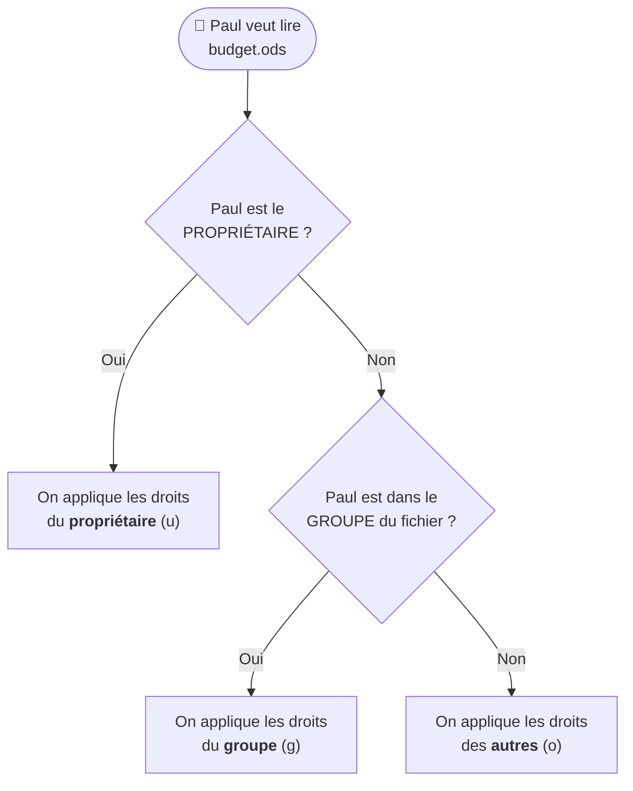

# Module 11 : Droits sur les fichiers et répertoires

*Cours : [Cours 4 - Administration d'une distribution GNU/Linux](../index.md)*

## 🎯 Objectif du module

- Revoir les droits **`rwx`** et **`chmod`** ([cours 3, module 8](../../cours-03-utilisateur-d-une-distribution-gnu-linux/module-8-mecanismes-avances-de-linux-et-bash/index.md)).
- Changer le **propriétaire** et le **groupe** : **`chown`**, **`chgrp`**.
- Comprendre le **`umask`** (droits par défaut).
- Connaître les **droits spéciaux** (SUID, SGID, sticky bit) et les **ACL**.
- Mettre en place un **dossier partagé** pour un service.

!!! abstract "En clair"
    Sous Windows, on règle les droits avec l'onglet Sécurité ([cours 2, module 6](../../cours-02-systeme-client-microsoft/module-6-la-securite-ntfs-et-les-acl/index.md)). Sous Linux, c'est plus simple : chaque fichier a **un propriétaire**, **un groupe** et **3 séries de droits** (`rwx`) pour le **propriétaire**, le **groupe** et **les autres**. Root, lui, passe partout.

## 🖼️ Résumé visuel

**Comment Linux décide si tu peux lire un fichier**



📌 Linux prend **la première case qui correspond**, et s'arrête là (contrairement à Windows, il n'additionne pas).

## 📖 Cours consolidé

### 1. Rappel : lire et changer les droits

```text
-rw-rw---- 1 marie compta 8192 21 oct. 10:15 budget.ods
 └┬┘└┬┘└┬┘   └─┬─┘ └──┬─┘
  u  g  o   propriétaire  groupe
```

| | r (4) | w (2) | x (1) |
|---|---|---|---|
| **Fichier** | Lire | Modifier | Exécuter |
| **Dossier** | Lister | Créer / supprimer dedans | Entrer (`cd`) |

```bash
chmod 660 budget.ods       # rw-rw---- : propriétaire et groupe lisent/écrivent, les autres rien
chmod g+w budget.ods       # ajouter l'écriture au groupe
chmod -R 750 /srv/compta   # -R = récursif : le dossier ET tout son contenu
```

---

### 2. Changer le propriétaire et le groupe

| Je veux… | Commande |
|---|---|
| Changer le **propriétaire** | `sudo chown paul budget.ods` |
| Changer le **propriétaire et le groupe** | **`sudo chown paul:compta budget.ods`** |
| Changer **seulement le groupe** | `sudo chgrp compta budget.ods` (ou `chown :compta`) |
| Tout un dossier, **récursivement** | `sudo chown -R paul:compta /srv/compta` |

📌 Seul **root** peut donner un fichier à quelqu'un d'autre (`chown`).

---

### 3. Les droits par défaut : `umask`

Quand tu crées un fichier, il reçoit des droits **par défaut**, calculés par le **`umask`** (le « masque » des droits à **retirer**).

| | Départ | − umask `022` | = Résultat |
|---|---|---|---|
| **Fichier** | `666` (rw-rw-rw-) | `022` | **`644`** (rw-r--r--) |
| **Dossier** | `777` (rwxrwxrwx) | `022` | **`755`** (rwxr-xr-x) |

```bash
umask          # affiche 0022 (valeur par défaut de Debian)
umask 027      # nouveaux fichiers en 640, dossiers en 750 (les « autres » n'ont plus rien)
```

---

### 4. Les droits spéciaux

| Droit | Sur… | Effet | Exemple réel | Valeur |
|---|---|---|---|---|
| **SUID** (`s` à la place du x du propriétaire) | Un **programme** | Il s'exécute avec les droits de son **propriétaire** (souvent root) | `/usr/bin/passwd` : un utilisateur peut modifier `/etc/shadow` **uniquement** via passwd | `4000` · `chmod u+s` |
| **SGID** (`s` à la place du x du groupe) | Un **dossier** | Les fichiers créés dedans **héritent du groupe du dossier** | Dossier partagé d'un service | `2000` · `chmod g+s` |
| **Sticky bit** (`t` à la place du x des autres) | Un **dossier** | Chacun ne peut supprimer **que ses propres** fichiers | **`/tmp`** (`drwxrwxrwt`) | `1000` · `chmod +t` |

---

### 5. Cas pratique : le dossier partagé du service Compta

**Besoin** : les membres de `compta` lisent et modifient tout dans `/srv/compta`, les autres n'ont aucun accès, et chacun ne supprime que ses fichiers.

```bash
sudo mkdir /srv/compta
sudo chown root:compta /srv/compta     # le dossier appartient au groupe compta
sudo chmod 3770 /srv/compta            # 3 = SGID (2) + sticky (1) ; 770 = rwx pour le propriétaire et le groupe, rien pour les autres
ls -ld /srv/compta                     # drwxrws--T 2 root compta ... /srv/compta
```

| Morceau | Effet |
|---|---|
| `chown root:compta` | Le **groupe compta** obtient les droits « groupe » |
| `770` | Le groupe lit, écrit et entre ; **les autres n'ont rien** |
| **SGID** (`2`) | Chaque nouveau fichier appartient au groupe **compta** : tous les collègues pourront l'ouvrir |
| **Sticky** (`1`) | Personne ne supprime le fichier d'un collègue |

---

### 6. Plus précis : les ACL

Quand « propriétaire / groupe / autres » ne suffit pas (donner un droit à **une personne de plus**), on utilise les **ACL** :

```bash
sudo setfacl -m u:julie:rx /srv/compta     # julie (hors du groupe compta) peut lire et entrer
getfacl /srv/compta                        # voir les ACL
```

Un **`+`** à la fin des droits dans `ls -l` (`drwxrws---+`) signale des ACL. Le paquet `acl` est parfois à installer.

## ✅ Points clés à retenir

- Linux regarde **propriétaire → groupe → autres** et applique **la première case qui correspond**.
- **`chmod`** (droits), **`chown user:groupe`** (propriétaire et groupe), **`chgrp`** ; **`-R`** = récursif.
- **`umask 022`** → fichiers en **644**, dossiers en **755** par défaut.
- **SUID** (`4`, programme exécuté avec les droits du propriétaire, ex. `passwd`) · **SGID** (`2`, sur un dossier : le groupe est hérité) · **sticky** (`1`, chacun supprime seulement ses fichiers, ex. `/tmp`).
- Dossier partagé : `chown root:groupe` + **`chmod 3770`**.
- **ACL** (`setfacl` / `getfacl`) pour des droits au cas par cas.

## 📝 Fiche de révision

| Commande | Rôle |
|---|---|
| `chmod 750 d` / `chmod g+w f` | Droits (chiffres / lettres) |
| `chown paul:compta f` | Propriétaire + groupe |
| `chgrp compta f` | Groupe seul |
| `chown -R` / `chmod -R` | Récursif |
| `umask` | Droits par défaut (022 → 644 / 755) |
| `chmod u+s` / `g+s` / `+t` | SUID / SGID / sticky |
| `setfacl -m u:julie:rx d` | ACL pour une personne |
| `getfacl d` | Voir les ACL |

| Valeur | Spécial |
|---|---|
| 4000 | SUID (`s` chez le propriétaire) |
| 2000 | SGID (`s` chez le groupe) |
| 1000 | Sticky (`t` chez les autres) |

**⚠️ Les pièges**

- `chmod -R 777` « pour que ça marche » = **faille de sécurité**.
- Un dossier sans **`x`** = impossible d'y entrer, même avec `r`.
- Linux **n'additionne pas** les droits : s'il est propriétaire avec `r--`, Paul n'a que `r--`, même si son groupe a `rw-`.

??? question "1. Que donne chmod 640 rapport.txt ?"
    `rw-r-----` : le propriétaire lit et modifie, le groupe lit, les autres n'ont rien.

??? question "2. Donne le dossier /srv/web à l'utilisateur www-data et au groupe www-data, récursivement."
    `sudo chown -R www-data:www-data /srv/web`

??? question "3. Avec un umask de 027, quels droits a un nouveau fichier ? Un nouveau dossier ?"
    Fichier : 666 − 027 → **640** (`rw-r-----`). Dossier : 777 − 027 → **750** (`rwxr-x---`).

??? question "4. Pourquoi /tmp a-t-il les droits drwxrwxrwt ?"
    Tout le monde peut y écrire (`rwx` pour les autres), mais le **sticky bit** (`t`) empêche de supprimer les fichiers **des autres**.

## 🧠 Quiz — entraîne-toi

<div id="quiz-cours-04-administration-d-une-distribution-gnu-linux-module-11-droits-sur-les-fichiers-et-repertoires"></div>

<script type="application/json" id="quiz-cours-04-administration-d-une-distribution-gnu-linux-module-11-droits-sur-les-fichiers-et-repertoires-data">
[
  {
    "question": "Dans quel ordre Linux vérifie-t-il les droits d'un utilisateur sur un fichier ?",
    "options": [
      "Autres, groupe, propriétaire",
      "Propriétaire, puis groupe, puis autres : il applique la première case qui correspond",
      "Il additionne les trois",
      "Seulement le groupe"
    ],
    "correctIndex": 1,
    "explanation": "Si l'utilisateur est le propriétaire, seuls les droits u comptent ; sinon, s'il est dans le groupe, les droits g ; sinon les droits o. Pas d'addition."
  },
  {
    "question": "Quelle commande donne le fichier budget.ods à paul et au groupe compta ?",
    "options": [
      "chmod paul:compta budget.ods",
      "chown paul:compta budget.ods",
      "chgrp paul budget.ods",
      "usermod paul budget.ods"
    ],
    "correctIndex": 1,
    "explanation": "chown utilisateur:groupe change à la fois le propriétaire et le groupe. chgrp ne change que le groupe."
  },
  {
    "question": "Que signifie l'option -R de chmod ou chown ?",
    "options": [
      "Lecture seule",
      "Récursif : le dossier et tout son contenu",
      "Root uniquement",
      "Retirer"
    ],
    "correctIndex": 1,
    "explanation": "-R applique la modification au dossier et à tout ce qu'il contient, sous-dossiers compris."
  },
  {
    "question": "Avec le umask par défaut 022, quels droits a un nouveau fichier ?",
    "options": [
      "777",
      "755",
      "644",
      "600"
    ],
    "correctIndex": 2,
    "explanation": "Un fichier part de 666 ; on retire 022, ce qui donne 644 (rw-r--r--). Un dossier part de 777, ce qui donne 755."
  },
  {
    "question": "Pourquoi la commande passwd a-t-elle le droit SUID ?",
    "options": [
      "Pour être plus rapide",
      "Pour pouvoir modifier /etc/shadow (réservé à root) quand un utilisateur change son mot de passe",
      "Pour être cachée",
      "Pour s'exécuter au démarrage"
    ],
    "correctIndex": 1,
    "explanation": "Avec le SUID, passwd s'exécute avec les droits de son propriétaire, root : c'est ainsi qu'un utilisateur peut mettre à jour son mot de passe dans /etc/shadow."
  },
  {
    "question": "Quel est l'effet du SGID sur un dossier ?",
    "options": [
      "Les fichiers créés dedans héritent du groupe du dossier",
      "Le dossier devient caché",
      "Seul root peut y écrire",
      "Le dossier est supprimé au redémarrage"
    ],
    "correctIndex": 0,
    "explanation": "Sur un dossier partagé, le SGID garantit que chaque nouveau fichier appartient au groupe du service, et reste donc accessible à tous ses membres."
  },
  {
    "question": "À quoi sert le sticky bit sur /tmp ?",
    "options": [
      "À vider /tmp au démarrage",
      "À empêcher chacun de supprimer les fichiers des autres",
      "À chiffrer les fichiers",
      "À rendre /tmp invisible"
    ],
    "correctIndex": 1,
    "explanation": "Tout le monde peut écrire dans /tmp, mais grâce au sticky bit (le t de drwxrwxrwt), chacun ne peut supprimer que ses propres fichiers."
  },
  {
    "question": "Quelle commande donne en plus à julie le droit de lire un dossier, grâce aux ACL ?",
    "options": [
      "chmod julie+r dossier",
      "setfacl -m u:julie:rx dossier",
      "chown julie dossier",
      "getfacl julie dossier"
    ],
    "correctIndex": 1,
    "explanation": "setfacl -m (modify) ajoute une entrée ACL pour l'utilisateur julie. getfacl permet ensuite de vérifier."
  },
  {
    "question": "Quels droits donne chmod 3770 à un dossier ?",
    "options": [
      "Tout pour tout le monde",
      "rwx pour le propriétaire et le groupe, rien pour les autres, avec SGID et sticky bit",
      "Lecture seule",
      "Uniquement le SUID"
    ],
    "correctIndex": 1,
    "explanation": "3 = SGID (2) + sticky (1) ; 770 = rwx, rwx, ---. C'est le réglage typique d'un dossier partagé de service."
  }
]
</script>

<script>
  document.addEventListener("DOMContentLoaded", function () {
    TSSRQuiz.init({
      containerId: "quiz-cours-04-administration-d-une-distribution-gnu-linux-module-11-droits-sur-les-fichiers-et-repertoires",
      dataId: "quiz-cours-04-administration-d-une-distribution-gnu-linux-module-11-droits-sur-les-fichiers-et-repertoires-data",
    });
  });
</script>
