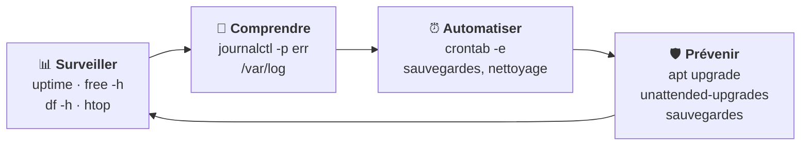

# Module 12 : Maintenance d'un système en production

*Cours : [Cours 4 - Administration d'une distribution GNU/Linux](../index.md)*

## 🎯 Objectif du module

- **Surveiller** un serveur : processeur, mémoire, disque, processus.
- **Lire les journaux** (`journalctl`, `/var/log`).
- **Planifier** des tâches automatiques avec **`cron`**.
- Garder le serveur **à jour** et **sauvegardé**.

!!! abstract "En clair"
    Un serveur « **en production** » est un serveur **utilisé pour de vrai** : s'il s'arrête, des gens ne peuvent plus travailler. Le travail de l'administrateur, c'est de **surveiller** (tout va bien ?), **comprendre** (que s'est-il passé ?), **automatiser** (les tâches répétitives) et **prévenir** (mises à jour, sauvegardes).

## 🖼️ Résumé visuel

**La routine de l'administrateur**



## 📖 Cours consolidé

### 1. Surveiller le serveur

| Question | Commande | À regarder |
|---|---|---|
| Est-il chargé ? | **`uptime`** | La **charge** sur 1, 5, 15 min : au-dessus du **nombre de processeurs** (`nproc`) = surchargé |
| Reste-t-il de la **RAM** ? | **`free -h`** | La colonne **`available`** ; **swap** très utilisée = RAM insuffisante |
| De la place **disque** ? | **`df -h`** | Plus de **90 %** = urgent |
| **Qui** consomme ? | **`htop`** / `top` | Haut de la liste (CPU %, MEM %) |
| Des services **plantés** ? | **`systemctl --failed`** | Rien = tout va bien |

```text
$ uptime
 10:42:13 up 37 days,  2:11,  2 users,  load average: 0,35, 0,41, 0,38   ← 1 · 5 · 15 min : faible ✅
$ free -h
               total   used   free   shared  buff/cache   available
Mem:           3,8Gi  1,2Gi  0,4Gi    12Mi       2,2Gi       2,4Gi      ← 2,4 Go disponibles ✅
```

- 💡 `free` bas ? Normal : la RAM libre sert de **cache** et est rendue à la demande. Regarde **`available`**.
- Processus bloqué : `ps aux | grep nom` puis `kill PID` (`-9` en dernier recours, [cours 3, module 8](../../cours-03-utilisateur-d-une-distribution-gnu-linux/module-8-mecanismes-avances-de-linux-et-bash/index.md)). Pour un **service** : **`systemctl restart`**.

---

### 2. Lire les journaux

**`journalctl`** rassemble les messages de **tous les services** et du **noyau**.

| Je veux… | Commande |
|---|---|
| Les **erreurs** (de ce matin) | **`journalctl -p err`** (`--since today`) |
| Un **service** | **`journalctl -u ssh`** |
| **En direct** | **`journalctl -f`** |
| Depuis le **démarrage** · une **période** | `journalctl -b` · `--since "2026-10-21 08:00" --until "09:00"` |

| Fichier de `/var/log` | Contient |
|---|---|
| `syslog` (si rsyslog) | Messages généraux |
| **`auth.log`** | **Connexions**, `sudo`, échecs de mot de passe |
| `apt/history.log` | Installations et mises à jour |
| `apache2/` | Serveur web |

💡 **`logrotate`** archive et compresse les vieux journaux (`syslog.1`, `syslog.2.gz`) pour qu'ils ne remplissent pas le disque.

---

### 3. Planifier des tâches : `cron`

```bash
crontab -e          # modifier MES tâches (sudo crontab -e pour root) · crontab -l pour les voir
```

```text
# min  heure  jour-du-mois  mois  jour-de-la-semaine   commande
  30   2      *             *     *                    /usr/local/bin/sauvegarde.sh   ← chaque jour à 2 h 30
```

Champs : **minute** (0-59) · **heure** (0-23) · **jour du mois** (1-31) · **mois** (1-12) · **jour de la semaine** (0-7, **0 et 7 = dimanche**). **`*`** = tous.

| Exemple | Signifie |
|---|---|
| `0 * * * *` | Toutes les heures pile |
| `*/15 * * * *` | Toutes les **15 minutes** |
| `0 8 * * 1-5` | À **8 h**, du **lundi au vendredi** |
| `0 3 1 * *` | Le **1ᵉʳ du mois** à 3 h |
| `@reboot` | **Au démarrage** |

- ⚠️ **Chemins complets** dans cron (`/usr/bin/tar`) : cron n'a pas ton `$PATH`.
- 💡 Une seule fois : `at 22:00` · alternative moderne : les **timers systemd** (`systemctl list-timers`).

---

### 4. Prévenir : mises à jour et sauvegardes

| Mise à jour | Comment |
|---|---|
| Régulière | `sudo apt update && sudo apt upgrade` ([module 6](../module-6-gestion-des-paquets-logiciels/index.md)) |
| **Sécurité automatique** ✅ | `sudo apt install unattended-upgrades` puis `sudo dpkg-reconfigure -plow unattended-upgrades` |
| Redémarrage nécessaire ? | Le fichier `/var/run/reboot-required` existe |

```bash
sudo tar -czf /backup/etc-$(date +%Y%m%d).tar.gz /etc          # archive datée de la configuration
rsync -av /srv/compta/ tech@srv-backup:/backup/compta/          # copie vers un autre serveur (seulement ce qui a changé)
```

📌 **Règle 3-2-1** ([cours 15](../../cours-15-sauvegarde-et-restauration/index.md)) : **3** copies, **2** supports, **1** hors site. Et une sauvegarde **jamais restaurée** ne compte pas : **teste les restaurations**.

## 📝 Fiche de révision

| Commande | Rôle |
|---|---|
| `uptime` | Durée de fonctionnement + charge |
| `free -h` | Mémoire (colonne available) |
| `df -h` | Disques |
| `htop` / `top` | Processus en direct |
| `systemctl --failed` | Services en échec |
| `journalctl -p err --since today` | Erreurs du jour |
| `journalctl -u ssh -f` | Un service, en direct |
| `/var/log/auth.log` | Connexions, sudo |
| `crontab -e` / `-l` | Modifier / voir les tâches planifiées |
| `unattended-upgrades` | Correctifs de sécurité automatiques |
| `tar -czf` / `rsync -av` | Archiver / synchroniser |

| Ligne cron | Quand ? |
|---|---|
| `30 2 * * *` | Tous les jours à 2 h 30 |
| `*/10 * * * *` | Toutes les 10 min |
| `0 8 * * 1-5` | 8 h en semaine |
| `0 0 1 * *` | Le 1ᵉʳ du mois à minuit |

**⚠️ Les pièges**

- Regarder la colonne `free` au lieu de **`available`** dans `free -h`.
- Dans cron, le **dimanche** = 0 **ou** 7 ; les **chemins** doivent être **complets**.
- Une sauvegarde **jamais testée** n'est pas une sauvegarde.

??? question "1. Écris la ligne cron qui lance /usr/local/bin/backup.sh chaque nuit à 1 h 15."
    `15 1 * * * /usr/local/bin/backup.sh`

??? question "2. Et chaque lundi à 7 h ?"
    `0 7 * * 1 /usr/local/bin/backup.sh`

??? question "3. Des utilisateurs se plaignent ce matin. Quelles commandes lances-tu en premier ?"
    `uptime` (charge), `free -h` (mémoire), `df -h` (disques), `systemctl --failed` (services), puis `journalctl -p err --since today` (erreurs du jour).

??? question "4. Comment savoir qui a tenté de se connecter au serveur en SSH ?"
    `sudo less /var/log/auth.log` (ou `journalctl -u ssh`) : on y voit les connexions réussies et les « Failed password ».

## 🧠 Quiz — entraîne-toi

<div id="quiz-cours-04-administration-d-une-distribution-gnu-linux-module-12-maintenance-d-un-systeme-en-production"></div>

<script type="application/json" id="quiz-cours-04-administration-d-une-distribution-gnu-linux-module-12-maintenance-d-un-systeme-en-production-data">
[
  {
    "question": "Dans free -h, quelle colonne indique la mémoire réellement disponible pour les programmes ?",
    "options": [
      "free",
      "used",
      "available",
      "shared"
    ],
    "correctIndex": 2,
    "explanation": "Linux utilise la RAM libre comme cache (buff/cache) et la rend à la demande : c'est available qui indique ce que les programmes peuvent encore utiliser."
  },
  {
    "question": "Que mesure la « load average » affichée par uptime ?",
    "options": [
      "La place disque",
      "La charge du processeur sur 1, 5 et 15 minutes",
      "Le nombre d'utilisateurs",
      "La température"
    ],
    "correctIndex": 1,
    "explanation": "La charge moyenne indique combien de tâches attendent le processeur. Au-dessus du nombre de processeurs (nproc), le serveur est surchargé."
  },
  {
    "question": "Quelle commande affiche uniquement les erreurs du journal système ?",
    "options": [
      "journalctl -p err",
      "journalctl -u err",
      "cat /var/err",
      "dmesg -f"
    ],
    "correctIndex": 0,
    "explanation": "-p (priority) err filtre les messages de priorité « erreur » ou plus grave. --since today limite à la journée."
  },
  {
    "question": "Quel fichier contient les connexions et l'usage de sudo ?",
    "options": [
      "/var/log/apt/history.log",
      "/var/log/auth.log",
      "/etc/passwd",
      "/var/log/boot"
    ],
    "correctIndex": 1,
    "explanation": "auth.log enregistre l'authentification : connexions SSH, échecs de mot de passe, utilisation de sudo."
  },
  {
    "question": "À quoi sert logrotate ?",
    "options": [
      "À faire tourner les services",
      "À archiver et compresser les vieux journaux pour ne pas remplir le disque",
      "À redémarrer le serveur",
      "À planifier des tâches"
    ],
    "correctIndex": 1,
    "explanation": "logrotate renomme, compresse et supprime les anciens journaux selon des règles, pour éviter qu'ils remplissent le disque."
  },
  {
    "question": "Quelle commande modifie ses tâches planifiées cron ?",
    "options": [
      "cron -edit",
      "crontab -e",
      "at -e",
      "systemctl cron"
    ],
    "correctIndex": 1,
    "explanation": "crontab -e ouvre la liste des tâches planifiées de l'utilisateur dans un éditeur ; crontab -l l'affiche."
  },
  {
    "question": "Que signifie la ligne cron « 30 2 * * * commande » ?",
    "options": [
      "Toutes les 30 minutes",
      "Tous les jours à 2 h 30",
      "Le 30 février",
      "Toutes les 2 heures"
    ],
    "correctIndex": 1,
    "explanation": "Les champs sont : minute (30), heure (2), jour du mois (*), mois (*), jour de la semaine (*). Donc chaque jour à 2 h 30."
  },
  {
    "question": "Que signifie « */15 * * * * » dans cron ?",
    "options": [
      "Le 15 de chaque mois",
      "Toutes les 15 minutes",
      "À 15 h chaque jour",
      "15 fois par jour"
    ],
    "correctIndex": 1,
    "explanation": "*/15 dans le champ minutes signifie « toutes les 15 minutes »."
  },
  {
    "question": "Quel paquet installe automatiquement les correctifs de sécurité ?",
    "options": [
      "cron-security",
      "unattended-upgrades",
      "apt-auto",
      "logrotate"
    ],
    "correctIndex": 1,
    "explanation": "unattended-upgrades installe automatiquement les mises à jour de sécurité, sans intervention de l'administrateur."
  },
  {
    "question": "Quelle est la règle 3-2-1 des sauvegardes ?",
    "options": [
      "3 sauvegardes par jour pendant 2 semaines, 1 restauration",
      "3 copies, sur 2 supports différents, dont 1 hors site",
      "3 disques, 2 serveurs, 1 administrateur",
      "Sauvegarder 3 fois en 2 minutes"
    ],
    "correctIndex": 1,
    "explanation": "3 copies des données, sur 2 types de supports différents, dont 1 stockée ailleurs : ainsi un incendie ou une panne ne détruit pas tout."
  },
  {
    "question": "Un programme bloqué ne répond plus. Quelle commande essaies-tu en premier ?",
    "options": [
      "kill -9 PID",
      "kill PID",
      "reboot",
      "rm -rf /proc/PID"
    ],
    "correctIndex": 1,
    "explanation": "kill PID demande poliment l'arrêt (le programme peut se fermer proprement). kill -9 force l'arrêt : c'est le dernier recours."
  },
  {
    "question": "Quelle commande suit le journal système en direct ?",
    "options": [
      "journalctl -f",
      "journalctl -b",
      "cat /var/log",
      "tail journalctl"
    ],
    "correctIndex": 0,
    "explanation": "-f (follow) affiche les nouveaux messages au fur et à mesure ; Ctrl + C pour arrêter."
  },
  {
    "question": "Quelle commande affiche les erreurs du journal depuis ce matin ?",
    "options": [
      "journalctl --errors",
      "journalctl -p err --since today",
      "grep err /etc",
      "journalctl -u today"
    ],
    "correctIndex": 1,
    "explanation": "-p err filtre par priorité (erreurs et plus grave) et --since today limite à aujourd'hui."
  },
  {
    "question": "Quelle commande affiche tes tâches cron sans les modifier ?",
    "options": [
      "crontab -e",
      "crontab -r",
      "crontab -l",
      "cron --show"
    ],
    "correctIndex": 2,
    "explanation": "-l liste, -e modifie. Attention : -r supprime toute ta crontab sans confirmation."
  },
  {
    "question": "Dans une crontab, que fait la ligne « @reboot /usr/local/bin/demarrage.sh » ?",
    "options": [
      "Elle redémarre le serveur chaque jour",
      "Elle lance le script à chaque démarrage du serveur",
      "Elle désactive cron",
      "Elle lance le script toutes les minutes"
    ],
    "correctIndex": 1,
    "explanation": "@reboot exécute la commande une fois, au démarrage du serveur."
  }
]
</script>

<script>
  document.addEventListener("DOMContentLoaded", function () {
    TSSRQuiz.init({
      containerId: "quiz-cours-04-administration-d-une-distribution-gnu-linux-module-12-maintenance-d-un-systeme-en-production",
      dataId: "quiz-cours-04-administration-d-une-distribution-gnu-linux-module-12-maintenance-d-un-systeme-en-production-data",
    });
  });
</script>
