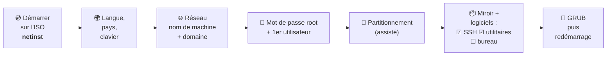

# Module 2 : Installation d'une distribution Debian

*Cours : [Cours 4 - Administration d'une distribution GNU/Linux](../index.md)*

## 🎯 Objectif du module

- Préparer une **machine virtuelle** et l'**image ISO** de Debian.
- Dérouler l'**installateur** étape par étape, en faisant les bons choix pour un **serveur**.
- Faire les **premières actions** après l'installation.

!!! abstract "En clair"
    On installe Debian comme Windows ([cours 2, module 2](../../cours-02-systeme-client-microsoft/module-2-installation-de-windows-10/index.md)) : on démarre sur une **ISO**, un assistant pose des questions, puis on redémarre. La différence : pour un **serveur**, on n'installe **pas d'interface graphique**, seulement le strict nécessaire et le **serveur SSH** pour l'administrer à distance.

## 🖼️ Résumé visuel

**Les étapes de l'installateur Debian**



## 📖 Cours consolidé

### 1. Avant d'installer

| Élément | Choix pour un serveur de TP |
|---|---|
| **Image** | **`debian-13.x-amd64-netinst.iso`** (~ 700 Mo) sur **debian.org** : l'installateur télécharge le reste sur Internet |
| **Machine virtuelle** | 1 à 2 processeurs, **2 Go** de RAM, disque de **20 Go**, réseau **NAT** ou **Bridge** ([cours 2, module 2bis](../../cours-02-systeme-client-microsoft/module-2bis-vmware-workstation/index.md)) |
| **Prérequis minimum** | 1 Go de RAM et 10 Go de disque sans interface graphique |

💡 **netinst** = petite image qui installe par le réseau. Il existe aussi les **DVD complets** (sans Internet) et les images **« live »** (pour essayer sans installer).

---

### 2. L'installation, étape par étape

| # | Écran | Ton choix (et pourquoi) |
|---|---|---|
| ① | Menu de démarrage | **Install** (en mode texte, plus léger) ou *Graphical install* |
| ② | Langue / pays / clavier | Français · France · Français |
| ③ | **Nom de machine** | Un nom clair : `srv-web01` |
| ④ | **Nom de domaine** | `entreprise.local` (ou vide en TP) |
| ⑤ | **Mot de passe root** | Un mot de passe **fort**. 💡 Si tu le laisses **vide**, root est **désactivé** et ton 1ᵉʳ utilisateur reçoit **`sudo`** automatiquement |
| ⑥ | **Utilisateur** | Ton nom, identifiant (`tech`) et mot de passe |
| ⑦ | Fuseau horaire | Europe/Paris (choisi d'après le pays) |
| ⑧ | **Partitionnement** | **Assisté – utiliser un disque entier** → *Tout dans une seule partition* (débutant) ; ou *avec LVM* (plus souple, module 8) |
| ⑨ | Miroir | France → **`deb.debian.org`** |
| ⑩ | **Sélection des logiciels** | ☐ Environnement de bureau · ☐ GNOME · ☑ **Serveur SSH** · ☑ **Utilitaires usuels du système** |
| ⑪ | **GRUB** | **Oui**, sur le disque principal (`/dev/sda`) : c'est le programme qui démarre Linux (module 3) |
| ⑫ | Fin | Retirer l'ISO → **Continuer** → redémarrage |

⚠️ À l'étape ⑩, **décoche le bureau** : un serveur n'a pas besoin d'interface graphique. C'est plus léger, plus rapide, et plus sûr (moins de logiciels = moins de failles).

---

### 3. Après l'installation : les premiers réflexes

```bash
ip a                          # 1. noter l'adresse IP du serveur
su -                          # 2. devenir root (si root a un mot de passe)
apt update && apt upgrade     # 3. mettre le système à jour (module 6)
apt install sudo              # 4. installer sudo s'il n'y est pas…
usermod -aG sudo tech         #    …et autoriser l'utilisateur « tech » à l'utiliser
exit                          #    (tech doit se reconnecter pour que ce soit pris en compte)
```

Ensuite, **tout se fait à distance** depuis ton PC : `ssh tech@IP-du-serveur` ([cours 3, module 2](../../cours-03-utilisateur-d-une-distribution-gnu-linux/module-2-decouverte-du-systeme-d-exploitation-linux/index.md)).

💡 **Dans une VM VMware** : `apt install open-vm-tools` améliore l'intégration (l'équivalent des VMware Tools).

## ✅ Points clés à retenir

- Image **netinst** (petite, installe par le réseau) ; VM avec **2 Go de RAM** et **20 Go** suffit.
- Choix clés : **nom de machine**, mot de passe **root** (vide = root désactivé + `sudo` pour le 1ᵉʳ utilisateur), **utilisateur**, partitionnement **assisté**.
- Logiciels pour un serveur : ☑ **SSH** ☑ **utilitaires usuels** ☐ **pas de bureau**.
- **GRUB** sur le disque principal.
- Après l'installation : `ip a`, **`apt update && apt upgrade`**, `sudo` (`usermod -aG sudo utilisateur`), puis administration en **SSH**.

## 📝 Fiche de révision

| Étape | À retenir |
|---|---|
| **ISO** | `debian-13-amd64-netinst.iso` |
| **Nom de machine** | Nom clair : `srv-web01` |
| **root vide** | root désactivé, 1ᵉʳ utilisateur dans le groupe `sudo` |
| **Partitionnement** | Assisté, disque entier (LVM en option) |
| **Logiciels serveur** | SSH + utilitaires usuels, **sans bureau** |
| **GRUB** | Chargeur de démarrage, sur `/dev/sda` |
| **Après** | `apt update && apt upgrade`, `sudo`, SSH |

**⚠️ Les pièges**

- Oublier de **cocher le serveur SSH** → impossible d'administrer à distance (`apt install openssh-server` pour rattraper).
- Laisser le **bureau** coché sur un serveur.
- Après `usermod -aG sudo`, il faut **se reconnecter**.

??? question "1. Quels logiciels cocher à l'installation d'un serveur ?"
    **Serveur SSH** et **utilitaires usuels du système**, sans environnement de bureau.

??? question "2. Tu as oublié de cocher SSH. Comment rattraper ?"
    Sur la console du serveur, en root : `apt install openssh-server`. Le service démarre tout seul.

??? question "3. L'utilisateur tech ne peut pas utiliser sudo. Que faire ?"
    En root : `usermod -aG sudo tech`, puis tech **se déconnecte et se reconnecte**.

## 🧠 Quiz — entraîne-toi

<div id="quiz-cours-04-administration-d-une-distribution-gnu-linux-module-2-installation-d-une-distribution-debian"></div>

<script type="application/json" id="quiz-cours-04-administration-d-une-distribution-gnu-linux-module-2-installation-d-une-distribution-debian-data">
[
  {
    "question": "Qu'est-ce qu'une image « netinst » de Debian ?",
    "options": [
      "Une image qui installe Windows",
      "Une petite image qui télécharge le reste du système par le réseau pendant l'installation",
      "Une image sans noyau",
      "Une sauvegarde complète d'un serveur"
    ],
    "correctIndex": 1,
    "explanation": "netinst (network install) contient le minimum pour démarrer l'installateur ; les paquets sont ensuite téléchargés depuis un miroir Debian."
  },
  {
    "question": "Que se passe-t-il si on laisse le mot de passe root vide à l'installation ?",
    "options": [
      "L'installation échoue",
      "root est désactivé et le premier utilisateur peut utiliser sudo",
      "root n'a pas de mot de passe et tout le monde peut se connecter",
      "Le serveur redémarre"
    ],
    "correctIndex": 1,
    "explanation": "Avec un mot de passe root vide, Debian désactive le compte root et ajoute le premier utilisateur au groupe sudo."
  },
  {
    "question": "Quels logiciels cocher pour un serveur ?",
    "options": [
      "Bureau GNOME uniquement",
      "Serveur SSH et utilitaires usuels, sans environnement de bureau",
      "Tous les logiciels",
      "Aucun"
    ],
    "correctIndex": 1,
    "explanation": "Un serveur s'administre à distance en SSH et n'a pas besoin d'interface graphique : moins de logiciels, c'est plus léger et plus sûr."
  },
  {
    "question": "À quoi sert GRUB, installé à la fin ?",
    "options": [
      "À gérer les utilisateurs",
      "À démarrer le système (chargeur de démarrage)",
      "À configurer le réseau",
      "À installer des paquets"
    ],
    "correctIndex": 1,
    "explanation": "GRUB est le chargeur de démarrage : il démarre le noyau Linux quand la machine s'allume (détails au module 3)."
  },
  {
    "question": "Quelle est la première commande à lancer après l'installation pour mettre le système à jour ?",
    "options": [
      "apt update && apt upgrade",
      "ipconfig /all",
      "sudo reboot now",
      "dpkg -l"
    ],
    "correctIndex": 0,
    "explanation": "apt update télécharge la liste des mises à jour, puis apt upgrade les installe (détails au module 6)."
  },
  {
    "question": "Comment autoriser l'utilisateur tech à utiliser sudo ?",
    "options": [
      "chmod +s tech",
      "usermod -aG sudo tech",
      "sudo add tech",
      "passwd sudo tech"
    ],
    "correctIndex": 1,
    "explanation": "usermod -aG sudo tech ajoute (-a) tech au groupe (-G) sudo. tech doit ensuite se reconnecter."
  },
  {
    "question": "Quelle commande installe le serveur SSH si on a oublié de le cocher ?",
    "options": [
      "apt install ssh-client",
      "apt install openssh-server",
      "systemctl ssh",
      "ssh --install"
    ],
    "correctIndex": 1,
    "explanation": "Le paquet openssh-server fournit le service SSH qui permet de se connecter à distance au serveur."
  }
]
</script>

<script>
  document.addEventListener("DOMContentLoaded", function () {
    TSSRQuiz.init({
      containerId: "quiz-cours-04-administration-d-une-distribution-gnu-linux-module-2-installation-d-une-distribution-debian",
      dataId: "quiz-cours-04-administration-d-une-distribution-gnu-linux-module-2-installation-d-une-distribution-debian-data",
    });
  });
</script>
