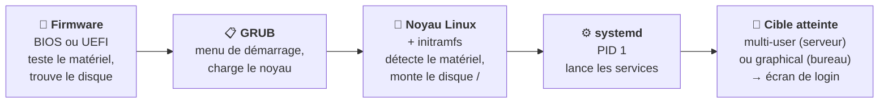

# Module 3 : Démarrage d'une distribution Debian

*Cours : [Cours 4 - Administration d'une distribution GNU/Linux](../index.md)*

## 🎯 Objectif du module

- Comprendre les **étapes du démarrage** : firmware → GRUB → noyau → systemd.
- Gérer les **services** avec **`systemctl`** (démarrer, arrêter, activer au démarrage).
- Connaître les **cibles** (*targets*) et savoir **arrêter / redémarrer** proprement.

!!! abstract "En clair"
    Quand tu appuies sur le bouton, plusieurs programmes se passent le relais, comme dans une course de relais. Le dernier, **systemd**, lance tous les **services** : le réseau, SSH, le serveur web… Un **service** est un programme qui tourne **en arrière-plan**, sans fenêtre (on dit aussi « démon », *daemon*).

## 🖼️ Résumé visuel

**La course de relais du démarrage**



## 📖 Cours consolidé

### 1. Les étapes du démarrage

| Étape | Qui ? | Rôle |
|---|---|---|
| ① | **Firmware** (BIOS ou UEFI) | Teste le matériel, trouve le disque de démarrage |
| ② | **GRUB** | Affiche le **menu** (quelques secondes), charge le **noyau** choisi. Sa configuration : `/etc/default/grub` (puis `update-grub`) |
| ③ | **Noyau** (`/boot/vmlinuz-…`) + **initramfs** | Le noyau démarre, détecte le matériel ; l'initramfs est un mini-système qui l'aide à trouver le disque principal |
| ④ | **systemd** | Premier programme lancé : **PID 1** (le n° 1 des processus). Il démarre **tous les services** |
| ⑤ | **Écran de connexion** | `login:` sur un serveur |

💡 Voir le **déroulement du dernier démarrage** : `journalctl -b`. Combien de temps il a pris : `systemd-analyze`.

---

### 2. Gérer les services avec `systemctl`

| Je veux… | Commande | Exemple |
|---|---|---|
| Voir l'**état** | `systemctl status service` | `systemctl status ssh` |
| **Démarrer** maintenant | `systemctl start service` | `systemctl start apache2` |
| **Arrêter** maintenant | `systemctl stop service` | |
| **Redémarrer** | `systemctl restart service` | Après avoir modifié sa configuration |
| **Recharger** la configuration sans couper | `systemctl reload service` | |
| **Activer au démarrage** | `systemctl enable service` | Il démarrera à chaque allumage |
| **Désactiver** au démarrage | `systemctl disable service` | |
| Les deux d'un coup | `systemctl enable --now service` | Activer **et** démarrer |
| Lister les services | `systemctl list-units --type=service` | |
| Les services **en échec** | `systemctl --failed` | |

⚠️ **`start` ≠ `enable`** : **`start`** démarre **maintenant** ; **`enable`** fait démarrer **au prochain allumage**. Pour un nouveau service : `enable --now`.

**Lire un `systemctl status`**

```text
● ssh.service - OpenBSD Secure Shell server
     Loaded: loaded (/lib/systemd/system/ssh.service; enabled; ...)   ← enabled = démarre à l'allumage
     Active: active (running) since mar. 2026-10-21 08:02:11 CEST     ← active (running) = il tourne ✅
   Main PID: 612 (sshd)
oct. 21 08:02:11 srv-web01 sshd[612]: Server listening on 0.0.0.0 port 22.   ← ses derniers messages
```

| État `Active:` | Signifie |
|---|---|
| **active (running)** | ✅ Il tourne |
| **inactive (dead)** | Arrêté |
| **failed** | ❌ Il a **planté** → lire les messages en bas, ou `journalctl -u service` |

📌 Toutes ces commandes qui **modifient** quelque chose se lancent avec **`sudo`**.

---

### 3. Les cibles (*targets*)

Une **cible** est un **état** du système, défini par la liste des services à démarrer.

| Cible | État | Ancien « niveau » |
|---|---|---|
| `poweroff.target` | Éteint | 0 |
| `rescue.target` | **Mode secours** : root seul, réseau coupé (module 4) | 1 |
| **`multi-user.target`** | **Serveur** : multi-utilisateur, réseau, **sans** interface graphique | 3 |
| `graphical.target` | **Poste de travail** : avec interface graphique | 5 |
| `reboot.target` | Redémarrage | 6 |

```bash
systemctl get-default                          # cible utilisée au démarrage
sudo systemctl set-default multi-user.target   # démarrer sans interface graphique
```

---

### 4. Arrêter et redémarrer

| Commande | Effet |
|---|---|
| **`sudo systemctl reboot`** (ou `sudo reboot`) | Redémarrer |
| **`sudo systemctl poweroff`** (ou `sudo poweroff`) | Éteindre |
| `sudo shutdown -h +10` | Éteindre **dans 10 minutes** (prévient les utilisateurs connectés) |
| `sudo shutdown -r 22:00` | Redémarrer **à 22 h** |
| `sudo shutdown -c` | **Annuler** un arrêt programmé |

⚠️ **Ne jamais couper le courant** d'un serveur : un arrêt propre laisse les services enregistrer leurs données.

## ✅ Points clés à retenir

- Démarrage : **firmware (BIOS/UEFI) → GRUB → noyau + initramfs → systemd (PID 1) → services → login**.
- Un **service** (démon) tourne en arrière-plan ; on le gère avec **`systemctl`** : `status`, `start`, `stop`, `restart`, **`enable`**, `disable`, `enable --now`.
- **`start`** = maintenant ; **`enable`** = à chaque démarrage.
- `Active: active (running)` ✅ · `failed` ❌ → **`journalctl -u service`**.
- Cibles : **`multi-user.target`** (serveur) · `graphical.target` (bureau) · `rescue.target` (secours).
- Arrêt : **`systemctl reboot`** / **`poweroff`**, ou **`shutdown`** programmé.

## 📝 Fiche de révision

| Commande | Rôle |
|---|---|
| `systemctl status ssh` | État d'un service |
| `systemctl start` / `stop` / `restart` | Agir maintenant |
| `systemctl enable` / `disable` | Au démarrage |
| `systemctl enable --now` | Activer + démarrer |
| `systemctl --failed` | Services en échec |
| `journalctl -u ssh` | Journal d'un service |
| `journalctl -b` | Journal du dernier démarrage |
| `systemctl get-default` / `set-default` | Cible de démarrage |
| `shutdown -r +5` / `shutdown -c` | Redémarrage programmé / annuler |

**⚠️ Les pièges**

- `start` sans `enable` → le service **ne redémarre pas** après un reboot.
- Modifier la configuration d'un service **sans le redémarrer** → la modification n'est pas prise en compte.
- `systemctl` modifie le système → **`sudo`**.

??? question "1. Tu installes Apache. Comment le démarrer tout de suite ET à chaque démarrage ?"
    `sudo systemctl enable --now apache2`

??? question "2. Un service affiche « failed ». Que fais-tu ?"
    Lire les messages : `systemctl status service` (dernières lignes), puis `journalctl -u service` pour le détail. Corriger, puis `sudo systemctl restart service`.

??? question "3. Programme un redémarrage dans 15 minutes, puis annule-le."
    `sudo shutdown -r +15`, puis `sudo shutdown -c`.

## 🧠 Quiz — entraîne-toi

<div id="quiz-cours-04-administration-d-une-distribution-gnu-linux-module-3-demarrage-d-une-distribution-debian"></div>

<script type="application/json" id="quiz-cours-04-administration-d-une-distribution-gnu-linux-module-3-demarrage-d-une-distribution-debian-data">
[
  {
    "question": "Dans quel ordre se déroule le démarrage ?",
    "options": [
      "systemd → GRUB → noyau → firmware",
      "Firmware (BIOS/UEFI) → GRUB → noyau → systemd",
      "GRUB → firmware → systemd → noyau",
      "Noyau → firmware → GRUB → systemd"
    ],
    "correctIndex": 1,
    "explanation": "Le firmware trouve le disque, GRUB charge le noyau, le noyau démarre puis lance systemd, qui démarre les services."
  },
  {
    "question": "Quel est le PID (numéro de processus) de systemd ?",
    "options": [
      "0",
      "1",
      "100",
      "Il change à chaque démarrage"
    ],
    "correctIndex": 1,
    "explanation": "systemd est le premier programme lancé par le noyau : il a toujours le PID 1, et c'est lui qui démarre tous les autres services."
  },
  {
    "question": "Quelle commande affiche l'état du service ssh ?",
    "options": [
      "service ssh",
      "systemctl status ssh",
      "ssh --status",
      "ps ssh"
    ],
    "correctIndex": 1,
    "explanation": "systemctl status affiche si le service tourne, s'il démarre au boot, et ses derniers messages."
  },
  {
    "question": "Quelle est la différence entre systemctl start et systemctl enable ?",
    "options": [
      "Aucune",
      "start démarre maintenant ; enable fait démarrer le service à chaque allumage",
      "start démarre au prochain allumage ; enable démarre maintenant",
      "enable supprime le service"
    ],
    "correctIndex": 1,
    "explanation": "start agit tout de suite mais ne survit pas à un redémarrage ; enable programme le démarrage automatique. enable --now fait les deux."
  },
  {
    "question": "Que signifie « Active: failed » dans systemctl status ?",
    "options": [
      "Le service tourne",
      "Le service a planté",
      "Le service est désactivé au démarrage",
      "Le service se met à jour"
    ],
    "correctIndex": 1,
    "explanation": "failed indique un échec. On lit les messages en bas du status, ou journalctl -u service pour comprendre pourquoi."
  },
  {
    "question": "Quelle cible correspond à un serveur sans interface graphique ?",
    "options": [
      "graphical.target",
      "rescue.target",
      "multi-user.target",
      "poweroff.target"
    ],
    "correctIndex": 2,
    "explanation": "multi-user.target démarre le réseau et les services sans interface graphique : c'est la cible normale d'un serveur."
  },
  {
    "question": "Quelle commande affiche le journal d'un service précis ?",
    "options": [
      "journalctl -u nom_du_service",
      "cat /var/service",
      "systemctl log",
      "dmesg -u"
    ],
    "correctIndex": 0,
    "explanation": "journalctl -u (unit) filtre le journal de systemd sur un service. journalctl -b affiche tout le dernier démarrage."
  },
  {
    "question": "Comment redémarrer le serveur dans 10 minutes ?",
    "options": [
      "reboot 10",
      "sudo shutdown -r +10",
      "systemctl reboot --10",
      "sleep 10 reboot"
    ],
    "correctIndex": 1,
    "explanation": "shutdown -r (reboot) +10 programme un redémarrage dans 10 minutes et prévient les utilisateurs. shutdown -c l'annule."
  }
]
</script>

<script>
  document.addEventListener("DOMContentLoaded", function () {
    TSSRQuiz.init({
      containerId: "quiz-cours-04-administration-d-une-distribution-gnu-linux-module-3-demarrage-d-une-distribution-debian",
      dataId: "quiz-cours-04-administration-d-une-distribution-gnu-linux-module-3-demarrage-d-une-distribution-debian-data",
    });
  });
</script>
