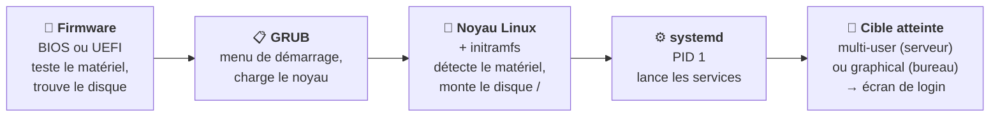

# Module 3 : Démarrage d'une distribution Debian

*Cours : [Cours 4 - Administration d'une distribution GNU/Linux](../index.md)*

## 🎯 Objectif du module

- Comprendre les **étapes du démarrage** : firmware → GRUB → noyau → systemd.
- Gérer les **services** avec **`systemctl`** (démarrer, arrêter, activer au démarrage).
- Connaître les **cibles** (*targets*) et savoir **arrêter / redémarrer** proprement.

!!! abstract "En clair"
    Quand tu appuies sur le bouton, plusieurs programmes se passent le relais, comme dans une course de relais. Le dernier, **systemd**, lance tous les **services** : le réseau, SSH, le serveur web… Un **service** est un programme qui tourne **en arrière-plan**, sans fenêtre (on dit aussi « démon », *daemon*).

## 🖼️ Résumé visuel

**La course de relais du démarrage**



## 📖 Cours consolidé

### 1. Les étapes du démarrage

| Étape | Qui ? | Rôle |
|---|---|---|
| ① | **Firmware** (BIOS / UEFI) | Teste le matériel, trouve le disque de démarrage |
| ② | **GRUB** | **Menu** de démarrage, charge le **noyau** (config : `/etc/default/grub`, puis `update-grub`) |
| ③ | **Noyau** + **initramfs** | Le noyau détecte le matériel ; l'initramfs l'aide à trouver le disque |
| ④ | **systemd** | **PID 1** : démarre **tous les services** |
| ⑤ | Connexion | `login:` |

💡 `journalctl -b` = le **dernier démarrage** · `systemd-analyze` = sa **durée**.

---

### 2. Gérer les services avec `systemctl`

| Je veux… | Commande |
|---|---|
| Voir l'**état** | `systemctl status ssh` |
| **Démarrer** / **arrêter** / **redémarrer** maintenant | `systemctl start` / `stop` / `restart apache2` |
| **Recharger** la config sans couper | `systemctl reload service` |
| **Activer** / **désactiver** au démarrage | `systemctl enable` / `disable service` |
| Activer **et** démarrer | `systemctl enable --now service` |
| Lister · voir les **échecs** | `systemctl list-units --type=service` · `systemctl --failed` |

⚠️ **`start` ≠ `enable`** : `start` = **maintenant** ; `enable` = **au prochain allumage**. Nouveau service : **`enable --now`**. Ce qui **modifie** se lance avec **`sudo`**.

```text
● ssh.service - OpenBSD Secure Shell server
     Loaded: loaded (/lib/systemd/system/ssh.service; enabled; ...)   ← enabled = démarre à l'allumage
     Active: active (running) since mar. 2026-10-21 08:02:11 CEST     ← il tourne ✅
oct. 21 08:02:11 srv-web01 sshd[612]: Server listening on 0.0.0.0 port 22.   ← derniers messages
```

`Active:` **active (running)** ✅ tourne · **inactive (dead)** arrêté · **failed** ❌ a **planté** → lire les messages ou `journalctl -u service`.

---

### 3. Les cibles (*targets*)

Un **état** du système = la liste des services à démarrer.

| Cible | État | Ancien niveau |
|---|---|---|
| `rescue.target` | **Secours** : root seul, sans réseau ([module 4](../module-4-debian-en-mode-maintenance/index.md)) | 1 |
| **`multi-user.target`** | **Serveur** : réseau, **sans** interface graphique | 3 |
| `graphical.target` | **Poste de travail** | 5 |
| `poweroff` / `reboot.target` | Éteint / redémarrage | 0 / 6 |

```bash
systemctl get-default                          # cible au démarrage
sudo systemctl set-default multi-user.target   # démarrer sans interface graphique
```

---

### 4. Arrêter et redémarrer

| Commande | Effet |
|---|---|
| **`sudo reboot`** / **`sudo poweroff`** | Redémarrer / éteindre |
| `sudo shutdown -h +10` · `-r 22:00` | Éteindre **dans 10 min** · redémarrer **à 22 h** (les utilisateurs sont prévenus) |
| `sudo shutdown -c` | **Annuler** |

⚠️ **Ne jamais couper le courant** : un arrêt propre laisse les services enregistrer leurs données.

## 📝 Fiche de révision

| Commande | Rôle |
|---|---|
| `systemctl status ssh` | État d'un service |
| `systemctl start` / `stop` / `restart` | Agir maintenant |
| `systemctl enable` / `disable` | Au démarrage |
| `systemctl enable --now` | Activer + démarrer |
| `systemctl --failed` | Services en échec |
| `journalctl -u ssh` | Journal d'un service |
| `journalctl -b` | Journal du dernier démarrage |
| `systemctl get-default` / `set-default` | Cible de démarrage |
| `shutdown -r +5` / `shutdown -c` | Redémarrage programmé / annuler |

**⚠️ Les pièges**

- `start` sans `enable` → le service **ne redémarre pas** après un reboot.
- Modifier la configuration d'un service **sans le redémarrer** → la modification n'est pas prise en compte.
- `systemctl` modifie le système → **`sudo`**.

??? question "1. Tu installes Apache. Comment le démarrer tout de suite ET à chaque démarrage ?"
    `sudo systemctl enable --now apache2`

??? question "2. Un service affiche « failed ». Que fais-tu ?"
    Lire les messages : `systemctl status service` (dernières lignes), puis `journalctl -u service` pour le détail. Corriger, puis `sudo systemctl restart service`.

??? question "3. Programme un redémarrage dans 15 minutes, puis annule-le."
    `sudo shutdown -r +15`, puis `sudo shutdown -c`.

## 🧠 Quiz — entraîne-toi

<div id="quiz-cours-04-administration-d-une-distribution-gnu-linux-module-3-demarrage-d-une-distribution-debian"></div>

<script type="application/json" id="quiz-cours-04-administration-d-une-distribution-gnu-linux-module-3-demarrage-d-une-distribution-debian-data">
[
  {
    "question": "Dans quel ordre se déroule le démarrage ?",
    "options": [
      "systemd → GRUB → noyau → firmware",
      "Firmware (BIOS/UEFI) → GRUB → noyau → systemd",
      "GRUB → firmware → systemd → noyau",
      "Noyau → firmware → GRUB → systemd"
    ],
    "correctIndex": 1,
    "explanation": "Le firmware trouve le disque, GRUB charge le noyau, le noyau démarre puis lance systemd, qui démarre les services."
  },
  {
    "question": "Quel est le PID (numéro de processus) de systemd ?",
    "options": [
      "0",
      "1",
      "100",
      "Il change à chaque démarrage"
    ],
    "correctIndex": 1,
    "explanation": "systemd est le premier programme lancé par le noyau : il a toujours le PID 1, et c'est lui qui démarre tous les autres services."
  },
  {
    "question": "Quelle commande affiche l'état du service ssh ?",
    "options": [
      "service ssh",
      "systemctl status ssh",
      "ssh --status",
      "ps ssh"
    ],
    "correctIndex": 1,
    "explanation": "systemctl status affiche si le service tourne, s'il démarre au boot, et ses derniers messages."
  },
  {
    "question": "Quelle est la différence entre systemctl start et systemctl enable ?",
    "options": [
      "Aucune",
      "start démarre maintenant ; enable fait démarrer le service à chaque allumage",
      "start démarre au prochain allumage ; enable démarre maintenant",
      "enable supprime le service"
    ],
    "correctIndex": 1,
    "explanation": "start agit tout de suite mais ne survit pas à un redémarrage ; enable programme le démarrage automatique. enable --now fait les deux."
  },
  {
    "question": "Que signifie « Active: failed » dans systemctl status ?",
    "options": [
      "Le service tourne",
      "Le service a planté",
      "Le service est désactivé au démarrage",
      "Le service se met à jour"
    ],
    "correctIndex": 1,
    "explanation": "failed indique un échec. On lit les messages en bas du status, ou journalctl -u service pour comprendre pourquoi."
  },
  {
    "question": "Quelle cible correspond à un serveur sans interface graphique ?",
    "options": [
      "graphical.target",
      "rescue.target",
      "multi-user.target",
      "poweroff.target"
    ],
    "correctIndex": 2,
    "explanation": "multi-user.target démarre le réseau et les services sans interface graphique : c'est la cible normale d'un serveur."
  },
  {
    "question": "Quelle commande affiche le journal d'un service précis ?",
    "options": [
      "journalctl -u nom_du_service",
      "cat /var/service",
      "systemctl log",
      "dmesg -u"
    ],
    "correctIndex": 0,
    "explanation": "journalctl -u (unit) filtre le journal de systemd sur un service. journalctl -b affiche tout le dernier démarrage."
  },
  {
    "question": "Comment redémarrer le serveur dans 10 minutes ?",
    "options": [
      "reboot 10",
      "sudo shutdown -r +10",
      "systemctl reboot --10",
      "sleep 10 reboot"
    ],
    "correctIndex": 1,
    "explanation": "shutdown -r (reboot) +10 programme un redémarrage dans 10 minutes et prévient les utilisateurs. shutdown -c l'annule."
  },
  {
    "question": "Quelle commande empêche le service apache2 de se lancer au démarrage, sans l'arrêter maintenant ?",
    "options": [
      "systemctl stop apache2",
      "systemctl disable apache2",
      "systemctl kill apache2",
      "systemctl mask --now apache2"
    ],
    "correctIndex": 1,
    "explanation": "disable agit sur le démarrage automatique. stop agit sur le moment présent. Les deux sont indépendants."
  },
  {
    "question": "Quelle est la différence entre systemctl reload et systemctl restart ?",
    "options": [
      "Aucune",
      "reload relit la configuration sans couper le service ; restart l'arrête puis le relance",
      "reload redémarre le serveur entier",
      "restart ne fonctionne qu'au démarrage"
    ],
    "correctIndex": 1,
    "explanation": "reload applique une nouvelle configuration sans interrompre les connexions en cours (si le service le permet). restart coupe puis relance."
  },
  {
    "question": "Quelle commande liste tous les services en échec ?",
    "options": [
      "systemctl --failed",
      "systemctl list-errors",
      "journalctl --failed",
      "service --all"
    ],
    "correctIndex": 0,
    "explanation": "systemctl --failed affiche les unités en état « failed ». C'est un bon réflexe après un redémarrage."
  },
  {
    "question": "Que fait systemctl enable --now ssh ?",
    "options": [
      "Il désactive SSH",
      "Il active SSH au démarrage ET le démarre tout de suite",
      "Il affiche le statut de SSH",
      "Il redémarre le serveur"
    ],
    "correctIndex": 1,
    "explanation": "--now combine les deux actions : enable (au démarrage) et start (maintenant)."
  },
  {
    "question": "Quelle commande affiche la cible (target) utilisée par défaut au démarrage ?",
    "options": [
      "systemctl status",
      "systemctl show-target",
      "systemctl get-default",
      "runlevel --default"
    ],
    "correctIndex": 2,
    "explanation": "systemctl get-default affiche la cible par défaut, par exemple multi-user.target sur un serveur."
  },
  {
    "question": "Quelle commande affiche les messages du journal depuis le dernier démarrage ?",
    "options": [
      "journalctl -b",
      "journalctl -f",
      "dmesg --old",
      "cat /boot/log"
    ],
    "correctIndex": 0,
    "explanation": "-b (boot) limite le journal au démarrage en cours. Pratique pour comprendre un problème de démarrage."
  },
  {
    "question": "Quelle commande éteint proprement le serveur immédiatement ?",
    "options": [
      "sudo shutdown -r +10",
      "sudo systemctl poweroff",
      "sudo halt --later",
      "sudo kill 1"
    ],
    "correctIndex": 1,
    "explanation": "systemctl poweroff (ou shutdown -h now) arrête proprement les services puis éteint la machine. shutdown -r +10 redémarre dans 10 minutes."
  }
]
</script>

<script>
  document.addEventListener("DOMContentLoaded", function () {
    TSSRQuiz.init({
      containerId: "quiz-cours-04-administration-d-une-distribution-gnu-linux-module-3-demarrage-d-une-distribution-debian",
      dataId: "quiz-cours-04-administration-d-une-distribution-gnu-linux-module-3-demarrage-d-une-distribution-debian-data",
    });
  });
</script>
