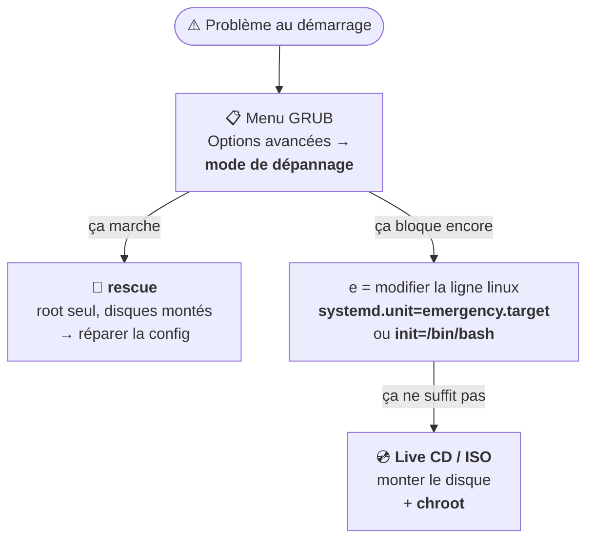

# Module 4 : Debian en mode maintenance

*Cours : [Cours 4 - Administration d'une distribution GNU/Linux](../index.md)*

## 🎯 Objectif du module

- Utiliser le **menu GRUB** pour démarrer autrement.
- Démarrer en **mode secours** (*rescue*) et en mode **urgence** (*emergency*).
- **Réinitialiser le mot de passe root** oublié.
- Réparer un système de l'extérieur avec un **live CD** et **`chroot`**.

!!! abstract "En clair"
    Un jour, un serveur ne démarrera plus (mauvaise configuration, disque abîmé), ou tu auras **oublié le mot de passe root**. Comme pour Windows avec WinRE ([cours 2, module 10](../../cours-02-systeme-client-microsoft/module-10-maintenance-du-systeme/index.md)), Linux a des **modes de secours**. Il faut un **accès à la console** de la machine : c'est l'un des rares cas où SSH ne suffit pas.

## 🖼️ Résumé visuel

**Le serveur ne démarre plus : quelle porte de secours ?**



## 📖 Cours consolidé

### 1. Le menu GRUB

Il s'affiche quelques secondes au démarrage (sur une VM, ++shift++ ou ++esc++ s'il passe trop vite).

| Entrée | Rôle |
|---|---|
| **Debian GNU/Linux** | Démarrage normal |
| **Options avancées** → *(recovery mode)* | **Mode secours** |
| Options avancées → **ancien noyau** | Si une mise à jour du noyau pose problème |

++e++ = **modifier** l'entrée (pour **ce** démarrage seulement) · ++ctrl+x++ ou ++f10++ = **démarrer** avec la modification.

---

### 2. Les modes secours et urgence

| Mode | Ce qui démarre | Quand ? |
|---|---|---|
| **rescue** | Disques montés, **sans réseau**, **root seul** | Corriger une config, un service qui bloque |
| **emergency** | `/` **en lecture seule**, rien d'autre | Problème de disque ou de `/etc/fstab` ([module 9](../module-9-gestion-des-espaces-de-stockage-systemes-de-fichiers/index.md)) |

Dans GRUB, ++e++, puis à la fin de la ligne **`linux`** :

```text
linux /boot/vmlinuz-6.12.0-1-amd64 root=UUID=… ro quiet  systemd.unit=rescue.target
                                                          └──── ajouté (ou emergency.target)
```

++ctrl+x++ → demande le **mot de passe root**. ⚠️ Root **désactivé** ? Accès refusé → méthode suivante.

---

### 3. Réinitialiser le mot de passe root (ou d'un utilisateur)

| # | Action |
|---|---|
| ① | Dans GRUB, ++e++ sur Debian |
| ② | Fin de la ligne **`linux`** : ajouter **`init=/bin/bash`** |
| ③ | ++ctrl+x++ → shell root **sans mot de passe** |
| ④ | **`mount -o remount,rw /`** (le disque était en lecture seule) |
| ⑤ | **`passwd root`** (ou `passwd tech`) |
| ⑥ | **`sync`** puis **`exec /sbin/init`** (ou `reboot -f`) |

⚠️ **Accès physique à la console = accès root** : en entreprise, on protège la console (salle fermée, mot de passe GRUB, chiffrement du disque).

---

### 4. Réparer depuis un live CD avec `chroot`

Quand **GRUB** est cassé : démarrer sur une **ISO Debian** (mode *Rescue* ou live), puis **entrer dans le système installé**.

```bash
lsblk                                                      # repérer la partition système (ex. /dev/sda1)
mount /dev/sda1 /mnt                                       # la monter
for d in dev proc sys; do mount --bind /$d /mnt/$d; done   # donner accès au matériel
chroot /mnt                                                # « entrer » dans le système installé
grub-install /dev/sda && update-grub                       # ex. : réinstaller GRUB
exit ; reboot
```

**`chroot`** fait croire au shell que `/mnt` est la racine : les commandes s'appliquent **au système du disque**, pas au live CD (on **entre dans la maison** pour la réparer).

---

### 5. Vérifier un système de fichiers : `fsck`

Après un **arrêt brutal**, **`fsck`** vérifie et répare (≈ `chkdsk`) : `fsck -f /dev/sda1`.

⚠️ **Jamais sur une partition montée en écriture** : depuis le mode **emergency** ou un **live CD**.

## 📝 Fiche de révision

| Situation | Solution |
|---|---|
| Service qui bloque le démarrage | Mode **rescue** (GRUB → mode de dépannage) |
| Problème de disque / fstab | `systemd.unit=emergency.target` |
| Mot de passe root oublié | `init=/bin/bash` → `mount -o remount,rw /` → `passwd root` |
| Nouveau noyau qui plante | GRUB → Options avancées → **ancien noyau** |
| GRUB cassé | Live CD + `mount` + **`chroot`** + `grub-install` |
| Système de fichiers abîmé | **`fsck`** sur une partition **démontée** |

**⚠️ Les pièges**

- La modification faite avec ++e++ dans GRUB ne vaut **que pour ce démarrage**.
- Après `init=/bin/bash`, sans **`remount,rw`**, `passwd` échoue (disque en lecture seule).
- **`fsck` sur une partition montée** = danger.

??? question "1. Tu as oublié le mot de passe root d'une VM. Écris la procédure."
    GRUB → ++e++ → ajouter `init=/bin/bash` à la ligne `linux` → ++ctrl+x++ → `mount -o remount,rw /` → `passwd root` → `exec /sbin/init`.

??? question "2. Depuis une mise à jour du noyau, le serveur plante au démarrage. Solution rapide ?"
    Dans GRUB : **Options avancées** → démarrer sur l'**ancien noyau**. Ensuite, chercher la cause tranquillement.

??? question "3. Pourquoi faut-il chroot après avoir démarré sur un live CD ?"
    Pour que les commandes (`grub-install`, `apt`, `passwd`…) s'appliquent au **système installé sur le disque**, et pas au live CD.

## 🧠 Quiz — entraîne-toi

<div id="quiz-cours-04-administration-d-une-distribution-gnu-linux-module-4-debian-en-mode-maintenance"></div>

<script type="application/json" id="quiz-cours-04-administration-d-une-distribution-gnu-linux-module-4-debian-en-mode-maintenance-data">
[
  {
    "question": "Dans le menu GRUB, quelle touche permet de modifier temporairement une entrée de démarrage ?",
    "options": [
      "Entrée",
      "e",
      "Échap",
      "F1"
    ],
    "correctIndex": 1,
    "explanation": "La touche e (edit) ouvre l'entrée en modification. Les changements ne valent que pour ce démarrage ; on démarre avec Ctrl + X ou F10."
  },
  {
    "question": "Que démarre le mode rescue (rescue.target) ?",
    "options": [
      "Le système complet avec interface graphique",
      "Le minimum : disques montés, réseau coupé, root seul",
      "Uniquement le réseau",
      "Windows"
    ],
    "correctIndex": 1,
    "explanation": "Le mode secours démarre le strict minimum pour réparer une configuration, avec un shell root."
  },
  {
    "question": "Quel ajout sur la ligne linux de GRUB permet d'obtenir un shell root sans mot de passe ?",
    "options": [
      "root=nopass",
      "init=/bin/bash",
      "single-user=yes",
      "passwd=0"
    ],
    "correctIndex": 1,
    "explanation": "init=/bin/bash remplace systemd par un simple shell root. C'est la méthode pour réinitialiser un mot de passe oublié."
  },
  {
    "question": "Après init=/bin/bash, pourquoi passwd root échoue-t-il d'abord ?",
    "options": [
      "Parce que root n'existe pas",
      "Parce que le disque / est monté en lecture seule",
      "Parce qu'il faut Internet",
      "Parce que passwd est interdit"
    ],
    "correctIndex": 1,
    "explanation": "Le système de fichiers racine est monté en lecture seule : il faut d'abord mount -o remount,rw / pour pouvoir écrire le nouveau mot de passe."
  },
  {
    "question": "À quoi sert la commande chroot depuis un live CD ?",
    "options": [
      "À formater le disque",
      "À « entrer » dans le système installé pour que les commandes s'y appliquent",
      "À changer le mot de passe du live CD",
      "À redémarrer"
    ],
    "correctIndex": 1,
    "explanation": "chroot /mnt fait de /mnt la nouvelle racine : grub-install, apt ou passwd agissent alors sur le système installé sur le disque."
  },
  {
    "question": "Quand peut-on lancer fsck sans danger ?",
    "options": [
      "Sur une partition montée en écriture",
      "Sur une partition non montée (ou en lecture seule)",
      "N'importe quand",
      "Seulement sous Windows"
    ],
    "correctIndex": 1,
    "explanation": "fsck modifie directement le système de fichiers : il ne doit jamais tourner sur une partition montée en écriture. On le lance depuis le mode emergency ou un live CD."
  },
  {
    "question": "Un nouveau noyau fait planter le serveur au démarrage. Solution la plus rapide ?",
    "options": [
      "Réinstaller Debian",
      "Dans GRUB, Options avancées, démarrer sur l'ancien noyau",
      "Supprimer GRUB",
      "Lancer fsck"
    ],
    "correctIndex": 1,
    "explanation": "Debian garde le noyau précédent : on peut le choisir dans les options avancées de GRUB, puis chercher la cause."
  },
  {
    "question": "Après avoir modifié une entrée dans GRUB avec la touche e, comment démarre-t-on ?",
    "options": [
      "Échap",
      "Ctrl + X (ou F10)",
      "Entrée",
      "Ctrl + Alt + Suppr"
    ],
    "correctIndex": 1,
    "explanation": "Ctrl + X ou F10 démarre avec l'entrée modifiée. Échap annule les modifications."
  },
  {
    "question": "Les modifications faites dans GRUB avec la touche e sont-elles permanentes ?",
    "options": [
      "Oui, elles sont enregistrées dans /etc/default/grub",
      "Oui, jusqu'à la prochaine mise à jour",
      "Non, elles ne valent que pour ce démarrage",
      "Seulement si on est root"
    ],
    "correctIndex": 2,
    "explanation": "C'est volontaire : on peut tester ou dépanner sans risque. Pour un changement durable, on modifie /etc/default/grub puis on lance update-grub."
  },
  {
    "question": "Après init=/bin/bash, quelle commande rend la racine modifiable ?",
    "options": [
      "mount -o remount,rw /",
      "chmod 777 /",
      "fsck /",
      "passwd root"
    ],
    "correctIndex": 0,
    "explanation": "Au démarrage, / est montée en lecture seule. remount,rw la remonte en lecture-écriture pour pouvoir changer le mot de passe."
  },
  {
    "question": "Quelle commande régénère le menu de GRUB après une modification ?",
    "options": [
      "grub-reset",
      "update-grub",
      "apt grub",
      "systemctl restart grub"
    ],
    "correctIndex": 1,
    "explanation": "update-grub relit /etc/default/grub et les noyaux installés, puis réécrit le menu de démarrage."
  },
  {
    "question": "Avant de faire chroot depuis un live CD, que faut-il monter dans /mnt ?",
    "options": [
      "Rien du tout",
      "Uniquement /home",
      "Une clé USB",
      "La partition racine du disque, puis /dev, /proc et /sys en --bind"
    ],
    "correctIndex": 3,
    "explanation": "On monte d'abord la racine du système à réparer, puis on lui donne accès au matériel avec mount --bind pour /dev, /proc et /sys."
  },
  {
    "question": "Quelle est la différence entre le mode secours (rescue) et le mode urgence (emergency) ?",
    "options": [
      "Aucune",
      "Le mode urgence est encore plus minimal : presque aucun service, racine en lecture seule",
      "Le mode secours n'existe que sous Windows",
      "Le mode urgence démarre l'interface graphique"
    ],
    "correctIndex": 1,
    "explanation": "rescue.target monte les systèmes de fichiers et démarre quelques services de base. emergency.target ne lance presque rien : c'est le dernier recours."
  },
  {
    "question": "Après avoir changé le mot de passe root avec init=/bin/bash, comment redémarrer correctement ?",
    "options": [
      "Débrancher le serveur",
      "Taper exit",
      "sync puis exec /sbin/init",
      "Appuyer sur Échap"
    ],
    "correctIndex": 2,
    "explanation": "sync écrit les données en attente sur le disque, puis exec /sbin/init lance le démarrage normal (sinon reboot -f)."
  },
  {
    "question": "Pourquoi faut-il démonter une partition avant de lancer fsck dessus ?",
    "options": [
      "Pour aller plus vite",
      "Pour ne pas abîmer des fichiers en cours d'écriture",
      "fsck ne marche que sur les clés USB",
      "Pour libérer de la mémoire"
    ],
    "correctIndex": 1,
    "explanation": "Réparer un système de fichiers pendant que des programmes y écrivent peut le corrompre. On le démonte, ou on travaille depuis le mode secours ou un live CD."
  }
]
</script>

<script>
  document.addEventListener("DOMContentLoaded", function () {
    TSSRQuiz.init({
      containerId: "quiz-cours-04-administration-d-une-distribution-gnu-linux-module-4-debian-en-mode-maintenance",
      dataId: "quiz-cours-04-administration-d-une-distribution-gnu-linux-module-4-debian-en-mode-maintenance-data",
    });
  });
</script>
