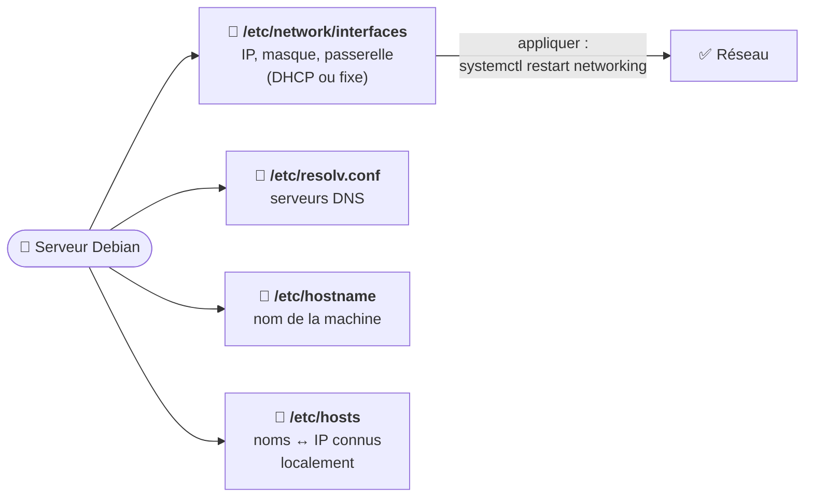

# Module 5 : Gestion du réseau

*Cours : [Cours 4 - Administration d'une distribution GNU/Linux](../index.md)*

## 🎯 Objectif du module

- Voir la **configuration réseau** d'un serveur (`ip a`, `ip r`).
- Donner une **adresse IP fixe** à un serveur Debian (`/etc/network/interfaces`).
- Configurer le **DNS**, le **nom de la machine** et le fichier **`/etc/hosts`**.
- **Vérifier** et **dépanner** le réseau.

!!! abstract "En clair"
    Un serveur doit **toujours avoir la même adresse IP** : les postes et les autres serveurs doivent savoir où le trouver ([cours 2, module 7](../../cours-02-systeme-client-microsoft/module-7-la-gestion-du-reseau-et-du-pare-feu/index.md)). Sous Debian serveur, on l'écrit dans un **fichier texte** de configuration. C'est l'équivalent de la fenêtre « Propriétés IPv4 » de Windows, mais en texte.

## 🖼️ Résumé visuel

**Les 4 fichiers du réseau Debian**



## 📖 Cours consolidé

### 1. Voir la configuration

| Je veux… | Commande | Équivalent Windows |
|---|---|---|
| Les **adresses IP** | **`ip a`** (*address*) | `ipconfig` |
| La **passerelle** (route par défaut) | **`ip r`** (*route*) | `ipconfig` |
| Les **DNS** | `cat /etc/resolv.conf` | `ipconfig /all` |
| Le **nom** de la machine | `hostname` · `hostnamectl` | `hostname` |
| Les **ports ouverts** | `ss -tulpn` | `netstat -ano` |

**Lire un `ip a`**

```text
1: lo: <LOOPBACK,UP> ...
    inet 127.0.0.1/8                       ← boucle locale (la machine elle-même)
2: ens33: <BROADCAST,MULTICAST,UP,LOWER_UP> ...       ← nom de la carte réseau (UP = active)
    link/ether 00:0c:29:3a:0b:12                       ← adresse MAC
    inet 192.168.1.50/24 brd 192.168.1.255             ← adresse IPv4 + masque (/24) + broadcast
    inet6 fe80::20c:29ff:fe3a:b12/64                   ← adresse IPv6 lien-local (cours 1, module 6)
```

📌 Les cartes réseau s'appellent **`ens33`**, **`enp0s3`**, `eth0`… selon le matériel. Repère d'abord le nom de **ta** carte avec `ip a`.

---

### 2. Configurer l'IP : `/etc/network/interfaces`

C'est le fichier de configuration réseau classique de **Debian serveur**. On l'édite en root : `sudo nano /etc/network/interfaces` ([cours 3, module 7](../../cours-03-utilisateur-d-une-distribution-gnu-linux/module-7-editer-du-texte-sous-linux/index.md)).

**En DHCP (adresse automatique)**

```text
auto ens33                 # activer la carte au démarrage
iface ens33 inet dhcp      # adresse fournie par un serveur DHCP
```

**En IP fixe (cas d'un serveur)** ✅

```text
auto ens33
iface ens33 inet static
    address 192.168.1.50/24       # IP + masque en notation CIDR (cours 1, module 3)
    gateway 192.168.1.1           # la passerelle (le routeur)
    dns-nameservers 192.168.1.1   # DNS (utilisé si le paquet resolvconf est installé)
```

**Appliquer** la nouvelle configuration :

```bash
sudo systemctl restart networking      # ou : sudo ifdown ens33 && sudo ifup ens33
ip a                                    # vérifier
```

⚠️ **En SSH, attention** : si tu changes l'IP du serveur, ta connexion **va couper**. Reconnecte-toi sur la **nouvelle** adresse. Une erreur dans le fichier peut t'enfermer dehors : garde un **accès console** (VM) sous la main.

💡 **Changer l'IP pour un test** (perdu au redémarrage) : `sudo ip addr add 192.168.1.60/24 dev ens33`.

📌 Sur les **postes avec bureau**, c'est souvent **NetworkManager** qui gère le réseau (icône en haut de l'écran, ou commande `nmcli`), et non ce fichier.

---

### 3. DNS, nom de machine et `/etc/hosts`

| Fichier | Rôle | Exemple |
|---|---|---|
| **`/etc/resolv.conf`** | Les **serveurs DNS** à interroger | `nameserver 192.168.1.1`<br/>`nameserver 1.1.1.1` |
| **`/etc/hostname`** | Le **nom** de la machine | `srv-web01` |
| **`/etc/hosts`** | Des correspondances **nom → IP** connues **localement**, consultées **avant** le DNS | `192.168.1.50  srv-web01.entreprise.local srv-web01` |

```bash
sudo hostnamectl set-hostname srv-web01     # changer le nom (pense à mettre /etc/hosts à jour aussi)
```

💡 `/etc/hosts` est pratique en TP : on donne un nom à une machine **sans serveur DNS**.

---

### 4. Vérifier et dépanner

La méthode du [cours 1, module 5](../../cours-01-bases-des-reseaux/module-5-les-premieres-commandes/index.md) marche aussi sous Linux :

| # | Commande | Si ça échoue… |
|---|---|---|
| ① | `ip a` | Pas d'IP ou carte `DOWN` → vérifier `/etc/network/interfaces` |
| ② | `ping -c 3 192.168.1.1` (passerelle) | Problème sur le réseau local |
| ③ | `ping -c 3 8.8.8.8` | Problème de passerelle ou de routeur : `ip r` |
| ④ | `ping -c 3 debian.org` | Problème de **DNS** : `/etc/resolv.conf` |
| ⑤ | `ss -tulpn` | Le service écoute-t-il sur le bon port ? |

```bash
ss -tulpn          # t = TCP, u = UDP, l = en écoute, p = programme, n = numéros
# tcp LISTEN 0 128 0.0.0.0:22  users:(("sshd",pid=612))   ← SSH écoute bien sur le port 22
```

## ✅ Points clés à retenir

- Voir : **`ip a`** (adresses), **`ip r`** (passerelle), `cat /etc/resolv.conf` (DNS), **`ss -tulpn`** (ports).
- IP fixe d'un serveur : **`/etc/network/interfaces`** → `iface ens33 inet static`, `address`, `gateway` ; appliquer avec **`systemctl restart networking`**.
- **`/etc/resolv.conf`** = DNS · **`/etc/hostname`** = nom · **`/etc/hosts`** = noms locaux (consultés avant le DNS).
- Changer de nom : **`hostnamectl set-hostname`**.
- En SSH, changer l'IP **coupe la connexion** : garde un accès console.
- Dépannage : `ip a` → ping passerelle → ping 8.8.8.8 → ping d'un nom.

## 📝 Fiche de révision

| Commande / fichier | Rôle |
|---|---|
| `ip a` / `ip r` | Adresses / routes (passerelle) |
| `/etc/network/interfaces` | Configuration IP (DHCP ou static) |
| `systemctl restart networking` | Appliquer |
| `/etc/resolv.conf` | Serveurs DNS |
| `/etc/hostname` · `hostnamectl` | Nom de la machine |
| `/etc/hosts` | Résolution locale nom → IP |
| `ss -tulpn` | Ports en écoute |
| `ping -c 3` | Tester (3 essais) |

**⚠️ Les pièges**

- Un **mauvais nom de carte** (`eth0` au lieu de `ens33`) → le réseau ne démarre pas.
- Oublier la **passerelle** → le réseau local marche, mais pas Internet.
- Sous Linux, `ping` ne s'arrête pas tout seul : `-c 3` ou ++ctrl+c++.

??? question "1. Configure ens33 en IP fixe 10.0.0.10/24, passerelle 10.0.0.254."
    Dans `/etc/network/interfaces` :
    ```text
    auto ens33
    iface ens33 inet static
        address 10.0.0.10/24
        gateway 10.0.0.254
    ```
    Puis `sudo systemctl restart networking` et `ip a` pour vérifier.

??? question "2. Le serveur ping 8.8.8.8 mais pas debian.org. Où regarder ?"
    C'est un problème de **DNS** : vérifier `/etc/resolv.conf` (une ligne `nameserver` correcte).

??? question "3. Comment vérifier que le serveur web écoute sur le port 80 ?"
    `sudo ss -tulpn | grep :80`

## 🧠 Quiz — entraîne-toi

<div id="quiz-cours-04-administration-d-une-distribution-gnu-linux-module-5-gestion-du-reseau"></div>

<script type="application/json" id="quiz-cours-04-administration-d-une-distribution-gnu-linux-module-5-gestion-du-reseau-data">
[
  {
    "question": "Quelle commande Linux affiche les adresses IP des cartes réseau ?",
    "options": [
      "ipconfig",
      "ip a",
      "ifconfig /all",
      "netstat -r"
    ],
    "correctIndex": 1,
    "explanation": "ip a (ip address) affiche les cartes, leurs adresses MAC, IPv4 et IPv6. C'est l'équivalent de ipconfig sous Windows."
  },
  {
    "question": "Quelle commande affiche la passerelle par défaut ?",
    "options": [
      "ip a",
      "ip r",
      "cat /etc/hostname",
      "ss -tulpn"
    ],
    "correctIndex": 1,
    "explanation": "ip r (ip route) affiche la table de routage ; la ligne « default via » indique la passerelle."
  },
  {
    "question": "Dans quel fichier configure-t-on l'adresse IP d'un serveur Debian ?",
    "options": [
      "/etc/resolv.conf",
      "/etc/network/interfaces",
      "/etc/hosts",
      "/etc/ip.conf"
    ],
    "correctIndex": 1,
    "explanation": "/etc/network/interfaces décrit chaque carte : en dhcp, ou en static avec address et gateway."
  },
  {
    "question": "Quel mot-clé indique une adresse IP fixe dans /etc/network/interfaces ?",
    "options": [
      "inet dhcp",
      "inet static",
      "inet fixed",
      "inet manual-ip"
    ],
    "correctIndex": 1,
    "explanation": "iface ens33 inet static, suivi des lignes address et gateway, configure une IP fixe."
  },
  {
    "question": "Quelle commande applique la nouvelle configuration réseau ?",
    "options": [
      "sudo systemctl restart networking",
      "sudo apt update",
      "sudo reboot GRUB",
      "ip r"
    ],
    "correctIndex": 0,
    "explanation": "Redémarrer le service networking relit /etc/network/interfaces. ifdown puis ifup sur la carte fonctionne aussi."
  },
  {
    "question": "Quel fichier contient les serveurs DNS utilisés ?",
    "options": [
      "/etc/hosts",
      "/etc/resolv.conf",
      "/etc/hostname",
      "/etc/dns"
    ],
    "correctIndex": 1,
    "explanation": "/etc/resolv.conf liste les serveurs DNS avec des lignes « nameserver adresse »."
  },
  {
    "question": "À quoi sert le fichier /etc/hosts ?",
    "options": [
      "À lister les utilisateurs",
      "À associer localement des noms à des IP, consultés avant le DNS",
      "À configurer le pare-feu",
      "À définir la passerelle"
    ],
    "correctIndex": 1,
    "explanation": "/etc/hosts fait la résolution de noms en local, sans serveur DNS : pratique en TP ou pour forcer une adresse."
  },
  {
    "question": "Quelle commande change le nom de la machine ?",
    "options": [
      "hostname --delete",
      "hostnamectl set-hostname srv-web01",
      "ip name srv-web01",
      "rename srv-web01"
    ],
    "correctIndex": 1,
    "explanation": "hostnamectl set-hostname modifie /etc/hostname et le nom actif. On met aussi /etc/hosts à jour."
  },
  {
    "question": "Quelle commande liste les ports en écoute et les programmes associés ?",
    "options": [
      "ss -tulpn",
      "ip a",
      "ping -c 3",
      "cat /etc/hosts"
    ],
    "correctIndex": 0,
    "explanation": "ss -tulpn : TCP, UDP, en écoute (listening), programme (process), en numérique. C'est le remplaçant moderne de netstat."
  }
]
</script>

<script>
  document.addEventListener("DOMContentLoaded", function () {
    TSSRQuiz.init({
      containerId: "quiz-cours-04-administration-d-une-distribution-gnu-linux-module-5-gestion-du-reseau",
      dataId: "quiz-cours-04-administration-d-une-distribution-gnu-linux-module-5-gestion-du-reseau-data",
    });
  });
</script>
