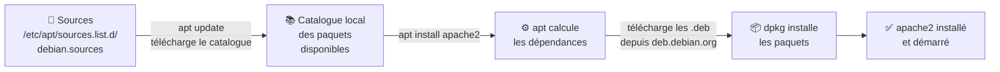

# Module 6 : Gestion des paquets logiciels

*Cours : [Cours 4 - Administration d'une distribution GNU/Linux](../index.md)*

## 🎯 Objectif du module

- Comprendre ce qu'est un **paquet** et un **dépôt**.
- **Installer, mettre à jour, supprimer** des logiciels avec **`apt`**.
- Utiliser **`dpkg`** pour un fichier `.deb` et pour interroger le système.
- Configurer les **sources** des logiciels.

!!! abstract "En clair : un magasin d'applications en ligne de commande"
    Sous Linux, on ne télécharge pas de `setup.exe` sur des sites au hasard. Les logiciels viennent d'un **magasin officiel**, le **dépôt** Debian, comme le Play Store sur un téléphone. Un logiciel prêt à installer s'appelle un **paquet** (`.deb`).

    **`apt`** est l'outil qui cherche, télécharge, installe et **met à jour** les paquets, en installant **automatiquement** tout ce dont ils ont besoin (les **dépendances**).

## 🖼️ Résumé visuel

**Comment `apt` installe un logiciel**



## 📖 Cours consolidé

### 1. Le vocabulaire

| Mot | En clair |
|---|---|
| **Paquet** (`.deb`) | Un logiciel prêt à installer : ses fichiers + sa description |
| **Dépôt** | Un **serveur** qui propose des milliers de paquets (ex. `deb.debian.org`) |
| **Dépendance** | Un autre paquet **nécessaire** au fonctionnement (installé automatiquement par apt) |
| **`apt`** | L'outil **de haut niveau** : utilise les dépôts, gère les dépendances ✅ |
| **`dpkg`** | L'outil **de bas niveau** : installe un fichier `.deb` local, **sans** gérer les dépendances |

---

### 2. Les commandes `apt` à connaître

Toutes celles qui **modifient** le système se lancent avec **`sudo`**.

| Je veux… | Commande |
|---|---|
| **Mettre à jour le catalogue** (la liste des paquets disponibles) | **`sudo apt update`** |
| **Installer les mises à jour** | **`sudo apt upgrade`** |
| Mises à jour **plus profondes** (peut ajouter ou retirer des paquets) | `sudo apt full-upgrade` |
| **Installer** un logiciel | **`sudo apt install apache2`** |
| Installer plusieurs logiciels | `sudo apt install curl vim htop` |
| **Supprimer** (garde la configuration) | `sudo apt remove apache2` |
| Supprimer **avec** sa configuration | **`sudo apt purge apache2`** |
| Supprimer les dépendances **devenues inutiles** | `sudo apt autoremove` |
| **Chercher** un paquet | `apt search serveur web` |
| **Infos** sur un paquet | `apt show apache2` |
| Lister les paquets **installés** | `apt list --installed` |
| Lister les **mises à jour** disponibles | `apt list --upgradable` |

!!! abstract "En clair : `update` ou `upgrade` ?"
    - **`update`** = **rafraîchir le catalogue** (« quoi de neuf au magasin ? »). Rien n'est installé.
    - **`upgrade`** = **installer** les nouvelles versions.

    On fait **toujours les deux, dans cet ordre** : `sudo apt update && sudo apt upgrade`.

---

### 3. Les sources des paquets

Debian 13 décrit ses dépôts dans **`/etc/apt/sources.list.d/debian.sources`** (format moderne). Les anciennes installations utilisent `/etc/apt/sources.list`.

```text
Types: deb
URIs: http://deb.debian.org/debian
Suites: trixie trixie-updates
Components: main contrib non-free non-free-firmware
Signed-By: /usr/share/keyrings/debian-archive-keyring.gpg

Types: deb
URIs: http://security.debian.org/debian-security
Suites: trixie-security
Components: main contrib non-free non-free-firmware
Signed-By: /usr/share/keyrings/debian-archive-keyring.gpg
```

L'ancien format tient en une ligne par dépôt : `deb http://deb.debian.org/debian trixie main contrib non-free non-free-firmware`.

| Élément | Signification |
|---|---|
| **trixie** | La version de Debian |
| **trixie-security** | Les **correctifs de sécurité** ⚠️ indispensable |
| **main** | Logiciels **100 % libres** (l'essentiel) |
| **contrib** / **non-free** | Logiciels qui dépendent de non-libre / non libres |
| **non-free-firmware** | **Micrologiciels** de matériel (cartes Wi-Fi, réseau…) |

📌 Après toute modification des sources : **`sudo apt update`**.

---

### 4. `dpkg` : l'outil de bas niveau

| Je veux… | Commande |
|---|---|
| Installer un **`.deb` téléchargé** | `sudo dpkg -i logiciel.deb` → puis `sudo apt -f install` pour récupérer les dépendances manquantes |
| ✅ Plus simple : installer un `.deb` **avec** ses dépendances | `sudo apt install ./logiciel.deb` |
| Ce paquet est-il installé ? | `dpkg -l | grep apache2` (`ii` en début de ligne = installé) |
| Quels fichiers a installés ce paquet ? | `dpkg -L apache2` |
| À quel paquet appartient ce fichier ? | `dpkg -S /usr/sbin/apache2` |

💡 Le **journal** des installations : `/var/log/apt/history.log` (qui a installé quoi, et quand).

## 📝 Fiche de révision

| Commande | Rôle |
|---|---|
| `apt update` | Rafraîchir le catalogue |
| `apt upgrade` | Installer les mises à jour |
| `apt install x` | Installer |
| `apt remove x` / `apt purge x` | Supprimer (sans / avec la configuration) |
| `apt autoremove` | Nettoyer les dépendances inutiles |
| `apt search` / `apt show` | Chercher / détails |
| `apt install ./f.deb` | Installer un .deb avec ses dépendances |
| `dpkg -l` / `-L` / `-S` | Installés / fichiers d'un paquet / paquet d'un fichier |
| `/var/log/apt/history.log` | Historique des installations |

**⚠️ Les pièges**

- `apt upgrade` **sans** `apt update` avant → rien de nouveau n'est trouvé.
- `remove` **garde** les fichiers de configuration ; `purge` les supprime.
- `dpkg -i` **ne gère pas les dépendances**.
- Sans le dépôt **`-security`**, le serveur ne reçoit **plus de correctifs de sécurité**.

??? question "1. Mets à jour complètement un serveur."
    `sudo apt update && sudo apt upgrade`

??? question "2. Installe le serveur web Apache, puis vérifie qu'il tourne."
    `sudo apt install apache2`, puis `systemctl status apache2` (module 3).

??? question "3. Supprime Apache ainsi que sa configuration, et nettoie les dépendances inutiles."
    `sudo apt purge apache2 && sudo apt autoremove`

??? question "4. Quel paquet a installé la commande /usr/bin/htop ?"
    `dpkg -S /usr/bin/htop` → `htop: /usr/bin/htop`

## 🧠 Quiz — entraîne-toi

<div id="quiz-cours-04-administration-d-une-distribution-gnu-linux-module-6-gestion-des-paquets-logiciels"></div>

<script type="application/json" id="quiz-cours-04-administration-d-une-distribution-gnu-linux-module-6-gestion-des-paquets-logiciels-data">
[
  {
    "question": "Qu'est-ce qu'un dépôt Debian ?",
    "options": [
      "Un dossier de sauvegarde",
      "Un serveur qui propose des paquets logiciels à installer",
      "Un fichier .deb",
      "Un utilisateur administrateur"
    ],
    "correctIndex": 1,
    "explanation": "Un dépôt (ex. deb.debian.org) met à disposition des milliers de paquets, qu'apt télécharge et installe."
  },
  {
    "question": "Que fait sudo apt update ?",
    "options": [
      "Installe les mises à jour",
      "Met à jour la liste (le catalogue) des paquets disponibles",
      "Redémarre le serveur",
      "Supprime les paquets inutiles"
    ],
    "correctIndex": 1,
    "explanation": "apt update rafraîchit seulement le catalogue. C'est apt upgrade qui installe ensuite les nouvelles versions."
  },
  {
    "question": "Dans quel ordre met-on à jour un serveur ?",
    "options": [
      "apt upgrade puis apt update",
      "apt update puis apt upgrade",
      "apt install puis apt update",
      "apt purge puis apt upgrade"
    ],
    "correctIndex": 1,
    "explanation": "D'abord update (connaître les nouvelles versions), puis upgrade (les installer) : sudo apt update && sudo apt upgrade."
  },
  {
    "question": "Quelle différence entre apt remove et apt purge ?",
    "options": [
      "Aucune",
      "remove garde les fichiers de configuration, purge les supprime aussi",
      "purge garde la configuration, remove la supprime",
      "remove supprime les dépendances"
    ],
    "correctIndex": 1,
    "explanation": "apt remove enlève le logiciel mais laisse sa configuration (utile pour réinstaller). apt purge supprime tout."
  },
  {
    "question": "À quoi sert apt autoremove ?",
    "options": [
      "À installer les mises à jour automatiquement",
      "À supprimer les dépendances qui ne servent plus",
      "À supprimer apt",
      "À redémarrer les services"
    ],
    "correctIndex": 1,
    "explanation": "Après la suppression d'un logiciel, ses dépendances peuvent rester installées pour rien : autoremove les nettoie."
  },
  {
    "question": "Quelle est la différence principale entre apt et dpkg ?",
    "options": [
      "dpkg gère les dépendances, pas apt",
      "apt utilise les dépôts et gère les dépendances ; dpkg installe un .deb local sans gérer les dépendances",
      "Aucune",
      "dpkg ne fonctionne que sur Ubuntu"
    ],
    "correctIndex": 1,
    "explanation": "apt est l'outil de haut niveau ; dpkg est l'outil de bas niveau utilisé par apt. Pour un .deb local, apt install ./fichier.deb gère aussi les dépendances."
  },
  {
    "question": "Quel dépôt est indispensable pour recevoir les correctifs de sécurité ?",
    "options": [
      "trixie-security",
      "contrib",
      "non-free",
      "trixie-backports"
    ],
    "correctIndex": 0,
    "explanation": "Le dépôt security.debian.org (suite trixie-security) fournit les correctifs de sécurité. Sans lui, le serveur reste vulnérable."
  },
  {
    "question": "Quelle commande indique à quel paquet appartient un fichier ?",
    "options": [
      "dpkg -L fichier",
      "dpkg -S fichier",
      "apt show fichier",
      "dpkg -i fichier"
    ],
    "correctIndex": 1,
    "explanation": "dpkg -S (search) trouve le paquet qui a installé un fichier. dpkg -L fait l'inverse : il liste les fichiers d'un paquet."
  },
  {
    "question": "Que contient la section « main » des dépôts Debian ?",
    "options": [
      "Les logiciels non libres",
      "Les logiciels 100 % libres",
      "Les micrologiciels uniquement",
      "Les jeux"
    ],
    "correctIndex": 1,
    "explanation": "main contient les logiciels entièrement libres, c'est-à-dire l'essentiel de Debian. non-free et non-free-firmware contiennent du non libre."
  },
  {
    "question": "Quelle commande cherche un paquet par mot-clé ?",
    "options": [
      "apt find",
      "apt search",
      "apt look",
      "dpkg --search-web"
    ],
    "correctIndex": 1,
    "explanation": "apt search motclé parcourt le catalogue local (mis à jour par apt update)."
  },
  {
    "question": "Quelle commande affiche la description, la version et les dépendances d'un paquet ?",
    "options": [
      "apt show paquet",
      "apt info --all",
      "dpkg -i paquet",
      "apt list --deps"
    ],
    "correctIndex": 0,
    "explanation": "apt show affiche la fiche du paquet avant de l'installer."
  },
  {
    "question": "Quelle commande liste les paquets qui peuvent être mis à jour ?",
    "options": [
      "apt upgrade --dry",
      "apt list --upgradable",
      "dpkg -l --new",
      "apt check"
    ],
    "correctIndex": 1,
    "explanation": "Après apt update, apt list --upgradable montre ce que apt upgrade installerait."
  },
  {
    "question": "Quelle est la façon la plus simple d'installer un fichier .deb téléchargé avec ses dépendances ?",
    "options": [
      "sudo dpkg -i logiciel.deb",
      "sudo apt install ./logiciel.deb",
      "sudo apt get logiciel.deb",
      "chmod +x logiciel.deb"
    ],
    "correctIndex": 1,
    "explanation": "apt install ./fichier.deb (avec le ./) récupère les dépendances manquantes. dpkg -i, lui, ne les installe pas."
  },
  {
    "question": "Dans quel fichier Debian 13 décrit-il ses dépôts ?",
    "options": [
      "/etc/apt/apt.conf",
      "/etc/debian_version",
      "/etc/apt/sources.list.d/debian.sources",
      "/var/lib/dpkg/status"
    ],
    "correctIndex": 2,
    "explanation": "Debian 13 utilise le format moderne debian.sources. Les anciennes installations utilisent /etc/apt/sources.list."
  },
  {
    "question": "Quelle commande dpkg liste les fichiers installés par un paquet ?",
    "options": [
      "dpkg -S",
      "dpkg -L",
      "dpkg -i",
      "dpkg -r"
    ],
    "correctIndex": 1,
    "explanation": "dpkg -L paquet liste ses fichiers ; dpkg -S fichier fait l'inverse (à quel paquet appartient ce fichier)."
  }
]
</script>

<script>
  document.addEventListener("DOMContentLoaded", function () {
    TSSRQuiz.init({
      containerId: "quiz-cours-04-administration-d-une-distribution-gnu-linux-module-6-gestion-des-paquets-logiciels",
      dataId: "quiz-cours-04-administration-d-une-distribution-gnu-linux-module-6-gestion-des-paquets-logiciels-data",
    });
  });
</script>
