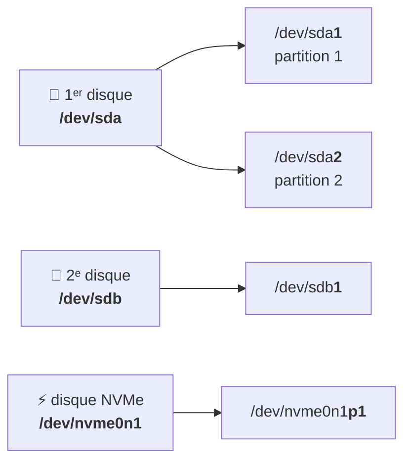

# Module 7 : Gestion des espaces de stockage

*Cours : [Cours 4 - Administration d'une distribution GNU/Linux](../index.md)*

## 🎯 Objectif du module

- Reconnaître les **noms des disques** sous Linux (`/dev/sda`, `/dev/nvme0n1`…).
- **Voir** les disques et partitions (`lsblk`, `fdisk -l`, `blkid`).
- **Créer une partition** sur un nouveau disque avec `fdisk`.
- Comprendre l'**UUID**, l'identifiant unique d'une partition.

!!! abstract "En clair"
    Le principe est le même que sous Windows ([cours 2, module 4](../../cours-02-systeme-client-microsoft/module-4-la-gestion-du-stockage/index.md)) : **partitionner → formater → rendre accessible**. La différence : sous Linux, il n'y a **pas de lettre `D:`**. Chaque disque est un **fichier dans `/dev`**, et on l'**accroche** à un dossier de l'arborescence (on dit qu'on le **monte**, module 9).

    Ce module couvre la **1ʳᵉ étape** : repérer le disque et le partitionner. Les modules 8 (LVM) et 9 (formater et monter) font la suite.

## 🖼️ Résumé visuel

**Comment Linux nomme les disques et les partitions**



## 📖 Cours consolidé

### 1. Les noms des disques

| Nom | Disque | Partitions |
|---|---|---|
| **`/dev/sda`**, `/dev/sdb`, `/dev/sdc`… | Disques **SATA / SCSI / USB** (et la plupart des disques de **VM**) : a = 1ᵉʳ, b = 2ᵉ… | `/dev/sda1`, `/dev/sda2`… |
| **`/dev/nvme0n1`** | Disque **NVMe** (SSD rapide) | `/dev/nvme0n1p1`, `p2`… |
| `/dev/vda` | Disque virtuel (KVM / Proxmox) | `/dev/vda1`… |
| `/dev/sr0` | Lecteur **CD/DVD** | |

📌 « **Tout est fichier** » ([cours 3, module 4](../../cours-03-utilisateur-d-une-distribution-gnu-linux/module-4-fichiers-et-dossiers-sous-linux/index.md)) : un disque est un fichier spécial dans **`/dev`**.

---

### 2. Voir les disques

| Commande | Montre… |
|---|---|
| **`lsblk`** | ✅ L'**arbre** des disques et partitions, avec leur taille et l'endroit où ils sont montés |
| `lsblk -f` | La même chose, avec le **système de fichiers** et l'**UUID** |
| `sudo fdisk -l` | Le détail des partitions de chaque disque (type de table : **gpt** ou **dos** = MBR) |
| `sudo blkid` | L'**UUID** et le type de chaque partition |
| `df -h` | L'**espace utilisé / libre** des partitions montées (module 9) |

**Lire un `lsblk`**

```text
NAME   MAJ:MIN RM  SIZE RO TYPE MOUNTPOINTS
sda      8:0    0   20G  0 disk                ← 1ᵉʳ disque : 20 Go
├─sda1   8:1    0   19G  0 part /              ← partition 1, montée sur / (le système)
├─sda2   8:2    0    1K  0 part                ← partition étendue (MBR)
└─sda5   8:5    0  975M  0 part [SWAP]         ← la swap (mémoire d'appoint, module 9)
sdb      8:16   0   10G  0 disk                ← 2ᵉ disque : 10 Go, AUCUNE partition → tout neuf
sr0     11:0    1  754M  0 rom                 ← le lecteur DVD (l'ISO)
```

---

### 3. Partitionner un nouveau disque avec `fdisk`

Rappel : **MBR** (4 partitions principales, 2 To max) ou **GPT** (128 partitions, plus de 2 To) — voir le [cours 2, module 4](../../cours-02-systeme-client-microsoft/module-4-la-gestion-du-stockage/index.md).

**Exemple : une seule partition sur tout le disque `/dev/sdb`**

```text
sudo fdisk /dev/sdb

Commande (m pour l'aide) : g        ← créer une table GPT (o = MBR)
Commande (m pour l'aide) : n        ← nouvelle partition
Numéro de partition (1-128, 1 par défaut) : Entrée
Premier secteur (…, 2048 par défaut) : Entrée
Dernier secteur, +/-secteurs ou +/-taille{K,M,G,T,P} : Entrée      ← tout le disque (ou +5G pour 5 Go)
Commande (m pour l'aide) : p        ← afficher pour vérifier
Commande (m pour l'aide) : w        ← ÉCRIRE et quitter
```

| Touche | Action |
|---|---|
| `m` | Aide |
| `p` | Afficher les partitions |
| `g` / `o` | Nouvelle table **GPT** / **MBR** |
| `n` | **Nouvelle** partition |
| `d` | **Supprimer** une partition |
| `t` | Changer le **type** (ex. LVM, swap) |
| **`w`** | **Écrire** les changements et quitter |
| **`q`** | **Quitter sans rien changer** |

!!! tip "Rien n'est modifié avant le `w`"
    Tant que tu n'as pas tapé **`w`**, `fdisk` ne touche à rien. En cas de doute : **`q`**.

💡 Autres outils : **`parted`** (plus puissant, scriptable), **`cfdisk`** (menus avec les flèches, plus simple pour débuter).

Ensuite, on **vérifie** avec `lsblk` : `/dev/sdb1` est apparu. Il reste à le **formater** et le **monter** (module 9), ou à l'utiliser avec **LVM** (module 8).

---

### 4. L'UUID : l'identifiant unique d'une partition

Les noms `sda`, `sdb` peuvent **changer** : si on ajoute ou retire un disque, l'ancien `sdb` peut devenir `sdc`. L'**UUID** (*Universally Unique IDentifier*) est un identifiant **unique et fixe**, créé au formatage :

```text
$ sudo blkid /dev/sdb1
/dev/sdb1: UUID="3f6a1c2e-8b7d-4c1e-9a0f-5d2e7b8c9a01" TYPE="ext4"
```

✅ C'est l'UUID qu'on utilise dans **`/etc/fstab`** pour monter les partitions au démarrage (module 9) : il ne change jamais.

## ✅ Points clés à retenir

- Disques : **`/dev/sda`**, `/dev/sdb`… (partitions **`sda1`**, `sda2`) ; NVMe : **`/dev/nvme0n1`** (partitions `p1`).
- Voir : **`lsblk`** (arbre), `lsblk -f`, `sudo fdisk -l`, **`sudo blkid`** (UUID).
- Partitionner : **`sudo fdisk /dev/sdb`** → `g` (GPT) → `n` → `p` → **`w`** ; **`q`** pour annuler. Rien n'est écrit avant `w`.
- **UUID** = identifiant **unique et fixe** d'une partition (les noms `sdX` peuvent changer).
- Suite : formater et monter (module 9) ou LVM (module 8).

## 📝 Fiche de révision

| Notion / commande | À retenir |
|---|---|
| `/dev/sda` → `/dev/sda1` | 1ᵉʳ disque → sa 1ʳᵉ partition |
| `/dev/nvme0n1p1` | 1ʳᵉ partition d'un SSD NVMe |
| `lsblk` | Arbre des disques |
| `sudo fdisk -l` | Détail des partitions |
| `sudo blkid` | UUID et type |
| `fdisk` : `g` `n` `p` `w` `q` | GPT · nouvelle · afficher · écrire · annuler |
| **UUID** | Identifiant fixe, utilisé dans fstab |

**⚠️ Les pièges**

- **Se tromper de disque** dans `fdisk` = perte de données : vérifie avec `lsblk` **avant**.
- Oublier **`w`** → rien n'est enregistré.
- Utiliser `/dev/sdb1` dans fstab au lieu de l'**UUID** → risque si les disques changent d'ordre.

??? question "1. Tu ajoutes un disque de 10 Go à ta VM. Comment le repérer ?"
    `lsblk` : un nouveau disque (`sdb`, 10G) apparaît, **sans partition** ni point de montage.

??? question "2. Crée une partition GPT sur tout le disque /dev/sdb."
    `sudo fdisk /dev/sdb` → `g` → `n` → Entrée × 3 → `p` (vérifier) → `w`. Puis `lsblk` : `sdb1` est apparu.

??? question "3. Pourquoi utiliser l'UUID plutôt que /dev/sdb1 ?"
    Les noms `sdX` peuvent changer si on ajoute ou retire un disque ; l'**UUID** est fixe et unique.

## 🧠 Quiz — entraîne-toi

<div id="quiz-cours-04-administration-d-une-distribution-gnu-linux-module-7-gestion-des-espaces-de-stockage"></div>

<script type="application/json" id="quiz-cours-04-administration-d-une-distribution-gnu-linux-module-7-gestion-des-espaces-de-stockage-data">
[
  {
    "question": "Comment s'appelle la 2ᵉ partition du 1ᵉʳ disque SATA sous Linux ?",
    "options": [
      "/dev/sdb1",
      "/dev/sda2",
      "C:\\2",
      "/dev/disk1p2"
    ],
    "correctIndex": 1,
    "explanation": "La lettre désigne le disque (a = 1ᵉʳ) et le chiffre la partition : /dev/sda2."
  },
  {
    "question": "Comment s'appelle la 1ʳᵉ partition d'un disque NVMe ?",
    "options": [
      "/dev/nvme0n1p1",
      "/dev/sda1",
      "/dev/nvme1",
      "/dev/nvme0n1-1"
    ],
    "correctIndex": 0,
    "explanation": "Pour les SSD NVMe, le disque s'appelle /dev/nvme0n1 et ses partitions ajoutent p1, p2…"
  },
  {
    "question": "Quelle commande affiche l'arbre des disques et partitions avec leurs points de montage ?",
    "options": [
      "lsblk",
      "ls /home",
      "df -i",
      "mount -a"
    ],
    "correctIndex": 0,
    "explanation": "lsblk (list block devices) montre chaque disque, ses partitions, leur taille et où elles sont montées."
  },
  {
    "question": "Dans fdisk, quelle touche enregistre les modifications ?",
    "options": [
      "q",
      "w",
      "s",
      "e"
    ],
    "correctIndex": 1,
    "explanation": "w (write) écrit la table de partitions sur le disque et quitte. Avant, rien n'est modifié ; q quitte sans enregistrer."
  },
  {
    "question": "Dans fdisk, quelle touche crée une nouvelle table de partitions GPT ?",
    "options": [
      "o",
      "g",
      "n",
      "t"
    ],
    "correctIndex": 1,
    "explanation": "g crée une table GPT, o une table MBR (dos), n une nouvelle partition, t change le type d'une partition."
  },
  {
    "question": "Qu'est-ce que l'UUID d'une partition ?",
    "options": [
      "Sa taille",
      "Un identifiant unique et fixe, qui ne change pas si l'ordre des disques change",
      "Son nom /dev/sdX",
      "Le nom de son propriétaire"
    ],
    "correctIndex": 1,
    "explanation": "L'UUID est créé au formatage et reste le même : c'est pour cela qu'on l'utilise dans /etc/fstab."
  },
  {
    "question": "Quelle commande affiche l'UUID des partitions ?",
    "options": [
      "sudo blkid",
      "uuid --show",
      "lsusb",
      "ip a"
    ],
    "correctIndex": 0,
    "explanation": "blkid affiche l'UUID et le type de système de fichiers de chaque partition. lsblk -f le montre aussi."
  }
]
</script>

<script>
  document.addEventListener("DOMContentLoaded", function () {
    TSSRQuiz.init({
      containerId: "quiz-cours-04-administration-d-une-distribution-gnu-linux-module-7-gestion-des-espaces-de-stockage",
      dataId: "quiz-cours-04-administration-d-une-distribution-gnu-linux-module-7-gestion-des-espaces-de-stockage-data",
    });
  });
</script>
