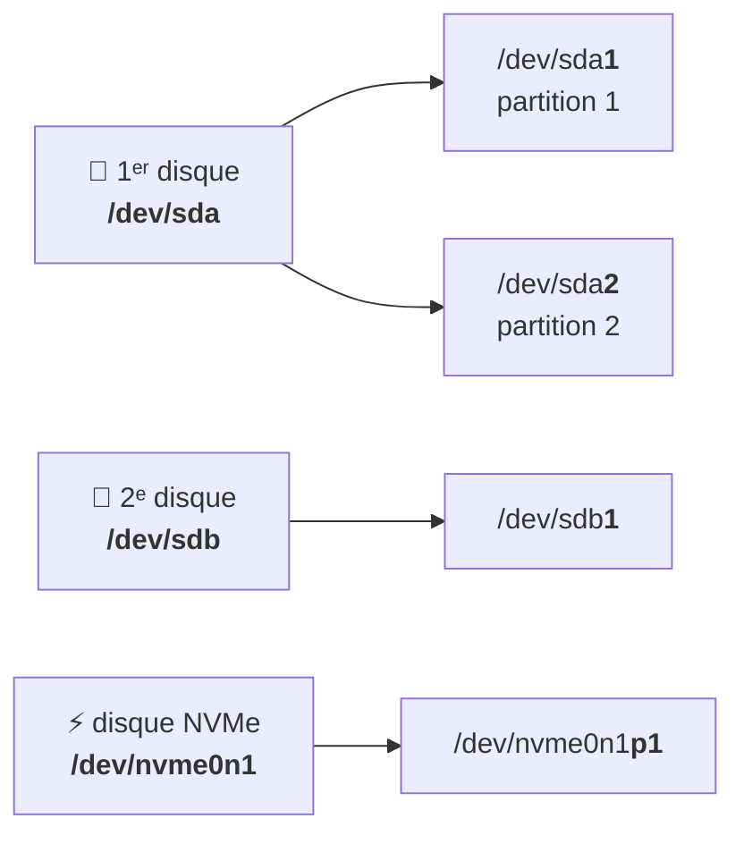

# Module 7 : Gestion des espaces de stockage

*Cours : [Cours 4 - Administration d'une distribution GNU/Linux](../index.md)*

## 🎯 Objectif du module

- Reconnaître les **noms des disques** sous Linux (`/dev/sda`, `/dev/nvme0n1`…).
- **Voir** les disques et partitions (`lsblk`, `fdisk -l`, `blkid`).
- **Créer une partition** sur un nouveau disque avec `fdisk`.
- Comprendre l'**UUID**, l'identifiant unique d'une partition.

!!! abstract "En clair"
    Le principe est le même que sous Windows ([cours 2, module 4](../../cours-02-systeme-client-microsoft/module-4-la-gestion-du-stockage/index.md)) : **partitionner → formater → rendre accessible**. La différence : sous Linux, il n'y a **pas de lettre `D:`**. Chaque disque est un **fichier dans `/dev`**, et on l'**accroche** à un dossier de l'arborescence (on dit qu'on le **monte**, module 9).

    Ce module couvre la **1ʳᵉ étape** : repérer le disque et le partitionner. Les modules 8 (LVM) et 9 (formater et monter) font la suite.

## 🖼️ Résumé visuel

**Comment Linux nomme les disques et les partitions**



## 📖 Cours consolidé

### 1. Les noms des disques

| Nom | Disque | Partitions |
|---|---|---|
| **`/dev/sda`**, `sdb`… | **SATA / SCSI / USB** et la plupart des disques de **VM** (a = 1ᵉʳ, b = 2ᵉ) | `/dev/sda1`, `sda2`… |
| **`/dev/nvme0n1`** | **NVMe** (SSD rapide) | `/dev/nvme0n1p1`… |
| `/dev/vda` · `/dev/sr0` | Disque virtuel KVM / Proxmox · lecteur **CD/DVD** | |

📌 « **Tout est fichier** » : un disque est un fichier spécial de **`/dev`**.

---

### 2. Voir les disques

| Commande | Montre… |
|---|---|
| **`lsblk`** (`-f` = avec système de fichiers et **UUID**) | ✅ L'**arbre** des disques et partitions, taille, point de montage |
| `sudo fdisk -l` | Le détail des partitions (table **gpt** ou **dos** = MBR) |
| `sudo blkid` | L'**UUID** et le type de chaque partition |
| `df -h` | Espace **utilisé / libre** ([module 9](../module-9-gestion-des-espaces-de-stockage-systemes-de-fichiers/index.md)) |

```text
NAME   MAJ:MIN RM  SIZE RO TYPE MOUNTPOINTS
sda      8:0    0   20G  0 disk                ← 1ᵉʳ disque : 20 Go
├─sda1   8:1    0   19G  0 part /              ← montée sur / (le système)
└─sda5   8:5    0  975M  0 part [SWAP]         ← la swap
sdb      8:16   0   10G  0 disk                ← 2ᵉ disque, AUCUNE partition → tout neuf
sr0     11:0    1  754M  0 rom                 ← le lecteur DVD
```

---

### 3. Partitionner avec `fdisk`

Rappel **MBR / GPT** : [cours 2, module 4](../../cours-02-systeme-client-microsoft/module-4-la-gestion-du-stockage/index.md).

```text
sudo fdisk /dev/sdb
Commande : g        ← table GPT (o = MBR)
Commande : n        ← nouvelle partition → Entrée × 3 (tout le disque, ou +5G)
Commande : p        ← vérifier
Commande : w        ← ÉCRIRE et quitter
```

| Touche | Action |
|---|---|
| `m` · `p` | Aide · afficher les partitions |
| `g` / `o` | Table **GPT** / **MBR** |
| `n` · `d` · `t` | **Nouvelle** · **supprimer** · changer le **type** (LVM, swap) |
| **`w`** / **`q`** | **Écrire et quitter** / **quitter sans rien changer** |

- 💡 **Rien n'est modifié avant le `w`** : en cas de doute, **`q`**.
- Autres outils : **`cfdisk`** (menus, plus simple), **`parted`** (scriptable).
- Ensuite : `lsblk` montre `/dev/sdb1` → le **formater et le monter** ([module 9](../module-9-gestion-des-espaces-de-stockage-systemes-de-fichiers/index.md)) ou l'utiliser en **LVM** ([module 8](../module-8-gestion-avancee-des-espaces-de-stockage-lvm/index.md)).

---

### 4. L'UUID

Les noms `sda`, `sdb` peuvent **changer** quand on ajoute ou retire un disque. L'**UUID** est un identifiant **unique et fixe**, créé au formatage :

```text
$ sudo blkid /dev/sdb1
/dev/sdb1: UUID="3f6a1c2e-8b7d-4c1e-9a0f-5d2e7b8c9a01" TYPE="ext4"
```

✅ C'est lui qu'on met dans **`/etc/fstab`** ([module 9](../module-9-gestion-des-espaces-de-stockage-systemes-de-fichiers/index.md)).

## 📝 Fiche de révision

| Notion / commande | À retenir |
|---|---|
| `/dev/sda` → `/dev/sda1` | 1ᵉʳ disque → sa 1ʳᵉ partition |
| `/dev/nvme0n1p1` | 1ʳᵉ partition d'un SSD NVMe |
| `lsblk` | Arbre des disques |
| `sudo fdisk -l` | Détail des partitions |
| `sudo blkid` | UUID et type |
| `fdisk` : `g` `n` `p` `w` `q` | GPT · nouvelle · afficher · écrire · annuler |
| **UUID** | Identifiant fixe, utilisé dans fstab |

**⚠️ Les pièges**

- **Se tromper de disque** dans `fdisk` = perte de données : vérifie avec `lsblk` **avant**.
- Oublier **`w`** → rien n'est enregistré.
- Utiliser `/dev/sdb1` dans fstab au lieu de l'**UUID** → risque si les disques changent d'ordre.

??? question "1. Tu ajoutes un disque de 10 Go à ta VM. Comment le repérer ?"
    `lsblk` : un nouveau disque (`sdb`, 10G) apparaît, **sans partition** ni point de montage.

??? question "2. Crée une partition GPT sur tout le disque /dev/sdb."
    `sudo fdisk /dev/sdb` → `g` → `n` → Entrée × 3 → `p` (vérifier) → `w`. Puis `lsblk` : `sdb1` est apparu.

??? question "3. Pourquoi utiliser l'UUID plutôt que /dev/sdb1 ?"
    Les noms `sdX` peuvent changer si on ajoute ou retire un disque ; l'**UUID** est fixe et unique.

## 🧠 Quiz — entraîne-toi

<div id="quiz-cours-04-administration-d-une-distribution-gnu-linux-module-7-gestion-des-espaces-de-stockage"></div>

<script type="application/json" id="quiz-cours-04-administration-d-une-distribution-gnu-linux-module-7-gestion-des-espaces-de-stockage-data">
[
  {
    "question": "Comment s'appelle la 2ᵉ partition du 1ᵉʳ disque SATA sous Linux ?",
    "options": [
      "/dev/sdb1",
      "/dev/sda2",
      "C:\\2",
      "/dev/disk1p2"
    ],
    "correctIndex": 1,
    "explanation": "La lettre désigne le disque (a = 1ᵉʳ) et le chiffre la partition : /dev/sda2."
  },
  {
    "question": "Comment s'appelle la 1ʳᵉ partition d'un disque NVMe ?",
    "options": [
      "/dev/nvme0n1p1",
      "/dev/sda1",
      "/dev/nvme1",
      "/dev/nvme0n1-1"
    ],
    "correctIndex": 0,
    "explanation": "Pour les SSD NVMe, le disque s'appelle /dev/nvme0n1 et ses partitions ajoutent p1, p2…"
  },
  {
    "question": "Quelle commande affiche l'arbre des disques et partitions avec leurs points de montage ?",
    "options": [
      "lsblk",
      "ls /home",
      "df -i",
      "mount -a"
    ],
    "correctIndex": 0,
    "explanation": "lsblk (list block devices) montre chaque disque, ses partitions, leur taille et où elles sont montées."
  },
  {
    "question": "Dans fdisk, quelle touche enregistre les modifications ?",
    "options": [
      "q",
      "w",
      "s",
      "e"
    ],
    "correctIndex": 1,
    "explanation": "w (write) écrit la table de partitions sur le disque et quitte. Avant, rien n'est modifié ; q quitte sans enregistrer."
  },
  {
    "question": "Dans fdisk, quelle touche crée une nouvelle table de partitions GPT ?",
    "options": [
      "o",
      "g",
      "n",
      "t"
    ],
    "correctIndex": 1,
    "explanation": "g crée une table GPT, o une table MBR (dos), n une nouvelle partition, t change le type d'une partition."
  },
  {
    "question": "Qu'est-ce que l'UUID d'une partition ?",
    "options": [
      "Sa taille",
      "Un identifiant unique et fixe, qui ne change pas si l'ordre des disques change",
      "Son nom /dev/sdX",
      "Le nom de son propriétaire"
    ],
    "correctIndex": 1,
    "explanation": "L'UUID est créé au formatage et reste le même : c'est pour cela qu'on l'utilise dans /etc/fstab."
  },
  {
    "question": "Quelle commande affiche l'UUID des partitions ?",
    "options": [
      "sudo blkid",
      "uuid --show",
      "lsusb",
      "ip a"
    ],
    "correctIndex": 0,
    "explanation": "blkid affiche l'UUID et le type de système de fichiers de chaque partition. lsblk -f le montre aussi."
  },
  {
    "question": "Quelles sont les limites d'une table de partitions MBR ?",
    "options": [
      "128 partitions et 18 Eo",
      "4 partitions principales et 2 To par disque",
      "Aucune limite",
      "1 partition et 32 Go"
    ],
    "correctIndex": 1,
    "explanation": "MBR est ancien : 4 partitions principales maximum (ou 3 + une étendue) et 2 To. GPT lève ces limites."
  },
  {
    "question": "Combien de partitions une table GPT accepte-t-elle par défaut ?",
    "options": [
      "4",
      "16",
      "128",
      "Illimité"
    ],
    "correctIndex": 2,
    "explanation": "GPT accepte 128 partitions par défaut et des disques de plus de 2 To."
  },
  {
    "question": "Dans fdisk, quelle touche crée une nouvelle partition ?",
    "options": [
      "p",
      "d",
      "w",
      "n"
    ],
    "correctIndex": 3,
    "explanation": "n = new (nouvelle partition), d = delete, p = print (afficher), w = write (enregistrer)."
  },
  {
    "question": "Dans fdisk, quelle touche quitte SANS enregistrer ?",
    "options": [
      "q",
      "w",
      "x",
      "s"
    ],
    "correctIndex": 0,
    "explanation": "q quitte sans rien écrire : rien n'est modifié tant qu'on n'a pas tapé w."
  },
  {
    "question": "Dans la sortie de fdisk -l, que signifie « Disklabel type: dos » ?",
    "options": [
      "Le disque est formaté pour MS-DOS",
      "Le disque utilise une table de partitions MBR",
      "Le disque est vide",
      "Le disque est en NTFS"
    ],
    "correctIndex": 1,
    "explanation": "fdisk appelle « dos » la table MBR ; « gpt » désigne une table GPT."
  },
  {
    "question": "Quelle commande montre les partitions avec leur système de fichiers et leur UUID ?",
    "options": [
      "lsblk -f",
      "ls -la /dev",
      "df -i",
      "mount --uuid"
    ],
    "correctIndex": 0,
    "explanation": "lsblk -f ajoute à l'arbre des disques le type de système de fichiers, l'étiquette et l'UUID."
  },
  {
    "question": "Tu ajoutes un 2ᵉ disque SATA à ta machine virtuelle. Quel nom aura-t-il le plus souvent ?",
    "options": [
      "/dev/sda",
      "/dev/sdb",
      "/dev/hda2",
      "C:"
    ],
    "correctIndex": 1,
    "explanation": "Les disques SATA ou SCSI sont nommés sda, sdb, sdc… dans l'ordre de détection. Le 2ᵉ disque est donc sdb."
  },
  {
    "question": "Pourquoi lancer lsblk avant de partitionner un disque ?",
    "options": [
      "Pour formater automatiquement",
      "Pour vérifier qu'on travaille sur le bon disque",
      "Pour créer l'UUID",
      "Ce n'est pas utile"
    ],
    "correctIndex": 1,
    "explanation": "Partitionner le mauvais disque efface des données. On vérifie le nom, la taille et l'absence de points de montage avant d'agir."
  }
]
</script>

<script>
  document.addEventListener("DOMContentLoaded", function () {
    TSSRQuiz.init({
      containerId: "quiz-cours-04-administration-d-une-distribution-gnu-linux-module-7-gestion-des-espaces-de-stockage",
      dataId: "quiz-cours-04-administration-d-une-distribution-gnu-linux-module-7-gestion-des-espaces-de-stockage-data",
    });
  });
</script>
