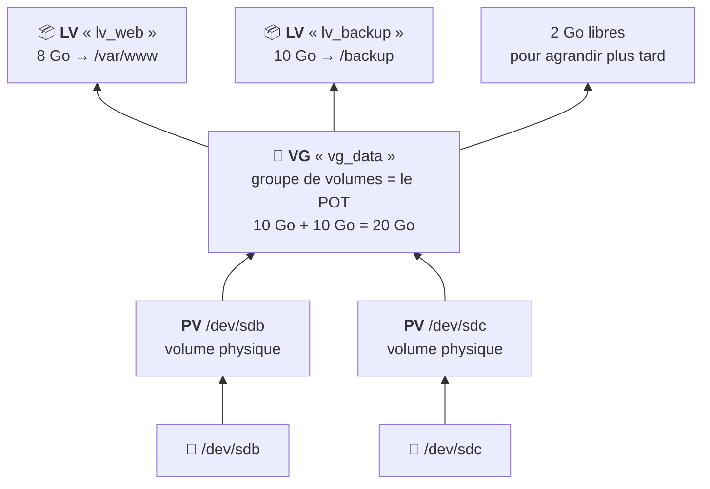

# Module 8 : Gestion avancée des espaces de stockage - LVM

*Cours : [Cours 4 - Administration d'une distribution GNU/Linux](../index.md)*

## 🎯 Objectif du module

- Comprendre **LVM** et ses 3 niveaux : **PV**, **VG**, **LV**.
- **Créer** un volume LVM de A à Z.
- **Agrandir** un volume **sans arrêter** le serveur.

!!! abstract "En clair : LVM, des disques en pâte à modeler"
    Avec des partitions classiques, la taille est **figée** : si `/var` est plein, c'est compliqué. **LVM** (*Logical Volume Manager*) met **tous les disques dans un même pot** (le **groupe de volumes**), puis on y découpe des **volumes** de la taille qu'on veut.

    Un volume est trop petit ? On l'**agrandit en une commande**, même pendant que le serveur tourne. Plus de place dans le pot ? On **ajoute un disque**, et le pot grossit.

## 🖼️ Résumé visuel

**Les 3 étages de LVM**



## 📖 Cours consolidé

### 1. Les 3 niveaux

| Niveau | Nom | Image | Exemple |
|---|---|---|---|
| **PV** | *Physical Volume* : volume **physique** | Les **ingrédients** : un disque ou une partition préparé pour LVM | `/dev/sdb` |
| **VG** | *Volume Group* : **groupe** de volumes | Le **pot** où l'on verse tous les PV | `vg_data` (20 Go) |
| **LV** | *Logical Volume* : volume **logique** | Les **parts** qu'on sert depuis le pot : c'est là qu'on **formate** et qu'on **monte** | `lv_web` (8 Go) |

Un LV s'utilise **comme une partition** : son chemin est **`/dev/vg_data/lv_web`** (ou `/dev/mapper/vg_data-lv_web`).

| ✅ Avantages de LVM | ⚠️ Limite |
|---|---|
| **Agrandir** un volume à chaud, sans arrêter | Une couche de plus à comprendre |
| **Ajouter un disque** au pot quand il est plein | Si un disque du pot meurt, les données qu'il porte sont perdues : LVM n'est **pas une sauvegarde** (et pas du RAID) |
| Des **noms clairs** (`lv_web`) au lieu de `sdb1` | |
| **Instantanés** (*snapshots*) avant une opération risquée | |

---

### 2. Créer un volume LVM, pas à pas

**Situation** : un nouveau disque `/dev/sdb` (10 Go). On veut un volume de 8 Go monté sur `/var/www`. (Si besoin : `sudo apt install lvm2`.)

```bash
# ① Préparer le disque comme volume physique (PV)
sudo pvcreate /dev/sdb

# ② Créer le groupe de volumes (VG) « vg_data » avec ce PV
sudo vgcreate vg_data /dev/sdb

# ③ Découper un volume logique (LV) de 8 Go nommé « lv_web »
sudo lvcreate -n lv_web -L 8G vg_data

# ④ Le formater et le monter (module 9)
sudo mkfs.ext4 /dev/vg_data/lv_web
sudo mkdir -p /var/www
sudo mount /dev/vg_data/lv_web /var/www
```

| Option `lvcreate` | Signifie |
|---|---|
| `-n lv_web` | Le **nom** du volume |
| `-L 8G` | Une **taille fixe** (8 Go) |
| `-l 100%FREE` | **Toute** la place restante du VG |

---

### 3. Voir où on en est

| Niveau | Résumé | Détail |
|---|---|---|
| PV | **`pvs`** | `pvdisplay` |
| VG | **`vgs`** (regarde la colonne **VFree** = place libre) | `vgdisplay` |
| LV | **`lvs`** | `lvdisplay` |

```text
$ sudo vgs
  VG      #PV #LV #SN Attr   VSize   VFree
  vg_data   1   1   0 wz--n- <10,00g <2,00g      ← 2 Go encore libres dans le pot
```

---

### 4. Agrandir : le vrai super-pouvoir

**`/var/www` est plein** : on ajoute **2 Go** au volume, **sans arrêter** le serveur.

```bash
sudo lvextend -r -L +2G /dev/vg_data/lv_web
```

| Option | Signifie |
|---|---|
| **`-L +2G`** | **Ajouter** 2 Go (sans le `+`, on donne la taille **totale**) |
| `-l +100%FREE` | Ajouter **toute** la place libre du VG |
| **`-r`** | Agrandir **aussi le système de fichiers** (*resize*) ⚠️ **ne pas l'oublier** |

Puis `df -h /var/www` : la nouvelle taille apparaît.

**Le pot (VG) est plein ? On ajoute un disque :**

```bash
sudo pvcreate /dev/sdc               # préparer le nouveau disque
sudo vgextend vg_data /dev/sdc       # l'ajouter au pot : le VG grossit
sudo lvextend -r -l +100%FREE /dev/vg_data/lv_web   # donner toute la place au volume
```

⚠️ **Réduire** un volume est **risqué** (perte de données possible) et impossible à chaud en ext4. On évite : mieux vaut créer des volumes un peu petits et les agrandir au besoin.

## ✅ Points clés à retenir

- **PV** (disque préparé) → **VG** (le pot commun) → **LV** (le volume qu'on formate et monte).
- Créer : **`pvcreate /dev/sdb`** → **`vgcreate vg_data /dev/sdb`** → **`lvcreate -n lv_web -L 8G vg_data`** → `mkfs.ext4` → `mount`.
- Chemin d'un LV : **`/dev/vg_data/lv_web`**.
- Voir : **`pvs`**, **`vgs`** (VFree = place libre), **`lvs`**.
- Agrandir à chaud : **`lvextend -r -L +2G /dev/vg_data/lv_web`** (**`-r`** agrandit aussi le système de fichiers).
- VG plein : **`pvcreate`** + **`vgextend`** avec un nouveau disque.
- LVM n'est **ni une sauvegarde ni du RAID**.

## 📝 Fiche de révision

| Étape | Commande |
|---|---|
| Disque → PV | `pvcreate /dev/sdb` |
| PV → VG | `vgcreate vg_data /dev/sdb` |
| VG → LV | `lvcreate -n lv_web -L 8G vg_data` |
| Formater | `mkfs.ext4 /dev/vg_data/lv_web` |
| Agrandir le LV (+ système de fichiers) | `lvextend -r -L +2G /dev/vg_data/lv_web` |
| Ajouter un disque au VG | `pvcreate /dev/sdc` + `vgextend vg_data /dev/sdc` |
| Voir | `pvs` · `vgs` · `lvs` |

**⚠️ Les pièges**

- **`lvextend` sans `-r`** : le volume grandit, mais **pas le système de fichiers** → `df -h` ne change pas (rattrapage : `resize2fs /dev/vg_data/lv_web`).
- `-L 2G` = taille **totale** de 2 Go ; `-L +2G` = **ajouter** 2 Go.
- **Réduire** un LV est risqué.

??? question "1. Crée un VG « vg_srv » avec /dev/sdb, puis un LV « lv_logs » de 5 Go."
    ```bash
    sudo pvcreate /dev/sdb
    sudo vgcreate vg_srv /dev/sdb
    sudo lvcreate -n lv_logs -L 5G vg_srv
    ```

??? question "2. lv_logs est plein. Ajoute-lui 3 Go, système de fichiers compris."
    `sudo lvextend -r -L +3G /dev/vg_srv/lv_logs`

??? question "3. vgs indique VFree = 0. Comment donner plus de place ?"
    Ajouter un disque au VG : `sudo pvcreate /dev/sdc` puis `sudo vgextend vg_srv /dev/sdc`. Ensuite, `lvextend` sur le volume concerné.

## 🧠 Quiz — entraîne-toi

<div id="quiz-cours-04-administration-d-une-distribution-gnu-linux-module-8-gestion-avancee-des-espaces-de-stockage-lvm"></div>

<script type="application/json" id="quiz-cours-04-administration-d-une-distribution-gnu-linux-module-8-gestion-avancee-des-espaces-de-stockage-lvm-data">
[
  {
    "question": "Dans quel ordre s'empilent les niveaux de LVM ?",
    "options": [
      "LV → VG → PV",
      "PV → VG → LV",
      "VG → PV → LV",
      "PV → LV → VG"
    ],
    "correctIndex": 1,
    "explanation": "On prépare des disques (PV), on les réunit dans un groupe (VG), puis on y découpe des volumes logiques (LV)."
  },
  {
    "question": "Que représente le VG (Volume Group) ?",
    "options": [
      "Un disque physique",
      "Le « pot » commun qui réunit l'espace de plusieurs PV",
      "Un système de fichiers",
      "Un utilisateur"
    ],
    "correctIndex": 1,
    "explanation": "Le groupe de volumes additionne l'espace de tous ses volumes physiques ; on y découpe ensuite des LV."
  },
  {
    "question": "Sur quel niveau LVM crée-t-on un système de fichiers (mkfs) ?",
    "options": [
      "Le PV",
      "Le VG",
      "Le LV",
      "Aucun"
    ],
    "correctIndex": 2,
    "explanation": "Le volume logique (LV) s'utilise comme une partition : on le formate (mkfs.ext4) puis on le monte."
  },
  {
    "question": "Quelle commande prépare le disque /dev/sdb pour LVM ?",
    "options": [
      "vgcreate /dev/sdb",
      "pvcreate /dev/sdb",
      "lvcreate /dev/sdb",
      "mkfs.lvm /dev/sdb"
    ],
    "correctIndex": 1,
    "explanation": "pvcreate transforme un disque ou une partition en volume physique (PV) utilisable par LVM."
  },
  {
    "question": "Quelle commande crée un LV de 8 Go nommé lv_web dans le VG vg_data ?",
    "options": [
      "lvcreate -n lv_web -L 8G vg_data",
      "lvcreate vg_data 8G",
      "vgcreate -n lv_web 8G",
      "lvextend -L 8G lv_web"
    ],
    "correctIndex": 0,
    "explanation": "-n donne le nom, -L la taille ; le dernier argument est le VG dans lequel découper."
  },
  {
    "question": "Que fait l'option -r de lvextend ?",
    "options": [
      "Elle réduit le volume",
      "Elle agrandit aussi le système de fichiers",
      "Elle redémarre le serveur",
      "Elle supprime le volume"
    ],
    "correctIndex": 1,
    "explanation": "-r (resize) agrandit le système de fichiers en même temps que le volume. Sans elle, df -h ne montre pas la nouvelle place."
  },
  {
    "question": "Quelle est la différence entre -L 5G et -L +5G avec lvextend ?",
    "options": [
      "Aucune",
      "-L 5G fixe une taille totale de 5 Go ; -L +5G ajoute 5 Go",
      "-L +5G réduit de 5 Go",
      "-L 5G ajoute 5 Go"
    ],
    "correctIndex": 1,
    "explanation": "Avec le +, on ajoute à la taille actuelle ; sans, on donne la taille finale voulue."
  },
  {
    "question": "Le VG est plein. Comment l'agrandir ?",
    "options": [
      "lvextend sur le VG",
      "Ajouter un disque : pvcreate puis vgextend",
      "Formater le VG",
      "Ce n'est pas possible"
    ],
    "correctIndex": 1,
    "explanation": "On prépare un nouveau disque avec pvcreate, puis vgextend l'ajoute au groupe : le VG gagne sa place."
  },
  {
    "question": "Quelle commande montre la place libre restante dans un VG ?",
    "options": [
      "lvs",
      "vgs (colonne VFree)",
      "pvdisplay -free",
      "df -h"
    ],
    "correctIndex": 1,
    "explanation": "vgs affiche un résumé de chaque groupe ; la colonne VFree indique l'espace encore disponible pour créer ou agrandir des LV."
  }
]
</script>

<script>
  document.addEventListener("DOMContentLoaded", function () {
    TSSRQuiz.init({
      containerId: "quiz-cours-04-administration-d-une-distribution-gnu-linux-module-8-gestion-avancee-des-espaces-de-stockage-lvm",
      dataId: "quiz-cours-04-administration-d-une-distribution-gnu-linux-module-8-gestion-avancee-des-espaces-de-stockage-lvm-data",
    });
  });
</script>
