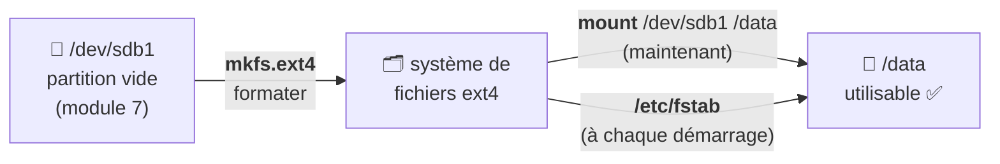

# Module 9 : Gestion des espaces de stockage - Systèmes de fichiers

*Cours : [Cours 4 - Administration d'une distribution GNU/Linux](../index.md)*

## 🎯 Objectif du module

- Choisir un **système de fichiers** Linux (ext4, XFS) et comprendre la **swap**.
- **Formater** une partition (`mkfs`).
- **Monter** et **démonter** (`mount`, `umount`).
- Monter **automatiquement au démarrage** avec **`/etc/fstab`**.
- Surveiller l'espace disque (`df`, `du`).

!!! abstract "En clair : « monter » un disque"
    Sous Windows, une nouvelle partition reçoit une **lettre** (`E:`). Sous Linux, on l'**accroche à un dossier** de l'arborescence, par exemple **`/data`** : c'est le **point de montage**. Tout ce qu'on écrit dans `/data` va alors **sur ce disque**.

    Et pour que ce soit refait **à chaque démarrage**, on l'écrit dans **`/etc/fstab`**.

## 🖼️ Résumé visuel

**De la partition au dossier utilisable**



## 📖 Cours consolidé

### 1. Les systèmes de fichiers Linux

| Système | Points forts | Usage |
|---|---|---|
| **ext4** | ✅ Le **standard** de Debian : fiable, éprouvé, se **réduit** et s'**agrandit** | Le choix par défaut |
| **XFS** | Très performant pour les **gros fichiers** et volumes ; s'agrandit mais **ne se réduit pas** | Serveurs de fichiers, Red Hat |
| **Btrfs** | Instantanés, compression | Usages avancés |
| **vfat / exFAT** | Lisible par Windows | Clés USB |
| **swap** | Pas un système de fichiers : **mémoire d'appoint** sur le disque | Voir plus bas |

!!! abstract "En clair : la swap"
    Quand la **mémoire vive (RAM) est pleine**, Linux déplace temporairement ce qui sert peu sur le disque, dans la **swap**. Ça évite les plantages, mais c'est **beaucoup plus lent** que la RAM. Un serveur qui utilise **beaucoup** sa swap manque de RAM.

---

### 2. Formater

```bash
sudo mkfs.ext4 /dev/sdb1                     # formater en ext4
sudo mkfs.ext4 -L DONNEES /dev/sdb1          # avec une étiquette (label)
sudo mkfs.xfs /dev/sdb1                      # en XFS
sudo mkswap /dev/sdc1 && sudo swapon /dev/sdc1   # créer et activer une swap
```

⚠️ **Formater efface tout** le contenu de la partition. Vérifie **deux fois** le nom avec `lsblk`.

---

### 3. Monter et démonter

```bash
sudo mkdir /data                 # 1. créer le dossier (point de montage)
sudo mount /dev/sdb1 /data       # 2. monter
df -h /data                      # 3. vérifier
sudo umount /data                # démonter (attention : umount, sans « n »)
```

| Commande | Effet |
|---|---|
| `mount` (seule) ou `findmnt` | Lister ce qui est monté |
| `mount /dev/sdb1 /data` | Monter **maintenant** (perdu au redémarrage) |
| **`umount /data`** | Démonter |
| `mount -a` | Monter **tout** ce qui est dans `/etc/fstab` (pour **tester** le fichier) |

⚠️ « **target is busy** » au démontage : quelqu'un (ou ton propre terminal) est **dans** le dossier → `cd /` puis réessayer.

---

### 4. Monter au démarrage : `/etc/fstab`

**`/etc/fstab`** (*file systems table*) liste ce qui doit être monté **à chaque démarrage**. Une ligne = un montage, en **6 colonnes** :

```text
# <quoi : UUID>                            <où>   <type> <options>          <dump> <fsck>
UUID=3f6a1c2e-8b7d-4c1e-9a0f-5d2e7b8c9a01  /data  ext4   defaults,nofail    0      2
/dev/vg_data/lv_web                         /var/www ext4 defaults           0      2
```

| Colonne | Contenu | Valeur habituelle |
|---|---|---|
| ① **Quoi** | La partition : **`UUID=…`** (trouvé avec `blkid`, module 7) ou le chemin d'un LV | |
| ② **Où** | Le **point de montage** | `/data` |
| ③ **Type** | Le système de fichiers | `ext4`, `xfs`, `swap` |
| ④ **Options** | `defaults` ; **`nofail`** = ne pas bloquer le démarrage si le disque est absent | `defaults` |
| ⑤ **dump** | Ancienne sauvegarde | `0` |
| ⑥ **fsck** | Ordre de vérification au démarrage : `1` = la racine `/`, `2` = les autres, `0` = jamais | `2` |

!!! danger "⚠️ Toujours tester fstab avant de redémarrer"
    Une **erreur dans `/etc/fstab`** peut **empêcher le serveur de démarrer** (il passe en mode urgence, voir le [module 4](../module-4-debian-en-mode-maintenance/index.md)). Après chaque modification :

    ```bash
    sudo systemctl daemon-reload
    sudo mount -a          # aucun message = tout va bien ✅
    ```

---

### 5. Surveiller l'espace disque

| Commande | Répond à… | Exemple |
|---|---|---|
| **`df -h`** | Combien de place reste-t-il **sur chaque partition** ? | `/dev/sda1  19G  6,2G  12G  35% /` |
| **`du -sh dossier`** | Combien pèse **ce dossier** ? | `du -sh /var/log` → `412M` |
| `du -h --max-depth=1 /var | sort -h` | **Quels sous-dossiers** prennent le plus de place ? | |
| `free -h` | La **RAM** et la **swap** utilisées | |

💡 Un disque plein **à 100 %** fait planter les services. Le coupable est souvent **`/var/log`** (des journaux énormes) : voir le module 12.

## 📝 Fiche de révision

| Commande / fichier | Rôle |
|---|---|
| `mkfs.ext4 /dev/sdb1` | Formater |
| `mkswap` / `swapon` | Créer / activer une swap |
| `mount /dev/sdb1 /data` | Monter |
| `umount /data` | Démonter |
| `/etc/fstab` | Montages au démarrage |
| `mount -a` | Tester fstab |
| `blkid` | Trouver l'UUID |
| `df -h` / `du -sh` | Place libre / poids d'un dossier |
| `free -h` | RAM et swap |

**Ligne fstab type :**
`UUID=xxxx  /data  ext4  defaults,nofail  0  2`

**⚠️ Les pièges**

- La commande s'écrit **`umount`** (pas « unmount »).
- Monter sur un dossier **non vide** cache son contenu (sans l'effacer).
- Une faute dans **fstab** → serveur bloqué en mode urgence : **`mount -a`** avant de redémarrer.
- `mount` seul **ne survit pas** à un redémarrage → fstab.

??? question "1. Formate /dev/sdb1 en ext4 et monte-le sur /sauvegardes."
    ```bash
    sudo mkfs.ext4 /dev/sdb1
    sudo mkdir /sauvegardes
    sudo mount /dev/sdb1 /sauvegardes
    ```

??? question "2. Rends ce montage permanent."
    `sudo blkid /dev/sdb1` pour l'UUID, puis ajouter dans `/etc/fstab` :
    `UUID=<uuid>  /sauvegardes  ext4  defaults,nofail  0  2`
    Enfin, **tester** : `sudo systemctl daemon-reload && sudo mount -a`.

??? question "3. Le disque / est plein à 98 %. Comment trouver le coupable ?"
    `df -h` confirme, puis `sudo du -h --max-depth=1 / | sort -h` pour voir les plus gros dossiers. Descendre ensuite dans le plus gros (souvent `/var/log`).

## 🧠 Quiz — entraîne-toi

<div id="quiz-cours-04-administration-d-une-distribution-gnu-linux-module-9-gestion-des-espaces-de-stockage-systemes-de-fichiers"></div>

<script type="application/json" id="quiz-cours-04-administration-d-une-distribution-gnu-linux-module-9-gestion-des-espaces-de-stockage-systemes-de-fichiers-data">
[
  {
    "question": "Quel est le système de fichiers par défaut de Debian ?",
    "options": [
      "NTFS",
      "ext4",
      "FAT32",
      "XFS"
    ],
    "correctIndex": 1,
    "explanation": "ext4 est le standard de Debian : fiable, il peut être agrandi et réduit. XFS est fréquent sur les gros serveurs et chez Red Hat."
  },
  {
    "question": "À quoi sert la swap ?",
    "options": [
      "À sauvegarder les fichiers",
      "De mémoire d'appoint sur le disque quand la RAM est pleine",
      "À accélérer le processeur",
      "À chiffrer le disque"
    ],
    "correctIndex": 1,
    "explanation": "La swap reçoit ce qui ne tient plus en RAM. Elle évite les plantages mais est beaucoup plus lente que la mémoire vive."
  },
  {
    "question": "Que signifie « monter » une partition sous Linux ?",
    "options": [
      "La formater",
      "L'accrocher à un dossier de l'arborescence pour y accéder",
      "La copier",
      "Lui donner une lettre comme D:"
    ],
    "correctIndex": 1,
    "explanation": "Monter /dev/sdb1 sur /data rend son contenu accessible dans le dossier /data, appelé point de montage."
  },
  {
    "question": "Quelle commande démonte le dossier /data ?",
    "options": [
      "unmount /data",
      "umount /data",
      "mount -d /data",
      "rm /data"
    ],
    "correctIndex": 1,
    "explanation": "La commande s'écrit umount, sans le « n ». Si elle répond « target is busy », quelqu'un utilise encore le dossier."
  },
  {
    "question": "Quel fichier liste les montages à faire à chaque démarrage ?",
    "options": [
      "/etc/mtab",
      "/etc/fstab",
      "/etc/disks",
      "/boot/mount"
    ],
    "correctIndex": 1,
    "explanation": "/etc/fstab (file systems table) contient une ligne par montage : partition, point de montage, type, options, dump, fsck."
  },
  {
    "question": "Pourquoi utiliser l'UUID plutôt que /dev/sdb1 dans /etc/fstab ?",
    "options": [
      "C'est plus court",
      "Parce que l'UUID ne change pas, même si l'ordre des disques change",
      "Parce que /dev/sdb1 est interdit",
      "Pour chiffrer"
    ],
    "correctIndex": 1,
    "explanation": "Les noms sdX peuvent changer quand on ajoute ou retire des disques ; l'UUID reste fixe."
  },
  {
    "question": "Quelle commande tester après avoir modifié /etc/fstab ?",
    "options": [
      "sudo reboot",
      "sudo mount -a",
      "sudo fsck /",
      "sudo apt update"
    ],
    "correctIndex": 1,
    "explanation": "mount -a monte tout ce qui est déclaré dans fstab. Sans message d'erreur, on peut redémarrer en confiance ; sinon le serveur risquerait de bloquer au démarrage."
  },
  {
    "question": "À quoi sert l'option nofail dans fstab ?",
    "options": [
      "À vérifier le disque",
      "À ne pas bloquer le démarrage si ce disque est absent",
      "À monter en lecture seule",
      "À formater automatiquement"
    ],
    "correctIndex": 1,
    "explanation": "Avec nofail, si le disque manque, le démarrage continue au lieu de basculer en mode urgence."
  },
  {
    "question": "Quelle commande indique la place libre de chaque partition montée ?",
    "options": [
      "du -sh",
      "df -h",
      "free -h",
      "lsblk -f"
    ],
    "correctIndex": 1,
    "explanation": "df -h (disk free, en unités lisibles) affiche la taille, l'espace utilisé et l'espace libre de chaque partition. du -sh donne le poids d'un dossier."
  },
  {
    "question": "Que faut-il avant de monter /dev/sdb1 sur /data ?",
    "options": [
      "Que le dossier /data existe (mkdir /data)",
      "Redémarrer le serveur",
      "Supprimer /etc/fstab",
      "Installer un pilote"
    ],
    "correctIndex": 0,
    "explanation": "Le point de montage est un dossier existant. On le crée avec sudo mkdir /data, puis sudo mount /dev/sdb1 /data."
  },
  {
    "question": "Le démontage répond « target is busy ». Quelle est la cause la plus courante ?",
    "options": [
      "Le disque est plein",
      "Ton terminal ou un programme est encore dans le dossier",
      "Le disque est en ext4",
      "fstab est vide"
    ],
    "correctIndex": 1,
    "explanation": "On ne peut pas démonter un dossier utilisé. Sors-en (cd /) et ferme les programmes qui l'utilisent, puis réessaie."
  },
  {
    "question": "Quelle commande indique combien pèse le dossier /var/log ?",
    "options": [
      "df -h /var/log",
      "free -h",
      "du -sh /var/log",
      "ls -size /var/log"
    ],
    "correctIndex": 2,
    "explanation": "du -sh (disk usage, résumé, lisible) donne le poids d'un dossier. df -h donne la place libre des partitions."
  },
  {
    "question": "Quelle commande crée et active une swap sur /dev/sdc1 ?",
    "options": [
      "mkfs.swap /dev/sdc1",
      "mkswap /dev/sdc1 puis swapon /dev/sdc1",
      "mount -t swap /dev/sdc1 /swap",
      "swapoff /dev/sdc1"
    ],
    "correctIndex": 1,
    "explanation": "mkswap prépare la partition, swapon l'active. Pour l'avoir à chaque démarrage, on l'ajoute dans /etc/fstab."
  },
  {
    "question": "Dans /etc/fstab, que contient la 3ᵉ colonne ?",
    "options": [
      "Le point de montage",
      "Les options",
      "L'UUID",
      "Le type de système de fichiers (ext4, xfs, swap)"
    ],
    "correctIndex": 3,
    "explanation": "Les colonnes sont : périphérique (UUID), point de montage, type, options, dump, ordre de vérification."
  },
  {
    "question": "df -h affiche / utilisée à 95 %. Que fais-tu en premier ?",
    "options": [
      "Rien, c'est normal",
      "Formater la partition",
      "Chercher les gros dossiers avec du -sh (souvent /var/log)",
      "Supprimer /etc"
    ],
    "correctIndex": 2,
    "explanation": "Au-delà de 90 %, c'est urgent. On cherche ce qui grossit (journaux, sauvegardes, fichiers temporaires) avant de supprimer quoi que ce soit."
  }
]
</script>

<script>
  document.addEventListener("DOMContentLoaded", function () {
    TSSRQuiz.init({
      containerId: "quiz-cours-04-administration-d-une-distribution-gnu-linux-module-9-gestion-des-espaces-de-stockage-systemes-de-fichiers",
      dataId: "quiz-cours-04-administration-d-une-distribution-gnu-linux-module-9-gestion-des-espaces-de-stockage-systemes-de-fichiers-data",
    });
  });
</script>
