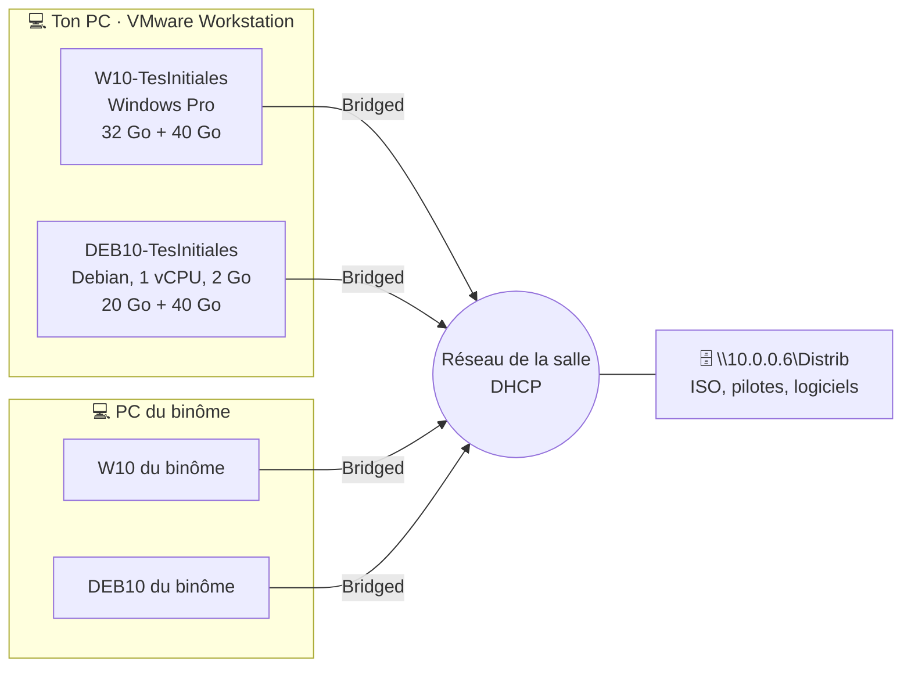
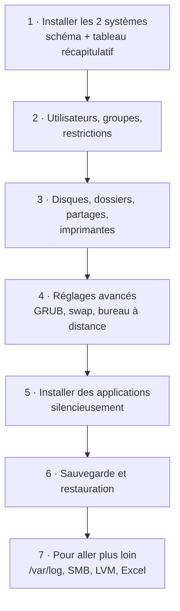
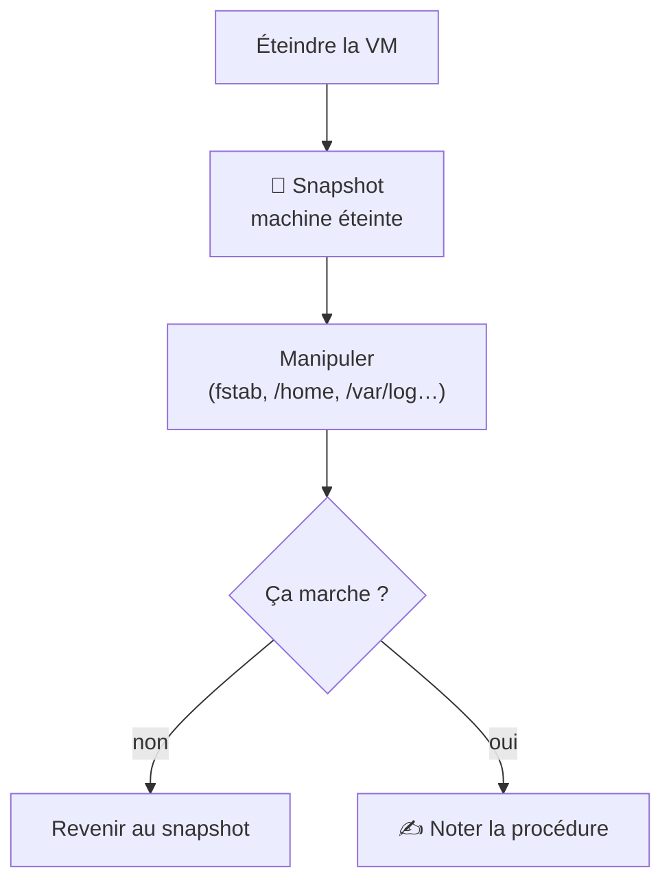
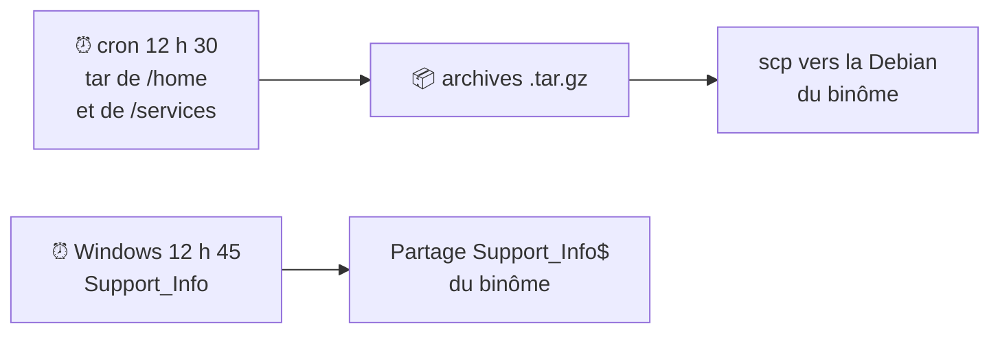

# Cours 5 - Mise en situation professionnelle : système client

!!! abstract "Informations pratiques"
    **Dates :** 30/11/2026 → 04/12/2026

    **Durée :** 35 h

    **Lieu :** En ligne (Campus en ligne)

    **Formateur(s) :** Alexandre CHAUSSIER

## 🎯 Objectif

Pendant 4 jours et demi, tu installes et configures **deux postes clients** (un Windows, un Debian) comme dans une vraie petite entreprise, puis tu travailles **en binôme** pour tester les partages, l'impression et le bureau à distance. C'est la **révision pratique** des cours 1 à 4.

!!! warning "Fais-le toi-même"
    Cette page te donne la **méthode** et les **commandes à retrouver**, pas le corrigé. Les pistes les plus avancées sont **repliées** : ouvre-les seulement si tu bloques. Et rédige tes **procédures** au fur et à mesure (avec l'outil `psr` : ++win+r++ → `psr`) : elles te serviront pour tes révisions, ton stage et ton Dossier Professionnel.

## 🗺️ L'essentiel en schémas

!!! info "Référentiel TSSR 2026"
    **CCP 1 · compétence 2** (déployer des postes) et **compétence 3** (assistance), **CCP 2 · compétences 4, 5 et 7** (réseau IP, serveurs Windows et Linux, accès et sécurité), **CCP 3 · compétence 9** (sauvegarde et restauration). C'est le format de l'épreuve : des manipulations sur machines virtuelles.

**① L'infrastructure du TP**



**② Les 7 parties dans l'ordre**



**③ Le réflexe avant chaque manipulation risquée**



## 🖼️ Résumé visuel

| Partie | Ce qu'on te demande | Cours à revoir |
|---|---|---|
| **1** Installation | 2 VM, nommage, partitionnement manuel de Debian, connectivité | [Cours 2 · module 2](../cours-02-systeme-client-microsoft/module-2-installation-de-windows-10/index.md), [2bis](../cours-02-systeme-client-microsoft/module-2bis-vmware-workstation/index.md) · [Cours 4 · module 2](../cours-04-administration-d-une-distribution-gnu-linux/module-2-installation-d-une-distribution-debian/index.md) |
| **2** Comptes | 9 employés, 5 services, cmd + PowerShell + graphique, horaires, mots de passe, restrictions | [Cours 2 · modules 5](../cours-02-systeme-client-microsoft/module-5-les-utilisateurs-et-les-groupes/index.md) et [13](../cours-02-systeme-client-microsoft/module-13-les-strategies-de-groupe-locales/index.md) · [Cours 4 · module 10](../cours-04-administration-d-une-distribution-gnu-linux/module-10-gestion-des-utilisateurs-et-des-groupes/index.md) |
| **3** Stockage | diskpart, fdisk, ext4 + xfs, déplacer `/home`, droits, partage caché, imprimantes | [Cours 2 · modules 4, 6, 8, 9](../cours-02-systeme-client-microsoft/module-4-la-gestion-du-stockage/index.md) · [Cours 4 · modules 7, 9, 11](../cours-04-administration-d-une-distribution-gnu-linux/module-7-gestion-des-espaces-de-stockage/index.md) |
| **4** Avancé | GRUB 2 s, swap 1 Go, mise à jour, RDP avec NLA | [Cours 4 · modules 4, 6, 9](../cours-04-administration-d-une-distribution-gnu-linux/module-9-gestion-des-espaces-de-stockage-systemes-de-fichiers/index.md) · [Cours 2 · module 8](../cours-02-systeme-client-microsoft/module-8-le-partage-de-ressources/index.md) |
| **5** Applications | 7-Zip sans fenêtre, client RDP sous Debian, Webmin | [Cours 4 · module 6](../cours-04-administration-d-une-distribution-gnu-linux/module-6-gestion-des-paquets-logiciels/index.md) |
| **6** Sauvegarde | `tar` planifié + copie `scp`, image système, points de restauration | [Cours 4 · module 12](../cours-04-administration-d-une-distribution-gnu-linux/module-12-maintenance-d-un-systeme-en-production/index.md) · [Cours 2 · module 10](../cours-02-systeme-client-microsoft/module-10-maintenance-du-systeme/index.md) |
| **7** Bonus | `/var/log` sur sa partition, montage SMB, fichier d'échange, LVM, Excel | [Cours 4 · module 8](../cours-04-administration-d-une-distribution-gnu-linux/module-8-gestion-avancee-des-espaces-de-stockage-lvm/index.md) |

## 📖 Cours consolidé

### 📋 Contexte et cahier des charges

Une société de **9 employés** répartis en **5 services** (Direction, Commercial, Comptabilité, Informatique, Logistique), avec un **intérimaire** et un **prestataire**. Tu es administrateur avec ton binôme. Ton travail :

- [ ] **Schéma réseau** des 4 VM avec leur adressage IP (draw.io, Visio…)
- [ ] **Tableau récapitulatif** : noms, IP, CPU, mémoire, comptes
- [ ] **Procédures** de toutes tes actions, partagées avec ton coach
- [ ] Les 7 parties ci-dessous, testées

**Règles du jeu** : comptes = **1re lettre du prénom + nom** (ex. `rgrimes`) · mots de passe selon les **recommandations de l'ANSSI**, sans expiration · une **même convention de nommage des groupes** sur Windows et Debian (ex. `GRP_Compta`).

---

### Partie 1 · Installation des systèmes

| Poste | Exigences |
|---|---|
| **Windows** | Édition **Professionnelle**, sur le 1er disque · **Windows Update empêché** de joindre Microsoft |
| **Debian** | ISO **DVD**, **avec** environnement graphique · dépôt `ftp.fr.debian.org` · partitionnement **manuel** en gardant de l'espace libre |

Partitionnement Debian demandé : `/` 17 Go · `/boot` 512 Mo · `swap` 256 Mo · `/home` 1 Go. Garde le **reste non alloué** : il servira en partie 4.

🔧 **Rappels** : `ip a` / `ipconfig` pour noter les IP · `ping` entre tes 2 VM **et** vers celles du binôme (pare-feu Windows : [cours 2 · module 7](../cours-02-systeme-client-microsoft/module-7-la-gestion-du-reseau-et-du-pare-feu/index.md)).

---

### Partie 2 · Utilisateurs, groupes et environnement

**Sur Windows**, la consigne impose **3 méthodes** : cmd (Direction, Comptabilité), PowerShell (Informatique, Logistique), graphique (Commerciaux). Chaque compte a son **service en description**.

```text
:: cmd
net localgroup GRP_Direction /add
net user rgrimes * /add /comment:"Direction"
net localgroup GRP_Direction rgrimes /add
```

```powershell
# PowerShell
New-LocalGroup -Name GRP_Informatique -Description "Service informatique"
New-LocalUser -Name eporter -Password (Read-Host -AsSecureString) -Description "Informatique" -PasswordNeverExpires
Add-LocalGroupMember -Group GRP_Informatique -Member eporter
```

| Exigence | Où / comment |
|---|---|
| Dossier `Procédures` sur le Bureau de **tous** les profils | Le **profil par défaut** (`C:\Users\Default\Desktop`) sert de modèle aux **nouveaux** profils |
| Intérimaire : connexion **9 h → 12 h**, lundi au vendredi | `net user nom /times:…` (le format des jours est dans `net user /?`) |
| Mots de passe : **12 caractères**, **25 jours**, complexité | `secpol.msc` → Stratégies de comptes (ou `net accounts /minpwlen:12 /maxpwage:25`) |
| Un 2e administrateur créé en **cmd** | `net user` + `net localgroup Administrateurs nom /add` |
| Informaticiens **administrateurs** | Leur groupe dans `Administrateurs` |
| Prestataire : changer son mot de passe **à la 1re connexion** | Windows : `net user nom /logonpasswordchg:yes` · Debian : `passwd -e nom` |
| Non-administrateurs : pas de gravure ni de lecteur CD/DVD, pas de `regedit`, fond d'écran imposé | Stratégie locale **ciblée sur les non-administrateurs** ([cours 2 · module 13](../cours-02-systeme-client-microsoft/module-13-les-strategies-de-groupe-locales/index.md)) |
| Pare-feu toujours actif | Stratégie locale (pare-feu Windows Defender) |

**Sur Debian**, tous les utilisateurs et groupes existent aussi ; shell `/bin/bash` pour tous, sauf le **prestataire en `ksh`**.

```bash
sudo groupadd grp_compta
sudo adduser mgreene
sudo usermod -aG grp_compta mgreene
sudo apt install ksh && sudo usermod -s /bin/ksh prestataire
```

**vim** : mettre à jour le paquet `vim`, commenter **en une ligne** les sources `deb-src` (et la ligne du DVD) de `/etc/apt/sources.list`, puis activer **couleurs** et **numéros de ligne**.

??? tip "Piste vim (si tu bloques)"
    `:g/^deb-src/s/^/# /` met un `#` devant chaque ligne qui commence par `deb-src`. Dans `~/.vimrc` : `syntax on` et `set number`.

---

### Partie 3 · Stockage et ressources

**Windows · diskpart** (2e disque, table **MBR**, partition **DATA** de 15 Go en `D:`)

```text
diskpart
list disk
select disk 1
convert mbr
create partition primary size=15360
format fs=ntfs label=DATA quick
assign letter=D
```

⚠️ `D:` est souvent **déjà pris par le lecteur CD** : change d'abord sa lettre.

**Debian · 2e disque** : 3 partitions principales `PROFILS` (ext4, 15 Go), `DATA` (ext4, 15 Go), `LOGS` (**xfs**, le reste).

```bash
sudo fdisk /dev/sdb              # table DOS (o), 3 partitions (n), écrire (w)
sudo mkfs.ext4 -L PROFILS /dev/sdb1
sudo mkfs.ext4 -L DATA /dev/sdb2
sudo apt install xfsprogs        # xfs n'est pas installé par défaut
sudo mkfs.xfs -L LOGS /dev/sdb3
```

| Tâche | Méthode |
|---|---|
| **Remplacer `/home`** par PROFILS | Snapshot · monter PROFILS ailleurs · **copier** `/home` en gardant les droits · ligne **fstab avec l'UUID** · `mount -a` · tester une connexion utilisateur |
| **DATA** monté sur `/services` | fstab · un dossier par service, droits **770** pour son groupe |
| Nouveaux fichiers au groupe `documentation` | Bit **SGID** sur le dossier (`chmod g+s`) |
| **Windows** : `D:\données\Commerciaux` et `D:\Support_Info` | Droits NTFS : seuls le service concerné (et les admins) ([cours 2 · module 6](../cours-02-systeme-client-microsoft/module-6-la-securite-ntfs-et-les-acl/index.md)) |
| **Partage caché** `Support_Info` | Nom qui **finit par `$`** · garder la commande PowerShell dans un `.ps1` · `net share` pour lister |
| Lecteur **U:** chez le binôme, **automatique** | 2 méthodes : Explorateur (« Se reconnecter à l'ouverture de session ») **et** `net use U: \\PC\Support_Info$ /persistent:yes` |

**Imprimantes** ([cours 2 · module 9](../cours-02-systeme-client-microsoft/module-9-les-pilotes-et-imprimantes/index.md))

- **HP LaserJet** partagée : tout le monde imprime · Comptabilité **gère les documents** · Informatique **contrôle total** · le binôme la met **par défaut**.
- **Pool** de 2 **Xerox** (Propriétés → Ports → *Activer le pool*) : Comptabilité seulement, **de 19 h à 3 h** (onglet Avancé).
- **2 files** pour la même Xerox : celle des **directeurs** a la **priorité la plus haute** (Avancé → Priorité, de 1 à 99).
- **Spouleur** déplacé sur `D:` (Propriétés du serveur d'impression → Avancé).

---

### Partie 4 · Configuration avancée

| Poste | Tâche | 🔧 Rappel |
|---|---|---|
| Debian | Menu **GRUB** affiché 2 s | `/etc/default/grub` → `GRUB_TIMEOUT=2` puis `sudo update-grub` |
| Debian | **Swap de 1 Go** définitif, sur l'espace libre du 1er disque | partition → `mkswap` → `swapon` → fstab · `free -h` pour vérifier |
| Debian | Tout mettre à jour | `sudo apt update && sudo apt upgrade` |
| Windows | **Bureau à distance avec NLA**, autorisé pour le binôme | `sysdm.cpl` → Utilisation à distance · vérifier le port : `netstat -an`, chercher `:3389` |

---

### Partie 5 · Applications

- **7-Zip silencieux** : l'option d'installation sans fenêtre est dans la **FAQ officielle** de 7-Zip (seule l'alerte UAC reste).
- **Client RDP sous Debian**, graphique, depuis les dépôts officiels, qui gère le **NLA** (Vinagre et FreeRDP le gèrent mal).
- **Webmin** : administration Linux par une interface web.

??? tip "Pistes partie 5 (si tu bloques)"
    7-Zip : l'installeur `.exe` accepte l'option `/S`. Client RDP : **Remmina** avec son greffon RDP. Webmin n'est pas dans les dépôts Debian : on ajoute **son dépôt officiel**, puis on ouvre `https://IP:10000`.

---

### Partie 6 · Sauvegarde et restauration



| Poste | Tâche | 🔧 Rappel |
|---|---|---|
| Debian | `tar` quotidien à **12 h 30** | `crontab -e` · ⚠️ dans une ligne cron, `%` doit s'écrire `\%` (ex. `$(date +\%F)`) |
| Debian | Copie vers le binôme | `scp` (paquet `openssh-client`) · sans mot de passe à saisir : clé SSH (`ssh-keygen`, `ssh-copy-id`) |
| Windows | Disque de 60 Go en plus, **image système** | Panneau de configuration → *Sauvegarder et restaurer (Windows 7)* → *Créer une image système* |
| Windows | Sauvegarde du dossier informatique à **12 h 45** vers le binôme | Planificateur de tâches (`taskschd.msc`) |
| Windows | Points de restauration sur `C:`, **8 %** | `sysdm.cpl` → Protection du système → Configurer |

---

### Partie 7 · Pour aller plus loin

| Tâche | Attention à… |
|---|---|
| `/var/log` sur la partition **LOGS** | Des fichiers sont ouverts en permanence : copier **en gardant droits et attributs**, de préférence en mode de dépannage · vérifier ensuite qu'un message écrit avec `logger test` apparaît bien dans les journaux |
| Monter `Support_Info$` depuis Debian | Paquet `cifs-utils` · `mount -t cifs` avec le compte adéquat · préciser la **version SMB** (`vers=3.0`) |
| Fichier d'échange Windows sur `D:` | `sysdm.cpl` → Avancé → Performances → Mémoire virtuelle |
| `/opt` sur **LVM** (2 disques de 20 Go → LV de 32 Go) | `pvcreate` × 2 → `vgcreate` → `lvcreate -L 32G` → `mkfs.ext4` → fstab ([cours 4 · module 8](../cours-04-administration-d-une-distribution-gnu-linux/module-8-gestion-avancee-des-espaces-de-stockage-lvm/index.md)) |
| Excel : totaux, moyennes, min, max, nombre, appréciation | `SOMME`, `MOYENNE`, `MAX`, `MIN`, `NB`, et `SI(ET(…))` imbriqués pour l'appréciation |

## 🧪 Tests et validation

- [ ] Les 4 VM se **pinguent** entre elles
- [ ] Chaque utilisateur **ouvre une session** et trouve `Procédures` sur son Bureau
- [ ] L'intérimaire est **refusé** en dehors de 9 h - 12 h
- [ ] Le prestataire doit **changer son mot de passe** à la 1re connexion (Windows et Debian)
- [ ] Un non-administrateur ne peut **pas lancer `regedit`**
- [ ] Après `/home` déplacé : les utilisateurs retrouvent **leurs fichiers**
- [ ] Un commercial ouvre `Commerciaux`, un comptable est **refusé**
- [ ] Le binôme a **U:** à chaque ouverture de session et peut **y écrire**
- [ ] L'imprimante HP apparaît chez le binôme, **par défaut**
- [ ] Le binôme se connecte en **RDP avec NLA** ; `netstat -an` montre le port **3389**
- [ ] Les sauvegardes `tar` apparaissent chez le binôme **après 12 h 30**
- [ ] `df -h` montre `/home`, `/services`, `/var/log` et `/opt` sur leurs volumes, **après un redémarrage**

## 📝 Fiche de révision

### ⚠️ Les pièges de cette MSP

- **Snapshot machine éteinte** avant de toucher à `/home`, `/var/log` ou fstab.
- Une **faute dans fstab** bloque le démarrage : `sudo mount -a` **avant** de redémarrer, et des **UUID** plutôt que `/dev/sdb1`.
- `usermod -G` **sans `-a`** retire l'utilisateur de ses autres groupes.
- `D:` souvent pris par le **lecteur CD**.
- Le **xfs** demande le paquet `xfsprogs`.
- Dans **crontab**, `%` s'écrit `\%`.
- Un partage caché finit par **`$`**, et il faut aussi taper le `$` pour s'y connecter.
- Droits de **partage** + droits **NTFS** : le **plus restrictif** gagne.
- Monter un partage Windows depuis Linux : préciser la **version SMB**.

### 🧮 L'adresse de l'imprimante HP

3e octet **10101000** en binaire = 128 + 32 + 8 = **168** ([cours 1 · module 2](../cours-01-bases-des-reseaux/module-2-les-unites-informatiques/index.md)). Pour les Xerox : **10101000** = 168 et **10101001** = **169**.

## 💬 Retour d'expérience

_À compléter par toi : difficultés rencontrées, ce que tu referais différemment._

## 🧠 Quiz — entraîne-toi

<div id="quiz-cours-05-msp-systeme-client"></div>

<script type="application/json" id="quiz-cours-05-msp-systeme-client-data">
[
  {
    "question": "La consigne demande que l'imprimante HP ait pour 3e octet 10101000 (en binaire). Quelle est sa valeur décimale ?",
    "options": ["160", "168", "170", "176"],
    "correctIndex": 1,
    "explanation": "10101000 = 128 + 32 + 8 = 168."
  },
  {
    "question": "Quel est le meilleur réflexe avant de déplacer /home ou /var/log sur une nouvelle partition ?",
    "options": ["Désactiver le pare-feu", "Faire un snapshot de la VM éteinte", "Supprimer la swap", "Passer en root avec su"],
    "correctIndex": 1,
    "explanation": "Un snapshot machine éteinte permet de revenir en arrière si la manipulation casse le démarrage."
  },
  {
    "question": "Après avoir modifié /etc/fstab, que fais-tu avant de redémarrer ?",
    "options": ["sudo mount -a", "sudo update-grub", "sudo apt upgrade", "sudo swapoff -a"],
    "correctIndex": 0,
    "explanation": "mount -a monte tout ce qui est dans fstab : une erreur apparaît tout de suite, au lieu de bloquer le prochain démarrage."
  },
  {
    "question": "Comment rendre un partage Windows invisible dans la liste des partages ?",
    "options": ["Le mettre en lecture seule", "Terminer son nom par $", "Le créer dans C:\\Windows", "Désactiver la découverte du réseau"],
    "correctIndex": 1,
    "explanation": "Un nom qui finit par $ (Support_Info$) rend le partage caché. Pour s'y connecter, il faut taper le nom complet avec le $."
  },
  {
    "question": "Quelle commande Windows rend un lecteur réseau U: permanent à chaque ouverture de session ?",
    "options": ["net share U: /persistent", "net use U: \\\\PC\\Support_Info$ /persistent:yes", "net view U:", "mstsc /v:U"],
    "correctIndex": 1,
    "explanation": "net use avec /persistent:yes reconnecte le lecteur à chaque ouverture de session."
  },
  {
    "question": "Sous Debian, formater une partition en xfs échoue avec « commande introuvable ». Pourquoi ?",
    "options": ["xfs est interdit sur un 2e disque", "Le paquet xfsprogs n'est pas installé", "Il faut d'abord un volume LVM", "xfs n'existe que sous Windows"],
    "correctIndex": 1,
    "explanation": "Les outils xfs (mkfs.xfs) sont dans le paquet xfsprogs, absent par défaut."
  },
  {
    "question": "Quelle option force un utilisateur à changer son mot de passe à sa première connexion sous Debian ?",
    "options": ["passwd -e nom", "usermod -L nom", "chmod 700 /home/nom", "deluser nom"],
    "correctIndex": 0,
    "explanation": "passwd -e fait expirer le mot de passe : il devra en choisir un nouveau à la connexion. Sous Windows : net user nom /logonpasswordchg:yes."
  },
  {
    "question": "Tous les nouveaux fichiers créés dans /services doivent appartenir au groupe documentation. Quel réglage utiliser ?",
    "options": ["Le bit SGID sur le dossier (chmod g+s)", "Le sticky bit (chmod +t)", "chmod 777", "Un umask de 000"],
    "correctIndex": 0,
    "explanation": "Avec le SGID sur un dossier, les fichiers créés dedans héritent du groupe du dossier."
  },
  {
    "question": "Comment répartir automatiquement les impressions sur 2 Xerox identiques ?",
    "options": ["Créer 2 partages différents", "Activer le pool d'imprimantes dans l'onglet Ports", "Changer la priorité à 99", "Déplacer le spouleur sur D:"],
    "correctIndex": 1,
    "explanation": "Le pool relie une imprimante logique à plusieurs machines identiques : chaque document part vers la première libre."
  },
  {
    "question": "Deux files d'attente pointent vers la même Xerox. Comment donner l'avantage aux directeurs ?",
    "options": ["Leur file a la priorité la plus haute (99)", "Leur file a la priorité la plus basse (1)", "On leur donne le contrôle total", "On active le pool"],
    "correctIndex": 0,
    "explanation": "La priorité va de 1 (la plus basse) à 99 (la plus haute) : les documents de la file à 99 passent avant."
  },
  {
    "question": "Dans une ligne crontab, comment écrire la date au format AAAA-MM-JJ dans un nom de fichier ?",
    "options": ["$(date +%F)", "$(date +\\%F)", "%date%", "$DATE"],
    "correctIndex": 1,
    "explanation": "Dans crontab, % a un sens spécial (retour à la ligne) : il faut l'écrire \\%."
  },
  {
    "question": "Quel port vérifies-tu avec netstat -an pour le Bureau à distance ?",
    "options": ["22", "445", "3389", "10000"],
    "correctIndex": 2,
    "explanation": "RDP écoute sur le port TCP 3389. 22 = SSH, 445 = SMB, 10000 = Webmin."
  },
  {
    "question": "Debian n'arrive pas à monter le partage Windows Support_Info$. Quelle cause la consigne signale-t-elle ?",
    "options": ["La version du protocole SMB", "Le port 22 fermé", "L'absence de swap", "Le fuseau horaire"],
    "correctIndex": 0,
    "explanation": "Windows 10 refuse les anciennes versions de SMB : on précise la version au montage (par exemple vers=3.0), avec le paquet cifs-utils."
  }
]
</script>

<script>
  document.addEventListener("DOMContentLoaded", function () {
    TSSRQuiz.init({
      containerId: "quiz-cours-05-msp-systeme-client",
      dataId: "quiz-cours-05-msp-systeme-client-data",
    });
  });
</script>
